<!--
內容整理自 D:\Books\html\1-5.世界史\威尼斯歷史大事記.html（沒有對應的 md 筆記），並整合中文維基百科〈威尼斯共和國〉〈威尼斯〉條目，以自己的話改寫。
時期依頁面的六個階段歸納：潟湖聚落與拜占庭統治、共和國的形成、海上帝國的擴張與巔峰、文藝復興與海權衰退、法奧統治與統一、現代威尼斯。頁面最後的「重要人物」「重要地點」與「理解威尼斯的五個關鍵」寫進時期說明與相關事件，不另立事件。
兩份資料出入與處理方式：
- 建城日：頁面說傳統的421年3月25日是後世傳說，不能視為確切建城日；維基百科也只說根據傳說，5世紀日耳曼人入侵後沿岸居民逃入潟湖。這裡把421年寫成傳說，主要敘述放在5～6世紀的聚落形成。
- 首任總督：頁面採傳統的697年保羅奇奧·阿納費斯托（並提醒早期總督史料有問題）；維基百科寫第一位受君士坦丁堡承認的總督是奧爾索·伊帕托，並說總督從726年起至1797年共119人。兩者都寫：697年（傳統說法）與726年（維基百科）。
- 8世紀自治：維基百科寫8世紀獲得自治權，頁面寫逐漸脫離拜占庭，照兩者合併。
- 十字軍：頁面寫1204年；維基百科補充攻陷君士坦丁堡的日期為4月13日，並取得克里特與優卑亞等島嶼，照此。
- 威尼斯與熱那亞：頁面只寫「14世紀多次戰爭」；維基百科補充1253至1381年的戰爭與1380年的基奧賈戰爭，威尼斯終於獲勝，寫成兩則事件。
- 大議會：頁面寫1172年與1290年代；維基百科寫1297年憲法（Serrata，只有約兩百個富有家族能進大議會）與1335年成立十人議會，照維基百科的年份，頁面的1290年代併入1297年。
- 本土擴張：維基百科寫1402至1410年取得威尼托大部分，並與米蘭爭霸（1421–1454年），頁面寫「1400年代」，照維基百科。
- 印刷：頁面寫1469年取得印刷特許、1470年代快速擴張、1499年阿爾杜斯的出版；維基百科寫1469年成立第一家印刷社、1500年已有417家印刷廠。阿爾杜斯的斜體字與小開本在1501年（取自印刷術大事記頁面），1499年是《尋愛綺夢》，依一般記載補充。
- 康布雷聯盟：頁面寫1508–1516年；維基百科寫1508年成立、1509年阿尼亞德洛之役法軍大勝，馬基維利評論威尼斯人一戰丟掉八百年的成果，到1521年耗盡國力，三者合併寫成兩則事件。
- 賽普勒斯與勒班陀：維基百科寫1570年鄂圖曼入侵賽普勒斯、1571年被征服；神聖同盟勒班陀勝利後威尼斯仍很快議和，頁面也說無法恢復優勢，照此。1571年10月7日（勒班陀）依一般記載補充。
- 衰落原因：維基百科補充1517年鄂圖曼征服埃及馬木留克王朝，傳統東西方通道落入土耳其人手中，寫進16世紀衰退事件。
- 克里特戰爭：頁面寫1645–1669年，維基百科寫1669年克里特被占領，經過24年較量（從1645年起算），照此。
- 1797年：頁面說拿破崙軍隊進入、共和國結束；維基百科說被分為奧地利的威尼斯省、法國的附庸國奇薩爾皮納共和國與法屬伊奧尼亞群島，兩者合併；坎波福爾米奧條約日期（10月17日）與末代總督馬寧（Ludovico Manin）退位（5月12日）依一般記載補充。
- 1805年與1814年：頁面寫1805年併入拿破崙的義大利王國、1815年維也納會議後屬倫巴底—威尼西亞王國；維基百科寫1814年被奧地利占領，這裡寫成1805年一則、1814–1815年一則。
- 1848年：維基百科寫「威尼斯共和國曾短暫復國」，頁面稱之為「聖馬可共和國」，照頁面，3月22日宣布與1849年8月22日投降依一般記載補充。
- 1866年：頁面寫第三次義大利獨立戰爭後併入；維基百科寫脫離奧地利、統一到以薩丁尼亞王國為主的義大利王國，10月的公民投票依一般記載補充。
- 洪水：頁面寫1966年水位約194公分，照此；11月4日依一般記載補充。2019年11月12日的高潮位（187公分，歷史第二高）依一般記載補充。
- 頁面把1499年阿爾杜斯、1618年「西班牙陰謀」、1720年弗洛里安咖啡館等寫成一列，這裡保留弗洛里安咖啡館，1618年的陰謀事件只在1606年事件說明威尼斯對外力干預的警戒，不另立事件。
- 人名與其他時間軸一致：馬可·波羅（頁面作「馬可・波羅」，分隔號改為·）、阿爾杜斯·馬努提烏斯、提香、丁托列托、韋羅內塞、維瓦第、卡納萊托、拿破崙。
圖片來源（皆為 Wikimedia Commons 公有領域／CC0 作品；繪畫、版畫與插圖多為後世作品，不代表事件當時的樣貌）：
- ven-cover.jpg：Jacopo de' Barbari - View of Venice - Google Art Project (cropped).jpg（巴爾巴里〈威尼斯鳥瞰圖〉（局部），1500）
- ven-attila.jpg：1. I Veneti riparano nelle isolette della laguna per la irruzione di Attila, anno 452.jpg（威尼托人為了躲避阿提拉入侵而逃往潟湖島嶼（後世版畫））
- ven-rialto.jpg：Giovanni Antonio Canal, il Canaletto - Grand Canal - The Rialto Bridge from the South - WGA03866.jpg（卡納萊托〈從南邊看大運河與里亞托橋〉）
- ven-mark.jpg：St Mark's Body Brought to Venice by Jacopo Tintoretto.jpg（丁托列托〈聖馬可的遺體運抵威尼斯〉）
- ven-basilica.jpg：View of St. Mark's Basilica, Venice, Italy.jpg（聖馬可大教堂正面）
- ven-arsenal.jpg：Francesco Guardi (1712-1793) - Venice, The Arsenal - NG3538 - National Gallery.jpg（瓜爾迪〈威尼斯兵工廠〉，18世紀）
- ven-dandolo.jpg：Doge Enrico Dandolo crowns Baldovino Met DP885911.jpg（總督丹多洛為鮑德溫加冕（版畫））
- ven-marcopolo.jpg：Marco Polo Mosaic from Palazzo Tursi.jpg（馬可·波羅（圖爾西宮的馬賽克肖像））
- ven-aldus.jpg：Aldus Manutius 2.jpg（阿爾杜斯·馬努提烏斯（版畫））
- ven-titian.jpg：Assumption of the Virgin – Titian.jpg（提香〈聖母升天〉）
- ven-lepanto.jpg：Battle of Lepanto 1571.jpg（勒班陀海戰，1571）
- ven-florian.jpg：Giovanni Antonio Canal, il Canaletto - Piazza San Marco - WGA03883.jpg（卡納萊托〈聖馬可廣場〉，18世紀）
- ven-manin.jpg：Portret van Daniele Manin Manin (titel op object), RP-P-1909-5887.jpg（丹尼爾·馬寧（荷蘭國立博物館藏肖像））
- ven-biennale.jpg：1895 poster.jpg（第一屆威尼斯國際藝術雙年展的海報，1895）
-->

# Periods
- 452 ~ 810 | 潟湖聚落與拜占庭統治 | #868e96
  匈人與日耳曼人入侵義大利後，沿岸居民逃入潟湖，托爾切洛、馬拉莫科等聚落逐步形成；義大利納入東羅馬帝國，總督制度出現，威尼斯慢慢脫離拜占庭的直接控制。
- 810 ~ 1100 | 共和國的形成 | #2f9e44
  政治中心移到里亞托，聖馬可遺骸運抵、聖馬可大教堂重建，威尼斯在亞得里亞海建立貿易與海軍基礎，擔任拜占庭與西歐之間的商業中介。
- 1100 ~ 1500 | 海上帝國與巔峰 | #1971c2
  第四次十字軍與熱那亞戰爭讓威尼斯獨占東方貿易，大議會封閉，共和政體走向貴族寡頭；15世紀向義大利本土擴張，成為北義首要強權。
- 1500 ~ 1797 | 文藝復興與海權衰退 | #e8590c
  印刷、繪畫與音樂極盛，但康布雷聯盟、鄂圖曼戰爭、瘟疫與大西洋貿易逐步削弱國力，1797年拿破崙結束延續約千年的共和國。
- 1797 ~ 1866 | 法國與奧地利統治 | #c92a2a
  先後受拿破崙與奧地利統治，1848年短暫復國，1866年併入統一的義大利王國。
- 1866 ~ 2026 | 現代威尼斯 | #7048e8
  成為義大利的文化名城，雙年展與電影節聞名；洪水、保護法、MOSE防洪閘與郵輪、觀光壓力成為城市治理的核心課題。

# Events

## 421-03-25 | 傳說中的建城日 {label="傳說：421年3月25日"}
威尼斯傳統上把建城日訂在西元421年3月25日，但這是後世形成的傳說，沒有充分史料可以證實。較可靠的證據顯示，潟湖聚落是在5～6世紀逐漸發展，城市核心則在後來的數百年間慢慢形成。

## 452 | 阿提拉入侵義大利
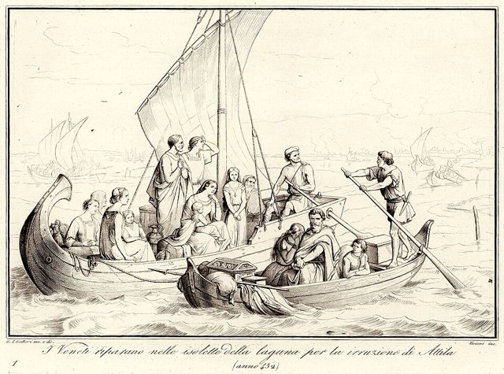
匈人首領阿提拉入侵義大利，阿奎萊亞等地遭到戰亂。後世常把難民逃往潟湖說成威尼斯的起源，但威尼斯並不是由單一事件產生的：5世紀日耳曼人征服義大利、西羅馬帝國滅亡的動盪中，沿岸居民陸續逃入潟湖，建立起半永久的聚落。

## 5世紀 ~ 6世紀 | 潟湖聚落形成 {label="5～6世紀"}
托爾切洛、馬拉莫科等潟湖島嶼逐漸形成較穩定的聚落，居民利用島嶼、淺灘與水道從事漁業、製鹽與貿易。潟湖既是防禦屏障，也讓居民得以透過水路發展貿易。威尼斯最初是由多個聚落整合而成，而不是從陸地向外擴張的城市。

## 553 | 納入東羅馬帝國
哥特戰爭結束，義大利部分地區重新納入東羅馬（拜占庭）帝國，已發展成正式城鎮的威尼斯成為拜占庭的領土，潟湖地區成為拜占庭在亞得里亞海北部的據點。568年倫巴底人進入義大利，拜占庭在義大利的控制範圍縮小，潟湖聚落的戰略地位反而提高。

## 697 | 傳說中的第一任總督 {label="傳說：約697年"}
傳統記載認為保羅奇奧·阿納費斯托（Paoluccio Anafesto）是威尼斯第一任總督（Doge），象徵威尼斯自治傳統的起點，但早期總督制度的細節仍有史料上的疑問。7世紀時潟湖內多個聚落成為地方政治、宗教與商業中心。

## 726 | 總督制度的確立
維基百科記載，第一位受君士坦丁堡承認的總督是奧爾索·伊帕托（Orso Ipato），總督起初由拜占庭任命，11世紀起改由本地選舉產生。從726年到1797年共和國覆亡，總督共有119人，平均任期九年。8世紀時潟湖的政治中心逐漸移動，地方統治者的自主性增加，威尼斯逐步獲得自治，脫離拜占庭的直接控制。

## 810 | 政治中心遷往里亞托 {label="810年前後"}
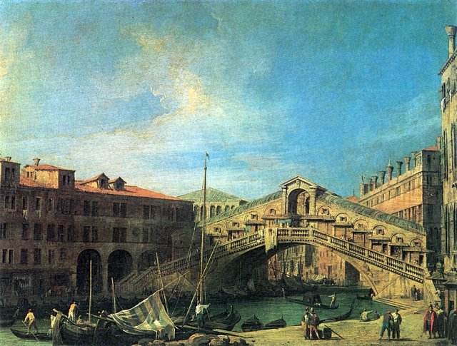
威尼斯的政治中心逐漸轉向里亞托（Rialto）一帶，這裡後來成為城市的核心。812年，法蘭克帝國與拜占庭帝國簽訂亞琛和約，威尼斯仍留在拜占庭的勢力範圍內，在兩大強權之間保持特殊的地位。

## 828 | 聖馬可遺骸運抵威尼斯
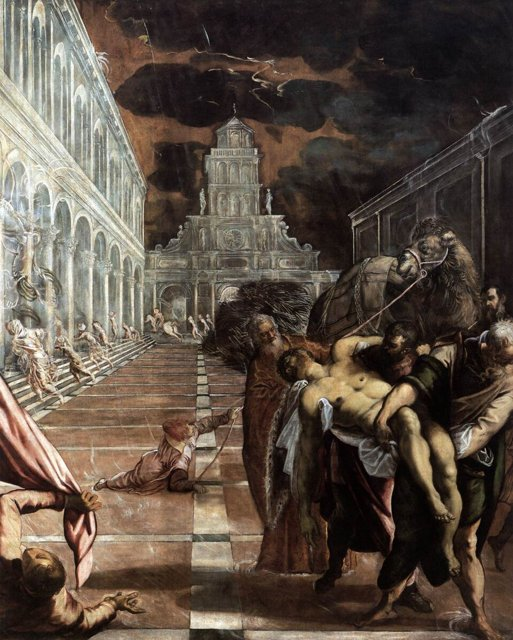
威尼斯商人把傳說中聖馬可（聖馬爾谷）的遺骸從埃及亞歷山卓帶回威尼斯，聖馬可從此成為威尼斯的守護聖人，飛獅也成為城市與國家的象徵。聖馬可大教堂與總督官邸相連，威尼斯雖信奉天主教，卻不受教宗約束，在中世紀是特殊的現象。

## 1000 | 控制亞得里亞海 {label="約1000年"}
10世紀起，威尼斯成為重要的海上強權，與拜占庭帝國及其他地中海政權維持貿易、外交與軍事關係，逐步建立東西方商業中介的地位。1000年前後，威尼斯加強對亞得里亞海航路的控制，為日後的地中海貿易網絡打下基礎。它的力量來自航運、造船、貿易、金融與外交共同支撐，而不是單純的軍事征服。

## 1063 ~ 1094 | 重建聖馬可大教堂
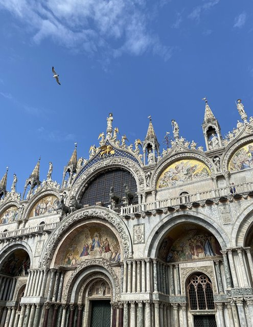
1063年，現存聖馬可大教堂主體的重建工程開始；1094年重建完成並舉行祝聖。大教堂展現威尼斯日益強盛的財富與拜占庭藝術的影響，也成為共和國宗教與政治認同的象徵。

## 1172 | 大議會制度化
威尼斯的政治制度進一步調整，大議會的角色逐漸加強，共和政體逐步制度化。1177年，神聖羅馬皇帝腓特烈一世與教宗亞歷山大三世在威尼斯達成和解，威尼斯成為歐洲外交的重要舞台。

## 1202 | 第四次十字軍從威尼斯出發
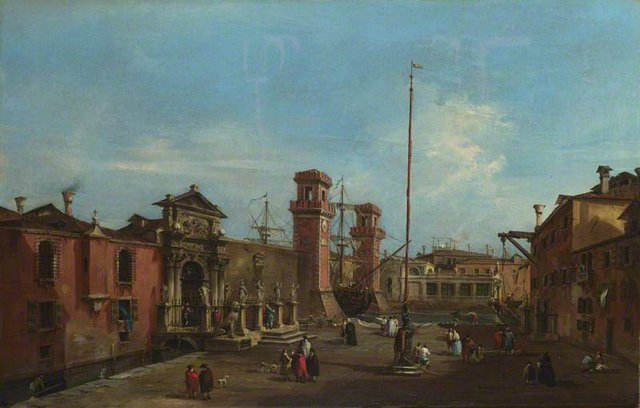
十字軍向威尼斯訂造船隊，威尼斯總督恩里科·丹多洛（Enrico Dandolo，約1107–1205）提出以十字軍協助奪回札拉等條件抵償運費，威尼斯的船隊、商業利益與十字軍運動密切結合。

## 1204-04-13 | 攻陷君士坦丁堡
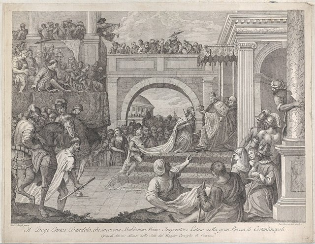
第四次十字軍原本要進攻穆斯林控制的區域，最後卻攻陷基督教世界的君士坦丁堡，並屠城劫掠。威尼斯在瓜分拜占庭領土時獲得愛琴海內的許多島嶼，包括克里特島與優卑亞島，建立起地中海的海上霸權。這次事件也加深了拉丁基督教世界與東正教拜占庭世界之間的裂痕。

## 1254 | 馬可·波羅出生
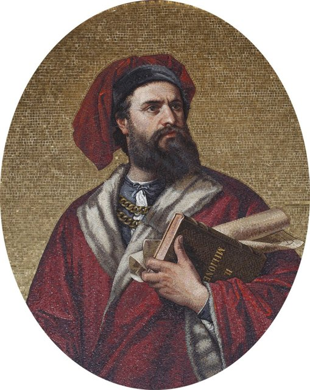
馬可·波羅（Marco Polo，1254–1324）生於威尼斯的商人家庭，父親與叔叔早已到過東方。他後來的旅行經歷，成為歐亞交流史的重要一環。

## 1253 ~ 1381 | 威尼斯—熱那亞戰爭
威尼斯與熱那亞為了爭奪地中海的貿易航線、港口與商業利益，在一百多年間發生多次戰爭。1380年的基奧賈戰爭是決定性的一戰，威尼斯擊敗熱那亞，熱那亞的船隊從此不再出現在東地中海，被迫把貿易重心放在西地中海，威尼斯因此獨占東方貿易與利潤最高的香料貿易，迎來1380至1499年的百年盛世。

## 1271 ~ 1295 | 馬可·波羅的東方之旅
馬可·波羅與父親、叔叔從威尼斯出發前往東方，在元朝停留多年，1290年代離開中國，經海路返回西方，展現威尼斯商人與亞洲貿易網絡的連結。1298年前後，他在熱那亞被俘期間口述旅行經歷，由魯斯蒂謙諾整理成書，《馬可·波羅遊記》日後成為歐洲認識亞洲的重要文獻，也有人認為他的記載啟發了後來的航海探險。

## 1297 | 大議會封閉
威尼斯通過新的憲法（Serrata），把約兩百個最富有的家族以外的人排除在大議會之外，共和政體轉向貴族寡頭政治。商人貴族像股東一樣共同經營國家，使威尼斯獲得中世紀後期少見的內部安定。1335年又成立權力強大的十人議會，負責國家安全，1600年前後因職權受到限制而逐漸沒落。

## 1348 | 黑死病
黑死病重創威尼斯與歐洲其他地區，人口、勞動力與商業活動受到嚴重衝擊。14世紀後期，威尼斯仍持續發展造船、金融、玻璃製造與貿易，形成結合海權、製造業與商業金融的城市經濟。

## 1402 ~ 1410 | 向義大利本土擴張
為了對抗米蘭公爵維斯孔蒂的擴張威脅，威尼斯在15世紀初向義大利內陸擴張，取得威尼托的大部分地區，包括維羅納與帕多瓦，1420年代又擴張到倫巴底西部，第一次建立真正的領土帝國，與米蘭爭霸三十多年（1421–1454年）。威尼斯控制的人口從母城的15萬增加到16世紀連同附屬地區的250萬人。1430年威尼斯失去塞薩洛尼基，15世紀又從熱那亞取得賽普勒斯島。

## 1453 | 君士坦丁堡陷落
鄂圖曼帝國攻陷君士坦丁堡，東地中海的政治與商業環境出現重大變化，威尼斯面臨新的外交與貿易挑戰。15世紀下半，鄂圖曼在巴爾幹與東地中海持續擴張，威尼斯的許多據點被迫讓出，1470年威尼斯失去內格羅蓬特島，並與鄂圖曼開始海上較量，威尼斯的海軍到1499年才被超越。

## 1469 | 印刷業興起
威尼斯取得重要的印刷特許權，成立第一家印刷社，1470年代印刷出版業迅速擴張。到1500年，威尼斯已有417家印刷廠，印刷業者大量出版古典著作、宗教文本與人文主義作品，成為歐洲最重要的印刷中心之一，推動文藝復興思想與知識的傳播。威尼斯也因為獨立的教會關係與出版自由，成為躲避羅馬天主教審查的安全地帶。

## 1494 | 義大利戰爭
法國國王查理八世入侵義大利，義大利戰爭展開，義大利半島的政治與軍事環境發生長期變化。威尼斯一面維持商業與外交，一面在列強之間周旋。

## 1499 | 《尋愛綺夢》
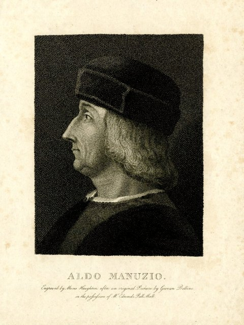
出版家阿爾杜斯·馬努提烏斯（Aldus Manutius，約1450–1515）在威尼斯出版《尋愛綺夢》，其出版社以古典作品、便攜式書籍與印刷革新聞名。1501年他推廣斜體字與小開本的書籍，使書籍更便於攜帶，威尼斯因此成為文藝復興出版的中心。

## 1500 | 威尼斯畫派 {label="1500年前後"}
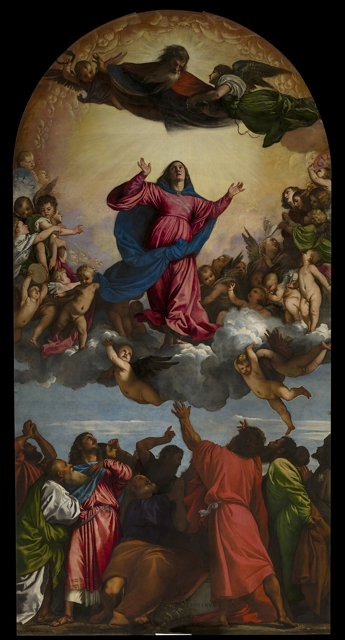
威尼斯畫派逐漸展現鮮明的特色：重視色彩、光線、油畫技法與大型的宗教與神話作品。喬爾喬內（約1477–1510）、提香（約1488–1576）、丁托列托（1518–1594）、韋羅內塞等畫家活躍於16世紀，深深影響歐洲藝術。聖馬可大教堂、總督宮與大運河沿岸的宮殿，也呈現拜占庭、哥德、文藝復興與巴洛克等多種風格。

## 1508 ~ 1516 | 康布雷聯盟戰爭
教宗儒略二世、法國國王路易十二、神聖羅馬皇帝馬克西米連一世與亞拉岡國王斐迪南二世組成康布雷聯盟，要消滅威尼斯共和國。1509年的阿尼亞德洛戰役中，法軍大勝威尼斯軍，馬基維利評論說威尼斯人一戰就丟掉了八百年來祖先的成果。後來聯盟內部分裂，加上威尼斯上下破家捐財、人民各自武裝，終於瓦解聯盟並收復大部分領土，但到1521年國力已經耗盡，威尼斯從此失去陸上的霸權，再也無法主導義大利中北部的政治格局。

## 1516 | 威尼斯猶太區
威尼斯設立猶太人強制居住區（Ghetto），這個名詞後來成為猶太隔離區的通稱。它反映當時城市在商業、宗教與社會治理上的複雜關係：猶太人被允許經商與放貸，卻被限制在固定的區域內。1517年鄂圖曼征服埃及的馬木留克王朝，傳統的東西方通道完全落入土耳其人手中，國際貿易逐漸從地中海轉向大西洋，威尼斯開始走下坡。

## 1570 ~ 1571 | 賽普勒斯與勒班陀海戰
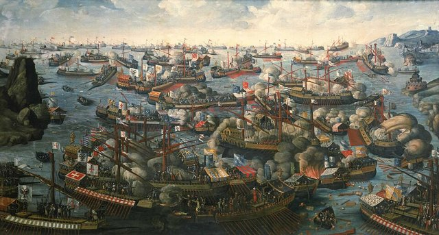
1570年鄂圖曼入侵賽普勒斯，1571年占領全島。同年10月，威尼斯參與的神聖同盟在勒班陀海戰中擊敗鄂圖曼艦隊，但威尼斯在確定失去賽普勒斯之後便很快與土耳其人議和，無法因這場勝利恢復在東地中海的優勢。1575至1577年的瘟疫更重創威尼斯的人口與經濟。

## 1606 ~ 1607 | 與教宗保祿五世衝突
威尼斯與教宗保祿五世發生嚴重的政治衝突，教宗對威尼斯發布禁令，共和國堅持維護自己的政治自主性。威尼斯長期對外力的干預保持戒心，1618年的所謂「西班牙陰謀」事件也反映這種政治恐慌。1629至1631年，瘟疫再度重創威尼斯。

## 1645 ~ 1669 | 克里特戰爭
威尼斯與鄂圖曼帝國進行長達24年的克里特戰爭，耗費大量的財政與軍事資源，1669年威尼斯最終失去克里特島。1684至1699年的摩里亞戰爭中，威尼斯一度取得希臘部分地區，卻難以扭轉海權的相對衰退。威尼斯的衰退不是單一戰爭造成的，而是大西洋貿易興起、鄂圖曼崛起、戰爭瘟疫與歐洲大國興起等因素長期累積的結果。

## 1720 | 弗洛里安咖啡館開業
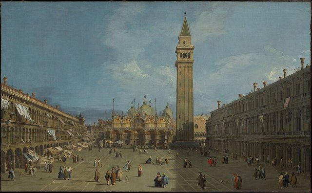
聖馬可廣場上的弗洛里安咖啡館（Caffè Florian）開業，成為威尼斯最著名的歷史咖啡館之一。18世紀的威尼斯在政治與軍事上已大不如前，卻以藝術、戲劇、音樂與觀光文化維持繁榮：維瓦第（1678–1741）在這裡從事音樂活動，卡納萊托等畫家筆下的威尼斯風景也傳遍歐洲。

## 1797 | 威尼斯共和國覆亡
拿破崙軍隊進入威尼斯，末代總督退位，延續約千年的共和國結束。同年10月的坎波福爾米奧條約把威尼斯交給奧地利，威尼斯共和國被分成奧地利的威尼斯省、法國的附庸國奇薩爾皮納共和國與法屬伊奧尼亞群島。

## 1805 | 納入拿破崙的義大利王國
拿破崙建立義大利王國，威尼斯納入法國主導的政權。1814年拿破崙失敗後奧地利再度占領威尼斯，1815年維也納會議後，威尼斯併入奧地利統治的倫巴底—威尼西亞王國，哈布斯堡王朝恢復對威尼斯的控制。

## 1848-03-22 | 聖馬可共和國
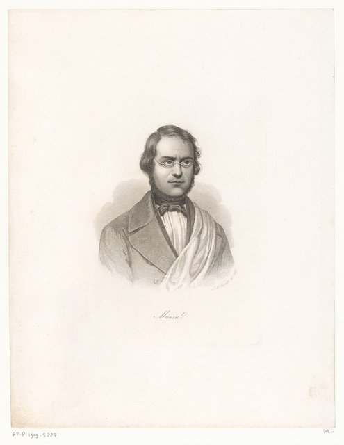
歐洲革命的浪潮中，威尼斯爆發反奧地利起義，丹尼爾·馬寧（Daniele Manin，1804–1857）等人宣布恢復共和政體，建立聖馬可共和國。奧地利軍隊圍困威尼斯，城市遭受戰爭、疾病與糧食危機的嚴重衝擊，1849年8月威尼斯投降，短暫的革命共和國結束。

## 1866-10 | 併入義大利王國
經過1859年第二次與1866年第三次義大利獨立戰爭，奧地利把威尼斯割讓出來，10月的公民投票決定脫離奧地利，威尼斯併入以薩丁尼亞王國為主統一的義大利王國，政治地位正式納入現代義大利國家體系。19世紀末鐵路與現代交通改善了威尼斯與本土的連結。

## 1895 | 第一屆威尼斯雙年展
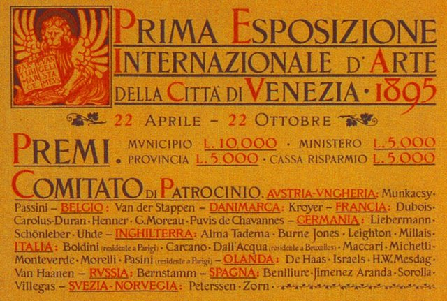
第一屆威尼斯國際藝術雙年展舉辦，威尼斯從歷史名城轉為現代國際藝術展覽的重要城市。20世紀初，威尼斯周邊的港口、工業與交通設施逐步發展，城市經濟不再只依靠歷史貿易與傳統工藝。

## 1915 ~ 1918 | 第一次世界大戰
第一次世界大戰期間，威尼斯與義大利東北部受到戰爭波及，城市與周邊地區面臨軍事與經濟壓力。1930年代威尼斯與本土之間的公路、鐵路與交通聯繫持續改善，1940至1945年的第二次世界大戰再度衝擊當地的經濟與社會。

## 1966-11-04 | 歷史性大洪水
威尼斯發生歷史性的嚴重洪水，水位一度達到約194公分，城市保存與潟湖防洪的問題受到國際高度關注。1973年義大利制定特別法律，把威尼斯的保護列為重要的國家事務，潟湖環境、城市保存與防洪治理逐步制度化。

## 1987 | 列入世界遺產
威尼斯及其潟湖被列入聯合國教科文組織的世界遺產名錄，肯定其歷史城市景觀、建築藝術與潟湖文化的世界價值。威尼斯不只是歷史建築的集合，而是城市、潟湖、水道、島嶼與人類活動共同形成的文化景觀。

## 2003 | MOSE防洪閘動工
MOSE潟湖防洪閘門系統開始興建，透過可升降的閘門降低高潮位與風暴潮對城市的威脅。2019年11月12日，威尼斯再度遭遇嚴重的高潮位與洪水，水位約187公分，氣候變遷與海平面上升的威脅再度受到關注。

## 2020-10-03 | MOSE首次啟動
MOSE系統首次正式啟動以阻擋高潮位，威尼斯開始以大型工程系統應對部分洪水的風險。2021年，威尼斯歷史中心開始對大型郵輪實施重要的航行限制，城市試圖在觀光經濟、潟湖生態與歷史景觀的保護之間取得平衡。
2020年代的威尼斯持續面對觀光壓力、人口流失、高潮位與潟湖生態變化，如何保存這座活的歷史城市，成為長期的治理課題。
