<!--
內容整理自中文維基百科「朱塞佩·威爾第」與英文維基百科「Giuseppe Verdi」條目（CC BY-SA 4.0），並以台灣用語改寫摘要。
https://zh.wikipedia.org/zh-tw/朱塞佩·威尔第
https://en.wikipedia.org/wiki/Giuseppe_Verdi
生日依中文條目作10月10日；英文條目指出受洗紀錄寫「昨日出生」，可能是9日或10日，威爾第自己一向在9日慶生。
各歌劇的首演日期，條目多半只寫年月，係依一般公認的史實補充。
圖片皆為 Wikimedia Commons 上的公有領域（含PD-US）作品（封面：波爾迪尼1886年所繪肖像）。
-->

# Periods
- 1813-10-10 ~ 1832 | 童年與求學@布塞托
  生於帕爾馬附近小村莊的旅店人家，8歲就成為村裡教堂的正式管風琴師。在布塞托跟普羅韋西學音樂，得到商人巴雷齊的大力資助，並和他的女兒瑪格麗塔相戀。
- 1832 ~ 1842 | 米蘭：起步與喪親之痛
  報考米蘭音樂學院落榜，改拜拉維尼亞為私人學生。娶了瑪格麗塔，但兩個孩子與妻子在短短幾年內相繼過世，第二部歌劇又慘敗，他一度發誓不再作曲。
- 1842 ~ 1853 | 「苦役船的歲月」
  《納布果》一舉成名，此後十多年馬不停蹄地寫了十幾部歌劇，他自稱這是在「苦役船上的十六年」。與女高音斯特雷波尼相戀，最後以《弄臣》、《遊唱詩人》、《茶花女》三部曲奠定大師地位。
- 1853 ~ 1871 | 聖阿加塔的鄉紳與愛國者@Sant'Agata
  退居聖阿加塔務農，創作步調放慢，卻寫出《化裝舞會》、《命運之力》、《唐·卡洛》、《阿依達》等大作。他的名字成了義大利統一運動的口號，還當選國會議員。
- 1871 ~ 1901 | 晚年：從《安魂曲》到《法斯塔夫》
  為紀念文豪孟佐尼寫下《安魂曲》，看似就此退休，卻在詩人博伊托的協助下，70多歲寫出《奧賽羅》，近80歲寫出喜劇《法斯塔夫》。晚年投入慈善，興建退休音樂家之家。

# Events

## 1813-10-10 | 出生@勒朗科勒
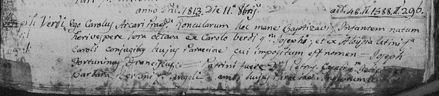
生於布塞托附近的小村莊勒朗科勒，當時屬於拿破崙法蘭西第一帝國的塔羅省。父親卡洛經營旅店，母親路易吉亞是紡紗工。他後來喜歡把自己說成出身目不識丁的農民，但其實父母都是小地主與商人家庭，父親還很積極栽培他的教育。

## 1817 | 啟蒙教育
4歲起跟村裡的校長學拉丁文與義大利文，6歲上村裡的學校。他學會彈管風琴後對音樂非常著迷，父母終於買了一架小鍵琴給他。

## 1821 | 8歲的教堂管風琴師
1820年起他在村裡的教堂唱詩、當輔祭、學管風琴，老師去世後，8歲的他就成了領薪水的正式管風琴師。不過他一輩子都反對教權，晚年還告誡孫子：「離神父遠一點。」

## 1823 | 到布塞托上學
10歲進入布塞托的文法學校，週日還要走好幾公里路回村裡彈管風琴。12歲起跟布塞托聖巴爾多祿茂教堂的樂長普羅韋西學音樂，他回憶13到18歲間寫了「上百首樂隊進行曲」和各式各樣的作品。

## 1826 | 第一次公開演出
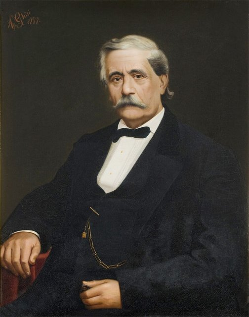
13歲時臨時代人上場，在家鄉首次公開演出，大部分彈的是自己的作品，一鳴驚人。布塞托愛樂協會的另一位負責人、雜貨批發商兼釀酒商巴雷齊從此成為他的贊助人。

## 1829 | 普羅韋西「已經沒東西可教」
15歲寫的清唱劇《掃羅的瘋狂》在貝加莫演出，大受讚賞。年底老師普羅韋西表示已經沒什麼可以教他了。他這時在教巴雷齊的女兒瑪格麗塔唱歌與鋼琴，到1831年兩人已私下訂婚。

## 1832 | 米蘭音樂學院落榜
到北義的文化之都米蘭報考音樂學院，卻沒有被錄取。巴雷齊替他安排拜前斯卡拉劇院指揮拉維尼亞為私人老師，拉維尼亞鼓勵他常去斯卡拉劇院，他在那裡聽了羅西尼與貝里尼的歌劇。

## 1836-05 | 與瑪格麗塔結婚
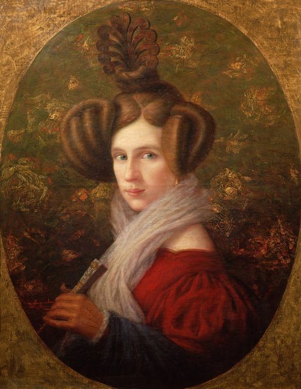
前一年他回布塞托擔任音樂學校校長，與巴雷齊的女兒瑪格麗塔結婚。女兒維吉尼亞生於1837年、兒子伊奇里奧生於1838年，卻都在嬰兒時夭折。

## 1839-11-17 | 第一部歌劇《奧貝爾托》
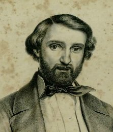
在斯卡拉劇院首演，相當成功，加演了13場。斯卡拉劇院的經理梅雷利因此和他簽約再寫三部歌劇。

## 1840-09-05 | 喪妻與《一日國王》的失敗
在寫第二部歌劇時，妻子瑪格麗塔因腦炎去世，年僅26歲。深愛妻兒的他悲痛欲絕。幾個月後首演的喜劇《一日國王》慘敗，只演了一場。據說他從此發誓不再作曲。

## 1842-03-09 | 《納布果》一舉成名
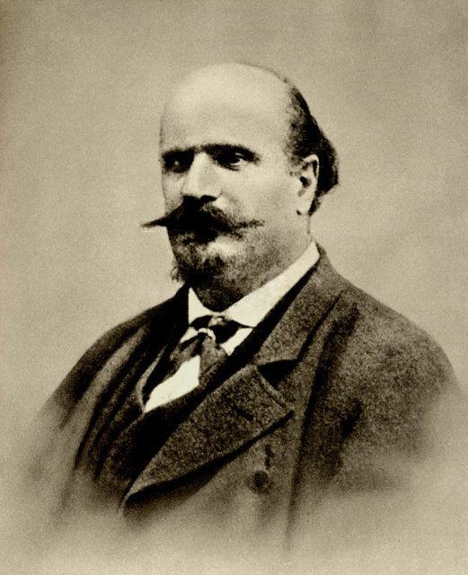
梅雷利硬塞給他一份劇本，據他回憶，自己「今天一句、明天一句，這裡一個音、那裡一段樂句」慢慢寫成了這部歌劇。首演大受歡迎，同年秋天在斯卡拉劇院連演57場，創下空前紀錄，幾年內就傳遍歐洲各大城市。劇中的希伯來奴隸合唱〈飛吧，思想，乘著金色的翅膀〉至今仍有人建議作為義大利國歌。

## 1843 | 唐尼采第的讚賞；結識斯特雷波尼
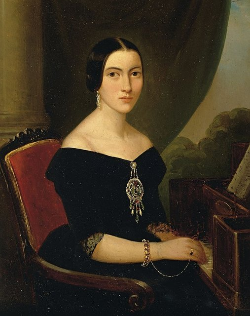
他到維也納監督《納布果》的演出，當地音樂總監唐尼采第寫信說：「我非常非常樂意讓位給威爾第這樣有才華的人。」之後在帕爾馬，他和飾演《納布果》女主角的女高音朱塞佩娜·斯特雷波尼展開戀情。同年《倫巴底人》在斯卡拉劇院首演，鞏固了他的名聲。

## 1844-03-09 | 《埃爾納尼》首演
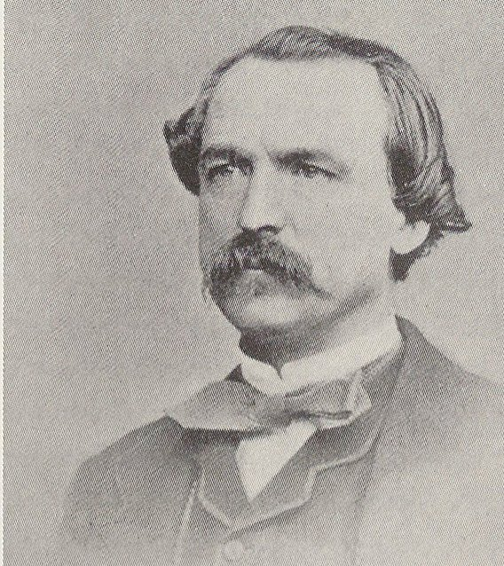
改編自雨果的戲劇，在威尼斯鳳凰劇院首演，半年內就在義大利20家劇院和維也納上演。此後十年他的生活就像一本旅行日記，四處奔波推出新作。他收了巴雷齊的另一位門生穆齊奧為唯一的學生兼抄譜員，兩人形影不離。

## 1847-03-14 | 《馬克白》首演
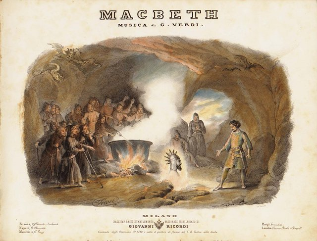
在佛羅倫斯首演，他把這部歌劇獻給巴雷齊，說它是自己「最珍視的作品」。這是他第一部沒有愛情故事的歌劇，打破了當時義大利歌劇的慣例。他要求飾演馬克白夫人的女高音聲音要「粗糙、窒息、空洞」，不要唱得太美。

## 1847-07-22 | 《群盜》倫敦首演
為倫敦寫的歌劇，他親自指揮首演，維多利亞女王與亞伯特親王都出席了。之後兩年他大多住在巴黎，把《倫巴底人》改編成法國大歌劇《耶路撒冷》，並獲頒榮譽軍團騎士勳章。

## 1848 | 米蘭五日起義
聽說米蘭市民在「五日起義」中暫時趕走了奧地利人，他趕到米蘭，興奮地寫信說：「我高興得快醉了！想想看，這裡再也沒有德國人了！」應愛國領袖馬志尼之邀，他寫了一首愛國讚歌。同年他在家鄉附近的聖阿加塔買下土地。

## 1849-01 | 《雷尼亞諾之戰》
在羅馬首演，正值短暫的羅馬共和國即將成立，觀眾反應熱烈，被稱為義大利統一運動的「專屬歌劇」。7月因為巴黎爆發霍亂，他和斯特雷波尼離開巴黎回到義大利。

## 1851-03-11 | 《弄臣》首演
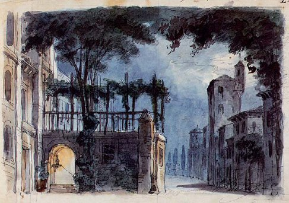
改編自雨果的《國王尋樂》，因為描寫謀殺國王，審查官要求大幅修改，他寸步不讓：「一個駝背的人唱歌……有何不可？」最後把國王改成公爵才得以上演，在威尼斯首演大獲成功。他知道公爵的詠嘆調〈女人善變〉一定會紅，排練時特地不讓樂團聽到，只讓男高音私下練習。

## 1851-05-01 | 搬進聖阿加塔
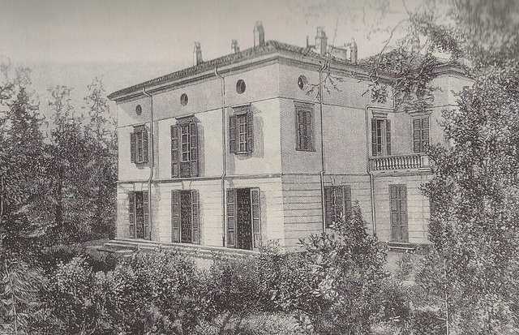
他和斯特雷波尼未婚同居，在布塞托遭到鎮民冷眼，連上教堂都被排擠。1月他和父母斷絕往來，5月兩人搬進聖阿加塔的莊園，他在這裡一直住到去世。6月母親過世，不久他開始寫《遊唱詩人》，這是他唯一一部以母親而非父親為核心的歌劇。

## 1853-01-19 | 《遊唱詩人》首演
在羅馬首演，至今仍是他最受歡迎的三四部歌劇之一，但始終不太受樂評青睞。

## 1853-03-06 | 《茶花女》首演失敗
前一年他在巴黎看了小仲馬的戲劇《茶花女》，立刻開始譜曲。威尼斯首演因為歌手不理想、劇院又堅持改成古裝而失敗，他寫道：「是我的錯還是歌手的錯？時間會證明。」修改後的版本在歐洲各地大受歡迎，成為他最著名的歌劇，其中的〈飲酒歌〉家喻戶曉。

## 1856 | 鄉居生活
回到聖阿加塔，熱衷於農作與養馬，寫信說自己「完全拋開音樂，讀點書，弄點農事和馬，就這樣」。斯特雷波尼形容他愛鄉間生活愛到「瘋狂」，天一亮就去看麥田和葡萄園。在《茶花女》之前的11年他寫了16部歌劇，接下來到《阿依達》的18年只寫了6部新作。

## 1859-02-17 | 《化裝舞會》首演
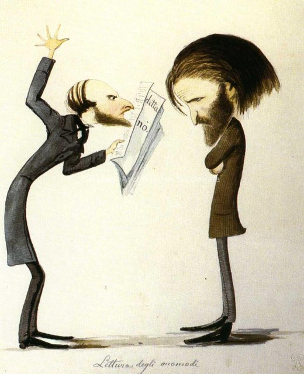
原本以瑞典國王古斯塔夫三世遇刺為題材，拿坡里的審查官百般刁難，他毀約打了官司，最後改在羅馬上演並更名為《化裝舞會》。

## 1859-08-29 | 與斯特雷波尼結婚
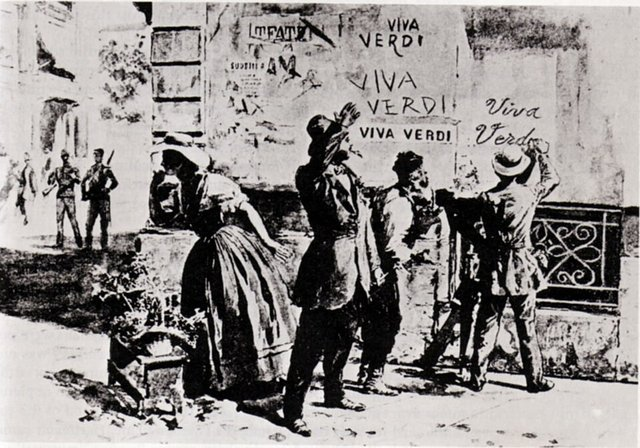
在當時屬於皮埃蒙特的一個小村莊成婚，見證人只有載他們來的馬車夫和教堂的敲鐘人。同年他當選新成立的省議會議員，並率代表團到杜林晉見國王維托里奧·埃馬努埃萊二世，還與統一運動的推手加富爾會面。這一年起，「威爾第萬歲」（Viva VERDI）成了「義大利國王維托里奧·埃馬努埃萊萬歲」的縮寫口號。

## 1861-02-03 | 當選國會議員
在加富爾的勸說下參選，條件是幾個月後就辭職。他當選皮埃蒙特－薩丁尼亞議會（不久成為義大利王國國會）議員，但加富爾當年去世讓他非常傷心，此後他很少出席。

## 1862-11-10 | 《命運之力》聖彼得堡首演
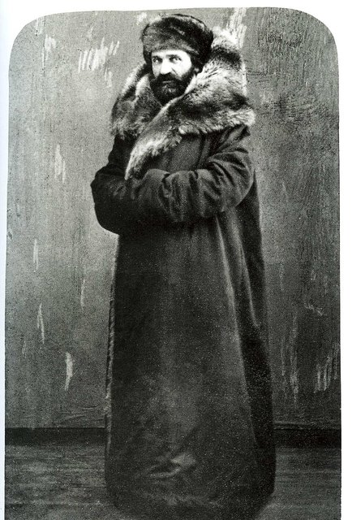
俄國皇家劇院以六萬法郎加全額費用邀約，他和妻子前往聖彼得堡，因選角問題延期近一年才首演，他獲頒聖斯坦尼斯勞斯勳章。這年他在巴黎結識了年輕詩人博伊托，請他為倫敦萬國博覽會寫歌詞。

## 1867-03-11 | 《唐·卡洛》巴黎首演
根據席勒的戲劇寫成的法國大歌劇，評價兩極，作曲家比才失望地說：「威爾第不再是義大利人了，他在追隨華格納。」同年父親卡洛（兩人早已和好）與恩人巴雷齊相繼去世，他和妻子收養了父親7歲的姪孫女菲洛梅娜。

## 1869 | 紀念羅西尼的安魂曲
羅西尼去世後，他提議由多位義大利作曲家合寫一部安魂曲紀念羅西尼，並負責了終曲〈拯救我〉。作品完成了，演出卻在最後關頭取消，直到1988年才首演。據中文條目，他把這次失敗歸咎於好友、指揮馬里亞尼，兩人從此決裂。

## 1871-12-24 | 《阿依達》開羅首演
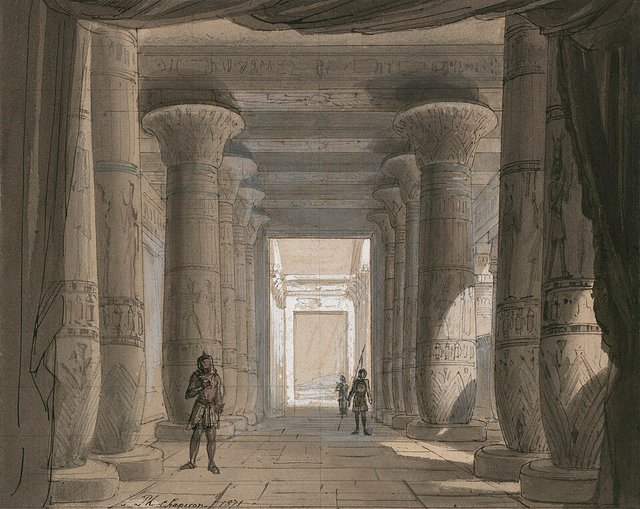
埃及政府為慶祝蘇伊士運河通航而興建開羅歌劇院，並委託他寫一部新歌劇（歌劇院開幕時上演的其實是《弄臣》）。據中文條目，他起初兩度婉拒，直到主辦方表示要改找華格納或古諾才答應。他拿到15萬法郎的鉅額報酬，雖然自承古埃及是他「從來無法欣賞的文明」。1872年他親自監督了米蘭、帕爾馬、拿坡里的演出，還在拿坡里排練期間寫了他唯一的弦樂四重奏。

## 1874-05-22 | 《安魂曲》首演
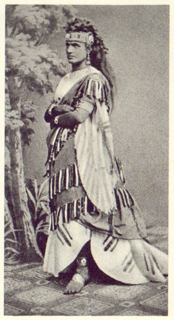
文豪孟佐尼去世一週年，他在米蘭大教堂指揮首演紀念孟佐尼的《安魂曲》，並把當年為羅西尼寫的〈拯救我〉改寫納入其中。女高音施托爾茨擔任獨唱，她與威爾第關係密切，起初讓妻子很不安，後來兩人和解。據中文條目，華格納聽了之後只說：「我還是什麼都別說的好。」同年他被任命為義大利參議員，但沒有參與議事。

## 1879 | 博伊托提議《奧賽羅》
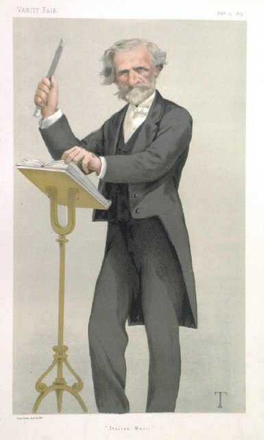
出版商里科第安排他與博伊托和解，博伊托私下向他提議以莎士比亞的《奧賽羅》寫歌劇。他口頭上說已經退休，卻偷偷開始創作，期間先和博伊托一起修訂了《西蒙·波卡涅拉》（1881）。同年他向里科第口述了自傳，是研究他早年生平的主要資料。

## 1883-02 | 華格納去世
這兩位同年出生、代表兩種歌劇風格的大師據說彼此看不順眼，卻從未見過面。他對華格納的評論很少，但聽到華格納的死訊時說：「可惜，可惜，可惜！這個名字將在藝術史上留下深刻的印記。」

## 1887-02-05 | 《奧賽羅》首演
在斯卡拉劇院首演，盛況空前。據中文條目，19歲的托斯卡尼尼在樂團中拉大提琴，從此與他結緣，後來認為威爾第與貝多芬一樣偉大。他說：「無情地殺害了那麼多英雄和女主角之後，我總算有權笑一笑了。」

## 1889-07-10 | 「那就寫《法斯塔夫》吧！」
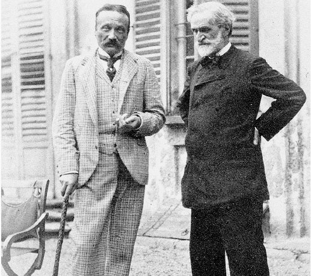
博伊托祕密寫好了以《溫莎的風流婦人》為主的喜劇劇本，他讀後大讚，卻擔心自己的年紀與健康無法完成。最後他回信說：「就這麼辦！我們來寫《法斯塔夫》吧！暫時別去想年紀和病痛這些障礙！」

## 1893-02-09 | 《法斯塔夫》首演
近80歲的他在斯卡拉劇院推出最後一部歌劇，票價高達平常的30倍，歐洲各地的王公貴族與藝文名流齊聚。演出大獲成功，最後的掌聲持續了一個小時。5月到羅馬演出時，車站擠滿了人，他一度只好躲進工具間，之後與國王翁貝托一世並坐在皇家包廂觀賞。

## 1895 | 興建退休音樂家之家
晚年投入慈善：1894年為西西里地震災民寫歌募款，1895年起規劃、興建並捐助米蘭的「退休音樂家之家」，也在布塞托附近蓋了一所醫院。他說這間音樂家之家是自己「最好的作品」。

## 1897 | 妻子斯特雷波尼去世
此後一直由施托爾茨陪伴他到最後。1898年他出版了最後一部重要作品《四首宗教歌曲》。

## 1900-07-29 | 國王翁貝托一世遇刺
他深受打擊，為國王寫了一首悼念曲的草稿，卻沒能完成。

## 1901-01-27 | 逝世@米蘭
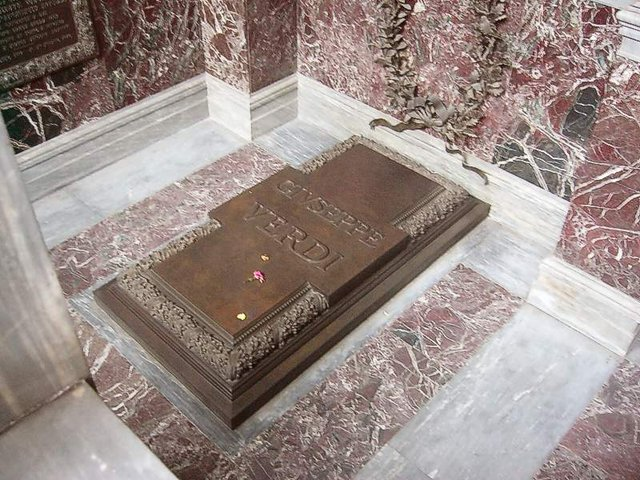
1月21日他在米蘭大飯店中風，之後一週逐漸衰弱，由施托爾茨照顧，27日去世，享年87歲。他先低調安葬於米蘭紀念公墓，一個月後遷葬到退休音樂家之家的地下墓室，由托斯卡尼尼指揮820人的合唱團演唱〈飛吧，思想，乘著金色的翅膀〉，約30萬人到場送行。博伊托寫道：他「像西班牙國王長眠在埃斯科里亞爾宮一樣，安睡在一塊覆蓋全身的青銅板下」。
