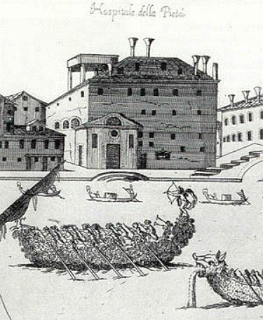
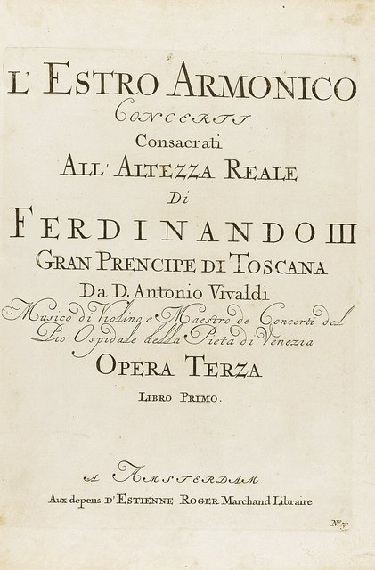
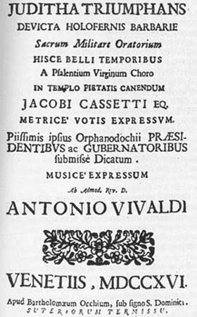
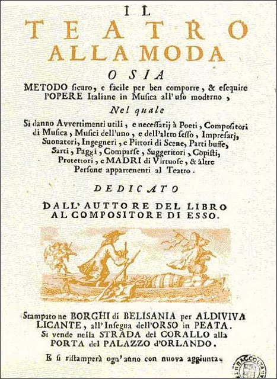
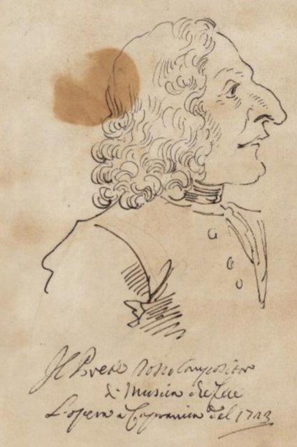
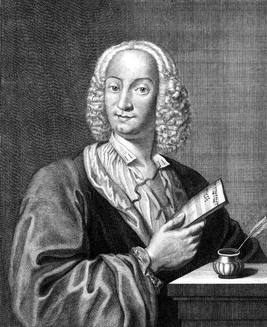
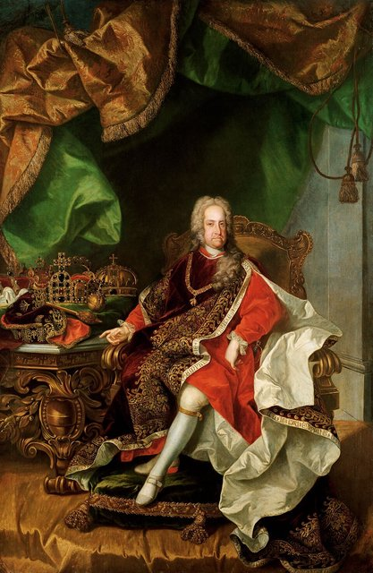
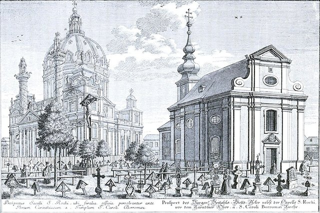

<!--
內容整理自中文維基百科「安東尼奧·韋瓦第」與英文維基百科「Antonio Vivaldi」條目（CC BY-SA 4.0），並以台灣用語改寫摘要。
https://zh.wikipedia.org/zh-tw/安东尼奥·维瓦尔第
https://en.wikipedia.org/wiki/Antonio_Vivaldi
兩者不一致處（如1709年離開慈悲院的原因與時間、首部歌劇的劇院）以英文條目為準。
圖片皆為 Wikimedia Commons 上的公有領域作品（封面：波隆那國際音樂博物館所藏的佚名油畫肖像）。
-->

# Periods
- 1678 ~ 1703 | 童年與修道@威尼斯
  父親是理髮師出身的小提琴手，在聖馬可大教堂演奏，親自教他小提琴、帶他四處演出。他自幼體弱，常受「胸悶」所苦，可能是氣喘。15歲開始修習神職，25歲晉鐸。
- 1703 ~ 1718 | 慈悲院的小提琴教師
  在收容棄兒的慈悲院教女孩們拉小提琴，為她們的樂團與合唱團寫下大量協奏曲和宗教音樂，樂團名聲傳遍歐洲。協奏曲集《和諧的靈感》讓他一舉成名，他也開始經營歌劇院、創作歌劇。
- 1718 ~ 1725 | 曼托瓦與羅馬
  擔任曼托瓦總督的宮廷樂長，之後在米蘭、羅馬推出歌劇，還在教宗面前演奏。名作《四季》可能就是受到曼托瓦鄉間景色的啟發。
- 1725 ~ 1740 | 名滿歐洲的「紅髮神父」
  回到威尼斯繼續經營聖天使劇院，接受法國大使、神聖羅馬皇帝等王公貴族的委託。晚年音樂品味轉變，他的作品漸漸退流行。
- 1740 ~ 1741 | 維也納的最後時光@Vienna
  前往維也納投靠查理六世，皇帝卻在他抵達後不久去世，他失去靠山，不到一年便在貧困中過世。

# Events

## 1678-03-04 | 出生@威尼斯
生於威尼斯共和國首都，是理髮師兼小提琴手喬瓦尼·巴蒂斯塔的長子。一出生就由產婆在家中緊急施洗，最可能的原因是身體虛弱；坊間流傳當天發生地震，其實是和1688年的另一場地震混淆了。正式的洗禮儀式在兩個月後才補辦。

## 1685 | 父親進入聖馬可大教堂
父親成為聖馬可大教堂的小提琴手，是威尼斯知名的炫技小提琴家，也是音樂家協會「聖則濟利亞會」的創始成員之一。他親自教兒子拉小提琴，還帶著他四處演出。據中文條目，年紀輕輕的安東尼奧已能代替父親上場。協會會長、聖馬可大教堂樂長雷格倫齊，可能是他最早的作曲老師。

## 1693 | 15歲開始修習神職
接受剃髮禮，開始為成為神父做準備。當時這也是提高社會地位的常見管道。

## 1703-03 | 晉鐸，「紅髮神父」
25歲成為神父，因為一頭家族遺傳的紅髮，被稱為「紅髮神父」。

## 1703-09 | 慈悲院的小提琴教師

出任威尼斯慈悲院的小提琴教師。慈悲院是收容棄兒與孤兒的機構，男孩學一門手藝，到15歲就得離開；女孩則接受音樂教育，最有天分的留下來成為樂團與合唱團的成員。他在這裡工作了三十多年，大部分重要作品都是為她們而寫。

## 1704 | 辭去主持彌撒的職務
晉鐸後只做了一年多就不再主持彌撒。他日後在信中說是因為「胸悶」的老毛病，可能是氣喘，但也有研究認為他只是想專心作曲。同年慈悲院把中提琴教學也交給他負責。

## 1705 | 第一部作品集出版
在威尼斯出版作品1：十二首三重奏鳴曲，風格還相當傳統。1709年又出版了作品2小提琴奏鳴曲集。

## 1709 | 被慈悲院以7比6解聘
慈悲院理事會每年都要投票決定是否續聘老師，他和理事會關係緊張，這一年以7比6一票之差被解聘，當了一年自由音樂家。

## 1711 | 《和諧的靈感》轟動全歐

第一部協奏曲集作品3在阿姆斯特丹出版，獻給熱愛音樂的托斯卡尼大公子斐迪南·德·梅迪奇（他也贊助過史卡拉第與韓德爾）。這部曲集轟動全歐洲，巴赫還把其中好幾首改編成大鍵琴與管風琴曲。同年慈悲院全票通過把他請回去。2月他與父親到布雷西亞，演出倉促寫成卻成為早期傑作的《聖母悼歌》。

## 1713 | 第一部歌劇《鄉間的奧托內》
在維琴察首演，開啟他的歌劇生涯。據他自己的說法，一生寫了94部歌劇，目前找到的約有50部。

## 1714 | 經營聖天使劇院
成為威尼斯聖天使劇院的經理人，推出新作《假瘋的奧蘭多》，觀眾卻不買帳，幾週就下檔。同年出版協奏曲集《異想》（作品4）。

## 1716 | 《猶滴的勝利》；升任音樂總監

為慶祝威尼斯從土耳其人手中奪回科孚島，寫下神劇《猶滴的勝利》，十一個角色男女都由慈悲院的女孩擔綱，並用上直笛、雙簧管、柔音中提琴、曼陀林等獨奏樂器展現她們的才藝。同年升任慈悲院的音樂總監，每月要寫兩首新協奏曲。前一年被審查官擋下的歌劇《阿爾希爾達》也終於上演，大獲成功。

## 1718 | 曼托瓦宮廷樂長
應曼托瓦總督黑森－達姆施塔特的菲利普親王之邀，擔任宮廷樂長三年，推出《提托·曼利奧》等歌劇。在曼托瓦他認識了年輕的歌手安娜·吉羅，她後來成為他的學生與最愛用的首席女高音，和姊姊一起與他同住、陪他四處旅行。外界對兩人的關係多有揣測，但他在信中堅決否認有任何戀情。

## 1720 | 馬切洛的諷刺小冊《時髦的劇場》

保守派貴族作曲家貝內代托·馬切洛出版小冊子嘲諷當時的歌劇界，雖然沒點名，矛頭明顯指向他：封面畫著聖天使劇院的船上站著一個戴神父帽、拉小提琴的小天使。馬切洛家族當時正為了聖天使劇院的產權與劇院打官司。

## 1723 | 羅馬：在教宗面前演奏

1723、1724年在羅馬推出歌劇新風格，並應1724年新任的教宗本篤十三世之邀為他演奏。畫家蓋齊這一年為他畫了一幅側面速寫漫畫，是他少數流傳下來的肖像之一。

## 1725 | 《四季》出版

協奏曲集《和聲與創意的試煉》（作品8）在阿姆斯特丹出版，前四首就是《四季》。每首協奏曲都搭配一首十四行詩（可能是他自己寫的），音樂中描繪了潺潺溪水、各種鳥鳴、狗吠、蚊蚋嗡嗡、暴風雨、醉漢跳舞、獵人與獵物，以及溜冰的孩子和冬日爐火，是早期標題音樂的經典。這部曲集扉頁上的版畫肖像，也是後世描繪他的主要依據。同年他回到威尼斯，一年內推出四部歌劇。

## 1726 | 為法國王室寫小夜曲
接連受法國駐威尼斯大使委託，為路易十五大婚與法國公主誕生寫下慶祝用的小夜曲，在法國大使館首演。據中文條目，此時他以聖天使劇院音樂總監的身分在威尼斯享有全歐洲的聲望，許多音樂家專程前來拜訪。

## 1728 | 與查理六世會面

神聖羅馬皇帝查理六世到的里雅斯特視察新港口時召見他。皇帝非常欣賞他的音樂，據說兩人談話的時間，比皇帝兩年內跟大臣說的話還多。皇帝封他為騎士、賜他金牌，並邀請他到維也納。他把協奏曲集《齊特拉琴》獻給皇帝。

## 1730 | 《法爾納切》；與父親遊歷維也納、布拉格
歌劇《法爾納切》前後重演了六次。同年他在父親陪同下前往維也納與布拉格。後期歌劇也和當時的大文豪合作，包括宮廷詩人梅塔斯塔西奧，以及年輕的哥多尼。

## 1736 | 父親去世
一路陪伴他的父親喬瓦尼·巴蒂斯塔去世，享年約81歲。

## 1737-11-16 | 否認與安娜·吉羅的戀情
在寫給贊助人本蒂沃利奧侯爵的信中，堅決否認與安娜·吉羅有任何戀愛關係；同一時期的信裡，他也提到自己寫過「94部歌劇」。

## 1740 | 變賣手稿，前往維也納
威尼斯的音樂品味轉變，他的作品不再受歡迎，晚年經濟拮据。他以低價賣掉大批手稿籌措旅費，前往維也納，希望在查理六世的宮廷謀得作曲家職位，並住在克恩頓門劇院附近準備上演歌劇。

## 1740-10 | 查理六世駕崩
他抵達維也納後不久，皇帝就病逝了，他頓時失去皇室庇護與穩定收入，很快陷入貧困。

## 1741-07-28 | 逝世@維也納

在一位馬鞍匠遺孀的房子裡死於「內部感染」，享年63歲。當天在聖史蒂芬大教堂舉行簡樸的葬禮，安葬於市立醫院的公墓（今維也納科技大學一帶）。傳說當時在大教堂唱詩班的少年海頓在他的葬禮上唱過歌，其實葬禮上並沒有演奏任何音樂。他住過的房子後來被拆除，原址一部分就是今天的薩赫飯店。

## 1926 | 在修道院發現大批手稿
他死後近兩百年幾乎被世人遺忘，連《四季》在古典與浪漫時期都沒沒無聞。二十世紀初小提琴家克萊斯勒以「韋瓦第風格」創作的協奏曲引起學者注意；1926年，研究者在皮埃蒙特的一座修道院發現十四冊（後來證實為十五冊）原以為毀於拿破崙戰爭的手稿，包括300首協奏曲、19部歌劇與百餘首聲樂作品，現藏於杜林國家大學圖書館。

## 1939 | 韋瓦第週：《榮耀頌》復活
作曲家卡塞拉在西恩納舉辦「韋瓦第週」，讓重新發現的《榮耀頌》與歌劇《奧林匹克》重見天日。二次大戰後，韋瓦第的作品廣受歡迎，古樂器演奏風潮更讓他聲名大噪。

## 2002-02 | 失傳歌劇《蒙特祖馬》重新出土
音樂學者在柏林歌唱學院的檔案中找到這部歌劇約七成的音樂，被譽為「75年來最重要的韋瓦第發現」。此後仍不斷有新發現，例如2006年找回1730年的歌劇《阿爾吉波》。
