<!--
內容整理自本機筆記〈伏爾泰生平大事記（1694–1778）〉（圖表\伏爾泰生平大事記（1694–1778）.md）與中文維基百科「伏爾泰」條目（CC BY-SA 4.0），以台灣用語改寫摘要。
https://zh.wikipedia.org/zh-tw/伏尔泰
史料與日期說明：
- 維基百科稱他在獄中寫的《伊底帕斯》是「關於路易十五的攝政」，此劇是改編希臘悲劇，與攝政無關，未採用。
- 筆名「伏爾泰」的由來有多種說法（本名 Arouet l.j.〔小阿魯埃〕的字母重組、家族領地的地名等），維基百科只寫了城堡一說，此處註明眾說紛紜。
- 「我不同意你的意見，但我誓死捍衛你發言的權利」並非伏爾泰的原話，而是英國作家霍爾在1906年的伏爾泰傳記中對他態度的概括；「棺材一半埋在教堂內、一半在外」的遺言也是無可考的傳說。兩者都未當作史實採用，前者在文中註明出處。
- 定居費爾內：筆記寫1759年前後；他1755年先住在日內瓦郊外的「歡樂居」，1758年底買下費爾內，此處分寫。
- 卡拉斯事件與拉巴爾騎士案只陳述「被處死」的事實，不描寫刑罰細節；1726年遭羅昂騎士的僕人毆打一事亦只簡述。
- 1746年當選法蘭西學術院院士、1752年《阿卡基亞博士》諷刺莫佩爾蒂、1753年在法蘭克福被扣留、1765年卡拉斯平反、1778年與富蘭克林會面與《伊蓮娜》加冕、1791年遷入先賢祠等細節，係依維基百科與一般公認的史實補充。
圖片來源（皆為 Wikimedia Commons 公有領域／CC0 作品）：
- vol-cover.jpg：Jean-Antoine Houdon, Voltaire, 1778, NGA 1266.jpg
- vol-bastille.jpg：Bastille 1715.jpg
- vol-1718.jpg：Nicolas de Largillière - Portrait de Voltaire (1694-1778) en 1718 - P208 - musée Carnavalet - 5 (cropped).jpg
- vol-letters.jpg：Letters concerning the English Nation.jpg
- vol-cirey.jpg：Cirey-1.jpg
- vol-emilie.jpg：Le Tonnelier de Breteuil, Emilie.jpg
- vol-tafelrunde.jpg：Tafelrunde.PNG
- vol-frederick.jpg：Friedrich II. von Preußen und Voltaire (cropped1).jpg
- vol-delices.jpg：Voltaire Museum.JPG
- vol-dinner.jpg：Un dîner de philosophes.Jean Huber.jpg
- vol-candide.jpg：Candide1759.jpg
- vol-calas.jpg：JeanCalas.jpg
- vol-dictionary.jpg：Voltaire dictionary.jpg
- vol-crown.jpg：Couronnement de Voltaire.jpg
- vol-newton.jpg：Voltaire Philosophy of Newton frontispiece.jpg
- vol-lisbon.jpg：1755 Lisbon earthquake.jpg
- vol-calas-execution.jpg：CalasChapbook.jpg
-->

# Periods
- 1694 ~ 1726 | 巴黎的才子 | #f08c00
  生於巴黎公證人家庭，在耶穌會學院受教育，不顧父親反對立志當作家，兩度因筆禍入獄，也以悲劇《伊底帕斯》一舉成名。
- 1726 ~ 1734 | 英國的啟蒙 | #1c7ed6
  被迫流亡英國，見識洛克的哲學、牛頓的科學與英國的自由，回國後寫成《哲學通信》。
- 1734 ~ 1750 | 西雷莊園與沙特萊夫人 | #2f9e44
  《哲學通信》遭禁後避居沙特萊夫人的西雷莊園，兩人一起研究牛頓科學；後來成為宮廷史官與學術院院士。
- 1750 ~ 1755 | 普魯士宮廷 | #495057
  應腓特烈大帝之邀前往柏林，從賓主相歡到反目決裂，狼狽離開。
- 1755 ~ 1778 | 費爾內的長老 | #f76707
  定居日內瓦邊境，寫出《憨第德》，為卡拉斯等冤案奔走、倡導寬容，成為全歐洲的輿論領袖；最後凱旋返回巴黎，在榮耀中去世。

# Events

## 1694-11-21 | 出生@巴黎
生於巴黎，本名法蘭索瓦－馬利·阿魯埃，是家中五個孩子中最小的，出生時體弱，家人擔心他活不下來。父親是富裕的公證人，後來在審計院任職；母親在他7歲時去世。他的教父是一位自由思想的神父，很早就帶他出入巴黎的文人沙龍。

## 1704-10 | 路易大帝學院
進入巴黎的耶穌會名校路易大帝學院就讀，接受拉丁文、修辭與古典文學的訓練。他在這裡愛上了戲劇與詩歌，也結交了一批日後在政壇有影響力的貴族同學。

## 1711 | 父命學法律
父親希望他當律師，他表面上到律師事務所見習，實際上把時間都花在寫諷刺詩與出入文人圈子，讓父親頭痛不已，一度被送到荷蘭使館當秘書以遠離巴黎。

## 1717-05 | 第一次關進巴士底監獄

因被指控寫詩諷刺攝政王奧爾良公爵與其女兒，被關進巴士底監獄十一個月。他在獄中構思悲劇《伊底帕斯》。

## 1718-11-18 | 《伊底帕斯》與筆名「伏爾泰」
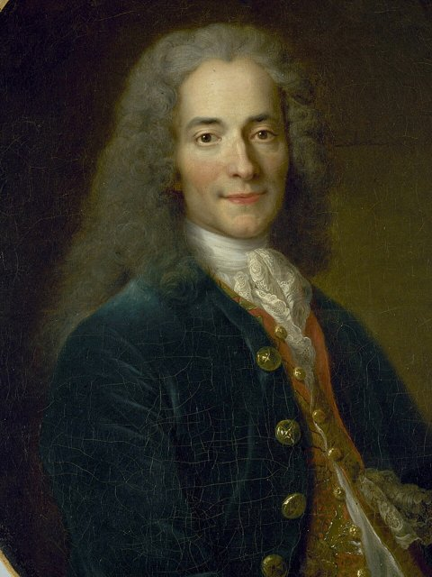
悲劇《伊底帕斯》在法蘭西喜劇院首演，大獲成功，連演四十多場，23歲的他成了巴黎最受矚目的劇作家。他從此以「伏爾泰」為筆名，由來眾說紛紜，一說是本名「小阿魯埃」的字母重組。

## 1726-04 | 羅昂騎士事件
在劇院與貴族羅昂騎士發生口角，他出言反譏。幾天後羅昂派僕人把他痛打一頓，自己在旁觀看；伏爾泰要求決鬥，卻反被以擾亂秩序為由關進巴士底監獄。他深刻體會到，在舊制度下才華敵不過出身。

## 1726-05 | 流亡英國
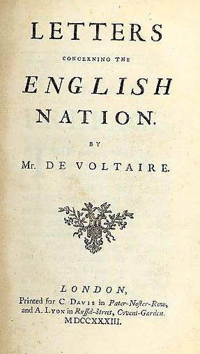
獲釋的條件是離開法國，他前往英國住了將近三年。他學會英語，結識詩人蒲柏與作家斯威夫特，研讀洛克的哲學，並在1727年參加了牛頓的國葬，對英國以國葬禮遇一位科學家大為感動。他也觀察到英國的宗教寬容：「一個英國人作為自由人，可以走自己喜歡的路上天堂。」據說牛頓與蘋果的故事，就是他從牛頓的外甥女那裡聽來、再寫進書中而流傳開來。

## 1729-04 | 返回法國
獲准回到法國，靠著巧妙的投資（包括買下政府彩券的漏洞）累積了大筆財富，從此經濟獨立，不必依賴貴族的資助。他陸續發表悲劇《布魯圖斯》《薩伊》與史書《查理十二世史》。

## 1734-04 | 《哲學通信》遭禁，避居西雷
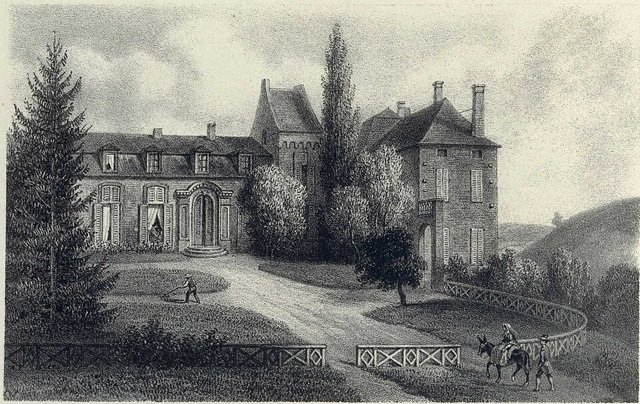
法文版《哲學通信》（又譯《英國通信》）出版，以介紹英國的宗教寬容、議會政治、洛克與牛頓為名，暗中批判法國的專制與教會。巴黎高等法院下令焚書並逮捕作者，他逃到情人沙特萊侯爵夫人在洛林邊境的西雷莊園，在那裡住了十多年。

## 1738 | 《牛頓哲學原理》
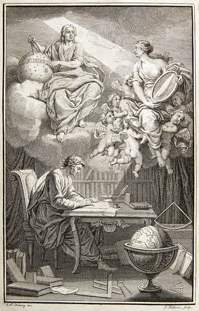
與精通數學與物理的沙特萊夫人一起在西雷建立實驗室，研究光學與熱，出版《牛頓哲學原理》，把牛頓的萬有引力與光學介紹給法國讀者，對抗當時法國仍以笛卡兒學說為主流的學界。沙特萊夫人後來把牛頓的《自然哲學的數學原理》譯成法文，至今仍是標準譯本。

## 1745-04 | 宮廷史官
靠著龐巴度夫人的支持，獲任為國王路易十五的宮廷史官，隔年當選法蘭西學術院院士，聲望達到頂點。但他在宮廷中的機智與尖刻也得罪了不少人。

## 1749-09 | 沙特萊夫人去世
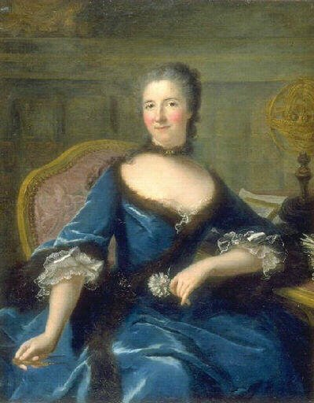
沙特萊夫人在生下與另一位情人的孩子後不久去世，年僅42歲。伏爾泰悲痛萬分，他說自己「失去了一半的自己」。

## 1750-07 | 前往普魯士宮廷
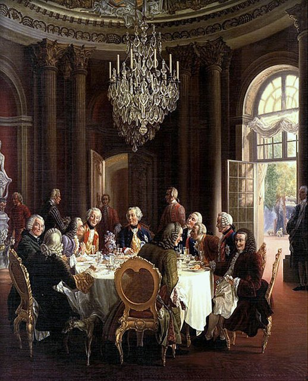
接受仰慕他多年的普魯士國王腓特烈二世（腓特烈大帝）之邀，前往柏林與波茨坦的無憂宮，擔任宮廷侍從，每天與國王一起吃飯、修改國王的法文詩作。起初賓主盡歡，但他捲入投機買賣的官司，又與普魯士科學院院長莫佩爾蒂爭執，關係逐漸惡化。

## 1753-03 | 與腓特烈大帝決裂
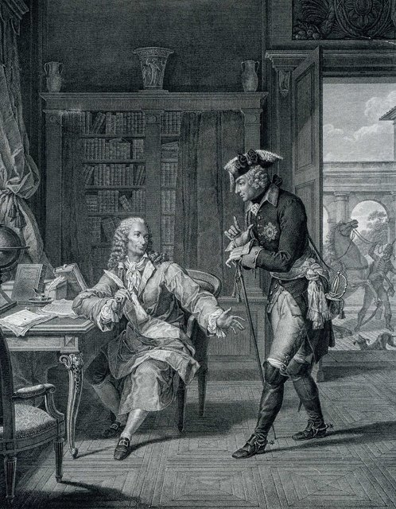
他匿名發表諷刺小冊子《阿卡基亞博士》嘲弄莫佩爾蒂，國王大怒，下令在柏林街頭公開焚燒。他藉口養病離開普魯士，途中卻在法蘭克福被國王的人扣留了一個多月，被搜回國王的詩稿才獲釋。兩人後來還是恢復了通信。

## 1755-03 | 日內瓦的「歡樂居」

法國國王不准他回巴黎，他在日內瓦郊外買下別墅，取名「歡樂居」。但喀爾文宗的日內瓦禁止戲劇演出，他在家中演戲屢屢與當局發生衝突。

## 1755-11-01 | 里斯本大地震
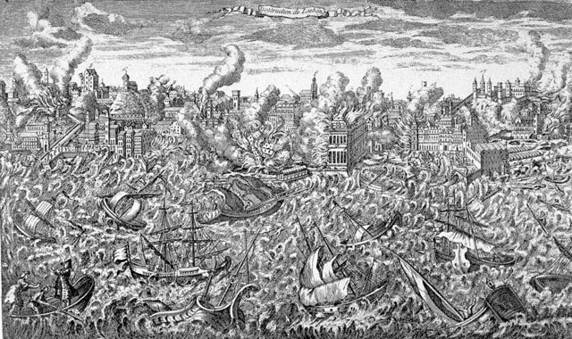
11月1日萬聖節，葡萄牙里斯本發生大地震與海嘯，數萬人罹難。他寫下《里斯本災難詩》，質疑「一切都是最好的安排」的樂觀主義：如果上帝是善的，為什麼無辜的人要受苦？這場辯論也讓盧梭寫信與他爭論天意的問題。

## 1756 | 《風俗論》
出版《論各民族的風俗與精神》，以世界文明史的眼光書寫歷史，不再以基督教歐洲為中心，而是從中國、印度、伊斯蘭世界寫起，他推崇孔子，讚揚中國以道德與文官治國。書中說神聖羅馬帝國「既不神聖，也不羅馬，更不是帝國」。他被視為現代文化史與「歷史哲學」一詞的開創者。

## 1758-12 | 買下費爾內莊園
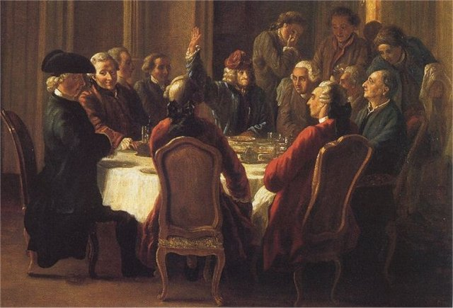
在法國與日內瓦的邊境買下費爾內莊園，此後住了將近二十年。邊境的地理位置讓他一旦遇到法國當局追究，就能立刻逃到日內瓦。他在費爾內蓋教堂、建學校、引進鐘錶業，把一個貧窮的小村子發展成數千人的小鎮，被尊為「費爾內的長老」，各國的名流與文人紛紛前來拜訪。

## 1759-01 | 《憨第德》
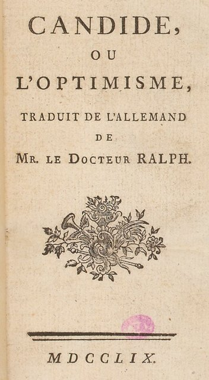
匿名出版諷刺小說《憨第德》（又譯《老實人》）。天真的青年憨第德深信老師邦格羅斯「這是所有可能的世界中最好的一個」的教導，卻接連遭遇戰爭、地震、宗教裁判所、奴隸制度等種種災難，最後在一座小農場安頓下來，結論是：「還是種我們的園子要緊。」小說諷刺萊布尼茲式的樂觀主義，出版當年就被查禁，卻在一年內再版二十多次，成為他最廣為流傳的作品。

## 1762-03 | 卡拉斯事件
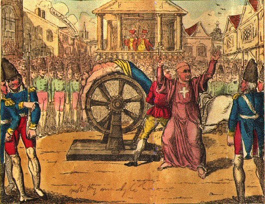
土魯斯的新教徒商人讓·卡拉斯被誣指為了阻止兒子改信天主教而殺子，在宗教偏見的氣氛下被判有罪處死。伏爾泰調查後確信這是冤案，發動全歐洲的輿論為他平反，喊出「消滅敗類！」（指宗教狂熱與迷信）的口號。

## 1763-12 | 《論寬容》
出版《論寬容》，以卡拉斯案為例，呼籲各宗教之間彼此寬容：「我們都是同一位父親的孩子，都是同一位上帝的造物。」他主張宗教不應成為迫害的藉口，國家不應干涉個人的信仰。

## 1764-07 | 《哲學辭典》
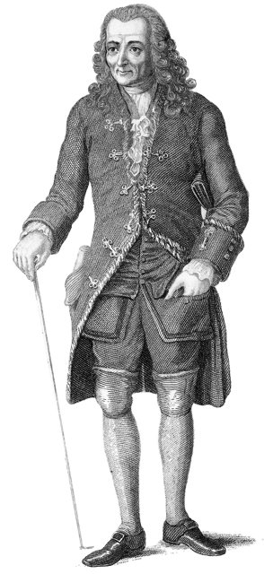
匿名出版袖珍型的《哲學辭典》，以短小精悍的辭條嘲諷宗教迷信、教條與狂熱，方便讀者隨身攜帶、私下傳閱。他對外一律否認自己是作者，此書在日內瓦、荷蘭與巴黎都被焚毀。

## 1765-03 | 卡拉斯平反
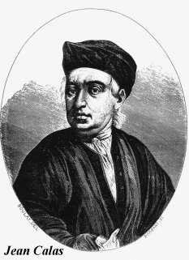
經過三年的奔走，法國國王的御前會議推翻原判，宣告卡拉斯無罪，恢復他的名譽，並給予家屬賠償。這是啟蒙思想家運用輿論改變司法判決的著名案例。

## 1766-07 | 拉巴爾騎士案
20歲的拉巴爾騎士被控褻瀆十字架、對宗教遊行不脫帽而被判處死，他的遺體與一本《哲學辭典》一起被焚燒。伏爾泰震驚憤怒，一度考慮帶著同道們移居普魯士，此後更積極為宗教與司法迫害的受害者奔走。

## 1778-02-10 | 凱旋返回巴黎
離開巴黎二十八年後，83歲的他回到巴黎觀看新劇《伊蓮娜》的首演，全城轟動，他的住處擠滿了訪客。他會見了美國駐法使節富蘭克林，並為富蘭克林的孫子祝福：「上帝與自由。」

## 1778-03-30 | 在法蘭西喜劇院加冕
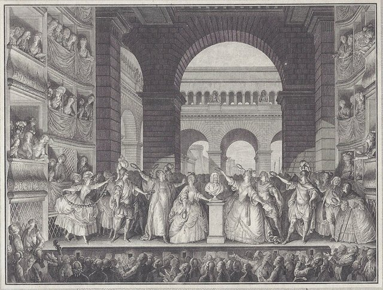
他出席《伊蓮娜》的第六場演出，觀眾起立歡呼長達二十分鐘，演員們在舞台上為他的胸像戴上桂冠。4月他也加入了共濟會。

## 1778-05-30 | 逝世@巴黎
在巴黎去世，享年83歲。他臨終前寫道：「我死時崇敬上帝，愛我的朋友，不恨我的敵人，厭惡迷信。」由於他拒絕收回對教會的批評，巴黎教會不准為他舉行宗教葬禮，他的姪子連夜把遺體運到香檳區的一座修道院安葬。1791年法國大革命期間，國民制憲議會將他的遺骸隆重遷入先賢祠，約有百萬人夾道送行，三年後，他的死敵盧梭也被遷入先賢祠，安葬在他的對面。後世常引用「我不同意你的意見，但我誓死捍衛你說話的權利」來代表他的精神，但這句話其實是英國作家霍爾在1906年所寫的概括。
