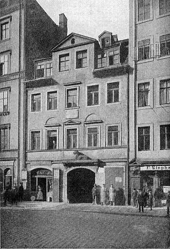
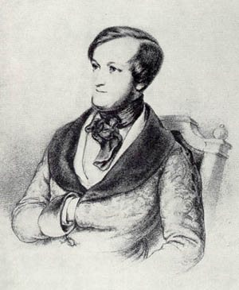
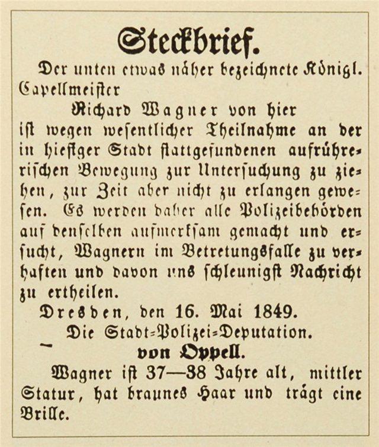
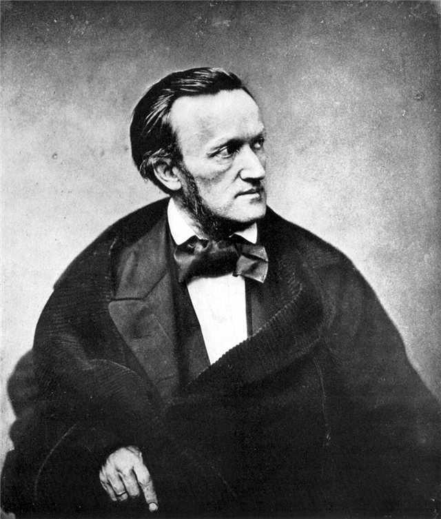
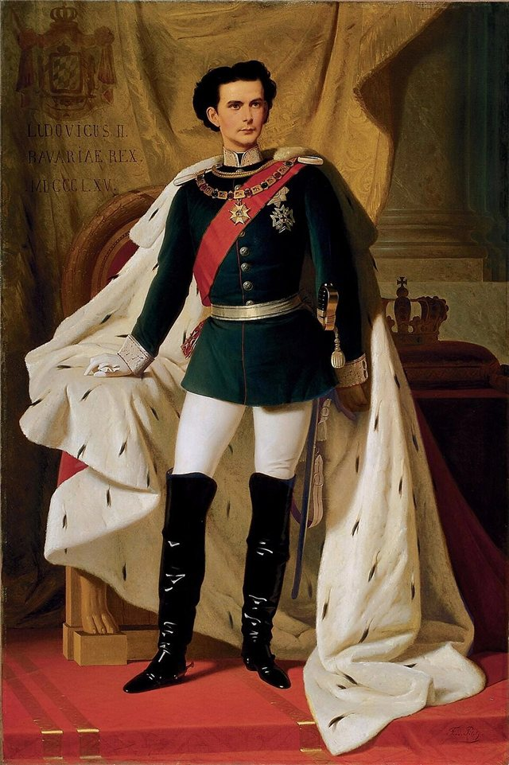
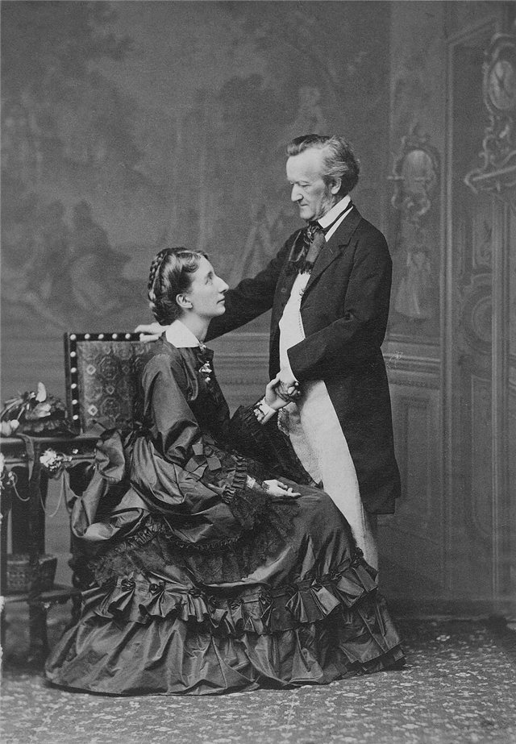

<!--
內容整理自中文維基百科「理查·華格納」條目（CC BY-SA 4.0），並以台灣用語改寫摘要。
https://zh.wikipedia.org/zh-tw/理查·華格納
圖片皆為 Wikimedia Commons 上的公有領域作品（封面：1871年於慕尼黑所攝肖像）。
-->

# Periods
- 1813 ~ 1833 | 早年@萊比錫、德勒斯登
  父親在他出生半年後去世，母親與演員兼劇作家蓋爾共同生活，華格納到14歲都以「理查·蓋爾」為名。受繼父影響愛上戲劇，起初立志當劇作家，後來為了替自己的劇本譜曲而學音樂。
- 1833 ~ 1842 | 早期職業生涯與婚姻
  先後在符茲堡、馬德堡、柯尼斯堡、里加的劇院任職，與女演員明娜結婚，婚姻動盪不安，債台高築，最後逃往巴黎，靠寫文章與改編他人作品勉強維生。
- 1842 ~ 1849 | 德勒斯登宮廷樂長@Dresden
  《黎恩濟》成功後定居德勒斯登，獲任薩克森宮廷樂長，推出《漂泊的荷蘭人》與《湯豪瑟》。他投身左翼政治，參與1849年五月起義，失敗後遭到通緝。
- 1849 ~ 1858 | 流亡瑞士@蘇黎世
  流亡德國境外十二年。在蘇黎世發表一系列論文，提出把音樂、詩歌、舞台融為一體的「整體藝術」，也寫下第一篇反猶文章《音樂中的猶太性》。開始創作《指環》，又因迷戀瑪蒂德·魏森東克而轉寫《崔斯坦與伊索德》。
- 1858 ~ 1862 | 流亡威尼斯與巴黎
  與瑪蒂德的戀情被妻子明娜發現後，獨自前往威尼斯完成《崔斯坦》，之後到巴黎推出新版《湯豪瑟》，卻以醜聞收場。
- 1862 ~ 1871 | 回歸與聲名再起
  政治禁令解除後回到德國。18歲的巴伐利亞國王路德維希二世熱烈崇拜他，替他還清巨額債務，讓《崔斯坦》與《名歌手》得以首演。他與李斯特的女兒科西瑪相戀，引起醜聞，被迫遷居瑞士琉森湖畔的特里布申。
- 1871 ~ 1876 | 拜魯特@Bayreuth
  決定在拜魯特興建專屬歌劇院，為了籌錢四處巡迴指揮，最後靠國王的貸款才得以完工。1876年首屆拜魯特音樂節首次完整上演《指環》。
- 1876 ~ 1883 | 最後時日
  因健康大多待在義大利，費時四年完成最後一部作品《帕西法爾》。晚年文章論調轉趨反動，也重申反猶觀點。1883年在威尼斯去世。

# Events

## 1813-05-22 | 出生@萊比錫

出生於萊比錫布呂爾街3號，在聖多馬教堂受洗（巴赫曾在這裡擔任樂長）。是家中九個孩子中最小的一個，父親是萊比錫警察機關的文員。

## 1813-11 | 父親去世
父親死於傷寒。母親隨後與父親的朋友、演員兼劇作家路德維希·蓋爾共同生活，全家遷往德勒斯登。華格納幾乎可以肯定以為蓋爾是自己的生父。

## 1822 | 觀看韋伯指揮《自由射手》
9歲時看了韋伯親自指揮自己的歌劇《自由射手》，深受其中的哥德元素震撼。前一年繼父蓋爾去世，他進入德勒斯登十字學校就讀。

## 1826 | 第一部創作：悲劇《洛伊巴爾德》
深受莎士比亞與歌德影響的劇本，後來被列為華格納作品目錄第1號。為了替它譜曲，他說服家人讓他學音樂。

## 1828 | 聽到貝多芬第七、第九號交響曲
全家已搬回萊比錫。他在布商大廈聽到貝多芬第七與第九號交響曲，貝多芬從此成為他重要的靈感來源，他還把第九號改編成鋼琴曲。

## 1829 | 被女高音施勒德-德弗里恩特震撼
這位女高音的演出成為他心目中戲劇與音樂融合的理想典範。他在自傳中寫道，回顧一生，沒有任何事能與這次的震撼相比。

## 1831 | 進入萊比錫大學；隨聖多馬樂長學作曲
隨聖多馬教堂樂長魏因利希學作曲，魏因利希驚嘆於他的才華，不收學費，還安排出版他的降B大調鋼琴奏鳴曲，成為他的作品第1號。

## 1832 | C大調交響曲
19歲寫下貝多芬風格的交響曲，在布拉格首演，隔年在萊比錫布商大廈演出。

## 1833 | 第一部完整歌劇《仙女》
到符茲堡劇院擔任合唱指揮，寫成仿效韋伯風格的《仙女》，但直到他死後才在慕尼黑首演。

## 1836 | 《禁戀》首演失敗，破產
在馬德堡擔任歌劇院音樂總監期間，根據莎士比亞《一報還一報》寫成《禁戀》，只演了一場就停演，劇團財務崩潰，他也隨之破產。

## 1836-11-24 | 與明娜結婚

與馬德堡劇院的當家花旦明娜·普拉納在柯尼斯堡結婚。隔年明娜就跟別的男人離開，這只是兩人動盪婚姻中的第一次變故。

## 1837-06 | 擔任里加歌劇院音樂總監
遷居當時屬於俄羅斯帝國的里加，隔年與明娜和好。

## 1839 | 逃離里加，前往巴黎
債台高築，夫妻倆逃離里加躲避債主，搭船在風浪中前往倫敦。這段航程後來啟發他寫出《漂泊的荷蘭人》。9月定居巴黎，靠寫文章與改編他人歌劇勉強度日。

## 1840 | 完成《黎恩濟》；結識李斯特

在梅耶貝爾大力支持下，《黎恩濟》獲德勒斯登宮廷劇院接受排演。同年結識李斯特。

## 1842-10-20 | 《黎恩濟》德勒斯登首演
回德國途中第一次看見萊因河，他寫道自己「熱淚盈眶，發誓永遠忠於德意志祖國」。《黎恩濟》首演廣受讚譽，他隨後獲任薩克森宮廷樂長。

## 1843-01-02 | 《漂泊的荷蘭人》首演

中期「浪漫歌劇」的第一部，在德勒斯登首演。

## 1845-10-19 | 《湯豪瑟》首演
在德勒斯登首演。他與作曲家希勒、建築師森佩爾等人往來，也開始與無政府主義者巴枯寧等激進人士交往。

## 1849-05 | 德勒斯登五月起義，展開流亡

在失敗的五月起義中扮演支援角色，當局在5月16日發出通緝令。他先逃到巴黎，再定居蘇黎世，從此流亡德國境外十二年。

## 1850-08-28 | 李斯特在威瑪指揮《羅恩格林》首演
華格納逃亡前已完成《羅恩格林》，焦急地寫信請李斯特在他缺席的情況下推出。這一年他也發表了第一篇反猶文章《音樂中的猶太性》。

## 1852 | 完成《指環》全部劇本

從1848年的《齊格弗里德之死》開始，倒著往前補寫故事，最後完成四部劇本。他在《致友人書》中宣告：「我再也不會寫歌劇了」，計畫用三天加一個前夜演出整部作品。

## 1854 | 接觸叔本華哲學；完成《萊因的黃金》
詩人朋友介紹他讀叔本華的《作為意志和表象的世界》，他後來稱此為一生中最重要的事件。叔本華認為音樂在諸藝術中地位最高，促使他在後期作品中讓音樂更具支配性。

## 1855 | 在倫敦指揮，見到維多利亞女王
與倫敦愛樂協會合作舉辦數場音樂會。女王喜歡他的《湯豪瑟》序曲，在日記中形容他「身材矮小，非常安靜，戴著眼鏡，前額寬闊」。

## 1857 | 擱置《指環》，轉寫《崔斯坦與伊索德》

絲綢商魏森東克借給他莊園裡的一棟小屋「庇護所」。他對魏森東克的妻子瑪蒂德日益迷戀，於是擱置了寫到一半的《齊格弗里德》，轉而創作取材亞瑟王傳說的愛情悲劇《崔斯坦與伊索德》，也以瑪蒂德的詩作寫下《魏森東克之歌》。

## 1858 | 戀情曝光，前往威尼斯
明娜截獲他寫給瑪蒂德的信，兩人大吵一架。華格納獨自前往威尼斯，明娜返回德國。

## 1859 | 完成《崔斯坦與伊索德》
他半開玩笑地寫信給瑪蒂德：「這部《崔斯坦》正在變成一件可怕的東西……演得十全十美，肯定會把人逼瘋。」這部作品後來被視為現代主義音樂的重要先聲。

## 1861 | 巴黎版《湯豪瑟》慘敗

保守的賽馬會俱樂部會員不滿芭蕾被安排在第一幕，在劇院內集體鬧場，演了三場就下檔，成為著名醜聞。詩人波德萊爾卻寫了一本小冊子讚揚他。

## 1862 | 政治禁令解除，與明娜永別
回到德國，定居萊因河畔的比布里希，開始創作他唯一的成熟喜劇《紐倫堡的名歌手》。明娜最後一次來與他相聚，兩人從此永遠分開，但他仍持續資助她。

## 1864 | 路德維希二世召他到慕尼黑

18歲即位的巴伐利亞國王熱烈崇拜他的歌劇，替他還清巨額債務，並提議上演他的所有作品。華格納也應國王要求開始口述自傳《我的生平》。

## 1865-06-10 | 《崔斯坦與伊索德》慕尼黑首演
由漢斯·馮·畢羅指揮，是十五年來華格納第一部首演的新歌劇。畢羅的妻子科西瑪（李斯特的女兒）當年4月生下的女兒伊索爾德，父親其實是華格納。這段婚外情震動慕尼黑，12月國王被迫要求他離開，把他安置在瑞士琉森湖畔的特里布申。

## 1866-01-25 | 明娜去世
在德勒斯登心臟病發去世，華格納沒有出席葬禮。

## 1868-06-21 | 《紐倫堡的名歌手》慕尼黑首演

同樣由畢羅指揮，立即獲得成功。

## 1870-08-25 | 與科西瑪結婚

科西瑪又為他生下女兒埃娃與兒子齊格弗里德後，畢羅才同意離婚。兩人的婚姻一直維持到華格納去世。

## 1870-12-25 | 《齊格弗里德牧歌》
為科西瑪生日安排的驚喜演出，在特里布申別墅的樓梯上首演。

## 1872 | 拜魯特節日劇院奠基
前一年決定遷居拜魯特，市議會捐出「綠丘」作為劇院用地。為籌措經費，各地成立「華格納協會」，他本人也四處巡迴指揮。

## 1874-04-18 | 遷入萬弗里德別墅
國王在計畫瀕臨夭折時讓步提供貸款。這一年他也完成了《指環》的終篇《諸神的黃昏》，從第一份劇本草稿到完工，總共花了26年。

## 1876-08-13 | 首屆拜魯特音樂節：《指環》首次完整上演

劇院以《萊因的黃金》揭幕，全套《指環》演出約15小時。出席者包括德皇威廉一世、布魯克納、聖桑與柴可夫斯基。葛利格認為作品「寫得如有神助」，《費加羅報》則稱其為「瘋子的夢」。好友尼采大失所望，從此與他決裂。

## 1882-07-26 | 《帕西法爾》首演
他唯一專為拜魯特節日劇院寫的作品，標為「舞台神獻慶典」，取材自聖杯傳說。8月29日最後一場演出時，已重病的他悄悄走進樂池，接過指揮棒，親自指揮到全劇落幕。

## 1883-02-13 | 逝世@威尼斯
在大運河畔的溫德拉敏宮心臟病發去世，享年69歲。遺體由靈柩貢多拉載著駛過大運河，運回德國，葬在拜魯特萬弗里德別墅的花園中。拜魯特音樂節此後由科西瑪接掌，至今仍由華格納的後代管理。
