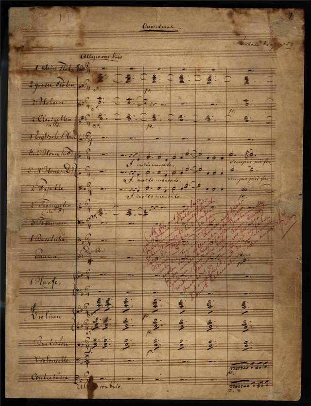
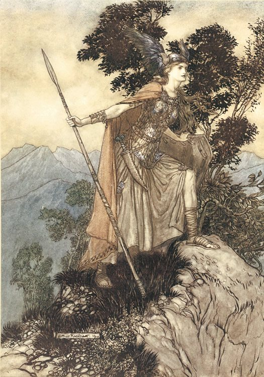
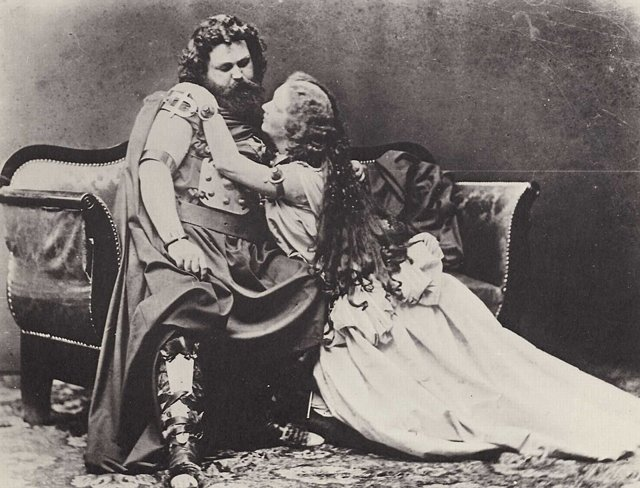
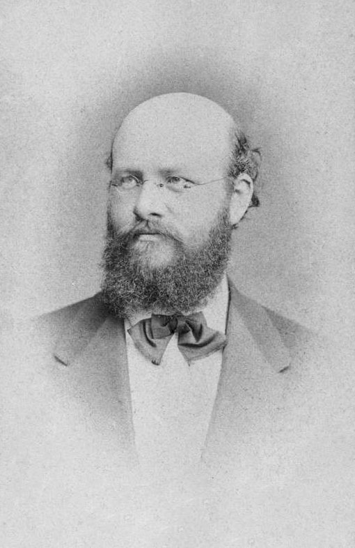
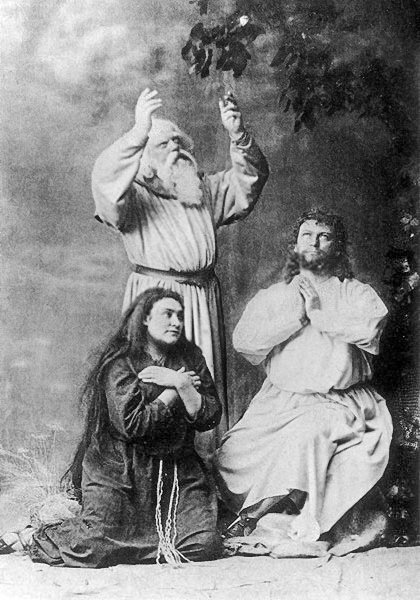
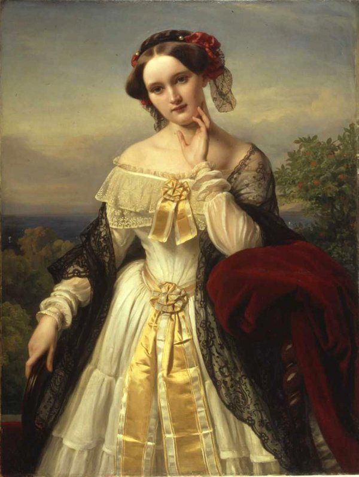

<!--
內容整理自本機筆記〈華格納主要作品〉（D:\Books\md\音樂\華格納主要作品.md，網頁版在知識圖譜的「5-2.音樂家作品」），做法比照「貝多芬主要作品」。
- 每首作品一則事件，日期採「創作時間」（多年創作的作品以區間呈現；「年代」以十年計、「世紀」以百年計，修訂或出版年份只寫在顯示文字裡），事件顏色依筆記的類別段落區分：主要歌劇與樂劇、《尼貝龍指環》四部曲、管弦樂、序曲與交響作品、聲樂與合唱作品、鋼琴與其他器樂作品。
- 「約」、「前後」、修訂、出版等不是單純年份的寫法，以原文作為顯示文字。
- 作品編號是目錄編號，不等於創作順序，時間軸依創作時間排序。
- 時期沿用「華格納生平」時間軸的主要時期（重疊的細分時期不列）。
- 筆記「優先聆聽」清單中的作品另註明順序。
- 以 follows 排在「華格納生平」之後；生平事件見該時間軸。
圖片來源（皆為 Wikimedia Commons 公有領域作品；註明「共用」者沿用生平時間軸的圖片）：
- wagner-1876-festspielhaus.jpg（拜魯特節慶劇院，1876年《指環》在此首次完整上演（與華格納生平共用））
- wagner-1843-dutchman.jpg（《漂泊的荷蘭人》序曲的手稿（與華格納生平共用））
- wagner-1852-brunnhilde.jpg（拉克姆為《女武神》繪製的布倫希爾德（與華格納生平共用））
- mw-wagner-tristan.jpg：Joseph Albert - Ludwig und Malwine Schnorr von Carolsfeld - Tristan und Isolde, 1865e.jpg（1865年慕尼黑首演的崔斯坦與伊索德：施諾爾·馮·卡羅斯菲爾德夫婦）
- wagner-1857-mathilde.jpg（瑪蒂爾德·魏森東克，歌詞的作者（與華格納生平共用））
- wagner-1868-betz.jpg（1868年首演時飾演漢斯·薩克斯的貝茨（與華格納生平共用））
- mw-wagner-parsifal.jpg：Parsifal (1882 retuschiert).jpg（1882年拜魯特《帕西法爾》首演的劇照）
-->

# Periods
- 1813 ~ 1833 | 早年@萊比錫、德勒斯登
  父親在他出生半年後去世，母親與演員兼劇作家蓋爾共同生活，華格納到14歲都以「理查·蓋爾」為名。受繼父影響愛上戲劇，起初立志當劇作家，後來為了替自己的劇本譜曲而學音樂。
- 1833 ~ 1842 | 早期職業生涯與婚姻
  先後在符茲堡、馬德堡、柯尼斯堡、里加的劇院任職，與女演員明娜結婚，婚姻動盪不安，債台高築，最後逃往巴黎，靠寫文章與改編他人作品勉強維生。
- 1842 ~ 1849 | 德勒斯登宮廷樂長@Dresden
  《黎恩濟》成功後定居德勒斯登，獲任薩克森宮廷樂長，推出《漂泊的荷蘭人》與《湯豪瑟》。他投身左翼政治，參與1849年五月起義，失敗後遭到通緝。
- 1849 ~ 1858 | 流亡瑞士@蘇黎世
  流亡德國境外十二年。在蘇黎世發表一系列論文，提出把音樂、詩歌、舞台融為一體的「整體藝術」，也寫下第一篇反猶文章《音樂中的猶太性》。開始創作《指環》，又因迷戀瑪蒂德·魏森東克而轉寫《崔斯坦與伊索德》。
- 1858 ~ 1862 | 流亡威尼斯與巴黎
  與瑪蒂德的戀情被妻子明娜發現後，獨自前往威尼斯完成《崔斯坦》，之後到巴黎推出新版《湯豪瑟》，卻以醜聞收場。
- 1862 ~ 1871 | 回歸與聲名再起
  政治禁令解除後回到德國。18歲的巴伐利亞國王路德維希二世熱烈崇拜他，替他還清巨額債務，讓《崔斯坦》與《名歌手》得以首演。他與李斯特的女兒科西瑪相戀，引起醜聞，被迫遷居瑞士琉森湖畔的特里布申。
- 1871 ~ 1876 | 拜魯特@Bayreuth
  決定在拜魯特興建專屬歌劇院，為了籌錢四處巡迴指揮，最後靠國王的貸款才得以完工。1876年首屆拜魯特音樂節首次完整上演《指環》。
- 1876 ~ 1883 | 最後時日
  因健康大多待在義大利，費時四年完成最後一部作品《帕西法爾》。晚年文章論調轉趨反動，也重申反猶觀點。1883年在威尼斯去世。

# Events

## 1833 ~ 1834 | WWV 32 《仙女》（Die Feen） {color=#c92a2a}
類別：浪漫歌劇（主要歌劇與樂劇）。

## 1834 ~ 1836 | WWV 38 《禁戀》（Das Liebesverbot） {color=#c92a2a}
類別：喜歌劇／早期歌劇（主要歌劇與樂劇）。

## 1837 ~ 1840 | WWV 49 《黎恩濟》（Rienzi） {color=#c92a2a}
類別：大型歷史歌劇（主要歌劇與樂劇）。入門推薦聆聽第 12 首。

## 1840 ~ 1841 | WWV 63 《漂泊的荷蘭人》（Der fliegende Holländer） {color=#c92a2a}

類別：浪漫歌劇（主要歌劇與樂劇）。入門推薦聆聽第 8 首。

## 1842 ~ 1845 | WWV 70 《唐懷瑟》（Tannhäuser） {color=#c92a2a label="1842–1845；後續修訂"}
類別：浪漫歌劇（主要歌劇與樂劇）。入門推薦聆聽第 7 首。

## 1845 ~ 1848 | WWV 75 《羅恩格林》（Lohengrin） {color=#c92a2a}
類別：浪漫歌劇（主要歌劇與樂劇）。入門推薦聆聽第 6 首。

## 1851 ~ 1854 | WWV 86A 《萊茵的黃金》（Das Rheingold） {color=#c92a2a}
類別：《尼貝龍指環》序夜（主要歌劇與樂劇）。

## 1851 ~ 1856 | WWV 86B 《女武神》（Die Walküre） {color=#c92a2a}

類別：《尼貝龍指環》第一日（主要歌劇與樂劇）。入門推薦聆聽第 3 首。

## 1851 ~ 1871 | WWV 86C 《齊格菲》（Siegfried） {color=#c92a2a}
類別：《尼貝龍指環》第二日（主要歌劇與樂劇）。

## 1848 ~ 1874 | WWV 86D 《諸神的黃昏》（Götterdämmerung） {color=#c92a2a}

類別：《尼貝龍指環》第三日（主要歌劇與樂劇）。

## 1857 ~ 1859 | WWV 90 《崔斯坦與伊索德》（Tristan und Isolde） {color=#c92a2a}

類別：樂劇（主要歌劇與樂劇）。入門推薦聆聽第 1 首。

## 1845 ~ 1867 | WWV 96 《紐倫堡的名歌手》（Die Meistersinger von Nürnberg） {color=#c92a2a}

類別：喜歌劇／樂劇（主要歌劇與樂劇）。入門推薦聆聽第 5 首。

## 1857 | WWV 111 《帕西法爾》（Parsifal） {color=#c92a2a label="1857年起構思；1877–1882完成主要作曲"}

類別：舞台神聖節慶劇（主要歌劇與樂劇）。入門推薦聆聽第 9 首。

## 1851 ~ 1854 | WWV 86A 《萊茵的黃金》 {color=#1971c2}
類別：《尼貝龍指環》四部曲。

## 1851 ~ 1856 | WWV 86B 《女武神》 {color=#1971c2}
類別：《尼貝龍指環》四部曲。入門推薦聆聽第 3 首。

## 1851 ~ 1871 | WWV 86C 《齊格菲》 {color=#1971c2}
類別：《尼貝龍指環》四部曲。

## 1848 ~ 1874 | WWV 86D 《諸神的黃昏》 {color=#1971c2}
類別：《尼貝龍指環》四部曲。

## 1831 | WWV 20 d 小調第一號音樂會序曲 {color=#e67700}
類別：管弦樂序曲（管弦樂、序曲與交響作品）。

## 1832 | WWV 27 C 大調第二號音樂會序曲 {color=#e67700}
類別：管弦樂序曲（管弦樂、序曲與交響作品）。

## 1832 | WWV 29 C 大調交響曲 {color=#e67700}
類別：交響曲（管弦樂、序曲與交響作品）。

## 1834 | WWV 35 E 大調交響曲（未完成） {color=#e67700}
類別：交響曲片段（管弦樂、序曲與交響作品）。

## 1834 ~ 1835 | WWV 37 《哥倫布》序曲及戲劇配樂 {color=#e67700}
類別：序曲、戲劇配樂（管弦樂、序曲與交響作品）。

## 1836 | WWV 39 C 大調《波蘭尼亞》序曲（Polonia） {color=#e67700}
類別：管弦樂序曲（管弦樂、序曲與交響作品）。

## 1837 | WWV 42 《統治吧，不列顛尼亞！》（Rule Britannia）序曲 {color=#e67700}
類別：管弦樂序曲（管弦樂、序曲與交響作品）。

## 1839 ~ 1840 | WWV 59 《浮士德序曲》 {color=#e67700 label="1839–1840；1855修訂"}
類別：管弦樂序曲（管弦樂、序曲與交響作品）。入門推薦聆聽第 11 首。

## 1844 | WWV 73 《葬禮音樂》（Trauermusik） {color=#e67700}
類別：管樂作品（管弦樂、序曲與交響作品）。

## 1864 | WWV 97 《致敬進行曲》（Huldigungsmarsch） {color=#e67700}
類別：進行曲（管弦樂、序曲與交響作品）。

## 1870 | WWV 103 《齊格菲牧歌》（Siegfried-Idyll） {color=#e67700}
類別：室內管弦樂（管弦樂、序曲與交響作品）。入門推薦聆聽第 4 首。

## 1871 | WWV 104 《皇帝進行曲》（Kaisermarsch） {color=#e67700}
類別：管弦樂進行曲（管弦樂、序曲與交響作品）。

## 1876 | WWV 110 《大型節慶進行曲》 {color=#e67700}
類別：管弦樂進行曲（管弦樂、序曲與交響作品）。

## 1831 | WWV 15 歌德《浮士德》的七首音樂作品 {color=#2f9e44}
類別：聲樂與戲劇音樂（聲樂與合唱作品）。

## 1838 | WWV 50 《冷杉樹》（Der Tannenbaum） {color=#2f9e44 label="約1838"}
類別：藝術歌曲（聲樂與合唱作品）。

## 1839 ~ 1840 | WWV 60 《兩名擲彈兵》（Les deux grenadiers） {color=#2f9e44}
類別：藝術歌曲（聲樂與合唱作品）。

## 1840 | WWV 61 《瑪麗・斯圖亞特的告別》（Les Adieux de Marie Stuart） {color=#2f9e44}
類別：藝術歌曲（聲樂與合唱作品）。

## 1843 | WWV 68 《白晝已然來臨》（Der Tag erscheint） {color=#2f9e44}
類別：節慶合唱（聲樂與合唱作品）。

## 1843 | WWV 69 《使徒的愛宴》（Das Liebesmahl der Apostel） {color=#2f9e44}
類別：男聲合唱與管弦樂（聲樂與合唱作品）。

## 1844 | WWV 71 《忠誠臣民的致意》 {color=#2f9e44}
類別：歌曲／合唱（聲樂與合唱作品）。

## 1857 ~ 1858 | WWV 91 《魏森東克歌曲》（Wesendonck-Lieder，五首） {color=#2f9e44}

類別：藝術歌曲套曲（聲樂與合唱作品）。入門推薦聆聽第 10 首。

## 1871 | WWV 105 《言語雖多》（Der Worte viele sind gemacht） {color=#2f9e44}
類別：聲樂作品（聲樂與合唱作品）。

## 1877 | WWV 112 《歡迎來到瓦恩弗里德》 {color=#2f9e44}
類別：聲樂作品（聲樂與合唱作品）。

## 1880 | WWV 113 《孩子們，快來，快來》 {color=#2f9e44}
類別：聲樂作品（聲樂與合唱作品）。

## 1831 | WWV 21（Op. 1） 降 B 大調鋼琴奏鳴曲 {color=#862e9c}
類別：鋼琴奏鳴曲（鋼琴與其他器樂作品）。

## 1831 | WWV 22（Op. 3） 升 f 小調幻想曲 {color=#862e9c}
類別：鋼琴幻想曲（鋼琴與其他器樂作品）。

## 1831 ~ 1832 | WWV 23 兩首波蘭舞曲 {color=#862e9c}
類別：鋼琴作品（鋼琴與其他器樂作品）。

## 1832 | WWV 26（Op. 4） A 大調鋼琴奏鳴曲 {color=#862e9c}
類別：鋼琴奏鳴曲（鋼琴與其他器樂作品）。

## 1840 | WWV 64 E 大調鋼琴小品《無詞之歌》 {color=#862e9c}
類別：鋼琴小品（鋼琴與其他器樂作品）。

## 1853 | WWV 84 G 大調波卡舞曲 {color=#862e9c}
類別：鋼琴舞曲（鋼琴與其他器樂作品）。

## 1853 | WWV 85 降 A 大調鋼琴奏鳴曲（為 M. W. 女士紀念冊而作） {color=#862e9c}
類別：鋼琴奏鳴曲（鋼琴與其他器樂作品）。

## 1854 | WWV 88 蘇黎世《Vielliebchen》圓舞曲 {color=#862e9c}
類別：鋼琴圓舞曲（鋼琴與其他器樂作品）。

## 1861 | WWV 94 為梅特涅公主紀念冊而作的鋼琴小品 {color=#862e9c}
類別：鋼琴小品（鋼琴與其他器樂作品）。

## 1861 | WWV 95 《抵達黑天鵝之旁》（Ankunft bei den schwarzen Schwänen） {color=#862e9c}
類別：鋼琴小品（鋼琴與其他器樂作品）。

## 1875 | WWV 108 為 Betty Schott 女士而作的鋼琴小品 {color=#862e9c}
類別：鋼琴小品（鋼琴與其他器樂作品）。
