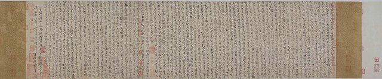

<!--
內容整理自本機筆記〈北宋王安石變法大事記——從改革背景、熙寧新法到新舊黨爭與變法廢除（1021—1127年）〉（D:\Books\md\歷史\東方歷史\北宋王安石變法大事記.md），以自己的話改寫；只依這份筆記，沒有另外合併其他資料。
時期依筆記的八個部分合併而成（筆記的第三、四部分年代互相重疊，這裡合為「新法推行」與「兩度罷相」，不重疊）。
處理方式：
- 筆記第一部分的事件編號不依時間先後（1021年出生、1042年中進士排在1043年慶曆新政之後），這裡一律依年份重排。
- 筆記把「呂惠卿」寫成簡體「吕惠卿」，這裡用正體。
- 年號：筆記每項都標年號（熙寧、元豐、元祐、紹聖、崇寧、靖康等），這裡只在需要的地方寫進內文，標題用西元年。
- 王安石的去世：筆記作「享年約65至66歲，依傳統虛歲計為66歲」，內文照寫。
- 筆記一再提醒的幾個區分，內文都保留：1068年是改革主張獲皇帝支持、1069年才開始推行新法；各項新法不是1070年同時頒行，而是在熙寧年間陸續推行；王安石罷相不等於變法結束，新法的廢除主要發生在神宗去世後；不能把北宋滅亡直接歸因於變法。
- 筆記第九部分（主要法令總表）、第十一部分（核心時間軸）屬於整理，內容已分散進各事件；第十部分（歷史評價）與第十二部分（總結）是評論，要點寫進1070年（新法的整體面貌）與1086年（廢法與評價）的說明。
- 筆記中的網頁引用連結（含追蹤參數）未收錄。
- 圖片皆為 Wikimedia Commons 上的公有領域（含 CC0）作品，縮成最長邊 640px 的 JPEG。
- sudongpo-wang-anshi.jpg（封面）：王安石像（與蘇東坡生平大事記共用）
- keju-taizu.jpg：宋太祖像（與中國科舉制度大事記共用）
- wangan-fan.jpg：Fan Zhongyan scth.jpg（《三才圖會》中的范仲淹像）
- wangan-shenzong.jpg：Shenzong of Song.jpg（宋神宗像，國立故宮博物院藏）
- sudongpo-sima-guang.jpg：司馬光像（與蘇東坡生平大事記共用）
- wangan-wasign.jpg：王安石 行书楞严经旨要卷.jpg（王安石行書《楞嚴經旨要》卷局部）
- wangan-zhezong.jpg：Song Zhezong.png（宋哲宗像）
-->

# Periods
- 960 ~ 1067 | 變法前的歷史背景 | #868e96
  宋初強化中央集權、限制武將；澶淵之盟與宋夏戰爭帶來沉重的歲幣與軍費，范仲淹的慶曆新政雖然中止，卻顯示朝廷已意識到制度問題。王安石在這段時間出生、中進士、做地方官、上萬言書。北宋並非單純的「貧窮」，真正的問題是財政收入、軍政開支、土地與財富分配和官僚體制之間的結構性矛盾。
- 1068 ~ 1073 | 熙寧新法的推行 | #1971c2
  宋神宗支持下，王安石任參知政事、再升宰相，均輸、青苗、農田水利、免役、保甲、市易、方田均稅、保馬、置將與科舉學校改革密集展開，涵蓋財政、農業、商業、土地、軍事與教育。
- 1074 ~ 1076 | 新舊黨爭與兩度罷相 | #e03131
  司馬光等人從「與民爭利」「執行偏差」「社會穩定」與程序等角度反對新法；鄭俠《流民圖》加深神宗疑慮，王安石在1074年第一次罷相，1075年復相，改革派內部也出現矛盾，1076年第二次罷相。
- 1077 ~ 1085 | 退居江寧與神宗後期 | #5c940d
  王安石退居江寧，神宗仍繼續推動部分改革，直到1085年神宗去世。
- 1086 ~ 1092 | 元祐更化 | #862e9c
  高太皇太后臨朝、司馬光出任宰相，青苗、免役、市易等新法被廢除或改回舊制。
- 1093 ~ 1127 | 新法反覆與北宋滅亡 | #e8590c
  哲宗親政後的紹聖更化恢復部分新法，徽宗時立元祐黨籍碑，改革淪為派系鬥爭的工具；1127年靖康之變，北宋滅亡。

# Events

## 960 | 趙匡胤建立北宋

後周禁軍將領趙匡胤發動陳橋兵變，建立宋朝，史稱北宋，逐步統一中原與南方主要地區。為了避免唐末、五代武將割據重演，宋初統治者強化中央集權、限制地方軍事權力。宋朝因此建立起相對成熟的文官政治體制，卻也逐漸出現軍事指揮權分散、官僚機構龐大與行政成本增加等問題，這些制度特徵後來成為改革者關注的對象。

## 1004 | 澶淵之盟
遼軍南下，與北宋軍隊對峙；宋真宗在寇準等人的主張下親赴澶州前線，雙方達成和約，史稱澶淵之盟，北宋每年向遼提供銀、絹等歲幣，雙方維持相對穩定的關係。這讓北宋獲得較長時期的和平，但歲幣、邊防與軍事維持費用，也成為財政負擔的一部分。

## 1021 | 王安石出生
王安石出生於北宋天禧五年，籍貫撫州臨川（約當今江西撫州一帶），字介甫，號半山。他後來成為北宋著名的政治家、思想家與文學家，也是唐宋八大家之一。

## 1040 ~ 1044 | 宋夏戰爭與慶曆和議
西夏在李元昊領導下建立獨立政權，與北宋爆發戰爭，北宋在三川口、好水川、定川寨等戰役中遭遇挫折；1044年宋夏達成和議，北宋以歲賜等條件換取邊境和平。這場戰爭暴露了北宋軍事體系的弱點，也加重了軍費支出：北宋雖然經濟繁榮、商業發達，卻面臨財政收入與龐大軍政開支之間的矛盾。

## 1042 | 王安石考中進士
慶曆二年，王安石考中進士，進入北宋的官僚體系，其後歷任地方官職、累積地方行政經驗。他的改革思想並不完全來自書齋中的理論，而與長期擔任地方官、接觸民間經濟與觀察行政問題的經驗密切相關。

## 1043 | 范仲淹推動慶曆新政

宋仁宗任用范仲淹等人整頓政治，范仲淹提出改革官僚考核、選拔人才、限制恩蔭與改善行政等主張，但改革受到既得利益者反對，推行不久就逐漸中止。慶曆新政是北宋中期改革的重要先聲，顯示朝廷已意識到官僚制度與行政管理的問題；王安石後來的改革規模與內容更廣，卻同樣面臨官僚利益、政治反對與執行等難題。

## 1057 ~ 1058 | 王安石提出改革主張 {label=1057～1058年}
王安石在地方任職期間持續思考北宋的政治與社會問題，撰寫《上仁宗皇帝言事書》，批評當時政治的弊端，主張培養人才、改革制度，並強調國家治理不能只靠表面的行政措施。這份奏書沒有立即促成全面改革，卻顯示他已形成較完整的政治主張：國家治理不能僅靠個別官員的道德與能力，更必須改革制度、培養人才，讓政策能夠有效執行。

## 1060 | 王安石進入中央任職
嘉祐五年，王安石奉召入京，擔任三司度支判官。三司是北宋掌管財政的重要機構，他因此有機會進一步了解中央財政、國家收入與支出的運作。

## 1067 | 宋神宗即位

治平四年，宋英宗去世，趙頊即位，是為宋神宗。神宗希望有所作為，改善北宋的財政與軍事狀況，對王安石的政治主張抱有高度期待，為後來的改革提供了關鍵的皇權支持。

## 1068 | 宋神宗召見王安石
熙寧元年，神宗召王安石入朝討論治國之道，王安石提出改革政治、經濟與軍事制度的主張，並撰寫《本朝百年無事札子》，分析北宋建國以來的政治形勢，指出制度弊端與改革的必要。1068年是他的改革主張獲得皇帝明確支持的轉折點，但全面推行新法則要到1069年才開始。

## 1069 | 王安石任參知政事，正式推動變法
熙寧二年，神宗任命王安石為參知政事（相當於副宰相），朝廷設立「制置三司條例司」作為規劃與推動改革的機構，王安石與支持改革的官員開始制定並推行新法，均輸法、青苗法、農田水利法等陸續展開。改革的目標包括富國（改善財政收入與資源調度）、強兵（整頓軍事制度）、抑制兼併（降低豪強與富商利用資金優勢牟利的空間）、改善民生，以及改革科舉、學校與官員培養方式；這些措施合稱「熙寧新法」，也稱王安石變法。

## 1069 | 均輸法
均輸法先在淮南、兩浙、江南等地推行。北宋中央每年需要各地供應大量物資，舊有的採購與運輸制度容易造成價格偏高、運輸浪費與額外負擔；均輸法讓主管官員統籌各地財賦與物資供應，依據市場價格、運輸條件與中央需求，選擇較合適的採購與運送方式，目標是降低政府採購成本、減少運輸支出、改善物資供應與財政調度。爭議在於：改革派認為改善採購方式可以節省開支，反對者則擔心官府過度介入商業，增加行政干預，甚至讓地方官員藉機牟利。

## 1069 | 青苗法
青苗法是新法中最具代表性、爭議也最大的政策之一。傳統農業社會裡，農民在春耕時缺少資金與糧食，到秋收才有收入，急需資金時往往向富戶或民間借貸，承受較重的利息；青苗法讓官府利用常平倉等機構的資金與糧食，向有需要的農戶貸款，農戶在青黃不接時借款、夏秋收穫後償還，並付一定利息，希望協助農民度過春耕前的資金困難、減少高利貸的剝削。問題出在理想與執行的落差：部分官員為了完成放貸額度或增加財政收入，可能強迫不需要貸款的農民借款，收成不佳時還款更會增加農戶壓力。因此它的爭議不宜簡化成「好政策」或「壞政策」，核心問題是政府能否在提供農業金融的同時，避免強制放貸、過度徵利與行政濫權。

## 1069 | 農田水利法
農田水利法鼓勵各地開墾荒地，修築堤防、疏通河渠、興建灌溉設施，並依受益情況安排相關民戶分擔費用或勞務，必要時以官府資金協助工程。它和單純增加賦稅不同，思路是改善生產條件、提高農業生產能力，來改善國家與農民的經濟狀況；不過水利工程需要資金、勞力與長期維護，各地成效也因地理環境與行政能力而異。

## 1070 | 王安石升任宰相，新法全面推行
熙寧三年，王安石升任同中書門下平章事，取得宰相地位；朝廷把制置三司條例司的職能併入中書，並以司農寺等機構負責推動新法，新法從個別政策擴大成涵蓋財政、農業、軍事、教育與行政制度的全面改革。除了前述三項，熙寧年間陸續推行的還有免役法（以納錢代替部分輪流服役）、市易法（官府調節部分市場供應）、方田均稅法（清查土地、調整賦稅）、保甲法（編組民戶，兼顧治安與軍事訓練）、保馬法（鼓勵民間養馬）、將兵法與置將法（改善軍隊訓練與指揮），以及太學三舍法與科舉改革。要注意各項新法並非都在1070年同時制定或全面實施，頒行、試行、推廣與調整的時間並不一致。改革有幾個正面意圖：改善財政與資源調度、扶助農民、改善軍事組織、重視教育與人才培養；但它也有明顯的限制：政策理想與地方執行出現落差、部分措施增加缺乏現金或遇到歉收農戶的壓力、改革觸及地主、富商與官員的既有利益，政治對立又持續擴大。

## 1070 ~ 1071 | 保甲法逐步推行 {label=1070～1071年}
保甲法把一定數量的民戶編組，讓地方居民共同承擔治安、巡邏與相關責任，並接受軍事訓練，目標是加強治安、建立民間基層組織、維持地方秩序，並在一定程度上擴充國家的軍事動員能力。它不只是治安政策，也反映王安石希望把地方社會納入更有組織的國家治理體系；但對一般民戶而言，編組、訓練與治安責任也可能是額外負擔。

## 1070 ~ 1071 | 免役法逐步推行 {label=1070～1071年}
免役法又稱募役法，是改革地方勞役制度的重要措施。舊有差役制度下，部分民戶得依戶等輪流承擔官府的差役，既占用農民的生產時間，各家實際負擔的成本也不一樣；免役法改由官府出錢聘人承擔部分差役，並依規定向民戶徵收免役錢（原本不必承擔差役的民戶也有助役錢），用貨幣徵收與僱用人力改變差役的分配。目標是減少農民因服役而中斷生產、讓地方行政有較穩定的人力來源，並改善各戶之間的負擔。爭議在於它讓貨幣徵收更重要：對缺乏現金的農民而言，繳免役錢未必比親自服役容易，徵收方式與地方財政需求也會影響政策效果。

## 1070 | 司馬光等人反對部分新法
司馬光等大臣反對部分新法，與王安石之間逐漸形成尖銳的政策與政治分歧。反對者的理由有四：擔心政府與民爭利，不該過度介入借貸、商業與市場；擔心地方官員為了完成指標或增加收入而偏離政策初衷；重視既有制度與社會穩定，擔心改革太快擾動秩序；對改革的方法與程序有分歧，爭論也牽涉皇帝、宰相與其他大臣之間的權力關係。王安石的立場則是：既有制度已經出了問題，若只因為改革困難就拒絕改革，國家便難以改善財政與軍事，所以應積極推動制度調整，並依靠支持新法的官員執行。新舊黨爭並不是單純的「好人反對壞人」或「改革者對抗守舊者」，雙方對國家治理、政府職能、財政政策、民生負擔與改革風險有不同判斷，改革本身的設計與執行問題，又與政治權力競爭交織在一起。

## 1071 ~ 1072 | 科舉與教育制度改革 {label=1071～1072年}
王安石認為改革不能只改財政與軍事，也要培養能理解政策、具備實務能力的人才。措施包括調整科舉考試的內容、加強經義與時務方面的考核、改革太學教育與選才制度，逐步建立以學校教育與考核為重要依據的選才方式，希望減少單靠文章技巧取士的傾向。這項改革和他的政治思想密切相關：制度改革若要長期維持，就必須培養能理解並執行改革的人才；但科舉與教育涉及士大夫的仕途與學術傳統，也引起相當大的爭論。

## 1072 | 市易法
北宋商業繁榮，但部分商人擁有較大的資金與貨物調度能力，在特定市場中占有優勢。市易法設立市易務等機構，在一定條件下收購或儲存貨物、向符合規定的商人提供資金，由官府調節部分商品的供應與流通，目標是降低囤積居奇的影響、改善市場供應、協助中小商人取得資金，並增加國家對商業經濟的調節能力。但這擴大了官府介入市場的程度：若政府缺乏足夠的市場資訊，或官員以增加財政收入為優先，就可能出現定價不合理、干預正常交易或與民爭利的問題。

## 1072 | 方田均稅法
土地是傳統農業社會的重要財富來源，土地調查不完整、田產申報不實與賦稅分配不均，都會影響國家財政與民戶負擔。方田均稅法清查土地面積，依土地品質與相關條件評定田地，重新核定土地資料，並依制度調整賦稅負擔，目標是讓賦稅分配更符合土地實況、減少隱匿田產與逃稅的空間、增加財政收入的穩定性。它反映王安石想靠重新掌握土地與財富資料來改善財政制度，但丈量與稅額調整容易觸及地主與地方勢力的利益，執行阻力相當大。

## 1072 ~ 1073 | 保馬法、置將法等軍事改革 {label=1072～1073年}
保馬法鼓勵民間養馬供軍事使用，減輕官府直接養馬的部分負擔；置將法則著重改善軍隊的指揮與訓練，期望減少軍事組織中指揮權分散、訓練不連貫的問題。這些措施的目標是改善軍事資源配置、增強訓練與指揮效率、減少部分軍事支出的浪費，並提升北宋面對遼、西夏等政權時的防衛能力。1069至1073年是新法密集推行的階段，改革涵蓋財政、農業、商業、土地、軍事與教育，並非單純的財政增收運動；但政策彼此牽動，許多措施又得靠地方官員執行，中央設計的目標不一定能在地方完整實現。

## 1073 | 改革與軍事局勢交織
熙寧年間，北宋除了推行內政改革，也積極處理西北邊境問題。王安石支持王韶等人經略熙河地區，想改善北宋在西北的戰略位置，這顯示他的改革不侷限於財政與民生，而是希望把財政、軍事與國家戰略結合起來；不過軍事行動同樣要投入資源，也增加了朝廷對改革成本與政策成效的爭論。

## 1074 | 鄭俠上呈《流民圖》
熙寧七年，鄭俠向宋神宗呈上《流民圖》，描繪百姓流離失所的情況，藉此批評新法施行後部分地區出現的民生問題，主張停止相關改革，加深了神宗對新法施行效果的疑慮。《流民圖》成為反對新法的重要政治事件，因為它把抽象的制度爭論變成具體的民生問題；不過也不能因此認定所有流民問題都是新法造成的，地方災害、經濟條件與行政執行等因素同樣需要考慮。

## 1074 | 王安石第一次罷相
王安石離開宰相職位，出知江寧府；呂惠卿等支持新法的官員在朝廷中的地位有所變化，新法並未立即全部停止，但改革失去了王安石直接主持的局面。原因包括：新法引起持續的政治反對、地方執行問題使民生爭議擴大、神宗對部分改革的效果與成本產生疑慮，以及王安石與其他官員之間的政治衝突日益加劇。第一次罷相不等於變法全面結束，新法仍在部分官員主持下繼續推行。

## 1075 | 王安石復相
熙寧八年，宋神宗重新召王安石入朝，他再度擔任宰相，試圖恢復對改革的領導，繼續支持新法，但朝廷內部的政策分歧並未消失。此時的問題已不只是新法是否合理，也涉及改革能否獲得穩定的政治支持：他要面對反對派的批評、改革派內部的權力競爭，以及皇帝對政策成效的不同判斷。

## 1075 ~ 1076 | 改革派內部矛盾加深 {label=1075～1076年}
王安石與部分原本支持新法的官員之間，也逐漸產生分歧。這說明政治改革並不是只要反對舊制度，就能維持改革派內部的一致：當改革涉及大量財政資源、官員任用與行政權力時，不同的改革者對政策的執行方式、優先順序與政治手段，也可能產生衝突。

## 1076 | 王安石第二次罷相
熙寧九年，王安石再次離開宰相職位，出知江寧府，此後逐漸淡出北宋中央政治。要區分三件事：王安石罷相，是改革失去主要領導者；新法持續，是部分政策仍由其他官員推行；新法廢除，則主要發生在宋神宗去世後的元祐年間。1076年是他個人政治生涯的重要轉折，也是熙寧變法由積極推動走向逐漸失去核心領導的階段。

## 1077 | 王安石退居江寧
王安石離開中央政壇後，逐漸退居江寧，把更多時間投入個人生活與學術活動，但仍關心國家政策，並未與政治議題完全切割。

## 1078 ~ 1080 | 王安石獲封國公 {label=1078～1080年}
1078年王安石獲封舒國公，1080年改封荊國公。這些封爵反映他仍有相當高的政治與社會地位，但並不代表他重新取得變法的實際主導權。

## 1080 ~ 1084 | 神宗時期的制度改革持續 {label=1080～1084年}
王安石退出核心政壇後，宋神宗仍繼續推動部分改革，並調整北宋中央的行政與軍事制度。因此不能把王安石第二次罷相，視為整個改革運動的立即終結。

## 1085 | 宋神宗去世，改革方向出現重大轉折
元豐八年，宋神宗去世，宋哲宗即位，因哲宗年幼，由高太皇太后臨朝聽政。高太皇太后支持反對新法的政治勢力，司馬光等舊黨人物重新獲得重要的政治地位。神宗是王安石變法最重要的皇權支持者，他去世後朝廷的力量對比改變，新法失去了原有的政治保障，為元祐年間的大規模廢法創造了條件。

## 1086 | 司馬光主持廢除新法（元祐更化）

元祐元年，司馬光重新出任宰相，舊黨主導朝廷政策，多項新法被廢除或改回舊制，青苗法、免役法、市易法等成為改革與廢法爭論的焦點，這一系列政策轉變通常稱為「元祐更化」。廢法的原因包括：舊黨認為部分新法增加了民間負擔、新法的執行方式受到強烈批評、新法與既有制度存在衝突，以及神宗去世後朝廷的政治主導權改變。新法遭到廢除，並不表示每一項改革都毫無價值；同樣地，新法曾經推行，也不代表實施效果完全符合原定目標。更重要的問題是：改革如何兼顧政策理想、行政能力、民間承受力與政治支持？

## 1086 | 王安石去世

王安石在元祐元年去世，享年約65至66歲，依傳統虛歲計為66歲，沒能親眼見到自己的改革主張在北宋政治中的後續發展；圍繞新法的政治爭論也沒有隨他離世而結束。

## 1093 | 高太皇太后去世，宋哲宗親政
元祐八年，高太皇太后去世，宋哲宗逐步親政，朝廷的政治方向再次改變，支持新法的官員重新獲得政治機會。

## 1094 | 紹聖更化，新法部分恢復

紹聖元年，宋哲宗親政後逐步調整元祐年間的政策，章惇等人取得重要的政治地位，部分新法重新恢復推行。新法與舊法的反覆，顯示北宋後期的政策已深受政治派系更替影響，改革不再只是政策本身的利弊問題，也成為政治勢力爭奪正統地位的重要工具。

## 1102 | 立元祐黨籍碑，黨爭進一步發展
崇寧元年，宋徽宗時期的朝廷延續並加劇了政治派系鬥爭，立「元祐黨籍碑」，把部分反對新法的官員列入政治打擊的範圍。這顯示北宋後期的政治爭論已不只是對改革方案的討論，也演變成對官員身分、政治立場與歷史評價的全面鬥爭。

## 1127 | 靖康之變，北宋滅亡
靖康二年，金軍攻陷北宋首都開封，宋徽宗、宋欽宗被俘，北宋滅亡，宋室南遷，南宋建立。王安石變法與北宋後期的政治、財政及軍事問題有歷史關聯，但不能直接把北宋滅亡歸因於王安石變法：北宋的滅亡涉及金朝崛起、宋金戰爭、軍事決策失誤、朝廷內部政治問題與國防體系等多重因素，變法的歷史作用，必須放在北宋一百多年的制度發展與國際局勢中評估。王安石變法最值得思考的問題是：一項政策即使有改善社會的理想，如果缺乏適當的執行機制、民間承受能力與穩定的政治支持，是否仍可能產生與原本目標相反的結果？
