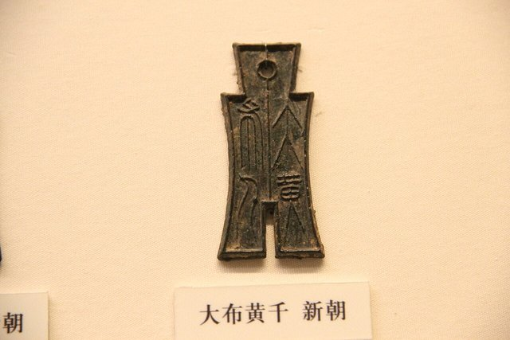
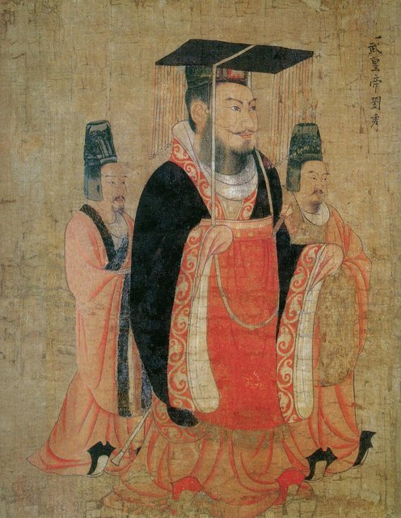
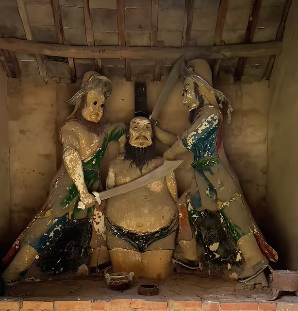

<!--
內容整理自本機筆記〈王莽興亡大事記——從西漢外戚權臣、托古改制到新朝滅亡（前45—公元23年）〉（D:\Books\md\歷史\東方歷史\王莽興亡大事記.md），以自己的話改寫；只依這份筆記，沒有另外合併其他資料。
時期依筆記的部分：早年崛起、失勢退居、重新掌權到建立新朝、改制與制度危機、民變崩潰、昆陽之戰與王莽之死。
處理方式：
- 筆記第一部分（西漢末年的外戚、土地兼併與儒家改革理想）屬於背景，併進第一則「出生」的內文，不另立事件。
- 年齡：本站以年份相減計算年齡，但跨越西元前後時沒有公元0年，公元後的年齡會多算一歲（例如前1年顯示44歲，公元1年會變成46歲）。因此公元後的事件都用 {age=} 指定，與前1年銜接；逝世時筆記作「終年約68歲」，那是舊式虛歲算法，以週歲計約為67歲，內文兩種說法都寫出來。筆記沒有給出生月日。
- 稱帝與始建國：筆記把稱帝放在公元8年、始建國放在公元9年，照寫；實際上他是在農曆初始元年十二月即位，換算成公曆已是公元9年1月，內文用括號說明。
- 筆記的許多年份是概數或沒有確切月日（「前22年前後」「公元7年前後」「公元17年前後」等），用 label 保留；昆陽之戰、更始政權、攻入長安等只寫公元23年，沒有補月份。
- 王莽早年的節儉、賑濟形象，筆記一再提醒主要出自《漢書》等後世史書，未必反映他真實的動機；內文保留這個提醒。
- 筆記第七部分的年份總表、第八部分的歷史評價與第九部分的歷史定位，是整理與評論，不單列事件；評價要點（改革失敗的五個原因、傳統與制度史的兩極評價、「理想與治理的落差」）寫進各項改革的說明與最後一則。
- 筆記中的網頁引用連結（含追蹤參數）未收錄。
- 圖片皆為 Wikimedia Commons 上的公有領域（含 CC0）作品，縮成最長邊 640px 的 JPEG。
- wangmang-jialiang.jpg：Xin Measure Jia-liang, 9-24 AD.jpg（新莽嘉量，新朝的標準量器，封面；CC0）。王莽沒有可靠的同時代畫像，封面改用新朝的代表性文物
- wangmang-coin.jpg：Chinese Money 10 - Xin (Wang Mang) Spade Coin.jpg（新朝「大布黃千」布幣；CC0）
- wangmang-guangwu.jpg：Han Guangwu Di.jpg（唐代帝王圖卷中的漢光武帝劉秀像）
- wangmang-kunyang.jpg：Wang Mang(Emperor of the Xin dynasty).png（河南葉縣劉秀廟中的王莽塑像；葉縣即昆陽所在）
-->

# Periods
- -45 ~ -7 | 出身與早年崛起 | #e8590c
  出身西漢外戚王氏家族，靠儒學修養、節儉形象與士人關係一步步上升，封新都侯、出任大司馬，進入權力核心。
- -7 ~ -1 | 失勢退居新野 | #5c940d
  漢成帝去世、哀帝即位後王氏被壓縮，王莽離開中央退居封國，但繼續經營聲望，等待機會。
- -1 ~ 9 | 重新掌權到建立新朝 | #1864ab
  漢哀帝去世後重回大司馬，扶立年幼的平帝、受封安漢公、攝政，並以符命與周公典故為自己尋找正當性，最後稱帝建立新朝。
- 9 ~ 16 | 改制與制度危機 | #c92a2a
  推行王田制、限制奴婢、改貨幣、五均六筦與官制地名大改，又與周邊政權衝突。失敗的原因交織在一起：理想制度與現實脫節、牽動既得利益、政策反覆、行政能力不足。
- 17 ~ 22 | 民變擴大與新朝崩潰 | #862e9c
  綠林軍、赤眉軍相繼起事，災害與流民讓治理陷入惡性循環，劉縯、劉秀等劉氏宗族成員加入反新力量。
- 23 ~ 23-10-06 | 昆陽之戰與王莽之死 | #0b7285
  昆陽一戰重挫新朝中央軍，更始政權成立，反新軍隊攻入長安，王莽被殺，新朝只存在約十四年。

# Events

## -45 | 出生於魏郡元城
王莽字巨君，出生於魏郡元城（約在今河北大名一帶）。他的姑母王政君是漢元帝的皇后、後來的漢成帝皇太后，王氏外戚因此在西漢末年的朝廷日漸坐大；但王莽的父親王曼在家族中並非最有權勢的一支，他早年也不能直接倚靠顯赫的爵位。當時的西漢，外戚常趁皇帝年幼或太后臨朝時掌權；土地兼併與地方豪強坐大，讓部分農民失去土地、朝廷對地方的控制力下降；儒學又成為政治思想與官僚教育的基礎，許多人相信理想的政治應回到古代聖王的制度。這些都是他日後崛起與改制的背景。史書記載他少年時生活儉樸、重視儒學、對母親與寡嫂恭敬、善於結交士人，但這份形象有多少出於真誠、多少出於政治經營，歷來有不同解讀；現存的主要敘事多半出自後來的史書，不能全盤當作他真實動機的證據。

## -22 | 進入仕途 {label=前22年前後}
王莽成年後逐漸進入官僚體系，先後擔任宮廷與軍事相關的職務。他不是靠家族背景就立刻登上高位，而是長期累積聲望、經營士人關係，並與王氏家族的重要人物保持密切往來；其中王鳳的提攜對他尤其重要。

## -16 | 封為新都侯
王莽受封新都侯，從具有外戚背景的官員，變成擁有正式爵位與政治資源的人物。他持續經營節儉、好學、禮賢下士的形象，與部分王氏子弟的奢華形成對比；在重視官員德行的政治文化裡，這種謙恭清廉的姿態替他贏得了朝臣與士人的支持。

## -8 | 首次出任大司馬
王莽出任大司馬，進入西漢的權力核心。大司馬掌握重要的軍政大權，他已有能力影響朝廷人事、軍政決策與政治方向。不過外戚政治的特徵之一，就是權力常隨皇帝更替、太后態度與其他外戚家族的興衰而改變，他的地位並不穩固。

## -7 | 漢成帝去世，王莽失勢
漢成帝去世，漢哀帝即位。皇帝一換，政治支持的網絡也跟著洗牌：哀帝的外戚傅氏、丁氏逐漸受到重用，王氏家族的影響力被壓縮，王莽離開中央，退居封國。這次失勢顯示，即使出身顯赫家族、又官居大司馬，也擺脫不了外戚政治「依附皇帝與太后而興衰」的限制。

## -7 ~ -2 | 退居新野，經營聲望 {label=前7～前2年前後 age=38}
退居地方期間，史書記載他仍保持謙恭儉樸的形象，資助士人、關心家族、維持人際關係。他並沒有完全退出政治，而是在等待重返中央的機會；即使失去官位，他仍被部分人視為有德行、可以輔政的人物。

## -1 | 漢哀帝去世，王莽重新出任大司馬
漢哀帝去世，皇位繼承與朝廷權力再度重組。王政君仍有重要的政治影響力，王莽趁機重回中央，再任大司馬，不但恢復了舊官位，也逐步成為決定皇位繼承、人事與國策的核心人物。

## -1 | 漢平帝即位，王莽掌握輔政大權
王氏家族支持立劉衎為帝，也就是漢平帝。平帝年幼，王莽因此取得主持朝政的機會，透過任命官員、提拔儒生、推動禮制活動來擴大政治基礎，同時繼續塑造忠於漢室、重視儒學的形象；這一方面替他爭取士人的支持，一方面也降低了其他官員對他權力擴張的警覺。

## 1 | 受封安漢公 {label=公元1年 age=45}
王莽因輔政有功受封安漢公，「安漢」意為安定漢室，把他塑造成維護漢朝秩序的重要人物。他採取了幾項措施：增設博士與學術職位，擴大儒學教育與人才選拔，吸引儒生進入政治體系；強調自己不追求奢華；提拔支持者，讓自己在朝廷有更穩固的基礎；並以維護漢室、安定天下的名義，逐步取得更多實權。他的地位從此不再只靠外戚身分，而是結合了家族權勢、儒學聲望與輔政功績。

## 2 | 賑濟與政治聲望擴大 {label=公元2年 age=46}
王莽持續運用儒家強調的仁政、節儉與照顧百姓等理念，塑造有德政治人物的形象；史書記載他曾拿自己的財物救濟貧民，遇到災害或社會困難時也表現出關懷百姓的姿態。這些作為提升了他的聲望，但要留意：王莽後來的形象深受《漢書》等史籍影響，史書對他早年德行與後期失政的敘述形成強烈對比，未必能完全反映他每個階段的真實動機。

## 4 | 女兒成為漢平帝皇后 {label=公元4年 age=48}
王莽把女兒嫁給漢平帝，由輔政大臣進一步成為皇帝的岳父，家族與皇室的關係更加緊密。權力也因此愈發集中在他個人與家族手中，和漢朝原有的皇權結構產生更深的矛盾。

## 5 | 漢平帝去世，王莽控制皇位繼承 {label=公元5年 age=49}
平帝去世，沒有留下足以穩固皇位的成年繼承人，王莽得以介入繼承的安排，朝廷選立年幼的劉嬰為皇太子，史稱孺子嬰。他開始以周公輔佐幼主的典故，為自己的攝政地位尋找正當性。公元5年是王莽由輔政大臣走向實際掌握皇位繼承權的重要節點。

## 6 | 王莽攝政 {label=公元6年 age=50}
孺子嬰年幼無法親政，王莽以攝政身分成為朝廷的實際統治者。他把自己比作周公，宣稱是為了輔佐幼主、安定天下，而不是奪取皇位；這套說法在當時很有分量，因為儒家雖強調臣子要忠於君主，也承認特殊情況下可以由德高望重的臣子輔佐幼主。王莽就是利用這套論述，一步步把攝政的權力轉成接近皇帝的地位。

## 7 | 翟義等人起兵反抗 {label=公元7年前後 age=51}
王莽的權力擴張並非沒有反對者。公元7年前後，部分地方官員與政治勢力開始反抗，翟義等人起兵想推翻他，王莽派兵鎮壓並擊敗了他們。這些事件顯示他並未獲得所有官僚與地方勢力的支持，政權在正式建立之前，就已面臨反抗與正當性的危機。

## 8 | 以符命稱帝，建立新朝 {label=公元8年 age=52}
王莽進一步利用祥瑞、符命與儒家政治論述，宣稱自己受命於天、有資格取代漢室。在古代政治文化裡，統治者除了軍事力量，還必須說明自己憑什麼統治天下；王莽把古代禪讓的故事、符命與儒家經典結合，試圖把權力轉移包裝成符合天命與古制的行動。同年他正式稱帝，建立新朝，國號為「新」。（依農曆年號，他是在初始元年十二月即位，換算成公曆已是公元9年1月。）

## 9 | 始建國：西漢滅亡 {label=公元9年 age=53}
王莽開始以新朝皇帝的身分統治天下，年號「始建國」，西漢至此正式滅亡。他要的不只是換個皇帝、改個國號，而是全面改造國家制度：希望恢復古代的周制，重新安排土地所有權、奴婢制度、貨幣流通、商業管理、官僚職位與社會秩序。但這些改革牽動既有的土地與財富分配，也影響豪強、商人、農民與官僚等不同群體的利益，新朝的難題就在於怎麼把理想的制度與現實的社會接起來。

## 9 | 王田制：改革土地制度 {label=公元9年 age=53}
王莽把天下土地改稱「王田」，並限制土地買賣，想抑制兼併；這個構想和古代井田制的觀念有關，希望由國家調整土地分配，減少少數人握有大量土地、農民失去生計的情況。但推行起來問題重重：西漢末年的土地所有權早已形成長期累積的社會關係，土地不只是生產工具，也是家族財產、政治地位與地方權力的基礎；國家若要重新分配，還得準確掌握土地面積與品質、人口與家戶需求，並有足夠的行政能力；限制買賣也可能妨礙民間應付債務、遷徙或經營變化。結果王田制遭到豪強與地主抵制、執行困難，政府始終沒能建立穩定有效的分配機制，反而增加了地方官的負擔、引發新的利益衝突。它的失敗不宜簡單歸咎於改革理念，應從政策設計、行政能力、既得利益與社會條件綜合來看。

## 9 | 限制奴婢買賣 {label=公元9年前後 age=53}
王莽也試圖限制奴婢買賣，把奴婢稱為「私屬」，禁止相關交易，反映他想重新調整社會關係、限制人被當成財產買賣。可是奴婢制度與當時的家內勞動、農業生產、債務關係與貴族生活緊密相連，若要改變，就得考慮原有奴婢的生活安排、家庭經濟與雇用關係怎麼調整；政策推出後沒有周全的配套，反而引起擁有奴婢者的不滿。

## 9 ~ 10 | 貨幣制度改革 {label=公元9～10年 age=53}

王莽多次改革貨幣，想重新確立國家對貨幣的控制：強化中央對鑄幣與流通的管理、調整不同貨幣之間的價值關係、增加國家財政收入，也藉此建立與西漢不同的政治象徵。問題是幣種與面額繁雜、變動頻繁，部分新貨幣的官方價值與實際金屬價值落差很大；政府規定了法定價值，卻無法讓民眾信任它的購買力，交易便容易出現困難，頻繁變動也提高了人們計算價格、儲存財富與經商的成本。這說明貨幣制度不能只靠行政命令改變，還需要民眾的信任、穩定的價值標準與可行的市場機制。

## 9 ~ 13 | 官制、地名與行政區劃頻繁變動 {label=公元9～13年 age=53}
王莽推崇周制，大幅調整官職名稱、行政區劃與部分制度，象徵意義很明顯：想透過恢復古制，建立一個帶有聖王政治色彩的新王朝。可是名稱與區劃的頻繁更動，增加了地方政府執行政令的困難，官員得適應新的稱呼與制度，百姓也得重新理解管轄、文書與相關規定；改革的速度太快時，行政成本上升，甚至妨礙正常的治理。

## 10 | 推行五均六筦 {label=公元10年前後 age=54}
王莽推動一系列和商業管理、物價調節、借貸與重要資源管制有關的政策，其中五均與六筦是新朝經濟改革的重要部分，目的是加強國家對市場與部分重要經濟活動的介入：限制商人囤積、抑制物價波動，避免經濟資源被少數人壟斷。但這類政策需要可靠的價格資訊、足夠的行政人員、財政能力與監督制度；官員一旦執行不當，國家介入市場也可能帶來尋租、腐敗或資源配置失衡。問題不只是「國家該不該管制市場」，而是政府有沒有足夠的制度能力，把理想中的管制變成有效的治理。

## 10 ~ 16 | 對外政策引發邊境衝突 {label=公元10～16年 age=54}
王莽也重新安排周邊政權與部族的政治地位，想以新朝的秩序重新界定對外關係。他調整匈奴等勢力的名號與地位，並要求對方接受新的政治安排，結果損害了既有的關係、外交衝突增加；戰事增多又帶來軍費、徵兵與物資需求，加重新朝的財政與社會負擔。新朝的危機因此不只來自內政改革，也來自內外政策彼此疊加的壓力。

## 17 | 綠林軍起事 {label=公元17年前後 age=61}
新朝各地的社會矛盾逐漸轉成大規模民變。土地與貨幣改革沒能改善民眾生活，加上行政混亂、徭役負擔與災害，部分地區出現反抗官府的武裝力量，綠林軍就是在這樣的背景下形成的。他們最初在荊州一帶活動，後來勢力愈來愈大，成為推翻新朝的重要力量。

## 18 | 赤眉軍興起 {label=公元18年前後 age=62}
赤眉軍主要在今山東一帶發展，由樊崇等人組織成大規模的武裝。赤眉與綠林雖然都反抗新朝，但形成背景、活動地區與領導結構並不完全相同；赤眉的崛起顯示，新朝面對的已不是局部的叛亂，而是多個地區同時出現的武裝反抗。

## 18 ~ 22 | 災害、流民與地方叛亂加劇 {label=公元18～22年 age=62}
新朝後期，自然災害與社會動盪互相加成：黃河水患等災害損害農業生產，流民增加；政府無法及時救濟，又得徵集資源鎮壓各地反抗，更難恢復秩序，軍隊還得在不同戰線之間奔走，軍費與負擔再度上升。這形成了惡性循環：改革與治理失誤加重不滿，天災與糧食問題讓更多人失去生計，地方武裝起事、政府調兵鎮壓，軍費與徵發又加重民眾負擔，中央控制地方的能力也一路下滑，新朝因此逐漸失去恢復穩定的機會。

## 22 | 劉縯、劉秀參與反新勢力 {label=公元22年 age=66}

反新力量中，劉氏宗族的成員逐漸崛起。劉縯與弟弟劉秀參與反新的軍事行動，並與綠林軍等力量聯繫；劉秀後來成為東漢的建立者，但這時他只是眾多反新軍事領袖之一。隨著新朝中央失去控制力，反新力量從地方武裝發展成足以爭奪重要城市與政治中心的軍事集團；新朝雖然仍握有相當的國家資源，面對多個方向的叛亂卻已難以集中兵力，派出的軍隊也無法迅速消滅主要的反抗勢力。

## 23 | 昆陽之戰 {label=公元23年 age=67}

新朝派出大軍，由王邑等人統率，企圖一舉消滅以綠林軍為核心的反抗力量，兵力遠多於昆陽一帶的反抗軍。劉秀參與防守與反擊：新朝大軍包圍昆陽時，他設法突圍求援，再率部隊回到戰場，與城內守軍夾擊新朝軍隊；反抗軍利用對方部署與指揮上的問題，擊敗了規模更大的敵軍，王邑等人敗退。這場戰役讓新朝的軍事威望崩潰、反新勢力士氣大振、綠林軍與劉氏宗族的地位顯著提高，也提升了劉秀的聲望。昆陽之戰常被視為以少勝多的著名戰例，但不能只用「兵少勝兵多」來解釋，新朝軍隊的指揮、作戰環境與戰場應變，以及反抗軍的協同與士氣，都影響了結果。

## 23 | 更始政權建立 {label=公元23年 age=67}
昆陽之戰前後，綠林軍與其他反新力量推立劉玄為帝，建立更始政權，以恢復漢室為號召，想取代新朝的統治。這代表反新勢力開始從地方武裝，轉向重建漢朝政治秩序的嘗試。

## 23 | 綠林軍攻入長安 {label=公元23年 age=67}
昆陽之戰後，新朝已無法組織有效的全國性防禦。反新軍隊向長安推進並攻入都城，新朝中央政權迅速瓦解，宮廷秩序崩潰，王莽也失去原本依賴的軍事與行政保護。

## 23-10-06 | 王莽被殺，新朝滅亡 {label=公元23年10月6日 age=67}
長安陷落後，王莽被殺，史載終年約68歲（舊式虛歲算法，以週歲計約為67歲）；建立不過約十四年的新朝也隨之瓦解。此後劉玄的更始政權一度控制部分地區，但漢室重建仍有新的政治與軍事競爭，劉秀後來逐步擴張勢力，最終建立東漢，所以王莽之死並不代表天下立刻恢復統一，而是開啟另一輪權力競爭。對他的評價長期兩極：傳統史學多視他為篡奪漢室的權臣，強調野心與政策失敗；但從制度史與社會史來看，他也確實想回應土地兼併、社會不平等與國家經濟控制等問題。他的改革失敗，原因包括理想制度與現實社會脫節、牽動既得利益、政策反覆增加行政成本、行政能力不足，以及天災與民變互相加劇。王莽興亡最值得注意的，是政治理想與實際治理之間的落差：他想以復古改制建立理想秩序，卻沒能充分處理現實社會的複雜條件，反而加速了新朝的崩潰。
