<!--
內容整理自本機筆記《武器與戰法》（D:\Books\md\歷史\世界史\武器與戰法，網頁版在知識圖譜的「1-6-3.武器與戰法」）。
- 99個年份檔各成一則事件，說明採用該檔的「案件摘要」（2個檔案沒有案件摘要，改用「案發現場」），結尾以「→ 對外連結」連到知識圖譜上的完整案件卷宗（在新分頁開啟）；摘要中提到同卷其他案件的連結改為連到知識圖譜。
- 摘要中以 LaTeX 寫的式子與因果鏈，時間軸無法顯示數學式，改寫為純文字，例如「王朝戰爭缺兵少餉 —民族＋攤派＋指券→ 人力資本總動員 → 總體戰」、「E = mc²」。
- 時期依 README「案件卷宗」的前十四段；第十三段（1945–2010）與第十四段（2001至今）在年代上重疊，以2001年為界首尾相接，第十一、十二段之間以1919年為界。第十五段「制度因素補篇」是橫跨1648–1948年的主題線，未做成色帶。
- README 年表中沒有獨立年份檔的條目（如石器時代的投矛器、弓箭）未收錄。README 第一段「石器時代」沒有任何事件，因此不列時期，時間軸從前3000年「戰爭的誕生」開始，第一個時期「青銅與城牆時代」也從前3000年起算（README 作前3500年）。
- 1066黑斯廷斯、1346克雷西、1453君士坦丁堡、1588無敵艦隊、1884馬克沁機槍、1941珍珠港等案件也出現在其他時間軸，各自保留。
圖片來源（皆為 Wikimedia Commons 公有領域作品；多為後世繪畫或摹本，年份見括號；註明「共用」者沿用其他時間軸已有的圖片）：
- war-cover.jpg：San Romano Battle (Paolo Uccello, London) 01.jpg（烏切洛〈聖羅馬諾之戰〉，約1438–1440）
- pop-ur.jpg（烏爾王軍旗上的戰車，約前2600年（與世界人口共用））
- war-kadesh.jpg：Ramses III (Ramesses II) lanciato col suo carro, e seguito da tre figli ugualmente sul carro, assale una fortezza piantata sopra una rupe, saettandone gli atterriti difensori (NYPL b14291206-425635).jpg（拉美西斯二世乘戰車攻城的神廟浮雕（1832年羅塞利尼摹繪，裁出圖版部分））
- war-chigi.jpg：Chigi vase detail.jpg（基吉陶瓶上的重裝步兵方陣，約前650年）
- gre-marathon.jpg（梅爾松〈馬拉松的士兵〉（與希臘史共用））
- war-greekfire.jpg：Greekfire-madridskylitzes1.jpg（《馬德里斯基里茨手抄本》中的希臘火，12世紀）
- wd-bayeux.jpg（貝葉掛毯上的諾曼騎兵（與世界發展史共用））
- war-genghis.jpg：YuanEmperorAlbumGenghisPortrait.jpg（元代畫像中的成吉思汗，14世紀）
- wd-crecy.jpg（傅華薩《編年史》中的克雷西戰役（與世界發展史共用））
- war-agincourt.jpg：Battle of Agincourt, St. Alban's Chronicle by Thomas Walsingham.jpg（《聖奧爾本斯編年史》中的阿金庫爾戰役，約1422）
- aod-constantinople.jpg（勒塔維尼耶繪〈君士坦丁堡之圍〉（與大航海時代共用））
- war-pavia.jpg：Battle of Pavia.jpg（帕維亞會戰掛毯，1528–1531）
- hob-armada.jpg（〈伊莉莎白一世的無敵艦隊肖像〉（與霍布斯共用））
- war-breitenfeld.jpg：Gustave Adolphe at Breitenfeld-Johann Walter-f3706497.jpg（〈古斯塔夫·阿道夫在布萊登菲爾德〉，17世紀）
- war-blenheim.jpg：Copy after Jan van Huchtenburgh (Haarlem 1647-Amsterdam 1733) - The Battle of Blenheim (or Höchstädt), 1704. - RCIN 404899 - Royal Collection.jpg（〈布倫海姆會戰〉（仿胡赫滕堡，18世紀））
- war-austerlitz.jpg：François Pascal Simon Gérard - La bataille d'Austerlitz. 2 decembre 1805.jpg（傑哈〈奧斯特里茨會戰〉，19世紀）
- war-trafalgar.jpg：The Battle of Trafalgar, 21 October 1805 RMG L8148-001.jpg（透納〈特拉法加海戰〉，1822（裁去畫框））
- war-waterloo.jpg：Battle of Waterloo 1815.PNG（滑鐵盧會戰）
- war-monitor.jpg：Battle between the Monitor and Merrimac-fought March 9th 1862 at Hampton Roads, near Norfolk, Va. LCCN91482238.jpg（〈監視者號與梅里馬克號之戰〉，1889年石版畫）
- ind-wright.jpg（1903年萊特兄弟首飛（與工業革命史共用））
- war-dreadnought.jpg：HMS Dreadnought (1906).jpg（英國皇家海軍無畏號，約1906–1907）
- cam-marne.jpg（馬恩河戰役中被炸毀的莫城橋（與卡繆共用））
- ind-tank.jpg（1916年9月索姆河戰役的Mark I戰車（與工業革命史共用））
- wd-arizona.jpg（1941年12月7日燃燒的亞利桑那號（與世界發展史共用））
- war-midway.jpg：Flight deck of USS Yorktown (CV-5) after damage at Midway 1942.jpg（中途島海戰中受創的約克鎮號飛行甲板，1942）
- war-hiroshima.jpg：Atomic cloud over Hiroshima - NARA 542192 - Edit.jpg（1945年8月6日廣島上空的蕈狀雲）
- war-sputnik.jpg：Sputnik 1 satellite replica.png（史普尼克1號人造衛星的複製品）
- war-iadrang.jpg：Ia Drang Infantry disembarking from Helicopter.jpg（1965年11月德浪河谷戰役中由直升機機降的美軍步兵）
- war-predator.jpg：MQ-1 Lethal Presence.jpg（MQ-1掠奪者無人機（美國空軍照片））
-->

# Periods
- -3000 ~ -1650 | 青銅與城牆時代：戰爭的誕生 | #b08900
  城邦林立，青銅劍矛、皮盾與城牆出現，戰爭走向有組織的陣列戰與攻城戰；青銅昂貴，使精兵集中在貴族手上，農業剩餘養出了職業軍人。
- -1650 ~ -1200 | 戰車時代：古代的裝甲突擊 | #e67700
  輻條輕戰車搭配複合弓，成為古代的「裝甲機動部隊」，戰車貴族武士當權，從喜克索斯到卡迭石會戰都是戰車的天下。
- -1200 ~ -500 | 鐵器與方陣時代：武器平民化 | #5c940d
  青銅時代崩潰後鐵器普及，武器變得便宜，全民皆兵成為可能；希臘重裝步兵方陣以集體紀律取代個人勇武，波斯建立起帝國軍制，《孫子兵法》問世。
- -500 ~ -200 | 古典方陣與殲滅戰 | #2b8a3e
  馬拉松會戰、馬其頓長矛方陣與諸兵種合成，到漢尼拔在坎尼的兩翼包圍，殲滅戰成為戰法的極致。
- -200 ~ 450 | 軍團與騎射的較量 | #c92a2a
  羅馬軍團以紀律與工程擊敗馬其頓方陣，卻在卡萊敗給帕提亞騎射；馬鐙與重騎兵興起，阿德里安堡與沙隆會戰顯示步兵逐漸喪失戰場主動權。
- 450 ~ 1450 | 騎士與弓城堡時代 | #862e9c
  封建騎士以衝擊稱雄，城堡讓戰爭變成攻城消耗；拜占庭的希臘火、維京長船、蒙古軍事體系各擅勝場，克雷西與阿金庫爾的長弓證明「紀律＋遠程」可以擊敗「血統＋衝擊」，火藥也在這時誕生。
- 1450 ~ 1650 | 火藥革命時代 | #1971c2
  火炮轟開君士坦丁堡的城牆，棱堡讓攻城變成工程競賽；火繩槍終結騎士，莫里斯的反向行進射擊把射擊速率變成核心戰術變數。
- 1650 ~ 1815 | 線列戰術時代 | #364fc7
  燧發槍與刺刀讓長矛退場，操練決定射速；從布倫海姆、洛伊滕到拿破崙的奧斯特里茨與耶拿，集中兵力於決勝點，全民徵兵讓戰爭變成國家總動員，最後在滑鐵盧落幕。
- 1815 ~ 1884 | 工業戰爭時代 | #495057
  雷汞火帽、針發槍、米尼彈與連珠槍提高了步兵火力，鐵甲艦與魚雷改寫海戰；鐵路與電報讓動員成為時刻表，普魯士總參謀部把工業產能變成戰爭能力。
- 1884 ~ 1919 | 機槍與塹壕時代 | #343a40
  馬克沁機槍、無煙火藥與速射炮讓防禦火力壓倒進攻機動；一戰陷入塹壕消耗戰，毒氣、迫擊炮、手榴彈、坦克與滲透戰術相繼登場，戰爭變成數學題。
- 1919 ~ 1945 | 裝甲、空權與航母時代 | #e8590c
  制空權理論、裝甲師與閃擊戰、雷達與不列顛空戰、航母與中途島、潛艇狼群與戰略轟炸，速度與情報取代正面強攻，體系對抗體系，最終以原子彈收場。
- 1945 ~ 2001 | 核子、精確制導與資訊時代 | #0c8599
  核武的毀滅力讓大國戰爭被「嚇阻」，AK-47 與 RPG 讓小國也能打游擊；洲際飛彈、直升機空騎、精確制導、隱形戰機、電子戰與 GPS 讓「偵測即打擊」，海灣戰爭展示了資訊化戰爭。
- 2001 ~ 2026 | 反恐、網路與無人機時代 | #6741d9
  武裝無人機、網路戰（震網）、混合戰與高超音速武器出現，納卡與俄烏戰爭中，便宜的 FPV 無人機與演算法開始打敗昂貴的平台，戰場變得透明。

# Events

## -3000 | 戰爭的誕生
西元前四千紀末至前三千紀，兩河與尼羅河谷發生了一樁改變人類命运的「案件」：農業剩餘催生了城市，城市催生了城牆，城牆催生了軍隊，而青銅冶煉則把武器從「石頭＋棍棒」升級為金屬兵器。西元前 2300 年左右，阿卡德的薩爾貢（Sargon of Akkad）供養了史上第一支有明確記載的常備職業軍隊——約 5,400 人「每日吃他麵包的兵」。這樁案件的兇手不是某一場戰爭，而是「剩餘糧食＋金屬冶煉＋城牆工程」的三重奏：它讓戰爭從部落械鬥，升級為有編制、有後勤、有戰法的組織化行動。

[→ 對外連結：戰爭的誕生：青銅、城牆與最早的職業軍隊](https://chad-liu.github.io/books/html/1-6-3.武器與戰法/-3000-戰爭的誕生.html)

## -2500 | 戰車革命

西元前 2500 年左右，蘇美人的「戰車」還是實心輪、被馴驢拖曳的移動平台；到了前 2000 年前後，烏拉爾-裏海草原的辛塔什塔文化造出輻條輪輕戰車；前 1650 年起，輕戰車＋複合弓席捲了近東與埃及。這樁案件的兇手是「輻條輪」：它把戰車重量砍掉數倍，讓戰車從移動砲台變成高速突擊兵器——人類第一次用「速度」本身作為武器，也第一次出現了以裝備定義的貴族武士階級。

[→ 對外連結：戰車革命：人類第一次把速度變成武器](https://chad-liu.github.io/books/html/1-6-3.武器與戰法/-2500-戰車革命.html)

## -1650 | 喜克索斯與戰車帝國
西元前 1650 年前後，被埃及人稱為「喜克索斯」（外邦統治者）的西閃語族群，以輻條輕戰車＋複合弓的機動戰法攻入尼羅河三角洲，建立第十五王朝，統治埃及北部約百年。但案件的高潮在後面：底比斯的埃及人**反向學會了敵人的戰法**——建立自己的戰車軍、奪回三角洲（阿赫摩斯一世，約前 1550），並把戰車軍隊推向帝國擴張。這樁案件證明了軍事史上最穩定的規律之一：**武器的優勢是暫時的，掌握戰法的優勢是持久的，而「抄襲」永遠是最快的武器。**

[→ 對外連結：喜克索斯與戰車帝國：技術擴散的第一次「反向工程」](https://chad-liu.github.io/books/html/1-6-3.武器與戰法/-1650-喜克索斯與戰車帝國.html)

## -1275 | 卡迭石會戰
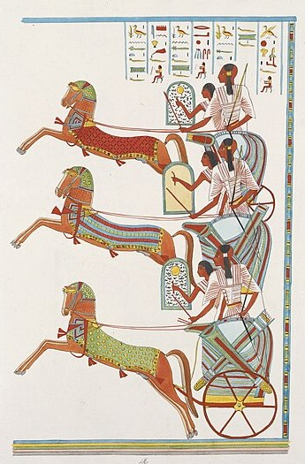
西元前 1274 年，埃及法老拉美西斯二世（約 25 歲）親率四個師約兩萬人北征，在奧龍特斯河畔的卡迭石城下，遭遇赫梯王穆瓦塔里二世約三萬五千人、三千餘輛戰車的合圍。埃及「拉」師被戰車洪流衝垮、王營被突破，拉美西斯二世以「阿蒙」師殘部逆勢反擊，撐到「普塔」師趕到，戰至日落成戰術平手。這樁案件的特殊性在於：它是**史上第一場有詳細當事人戰報、且戰後簽署了現存最早和平條約（前 1259）的會戰**——我們第一次能對照「宣傳」與「現實」兩份檔案，還原古代戰術的真相。

[→ 對外連結：卡迭石會戰：史上第一場「有戰報」的大會戰](https://chad-liu.github.io/books/html/1-6-3.武器與戰法/-1275-卡迭石會戰.html)

## -1200 | 鐵器革命
西元前 1200 年前後的數十年間，從希臘到美索不達米亞，青銅時代的世界體系崩潰：邁錫尼宮殿化為灰燼、赫梯帝國消失、埃及勉強自保，書寫、貿易與戰車帝國一併傾覆。但案件的真相不是單純的毀滅——同一時期，一項材料學革命正在民間發酵：**鐵器**。鐵礦遍地皆有，不必依賴稀缺的錫貿易網；一旦冶煉工藝（淬火、滲碳）成熟，鐵武器以更低成本提供同等甚至更好的性能。這樁案件的兇手是「成本崩塌」：武器價格大跌 → 全民武裝 → 軍隊規模爆炸 → 貴族戰車武士被公民步兵與職業軍團取代。五萬年的軍備競賽，從此進入「比紀律」的時代。

[→ 對外連結：鐵器革命：武器平民化與大軍隊的誕生](https://chad-liu.github.io/books/html/1-6-3.武器與戰法/-1200-鐵器革命.html)

## -650 | 希臘重裝步兵方陣
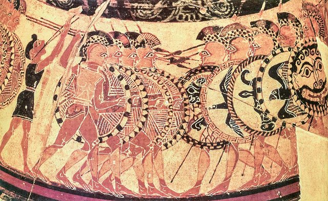
西元前七世紀，希臘城邦出現了一種前所未有的戰士：重裝步兵（hoplite）。他自備圓盾（aspis）、長矛、青銅頭盔與胸甲，以八列縱深的密集方陣並肩作戰——不是個人決鬥，而是「一面移動的盾牆」。這樁案件的兇手不是某個將軍，而是一種**幾何與社會契約**：盾牌的握法（前臂套環＋邊緣握把）使每面盾不只護自己、還護住左邊的戰友；陣列因此成為一個「共同承諾裝置」。方陣戰法把戰爭從貴族單挑變成公民集體行動，並反過來塑造了城邦政治——**武器形態決定社會形態**的經典案例。

[→ 對外連結：希臘重裝步兵方陣：集體紀律取代個人勇武](https://chad-liu.github.io/books/html/1-6-3.武器與戰法/-0650-希臘重裝步兵方陣.html)

## -550 | 波斯帝國軍制
西元前六世紀中葉，居魯士大帝與其繼承者建立了人類史上第一個橫跨三大洲的帝國。波斯的軍事體系有三大發明：**行省總督＋駐軍**的帝國防務、**多兵種多民族合成大軍**（不死軍、騎兵、弓手、攻城兵、水師）、以及以**王家大道與驛站**支撐的戰略機動。這樁案件的兇手是「官僚化軍事」：波斯證明了一支由數十個民族組成、靠行政體系而非血緣忠誠凝聚的大軍，可以投射到三千公里外——帝國戰法的原型從此誕生。

[→ 對外連結：波斯帝國軍制：多民族大軍與帝國戰法](https://chad-liu.github.io/books/html/1-6-3.武器與戰法/-0550-波斯帝國軍制.html)

## -512 | 孫子兵法
春秋末年（約前六世紀末至前五世紀初），孫武以十三篇兵書為吳國練兵，大敗楚軍。但案件的真正兇手不是那場勝利，而是那本書：《孫子兵法》——**史上第一部把戰爭當作系統問題來分析的理論著作**。它不談武器規格，談的是結構：什麼情況下必勝（先算再戰）、什麼是最高戰法（不戰而屈人之兵）、如何用情報（用間篇）、如何管理速度（兵貴神速）。比克勞塞維茨早 2,300 年，孫子已經建立了戰爭的「運籌學」框架。

[→ 對外連結：孫子兵法：最早的系統戰略理論](https://chad-liu.github.io/books/html/1-6-3.武器與戰法/-0512-孫子兵法.html)

## -490 | 馬拉松會戰
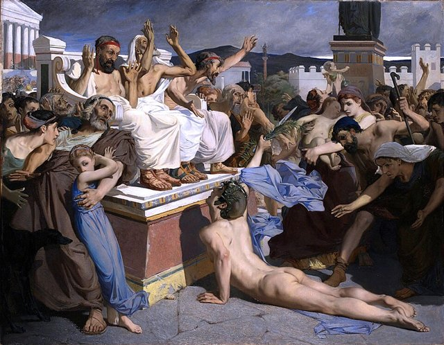
西元前 490 年 9 月，波斯大軍在達提斯率領下登陸阿提卡馬拉松平原。雅典傾全城之力約一萬人，加上普拉提亞一千人，面對現代估計約兩萬餘人的波斯軍。統帥米太亞德做出了一個違反直覺的部署：**加強兩翼、中央減薄**。會戰當日，希臘兩翼碾碎波斯軍翼側，中央勉強頂住後合圍——波斯軍潰敗，陣亡約六千四百人，希臘陣亡一百九十二人。這樁案件確立了西方戰爭史的經典劇本：**以正確的兵力配置，在決勝翼側製造局部優勢**——雙翼包圍（double envelopment）的祖先。

[→ 對外連結：馬拉松會戰：雙翼包圍的經典劇本](https://chad-liu.github.io/books/html/1-6-3.武器與戰法/-0490-馬拉松會戰.html)

## -338 | 喀羅尼亞與馬其頓體系
西元前 338 年 8 月，腓力二世率馬其頓軍在希臘中部喀羅尼亞，與雅典-底比斯聯軍決戰。腓力做出雙重部署：自己指揮的右翼「主動後退」引誘雅典軍前進，而 18 歲的亞歷山大率夥伴騎兵楔形突擊，鑿穿聯軍防線，殲滅底比斯「聖隊」。聯軍崩潰，希臘城邦的獨立時代落幕。這樁案件確立了「馬其頓體系」：**長矛方陣（sarissa）為鐵砧釘住敵軍，重騎兵為鐵鎚在決勝翼側一錘定音**——諸兵種合成作戰（combined arms）的誕生，人類此後的每一種「鐵砧＋鎚擊」戰法（步兵＋炮兵、步兵＋坦克、無人機＋火箭炮）都是它的後裔。

[→ 對外連結：喀羅尼亞與馬其頓體系：鐵砧與鐵鎚的誕生](https://chad-liu.github.io/books/html/1-6-3.武器與戰法/-0338-喀羅尼亞與馬其頓體系.html)

## -216 | 坎尼會戰
西元前 216 年 8 月 2 日，漢尼拔以約五萬人（高盧/西班牙步兵約 3.2 萬＋非洲重步兵約 1 萬＋騎兵約 1 萬）在坎尼平原迎戰約八萬羅馬大軍。他做出軍事史上最大膽的部署：**中央凸弧迎敵、兩翼非洲重兵藏於後方、騎兵壓制兩翼**。會戰當日，中央高盧/西班牙步兵且戰且退、把八萬羅馬軍擠成密集人團，兩翼非洲重兵從兩側合攏，騎兵封閉後方——羅馬軍被完全包圍，陣亡約五至七萬人。這是殲滅戰（annihilation）的極致：**以劣勢兵力完成雙翼包圍，將優勢之敵整體殲滅**。兩千兩百年後，德國參謀總長施里芬仍然說「整個軍事史就是坎尼的研究」。

[→ 對外連結：坎尼會戰：殲滅戰的教科書](https://chad-liu.github.io/books/html/1-6-3.武器與戰法/-0216-坎尼會戰.html)

## -168 | 彼得納會戰與羅馬軍團
西元前 168 年，希臘本土的彼得納（Pydna）平原，馬其頓末代國王珀爾修斯以五臂長的 sarissa 長矛方陣（約四萬人）對陣羅馬執政官埃米利烏斯·保盧斯的兩個軍團（約三萬八千人）。開戰之初，羅馬步兵的標槍與短劍「像砍稻草般彈開」，長矛牆勢不可擋；但地面的起伏與追擊中的隊形撕裂，讓方陣出現縫隙——羅馬人丟下標槍，拔出短劍，鑽進矛林肉搏。一小時後，世界最強的長矛體系崩潰，馬其頓王國亡國。這樁案件宣判：**前二世的戰場已屬於「彈性 + 個體近戰」的軍團，不再屬於「剛性 + 集體推力」的方陣**。亞歷山大的遺產（見 [喀羅尼亞與馬其頓體系](https://chad-liu.github.io/books/html/1-6-3.武器與戰法/-0338-喀羅尼亞與馬其頓體系.html)）就此移交羅馬。

[→ 對外連結：彼得納會戰與羅馬軍團：長矛牆的敗訴](https://chad-liu.github.io/books/html/1-6-3.武器與戰法/-0168-彼得納會戰與羅馬軍團.html)

## -53 | 卡萊之戰
西元前 53 年，羅馬首富、三巨頭之一的克拉蘇率七個軍團約四萬人入侵帕提亞，在卡萊（Carrhae，今土耳其哈蘭）遭遇帕提亞貴族蘇萊納率領的區區一萬騎——一千重裝騎兵＋九千弓騎。半日之內，羅馬軍團被「移動的箭雨」壓制到無法展開；克拉蘇之子率騎兵出擊即被誘殲；夜間突圍後，克拉蘇在談判中被殺，羅馬軍近兩萬人陣亡、上萬人被俘。這樁案件確立了冷兵器時代最不對稱的戰法對比：**重步兵的勝負取決於貼身近戰，騎射兵種的勝負取決於「永遠不貼身」**——火與機動的體系對抗，兩千年後仍然是戰爭的基本形態。

[→ 對外連結：卡萊之戰：騎射手對重步兵的完勝](https://chad-liu.github.io/books/html/1-6-3.武器與戰法/-0053-卡萊之戰.html)

## 322 | 馬鐙與重騎兵革命
西元 322 年前後（中國東晉時期，墓葬陶俑為最早證據），馬鐙在中國問世；第四至五世紀經草原擴散，約 580 年由阿瓦爾人帶入歐洲。這個小小的金屬環帶來了一樁動力學案件：**騎士終於可以「把馬的全部動量，交到一支夾持的長矛上」**——夾槍衝擊（couched lance）成為可能，重騎兵從輕騷擾兵種變成戰場決勝兵種，並以「昂貴」定義了封建騎士階級。馬鐙是武器史上最便宜也最昂貴的發明：一對鐵環，換來一個階級與一套政治制度。

[→ 對外連結：馬鐙與重騎兵革命：把馬的動量交給騎士的長矛](https://chad-liu.github.io/books/html/1-6-3.武器與戰法/0322-馬鐙與重騎兵革命.html)

## 378 | 阿德里安堡會戰
西元 378 年 8 月 9 日，東羅馬皇帝瓦倫斯在未等到西帝格薩提恩援軍的情況下，率約一萬五千至兩萬人的野戰軍，在酷暑中直接進攻以車陣防禦的哥特人。會戰最關鍵的一幕：羅馬左翼騎兵未等命令擅自衝擊、被擊退，而哥特騎兵（格魯森尼人）恰在此時結束覓食返回，從羅馬右翼撞入——羅馬軍被包圍，三分之二兵力陣亡，皇帝瓦倫斯葬身火場。這樁案件常被稱為「騎兵取代步兵的宣言」，但偵探的推理更微妙：**勝負的關鍵不是騎兵的武器優勢，而是羅馬軍制的結構性衰退**——同時代的騎兵也有被步兵擊潰的戰例。阿德里安堡是「帝國軍制依賴蠻族雇傭兵」這條死亡螺旋的起點。

[→ 對外連結：阿德里安堡會戰：騎兵時代的開幕](https://chad-liu.github.io/books/html/1-6-3.武器與戰法/0378-阿德里安堡會戰.html)

## 451 | 沙隆會戰與匈人騎射
西元 451 年 6 月，高盧沙隆平原，羅馬將領埃提烏斯率羅馬—西哥特聯軍擋下匈人阿提拉的西進。這不是一場乾淨的勝仗——雙方傷亡慘重、阿提拉全身而退——卻是軍事史的斷層線：**古典軍團步兵體系在此後徹底讓位給騎兵時代**。本案的兇手是「機動」：匈人複合弓騎把戰場主動權從重步兵手中奪走，羅馬只能靠「以蠻制蠻」續命。此案補上卡萊（前53）到阿德里安堡（378）再到馬鐙（322）之間缺失的一環：**騎射何以從邊疆騷擾變成帝國級威脅**。

[→ 對外連結：沙隆會戰：騎射遊牧對羅馬步兵的最後審判](https://chad-liu.github.io/books/html/1-6-3.武器與戰法/0451-沙隆會戰與匈人騎射.html)

## 678 | 希臘火與拜占庭軍事體系
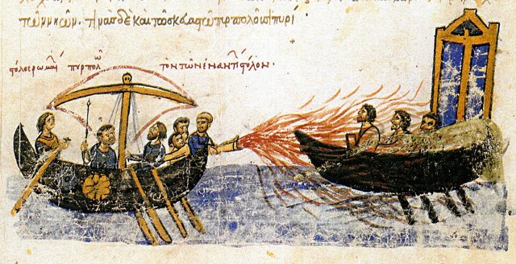
674–678 年，阿拉伯艦隊連年圍攻君士坦丁堡；拜占庭以一種「海面會燃燒、澆水不滅、貼著水面追著敵艦跑」的神祕液體武器——希臘火——焚燒阿拉伯戰船，解第一次之圍（678）。這樁案件的雙重離奇在於：其一，這種化學武器**配方保密了七百年**（直到 1204 年第四次十字軍劫城後失傳，今日仍無定論）；其二，拜占庭不僅贏在一種武器，而是建構了從技術、情報到外交的**完整體系**，讓一個中東小帝國在強鄰環伺下存活一千年。本案偵破的是一個更深的謎題：**武器能否靠「保密」而長壽？** 答案是：能，但只夠活到你被體系化超越為止。

[→ 對外連結：希臘火與拜占庭軍事體系：技術保密的國防奇案](https://chad-liu.github.io/books/html/1-6-3.武器與戰法/0678-希臘火與拜占庭軍事體系.html)

## 793 | 維京長船與機動劫掠
793 年 6 月 8 日，維京長船突襲英格蘭林迪斯法恩修道院，僧侶被殺、聖物被掠——歐洲為之震動三百年。這樁懸案的兇手不是人數（每次不過數船數十人），而是**速度＋吃水**：長船順風時速 11 節、吃水僅 1 公尺，可海河直達內陸，來去如風。加洛林帝國的重騎兵與城牆對此完全失效。本案補上 678（希臘火）到 850（火藥）之間缺失的海戰—機動環：**當敵人不打會戰只打劫掠，帝國軍制如何破產**。

[→ 對外連結：維京長船：機動劫掠如何逼出封建城堡](https://chad-liu.github.io/books/html/1-6-3.武器與戰法/0793-維京長船與機動劫掠.html)

## 850 | 火藥的誕生
西元 850 年前後，唐代煉丹家在追求「長生不老藥」的實驗中，留下了史上最早的火藥配方警告（火藥易燃、燒手、焚屋）；1044 年《武經總要》記載了三種軍用配方。此後八百年，火藥沿「火攻 → 爆炸 → 投射」的路線演化：火器（火箭、火炮）、鐵火炮（震天雷）、1259 年突火槍（最早管形火器）；十三世紀經蒙古西征傳入伊斯蘭世界與歐洲——1453 年君士坦丁堡的巨炮（[君士坦丁堡陷落](https://chad-liu.github.io/books/html/1-6-3.武器與戰法/1453-君士坦丁堡陷落.html)）與 1503 年切里尼亞奧拉的火繩槍（[切里尼亞奧拉與火繩槍](https://chad-liu.github.io/books/html/1-6-3.武器與戰法/1503-切里尼亞奧拉與火繩槍.html)），都是這樁案件的遠期後果。

[→ 對外連結：火藥的誕生：從煉丹爐到攻城炮的八百年](https://chad-liu.github.io/books/html/1-6-3.武器與戰法/0850-火藥的誕生.html)

## 1066 | 黑斯廷斯會戰

西元 1066 年 10 月 14 日，諾曼第公爵威廉在英格蘭黑斯廷斯附近的森拉克山丘，對抗哈羅德二世的盎格魯-撒克遜軍。哈羅德以「盾牆」防守山頂，一整天守住了諾曼軍的弓兵、步兵與騎兵衝擊；轉折點出現在諾曼左翼潰退時——盎格魯-撒克遜右翼追擊下山，威廉藉機回身反殺，並把「假撤退」變成標準戰術；黃昏時，哈羅德陣亡，盾牆崩潰。這樁案件確立了封建騎士時代的戰法：**弓兵壓制、步兵消耗、騎兵衝擊的三兵種循環**，以及「紀律性撤退」作為武器。它也定義了此後三百年的戰爭問題：**重騎兵的衝擊 vs 步兵的穩定陣線**——直到長弓（[克雷西會戰](https://chad-liu.github.io/books/html/1-6-3.武器與戰法/1346-克雷西會戰.html)）與火槍（[切里尼亞奧拉與火繩槍](https://chad-liu.github.io/books/html/1-6-3.武器與戰法/1503-切里尼亞奧拉與火繩槍.html)）先後破解。

[→ 對外連結：黑斯廷斯會戰：三兵種循環衝擊攻破盾牆](https://chad-liu.github.io/books/html/1-6-3.武器與戰法/1066-黑斯廷斯會戰.html)

## 1187 | 哈丁會戰與水源戰
1187 年 7 月 4 日，加利利哈丁號角山下，薩拉丁以三萬機動軍全殲耶路撒冷王國兩萬十字軍，國王居伊被俘，聖城三個月後陷落。這樁案件的兇手是「水」：薩拉丁封井、縱火、煙熏，把重騎士誘入無水高地，再以弓騎圍射耗盡其體力。十字軍引以為傲的騎士衝擊一次都沒衝出去。本案補上黑斯廷斯（1066）到蒙古（1206）之間缺失的十字軍戰法環：**西歐騎士體系為何在東方水土不服**。

[→ 對外連結：哈丁會戰：沙漠如何吞掉重騎兵](https://chad-liu.github.io/books/html/1-6-3.武器與戰法/1187-哈丁會戰與水源戰.html)

## 1206 | 蒙古軍事體系

西元 1206 年，鐵木真在斡難河源頭的忽里勒台大會上獲得「成吉思汗」尊號。此後六十年，蒙古人以總人口不到百萬的草原軍隊，殲滅金朝、花剌子模、西夏、羅斯、匈牙利與波蘭的主力部隊，建立了人類史上最大的連續帝國。這樁案件的兇手不是某一種武器（蒙古人的武器並不先進），而是一個**完整的軍事系統**：十進制編制、驛站（yam）情報網、每人 3–5 匹備馬的戰略機動、以複合弓騎為核心的火力和機動組合、以及以「屠城」為威嚇的心理戰。蒙古證明：**當武器的性能差距不大時，組織、速度與情報就是決定性的武器**。

[→ 對外連結：蒙古軍事體系：機動、情報與心理戰的極致](https://chad-liu.github.io/books/html/1-6-3.武器與戰法/1206-蒙古軍事體系.html)

## 1288 | 火門槍與銅手銃
西元 1288 年，元朝在黑龍江阿城出土的銅手銃（銅火銃），是現存公認最早的槍械實物；1298 年甘肅武威銅火銃緊隨其後；1326 年歐洲文獻（米勒梅特手稿）首次畫出火門槍（pot-de-fer）。這樁案件要偵破的問題是：**人類如何把「爆炸」從攻城武器縮小到一個士兵肩上？** 答案是一條長達六百年的技術譜系：銅手銃（1288）→ 火門槍（1326）→ 火繩槍（[切里尼亞奧拉與火繩槍](https://chad-liu.github.io/books/html/1-6-3.武器與戰法/1503-切里尼亞奧拉與火繩槍.html)）→ 燧發槍（[燧發槍與紙殼定裝彈](https://chad-liu.github.io/books/html/1-6-3.武器與戰法/1610-燧發槍與紙殼定裝彈.html)）→ 後膛槍（[德萊賽針發槍](https://chad-liu.github.io/books/html/1-6-3.武器與戰法/1841-德萊賽針發槍.html)）→ 突擊步槍（[StG44突擊步槍](https://chad-liu.github.io/books/html/1-6-3.武器與戰法/1944-StG44突擊步槍.html)）。本案是這條譜系的**第一環**。

[→ 對外連結：火門槍與銅手銃：槍械譜系的第一環](https://chad-liu.github.io/books/html/1-6-3.武器與戰法/1288-火門槍與銅手銃.html)

## 1346 | 克雷西會戰

西元 1346 年 8 月 26 日，愛德華三世以約一萬英軍（約五千至七千長弓手＋下馬騎士）在克雷西村後的緩坡上，迎戰法王腓力六世數倍兵力的騎士大軍。英軍以「下馬武士居兩翼、長弓手列於側翼成 V 形、陣前掘坑插樁」的部署，一天之內擋下法軍十五到十六波騎兵衝擊——法軍陣亡數千人（含盲王波希米亞的約翰與大量貴族），英軍損失輕微。這樁案件確立了中世紀戰爭的分水嶺：**紀律化的農民弓手，可以戰勝血統貴族的騎士衝擊**——「訓練＋遠程火力」擊敗「階級＋衝擊」，武器民主化浪潮的先聲。

[→ 對外連結：克雷西會戰：長弓對騎士的完勝](https://chad-liu.github.io/books/html/1-6-3.武器與戰法/1346-克雷西會戰.html)

## 1415 | 阿金庫爾與英格蘭長弓
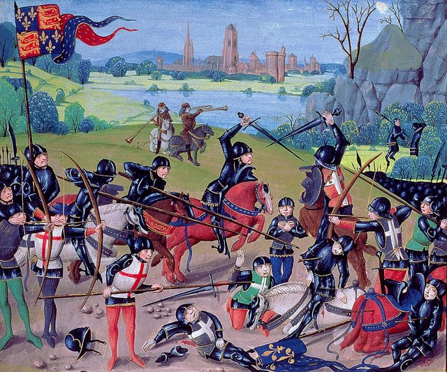
西元 1415 年 10 月 25 日，英王亨利五世率約六千人（其中長弓手約五千）在阿金庫爾迎戰兵力兩至三倍的法國貴族大軍。泥濘、尖木樁與每分鐘十餘箭的箭雨，讓法國騎士衝鋒徹底崩潰：法軍戰死約五千至六千人（含三名公爵），英軍損失不足五百。**長弓——一種由農民使用、造價低廉的武器——三度（福爾柯克、克雷西、阿金庫爾）殲滅歐洲最昂貴的武士階級。** 本案偵破的問題是：為什麼「便宜＋訓練」可以系統性打贏「血統＋板甲」？以及，為什麼這種統治戰場近百年的武器，最後還是輸了？

[→ 對外連結：阿金庫爾與英格蘭長弓：農民弓手的最後王朝](https://chad-liu.github.io/books/html/1-6-3.武器與戰法/1415-阿金庫爾與英格蘭長弓.html)

## 1453 | 君士坦丁堡陷落

西元 1453 年 4 月 6 日至 5 月 29 日，年僅 21 歲的鄂圖曼蘇丹穆罕默德二世以約八萬大軍（含龐大的炮兵與工程兵）、數百艘船隻圍攻君士坦丁堡。守軍只有約七千至八千人，但倚仗千年未破的狄奧多西三重城牆。案件的核心兇手是匈牙利工匠烏爾班鑄造的巨炮：石彈重達五百公斤上下，直接砸碎城牆的厚度邏輯。鄂圖曼以「持續炮轟＋艦船越地拖入金角灣＋坑道作業＋最後總攻」的多兵種合成攻城，五十三天後攻陷帝都。這樁案件宣告：**垂直高牆的時代一夜之間失效，戰爭從「武士的勇氣」變成「工程師的算術」**。

[→ 對外連結：君士坦丁堡陷落：火炮攻城革命](https://chad-liu.github.io/books/html/1-6-3.武器與戰法/1453-君士坦丁堡陷落.html)

## 1500 | 簧輪槍與騎兵手槍
約西元 1500 年，德意志紐倫堡的鐘錶匠工藝造出簧輪槍（wheellock）：發條驅動刻紋鋼輪旋轉，摩擦黃鐵礦迸出火花點燃藥池——**史上第一種「自帶點火」、無需預燃火繩的單兵火器**。它昂貴如鐘錶，於是成為貴族騎兵的專屬武器，催生了皮套手槍與「卡拉科爾」輪射手槍騎兵戰法。本案偵破的問題是：第一個解開「火繩死結」的機構，為什麼反而輸給了後來更「笨」的燧發槍（[燧發槍與紙殼定裝彈](https://chad-liu.github.io/books/html/1-6-3.武器與戰法/1610-燧發槍與紙殼定裝彈.html)）？

[→ 對外連結：簧輪槍與騎兵手槍：免火繩的第一步](https://chad-liu.github.io/books/html/1-6-3.武器與戰法/1500-簧輪槍與騎兵手槍.html)

## 1503 | 切里尼亞奧拉與火繩槍
西元 1503 年 4 月 21 日，西班牙名將「大隊長」貢薩洛·費爾南德斯·德·科爾多瓦在義大利南部的切里尼亞奧拉，以壕溝後列陣的火繩槍手，對抗法國騎士與步兵的衝擊。法軍統帥內穆爾公爵戰死，法軍潰敗——**史上第一場由火器（火繩槍）單獨決定勝負的會戰**。這樁案件確立了此後兩百年戰法的基礎：西班牙以「長矛方陣＋火繩槍袖隊」的大方陣（tercio）縱橫歐洲一個半世紀；火繩槍手從配角變成主角；騎士衝擊（阿金庫爾之後的殘餘霸權）正式讓位於火器。武器與戰法的競賽，進入「比射速」的時代。

[→ 對外連結：切里尼亞奧拉與火繩槍：火器首次單獨決定會戰](https://chad-liu.github.io/books/html/1-6-3.武器與戰法/1503-切里尼亞奧拉與火繩槍.html)

## 1525 | 帕維亞會戰與騎士終結
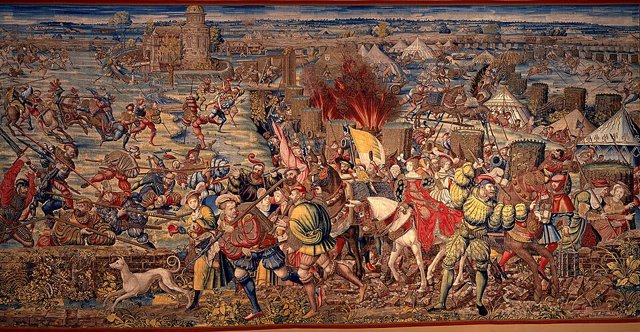
1525 年 2 月 24 日，義大利帕維亞，西班牙—帝國軍以火繩槍手＋棱堡化修道院陣地，全殲法軍，法王弗朗索瓦一世被俘——歐洲史上第一位戰場被俘的國王。這樁案件的兇手是「三百名巴斯克火繩槍手」：他們在晨霧中從側翼齊射，把法國重騎的衝擊走廊變成屠宰場。切里尼亞奧拉（1503）證明火器能決勝，帕維亞證明**火器能俘虜國王**。本案補上 1503 到 1530（棱堡）之間缺失的一環：騎士時代的正式死亡證明。

[→ 對外連結：帕維亞會戰：火繩槍埋葬騎士階級](https://chad-liu.github.io/books/html/1-6-3.武器與戰法/1525-帕維亞會戰與騎士終結.html)

## 1530 | 棱堡與攻城工程革命
1453 年君士坦丁堡陷落（[君士坦丁堡陷落](https://chad-liu.github.io/books/html/1-6-3.武器與戰法/1453-君士坦丁堡陷落.html)）時，人人都以為「城牆時代」已經被火炮判處死刑。但半個世紀後，義大利軍事工程師交出了一份翻案狀：一種低矮、厚實、佈滿尖角與交叉火力的新型要塞——**棱堡（trace italienne）**。1530 年代起，從米蘭到低地國，攻城戰的天平重新倒向守方；一個法國軍隊要圍城數月甚至數年，死傷於疾病者數倍於炮火。本案偵破的謎題是：**攻守軍備競賽中，「防禦反擊」如何以純幾何學完成？** 以及，這種幾何如何意外地重塑了歐洲政治地圖與戰爭的價格。

[→ 對外連結：棱堡與攻城工程革命：城牆的反擊](https://chad-liu.github.io/books/html/1-6-3.武器與戰法/1530-棱堡與攻城工程革命.html)

## 1588 | 無敵艦隊覆滅

1588 年 7–8 月，西班牙 130 艘戰艦組成的「無敵艦隊」（Armada）遠征英格蘭，企圖護送帕爾馬公爵的陸軍登陸；英軍以約 200 艘較小、較靈活的武裝商船＋皇家戰艦迎戰。兩軍在英吉利海峽追逐九日，英軍始終拒絕接舷，以遠程舷側炮逐日轟擊；8 月 8 日格拉沃利訥（Gravelines）之夜，英軍火船衝散西班牙錨地隊形，次日炮戰擊沉重創多艘，殘部被迫繞行蘇格蘭，風暴吞掉半數——生還返國僅約 65 艘。**接舷跳幫的時代被舷側炮術終結。** 本案偵破的是海戰的火力轉型：西班牙把船當運兵渡輪，英國把船當浮動炮台。

[→ 對外連結：無敵艦隊覆滅：遠程炮術、接舷跳幫與海戰火力革命](https://chad-liu.github.io/books/html/1-6-3.武器與戰法/1588-無敵艦隊覆滅.html)

## 1594 | 莫里斯反向行進射擊
西元 1590 年代，荷蘭執政拿騷的莫里斯親王面對西班牙大方陣，做出一項影響此後兩百年的改革：**以操典（drill）把火繩槍手變成射擊機器**。他把火槍裝填拆解為標準化的連續動作、以「反向行進射擊」（countermarch）讓橫隊輪流上前開火再退後裝填，使火槍隊能維持近乎不中斷的齊射；並以小型橫隊取代巨型方陣。1607 年《武器操演》（Wapenhandelinghe）出版，圖解全部動作。這樁案件確立了線列時代的基礎：**操練 = 射速 = 戰鬥力**，個體射速不足就靠「輪射組織」補足——軍隊從此變成「標準化作業的戰鬥機器」。

[→ 對外連結：莫里斯反向行進射擊：把火槍手變成「機器」](https://chad-liu.github.io/books/html/1-6-3.武器與戰法/1594-莫里斯反向行進射擊.html)

## 1610 | 燧發槍與紙殼定裝彈
約西元 1610 年，法王路易十三的槍匠馬蘭·布爾茹瓦（Marin le Bourgeoys）完成燧發槍（flintlock）：擊錘夾燧石、撞擊鋼砧迸火花點燃藥池——把簧輪槍的鐘錶機構（[簧輪槍與騎兵手槍](https://chad-liu.github.io/books/html/1-6-3.武器與戰法/1500-簧輪槍與騎兵手槍.html)）簡化為三個零件。它便宜、可靠、不受火繩牽制，配上 1630 年代古斯塔夫二世的紙殼定裝彈，成為此後兩百年的步兵制式武器。**沒有燧發槍，就沒有線列戰術時代（1650–1815）**——本案偵破的正是「線列時代」的物質基礎。

[→ 對外連結：燧發槍與紙殼定裝彈：線列步兵的物質基礎](https://chad-liu.github.io/books/html/1-6-3.武器與戰法/1610-燧發槍與紙殼定裝彈.html)

## 1631 | 布萊登菲爾德會戰
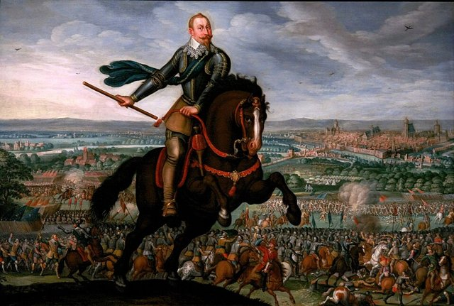
西元 1631 年 9 月 17 日，瑞典國王古斯塔夫二世·阿道夫在萊比錫附近的布萊登菲爾德，以約兩萬三千人（含薩克森盟軍）對抗帝國名將提利約三萬一千人的天主教聯軍。會戰最關鍵的一幕：薩克森盟軍潰逃、瑞典左翼完全暴露，提利企圖包抄——但古斯塔夫以**預備隊梯隊轉向、機動團屬輕炮、以及薄線的火力齊射**，頂住了包抄並反轉戰局，提利的帝國大方陣在瑞典火力下崩潰，傷亡過半。這樁案件確立了「線性戰術」：**薄線火力 + 機動炮兵 + 騎兵衝擊**的合成體系，此後成為歐洲戰場標準，直到拿破崙。

[→ 對外連結：布萊登菲爾德會戰：線性戰術的誕生](https://chad-liu.github.io/books/html/1-6-3.武器與戰法/1631-布萊登菲爾德會戰.html)

## 1648 | 威斯特伐利亞與軍事財政國家
1648 年威斯特伐利亞和約結束三十年戰爭，真正的兇手不是和約條文，而是一個被戰爭逼出來的制度怪物：**軍事財政國家（fiscal-military state）**。三十年戰爭把僱傭兵變成蝗蟲、把德意志人口吃掉三分之一，各國君主學到同一課：臨時募兵＝國家自殺。瑞典的古斯塔夫、法國的黎塞留、普魯士的選帝侯不約而同走向同一答案：常備軍＋中央稅制＋國債融資。戰爭從「包工頭承包」變成「國家壟斷的官僚工程」。

長期戰爭 → 僱傭兵失控 → 常備軍＋稅制＋國債 → 軍事財政國家

[→ 對外連結：威斯特伐利亞與軍事財政國家：戰爭如何逼出國債與常備軍](https://chad-liu.github.io/books/html/1-6-3.武器與戰法/1648-威斯特伐利亞與軍事財政國家.html)

## 1688 | 刺刀與長矛的退場
1687 年，法國沃邦元帥改進插座式刺刀（以卡榫固定於槍管側面，射擊不中斷），法軍 1688 年起列裝、1703 年正式廢除長矛——**延續兩千年的「長矛兵種」消失，步兵從「射手＋矛兵」兩種兵合而為一**。本案偵破的問題是：一個小零件如何完成步兵編制的大一統？以及，為什麼長矛時代的最後一課，是在蘇格蘭的基利克蘭基寫下的？

[→ 對外連結：刺刀與長矛的退場：步兵的大一統](https://chad-liu.github.io/books/html/1-6-3.武器與戰法/1688-刺刀與長矛的退場.html)

## 1704 | 布倫海姆會戰與縱隊機動
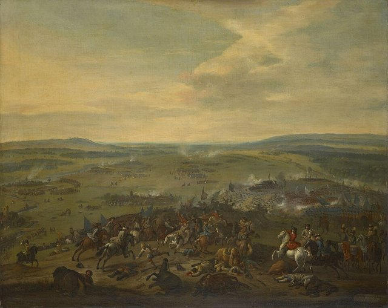
1704 年 8 月 13 日，多瑙河畔布倫海姆，馬爾波羅公爵率英奧聯軍以 5 萬兵力擊潰 6 萬法巴聯軍，俘虜過萬——西班牙王位繼承戰的轉捩點。這樁案件的兇手是「縱隊」：馬爾波羅用縱隊行軍接敵、到射程才展開成線列，以機動換火力，以集中換包圍。路易十四的線列正統在此被學生超越。本案補上刺刀（1688）到洛伊滕（1757）之間缺失的一環：**線列戰術誕生後第一次被「機動＋集中」擊敗**。

[→ 對外連結：布倫海姆會戰：縱隊接敵如何擊碎線列正統](https://chad-liu.github.io/books/html/1-6-3.武器與戰法/1704-布倫海姆會戰與縱隊機動.html)

## 1757 | 洛伊滕會戰
西元 1757 年 12 月 5 日，普魯士腓特烈二世以約三萬五千人在西里西亞洛伊滕，迎戰奧地利約六萬五千大軍。腓特烈以「拒止一翼、以全軍斜向攻擊敵軍另一翼」的斜線戰術（schiefe Schlachtordnung），藉低丘地形遮蔽行軍，全軍在奧軍南翼集中，逐段「捲」翻奧軍陣線——奧軍傷亡被俘逾三萬，普軍傷亡約六千。這樁案件是「決勝點集中」戰法的顛峰：**以行軍的時間差在敵軍一翼製造 2:1 以上的局部優勢**——馬拉松（[馬拉松會戰](https://chad-liu.github.io/books/html/1-6-3.武器與戰法/-0490-馬拉松會戰.html)）與留克特拉的幾何，被普魯士操練與鐵質通條的射速優勢推到極致。

[→ 對外連結：洛伊滕會戰：普魯士斜線戰術的顛峰](https://chad-liu.github.io/books/html/1-6-3.武器與戰法/1757-洛伊滕會戰.html)

## 1776 | 來福槍與神射手
1776 年，英軍少校帕特里克·弗格森（Patrick Ferguson）為自己的後膛來福槍取得專利並組建小隊投入美國獨立戰爭；同年，摩根上校的美洲來福槍手在薩拉托加用 Kentucky 來福槍狙殺英將軍官——**「來福線」這門十五世紀的老工藝，第一次成為會戰級變數**。本案偵破的問題是：為什麼精確度更高的來福槍，在會戰主流陣營裡整整遲到三百年？以及，那道螺旋刻線背後寫著什麼物理？

[→ 對外連結：來福槍與神射手：螺旋膛線的精確革命](https://chad-liu.github.io/books/html/1-6-3.武器與戰法/1776-來福槍與神射手.html)

## 1793 | 全民徵兵與戰爭財政
1793 年 8 月 23 日，法國國民公會頒布「全民徵兵令」（levée en masse）：未婚青年入伍、已婚者造武器、婦女做帳篷軍服、兒童捐舊衣、老人演講鼓舞士氣。一年內法軍從三十萬膨脹到七十五萬——歐洲史上第一支真正的國民軍隊。本案兇手不是大炮，而是一套**人力財政制度**：把「人口」記入國家資產負債表，把徵兵、攤派（requisition）、指券（assignat）打包成戰爭融資機器。拿破崙的軍團體系（見 [奧斯特里茨會戰](https://chad-liu.github.io/books/html/1-6-3.武器與戰法/1805-奧斯特里茨會戰.html)）只是這台機器的輸出端。

王朝戰爭缺兵少餉 —民族＋攤派＋指券→ 人力資本總動員 → 總體戰

[→ 對外連結：全民徵兵與戰爭財政：國家如何把人口變成彈藥](https://chad-liu.github.io/books/html/1-6-3.武器與戰法/1793-全民徵兵與戰爭財政.html)

## 1795 | 罐頭與軍糧
1795 年，法國督政府懸賞 12,000 法郎征求軍糧保存法；1809 年，糖果商阿佩爾以後靠加熱密封玻璃瓶（水浴殺菌）獲獎；1810 年，英國杜蘭德錫罐專利；拿破崙名言「軍隊靠胃行軍」（一說）。此前：七年戰爭、美國獨立戰爭皆因補給崩盤；此後：罐頭養活拿破崙大軍、兩次世界大戰、南極探險。**一顆罐頭如何改變戰爭？當胃不再限制行軍，軍隊的半徑由誰定？**

> **補給線是軍隊的臍帶，罐頭是剪刀嗎？從醃肉到罐頭——保存期限每翻一倍，帝國的半徑翻幾倍？**

[→ 對外連結：罐頭與軍糧：拿破崙懸賞養活大軍](https://chad-liu.github.io/books/html/1-6-3.武器與戰法/1795-罐頭與軍糧.html)

## 1805 | 奧斯特里茨會戰
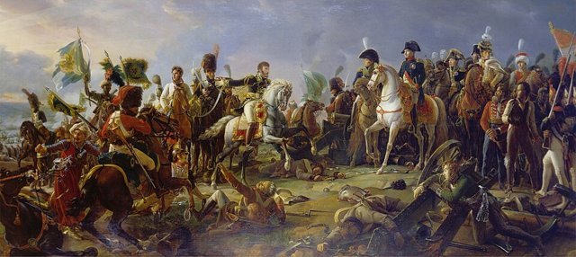
西元 1805 年 12 月 2 日，拿破崙以約七萬三法軍在摩拉維亞奧斯特里茨（Austerlitz）迎戰俄奧聯軍約八萬五（三皇會戰）。拿破崙故意示弱：**放棄居高臨下的普拉岑高地、削薄右翼**，誘使聯軍主力南下搶佔他的右翼；上午濃霧散去，蘇爾特軍團從中央直插已被掏空的普拉岑高地，把聯軍攔腰切斷——聯軍潰敗，傷亡被俘逾三萬六。這樁案件是「拿破崙體系」的教科書展示：**軍團制（獨立合成兵團）＋戰略欺騙＋決勝點集中**——戰爭從「戰術的對抗」升級為「戰役的設計」。

[→ 對外連結：奧斯特里茨會戰：拿破崙軍團體系的顛峰](https://chad-liu.github.io/books/html/1-6-3.武器與戰法/1805-奧斯特里茨會戰.html)

## 1805 | 特拉法加海戰
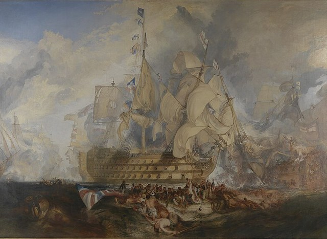
西元 1805 年 10 月 21 日，西班牙特拉法加角外海，納爾遜以 27 艘戰列艦對抗法西聯合艦隊 33 艘。他違反當時海戰教範（單縱隊平行對射），以**兩個縱隊垂直切入敵方艦列**：先鋒艦承受集中炮火硬闖，隨後各艦近距離以舷側炮逐艦殲滅。聯合艦隊 18 艘被俘或焚毀，英艦一艘未失（但納爾遜本人陣亡）。這樁案件確立了海戰的新戰法：**主動放棄「安全距離」，以縱隊切入製造局部數量優勢**——與陸戰的「決勝點集中」（洛伊滕、奧斯特里茨）完全同構。特拉法加之後，英國海上霸權維持了一個世紀。

[→ 對外連結：特拉法加海戰：海戰新戰法——雙縱隊斷敵陣](https://chad-liu.github.io/books/html/1-6-3.武器與戰法/1805-特拉法加海戰.html)

## 1806 | 耶拿會戰與拿破崙軍制
西元 1806 年 10 月 14 日，拿破崙在耶拿、達武在奧爾施泰特，
同一日兩場會戰殲滅普魯士–薩克森聯軍：普軍損失約四萬人、
法軍約一萬，普魯士六週內投降。
**舊式僱傭軍＋世襲軍官＋僵硬線列，被徵兵＋軍團＋參謀速度一天拆解。**
本案偵破的問題是：為什麼 1805 年奧斯特里茨（[奧斯特里茨會戰](https://chad-liu.github.io/books/html/1-6-3.武器與戰法/1805-奧斯特里茨會戰.html)）
贏的是戰術，而 1806 年耶拿贏的是**制度**？

[→ 對外連結：耶拿會戰與拿破崙軍制：一天殲滅普魯士舊軍隊](https://chad-liu.github.io/books/html/1-6-3.武器與戰法/1806-耶拿會戰與拿破崙軍制.html)

## 1807 | 雷汞火帽
1807 年，蘇格蘭牧師亞歷山大・福賽斯（Alexander Forsyth）為打獵時燧發槍火光驚飛禽而苦惱，取得以雷酸汞（fulminate of mercury）擊發的「香水瓶槍鎖」專利——撞擊即爆、無需火繩火石引火。這樁看似獵人小發明的案件，是 19 世紀輕武器革命的**化學引信**：沒有火帽，就沒有紙殼定裝彈的可靠擊發、沒有德萊賽針發槍（1841）、沒有金屬彈殼與後膛普及。本案偵破的是被低估的中間層：**偉大革命（後膛）站在不起眼的化學小發明肩上**。

[→ 對外連結：雷汞火帽：化學擊發取代燧石、定裝彈的引信案](https://chad-liu.github.io/books/html/1-6-3.武器與戰法/1807-雷汞火帽.html)

## 1815 | 滑鐵盧會戰

西元 1815 年 6 月 18 日，威靈頓以約六萬八英荷聯軍，在比利時滑鐵盧以南的聖讓山上迎戰拿破崙約七萬二法軍。威靈頓以**反斜面部署**（部隊藏在山脊後方，不受法軍炮兵直射）、要點據守（烏古蒙、聖拉埃農莊）、**方陣抗騎兵**，撐到布呂歇爾普軍於傍晚到達——法軍崩潰，拿破崙帝國終結。這樁案件是線列戰術時代的巔峰與謝幕：**反斜面、方陣、要點防禦**把線列時代的防禦戰法推到極致，而五年後（米尼彈 1849）來福槍將使這一切戰法全部重寫。

[→ 對外連結：滑鐵盧會戰：線列戰術的巔峰謝幕](https://chad-liu.github.io/books/html/1-6-3.武器與戰法/1815-滑鐵盧會戰.html)

## 1841 | 德萊賽針發槍
1841 年，普魯士陸軍採用德萊賽針發槍（Dreyse Zündnadelgewehr）：旋轉閉鎖槍機＋紙殼彈，長針穿透藥包擊發底火——**史上第一種制式後膛軍用步槍**。1866 年克尼格雷茨會戰，普軍以每分鐘四至五發的臥姿火力，對抗奧軍站立裝填的前膛槍（每分鐘一至兩發）：奧軍傷亡約四萬四千、普軍僅約九千。**裝填邏輯的改變（前膛 → 後膛）重寫了會戰勝負。** 本案偵破的問題是：一種被普魯士藏了二十年、甚至被自家將領嫌棄的槍，如何贏下德意志的統一戰爭？

[→ 對外連結：德萊賽針發槍：後膛革命的第一槍](https://chad-liu.github.io/books/html/1-6-3.武器與戰法/1841-德萊賽針發槍.html)

## 1849 | 米尼彈革命
西元 1849 年，法國軍官米尼（Claude-Étienne Minié）在德爾維涅等人實驗的基礎上，設計出錐形空心底鉛彈：發射時氣壓撐開彈底鐵杯，使彈體脹大嵌入膛線。這顆小小的彈丸終結了一個兩百年的僵局——**來福槍的精確與射程，首次配上滑膛槍的裝填速度**。射程從約 100 公尺跳到 400–500 公尺，正面衝鋒的「死亡地帶」放大四倍以上。克里米亞戰爭（1853–1856）與美國內戰（1861–1865）立即驗證了后果：正面強攻的傷亡率暴增，軍隊被迫掘壕自保——**塹壕戰的第一次預演**。這樁案件的兇手是「一顆子彈的形狀」：它使衝鋒成為死刑，使戰爭走向防禦。

[→ 對外連結：米尼彈革命：步槍讓衝鋒走向死刑](https://chad-liu.github.io/books/html/1-6-3.武器與戰法/1849-米尼彈革命.html)

## 1860 | 連珠槍與溫徹斯特
1860 年，克里斯多福·斯賓塞的七連發槓桿卡賓槍與泰勒·亨利的十六連發亨利槍同年問世；1866 年溫徹斯特公司改良量產——**「一次裝彈、多次發射」的彈倉時代來臨**。美國內戰中，連珠槍騎兵「周日裝彈，整週開火」的火力讓南軍印象深刻。本案偵破的問題是：為什麼這種火力革命率先發生在商業市場，而非軍隊採購清單上？

[→ 對外連結：連珠槍與溫徹斯特：火力輸出脫離裝填節奏](https://chad-liu.github.io/books/html/1-6-3.武器與戰法/1860-連珠槍與溫徹斯特.html)

## 1861 | 聯邦軍需部與總體戰後勤
1861 年美國內戰爆發，北軍的兇手不是米尼彈（見 [米尼彈革命](https://chad-liu.github.io/books/html/1-6-3.武器與戰法/1849-米尼彈革命.html)），而是蒙哥馬利·梅格斯（Montgomery Meigs）領導的軍需部（Quartermaster Department）：制服、皮靴、罐頭、騾馬、鐵路時刻表全部標準化、招標、審計。一年採購五十萬套軍服、三十萬匹騾馬，腐敗案件反而比戰前更少。南軍將領穿自家裁縫的華服挨餓，北軍士兵穿招標來的粗布吃飽——**後勤官僚制第一次證明：表格比子彈先決定勝負**。

志願兵洪流 —標準化＋招標＋鐵路→ 可複製的補給流 → 總體戰後勤

[→ 對外連結：聯邦軍需部與總體戰後勤：表格如何打贏戰爭](https://chad-liu.github.io/books/html/1-6-3.武器與戰法/1861-聯邦軍需部與總體戰後勤.html)

## 1862 | 漢普頓錨地鐵甲艦
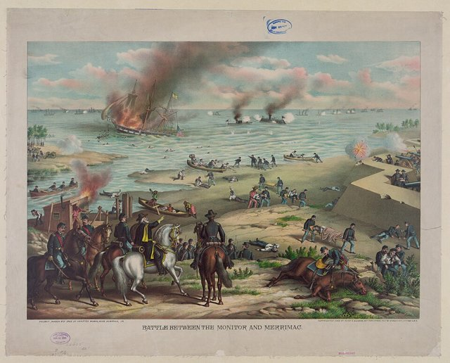
西元 1862 年 3 月 8 日至 9 日，美國內戰的漢普頓錨地（Hampton Roads）：南方邦聯的鐵甲艦「維吉尼亞號」（CSS Virginia，由打撈的梅里梅克號改裝）在一天之內摧毀兩艘木造戰艦；次日，北方聯邦革命性的「監視者號」（USS Monitor，可旋轉炮塔、低舷鐵殼）趕到，兩艘鐵甲艦對轟四小時不分勝負——**木造戰艦的時代在一天之內終結**。這樁案件的兇手是「帕桑爆炸彈＋鐵甲」的組合：爆炸彈使木船成為火種，鐵甲使炮彈無效，而兩者的競賽把海軍推向工業化的軍備競賽。

[→ 對外連結：漢普頓錨地鐵甲艦：海戰的工業革命](https://chad-liu.github.io/books/html/1-6-3.武器與戰法/1862-漢普頓錨地鐵甲艦.html)

## 1866 | 白頭魚雷
1866 年，奧地利海軍軍官盧皮斯（Giovanni Luppis）與英國工程師懷特黑德（Robert Whitehead）在阜姆（Fiume，今里耶卡）造出世界第一枚實用自航魚雷——壓縮空氣推進、繩索定深、航速 7 節、射程 700 公尺，命名「Minenschiff」（水雷船）。此前水雷要人送、火船要命換，一艘小炮艇對戰列艦毫無辦法；此後**任何小艇攜一枚魚雷，即對大艦構成存在威脅**。1866 年利薩海戰（奧意）甫驗證撞角，魚雷在十年內把撞角掃進博物館。本案偵破的是海戰的不對稱起點：**大艦的噸位第一次變成靶子尺寸**。

[→ 對外連結：白頭魚雷：小艇攜雷即威脅大艦、不對稱海戰案](https://chad-liu.github.io/books/html/1-6-3.武器與戰法/1866-白頭魚雷.html)

## 1870 | 普法戰爭與總參謀部
西元 1866 年與 1870 年，普魯士接連擊潰奧地利與法國。案件的兇手不是任何一種武器（法國的夏塞波步槍性能甚至優於普魯士的針發槍），而是一個**機構**：總參謀部（Generalstab）。毛奇（Moltke）以鐵路時刻表計畫動員、以「分進合擊」安排大軍行動、以「任務式指揮」（Auftragstaktik）授權軍團長自主判斷、以兵棋推演預先演練戰爭。1866 克尼格雷茨兩周擊潰奧軍；1870 色當合圍俘虜法皇，德意志帝國誕生。這樁案件確立了現代戰爭的根本形態：**戰爭 = 工業產能 × 動員體系 × 參謀流程**——國家的行政能力成為武器。

[→ 對外連結：普法戰爭與總參謀部：戰爭成為工業化官僚流程](https://chad-liu.github.io/books/html/1-6-3.武器與戰法/1870-普法戰爭與總參謀部.html)

## 1884 | 馬克沁機槍
西元 1884 年，美裔英國發明家海勒姆·馬克沁（Hiram Maxim）取得世界首挺全自動機槍專利：以火藥氣體的後座力完成「開鎖—退殼—上膛—擊發」的循環，每分鐘理論射速約 600 發——**人類第一次擁有「自己會開火」的武器**。此前的加特林（1860）仍需手搖，馬克沁讓火力成為「自動化過程」。殖民戰爭立即驗證其威力：1898 恩圖曼之戰，英軍機槍陣地一日殲滅上萬馬赫迪騎兵，自身傷亡不足五百。但案件的深層含義要到二十年後才揭曉：**歐洲將領對「同款武器」的使用毫無準備**——機槍在殖民地是屠殺工具，在 1914 的西線成為戰爭形態的終審法官。

[→ 對外連結：馬克沁機槍：全自動火力的誕生](https://chad-liu.github.io/books/html/1-6-3.武器與戰法/1884-馬克沁機槍.html)

## 1886 | 勒貝爾與無煙火藥
1884 年，法國化學家保羅·維埃耶（Paul Vieille）完成無煙火藥（Poudre B）：硝化纖維以乙醚／酒精膠化塑形；1886 年法國陸軍採用勒貝爾步槍（Lebel M1886，8 公厘、初速約 630 m/s）——**史上第一種制式無煙火藥步槍**。初速從黑火藥的約 400 m/s 跳到 630 m/s，有效射程翻倍，戰場上的煙幕消失。本案偵破的問題是：為什麼一項「純化學」的發明，能在五年內讓全歐洲的陸軍一夜過時？

[→ 對外連結：勒貝爾與無煙火藥：彈道化學革命](https://chad-liu.github.io/books/html/1-6-3.武器與戰法/1886-勒貝爾與無煙火藥.html)

## 1903 | 飛機問世與軍用航空

西元 1903 年 12 月 17 日，萊特兄弟在基蒂霍克完成 12 秒的動力飛行；1909 年美國陸軍購入第一架軍用飛機；1911 年 11 月 1 日，義土戰爭中加沃蒂（Gavotti）從飛機上投下第一枚炸彈——**武器登上了第三維**。第一次世界大戰讓飛機從偵察玩具變成戰場必需品：偵察使炮兵「看得見」（1917 預測射擊的基礎）、福克斷續器（1915）使機槍能穿過螺旋槳射擊（戰鬥機誕生）、轟炸機催生杜黑理論（1921）。這樁案件的兇手是「輕型引擎＋翼型理論」：它把戰場的「封鎖」與「偵察」兩個問題同時瓦解。

[→ 對外連結：飛機問世與軍用航空：戰場升上第三維](https://chad-liu.github.io/books/html/1-6-3.武器與戰法/1903-飛機問世與軍用航空.html)

## 1905 | 旅順攻防戰
西元 1904 年 8 月至 1905 年 1 月，日軍乃木希典將軍對旅順（Port Arthur）要塞發動總攻。俄軍以**塹壕、鐵絲網、機槍、手榴彈、電網、探照燈**構築了現代要塞防禦；日軍以「夜間肉搏衝鋒」反覆強攻，單次總攻傷亡逾一萬五。最後日軍改用**28 公分重炮**轟擊要塞、以坑道爆破逼降——1905 年 1 月 2 日要塞投降，日軍總傷亡約五萬七。這樁案件是一次「免費的預言」：**塹壕、機槍、鐵絲網、重炮、手榴彈、人海衝鋒的失敗——1914 年西線的一切，旅順都預演過了**。全世界的軍事觀察員都派來了，卻沒有人真正聽懂。

[→ 對外連結：旅順攻防戰：塹壕戰的預演](https://chad-liu.github.io/books/html/1-6-3.武器與戰法/1905-旅順攻防戰.html)

## 1906 | 無畏艦與海軍預算競賽
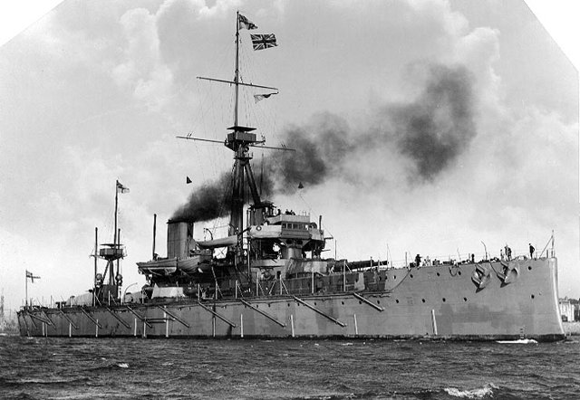
1906 年英國「無畏號」（HMS Dreadnought）下水：全重型火炮（all-big-gun）、蒸汽輪機，一艦即讓全球戰列艦過時。真正的案件卻在議會：海軍大臣費舍爾以無畏艦為槓桿，把海軍預算從 1900 年三千萬鎊推高到 1914 年五千萬鎊；德國提爾皮茨以《海軍法》五年撥款綁定議會，英德陷入「兩強標準」（two-power standard）的預算螺旋。本案兇手是**預算制度**：當武器以「世代」跳躍，財政以「年度」審議，軍備競賽就變成會計報表的自我實現。

技術跳躍（無畏艦） —多年撥款＋兩強標準→ 預算棘輪 → 一戰海軍對峙

[→ 對外連結：無畏艦與海軍預算競賽：預算表上的軍備競賽](https://chad-liu.github.io/books/html/1-6-3.武器與戰法/1906-無畏艦與海軍預算競賽.html)

## 1914 | 軍馬與飼料後勤
一戰期間，各國動員軍馬逾千萬匹（一說）：英國 100 萬（本土+殖民地），德國 70 萬+，法國 60 萬+，俄國數百萬。結局：死亡八成以上（一說，戰死+病死+餓死+戰後屠宰），索姆河泥漿、凡爾登炮火、東線嚴寒——馬匹的凡爾登。**機器時代的第一場大戰，為何還靠馬？千萬匹馬死了，誰記得？**

> **坦克和馬誰先到前線？當鐵路把大炮運到車站，最後一公里靠什麼——馬的胃和人的胃，哪個先空？**

[→ 對外連結：軍馬：被遺忘的千萬大軍](https://chad-liu.github.io/books/html/1-6-3.武器與戰法/1914-軍馬與飼料後勤.html)

## 1914 | 馬恩河會戰

西元 1914 年 8 月，德國以「施里芬計畫」開戰：右翼借道比利時、六周內擊潰法國，再轉攻俄國。計畫的每一步都是時刻表——但四個變數在第一個月全部出錯：比利時抵抗、俄國動員比預期快、右翼部隊跑贏了自己的補給線、德軍統帥部在 8 月底抽調兩個軍團東調。9 月 5 日至 12 日，德軍在馬恩河被法英聯軍攔下，計畫破產；之後雙方「奔向大海」，七百公里塹壕從瑞士鋪到北海。這樁案件確立了機槍時代的根本困境：**防禦火力壓倒進攻機動，戰爭變成四年不動的消耗戰**。

[→ 對外連結：馬恩河會戰：施里芬計畫的破產](https://chad-liu.github.io/books/html/1-6-3.武器與戰法/1914-馬恩河會戰.html)

## 1915 | 斯托克斯迫擊炮
1915 年，英國工程師威爾弗雷德·斯托克斯（Wilfred Stokes）設計三吋迫擊炮：無復進機構、炮彈沿炮管下滑撞擊固定擊針發射——**一分鐘可爆發二十餘發、四個士兵扛得動的「步兵曲射炮」**。它專為塹壕而設計：高角曲射越過鐵絲網、垂直落入壕底。本案偵破的問題是：當直射火炮對壕溝束手無策時，誰給了步兵一門「自己扛得動的炮」？

[→ 對外連結：斯托克斯迫擊炮：步兵自帶的曲射炮](https://chad-liu.github.io/books/html/1-6-3.武器與戰法/1915-斯托克斯迫擊炮.html)

## 1915 | 毒氣戰
西元 1915 年 4 月 22 日黃昏，伊普爾（Ypres）戰線：德軍開啟 5,700 罐氯氣，168 噸毒氣隨風飄向法屬阿爾及利亞殖民地部隊陣地——士兵潰逃，防線撕開數公里缺口。這是史上第一次大規模化學武器攻擊。此後三年，毒氣沿「氯→光氣→芥子」升級，一戰化學武器傷亡約一百二十萬人、死亡約九萬人；但案件的結局出人意料：**毒氣沒有改變任何戰線**——防毒面具數月內問世、天候依賴性使攻擊不可靠、報復使雙方相互克制。1925 年《日內瓦議定書》禁止化學武器——**化學武器的「戰法」最終是「不用」**。

[→ 對外連結：毒氣戰：化學工業上戰場](https://chad-liu.github.io/books/html/1-6-3.武器與戰法/1915-毒氣戰.html)

## 1915 | 米爾斯手榴彈
1915 年，英國工程師威廉·米爾斯（William Mills）設計 No.5 手榴彈：鑄鐵刻槽彈體、槓桿擊針、七秒延期引信——**塹壕戰把這門已退役的古老武器重新請回戰場，並以工業量產的方式把它變成步兵常備**。到 1918 年，英軍產量約三千五百萬枚。本案偵破的問題是：為什麼日俄戰爭與一戰壕溝，會讓一種近乎被遺忘的冷兵器時代遺物復活？

[→ 對外連結：米爾斯手榴彈：口袋裡的炮彈](https://chad-liu.github.io/books/html/1-6-3.武器與戰法/1915-米爾斯手榴彈.html)

## 1916 | 索姆河與坦克登場

西元 1916 年，西線迎來機槍時代的兩個巔峰：凡爾登（2 月–12 月，德軍企圖「把法國流血放乾」，雙方傷亡合計約七十萬）與索姆河（7 月–11 月，7 月 1 日英軍單日傷亡 57,470 人，英軍史上最慘的一日）。但索姆河的 9 月 15 日，一件新武器登場：**坦克**——英軍以 49 輛 Mark I 在弗萊爾-庫爾瑟萊特發動攻擊，突破深度創下西線單日紀錄。這樁案件是雙重案件：**塹壕死結的極致（炮火準備無效）＋第一把鑰匙（坦克）的登場**。蘭徹斯特的《飛機在戰爭中》（1916）發表的平方律方程，第一次把這場戰爭寫成了數學題。

[→ 對外連結：索姆河與坦克登場：塹壕死結與第一把鑰匙](https://chad-liu.github.io/books/html/1-6-3.武器與戰法/1916-索姆河與坦克登場.html)

## 1917 | 滲透戰術與康布雷
西元 1917 年，西線的塹壕死結被兩把鑰匙先後嘗試打開。第一把是德國的**滲透戰術**（Hutier tactics）：9 月里加、10 月卡波雷托，德軍突擊隊以「短促急襲炮擊＋越點滲透＋切斷通信」穿透俄軍與義軍防線；1918 年 3 月春季攻勢一度推進約六十公里。第二把是英國的**康布雷戰役**（11 月 20 日）：476 輛坦克**不發一炮**（無炮火準備，改用「預測射擊」）突襲興登堡防線，一日突破五公里，倫敦教堂鐘聲自 1914 年以來首次響起。兩把鑰匙都開了門，但都沒走進去——**突破容易，擴張難**。這樁案件確立了現代進攻戰法的兩大支柱：**以「奇襲」取代「強攻」，以「越點」取代「平推」**。

[→ 對外連結：滲透戰術與康布雷：解開塹壕死結的兩把鑰匙](https://chad-liu.github.io/books/html/1-6-3.武器與戰法/1917-滲透戰術與康布雷.html)

## 1918 | MP18衝鋒槍
1918 年春，德軍突擊隊（Sturmtruppen）在米夏埃爾攻勢中首次大量投入 MP18 衝鋒槍（伯格曼工廠，胡戈·施邁瑟設計）：9×19 公厘手槍彈、三十二發蝸牛彈鼓、每分鐘約 350 發——**史上第一種實用化衝鋒槍**。它伴隨滲透戰術（[滲透戰術與康布雷](https://chad-liu.github.io/books/html/1-6-3.武器與戰法/1917-滲透戰術與康布雷.html)）撕開了靜態塹壕。本案偵破的問題是：為什麼「一種發射手槍彈的自動武器」，能成為突破塹壕僵局的關鍵拼圖？

[→ 對外連結：MP18衝鋒槍：塹壕清掃者](https://chad-liu.github.io/books/html/1-6-3.武器與戰法/1918-MP18衝鋒槍.html)

## 1921 | 杜黑與制空權理論
1921 年，義大利退役炮兵軍官朱利奧·杜黑出版《制空權》（Il dominio dell'aria）。此時飛機問世僅十八年、一戰空戰剛落幕，杜黑卻斷言：**未來戰爭的第一擊將由轟炸機完成——集中轟炸敵方的城市與工業，就能在陸海軍出動之前贏得戰爭**。陸軍、海軍都將淪為配角。這樁案件特殊之處在於：它是一樁「預謀案」——兇器（戰略轟炸）在理論發表後二十年才正式出手，而破案（檢驗理論對錯）要等到 1945 年。杜黑錯了三分之一、對了三分之二，而錯的那三分之一，恰恰殺死了最多的人。

[→ 對外連結：杜黑與制空權：一種先於飛機戰績的戰法理論](https://chad-liu.github.io/books/html/1-6-3.武器與戰法/1921-杜黑與制空權理論.html)

## 1934 | 德國裝甲師與閃擊戰
1934–1935 年，德國以和約明文禁止的方式祕密重建裝甲部隊：1934 年古德里安就任第 2 機動化師首任師長，1935 年 10 月首批三個裝甲師正式成軍——坦克、載重摩托化步兵、炮兵、工兵、通信編入**同一個師**，以無線電即時指揮。1939–1940 年，這套體系用六周撕開波蘭、六周毀滅法國（[色當與閃擊戰](https://chad-liu.github.io/books/html/1-6-3.武器與戰法/1940-色當與閃擊戰.html)）。本案偵破的謎題：**一戰的勝利者（英法）與失敗者（德國）拿到了同樣的技術（坦克、無線電、飛機），為什麼只有失敗者完成了戰法集成？** 答案不在工程，而在組織學習的動機結構。

[→ 對外連結：德國裝甲師與閃擊戰：把一戰的敗局改寫成理論](https://chad-liu.github.io/books/html/1-6-3.武器與戰法/1934-德國裝甲師與閃擊戰.html)

## 1936 | M1加蘭德半自動步槍
1936 年，美國陸軍採用約翰·加蘭德（John C. Garand）設計的 M1 步槍：導氣活塞、回轉槍機、八發整體彈夾——**史上第一種制式半自動步槍**。二戰中約五百五十萬支服役，巴頓將軍稱之為「史上最偉大的戰爭工具」。當德軍與日軍步兵仍在拉栓，美軍班組的對射火力已經翻倍。本案偵破的問題是：為什麼半自動步槍的「制式化首獎」，落在了一個戰間期軍費緊縮的國家手裡？

[→ 對外連結：M1加蘭德半自動步槍：栓式步槍的終結者](https://chad-liu.github.io/books/html/1-6-3.武器與戰法/1936-M1加蘭德半自動步槍.html)

## 1939 | 噴射機的誕生
西元 1939 年 8 月 27 日，德國亨克爾 He 178 完成史上第一架渦輪噴射引擎飛機的首飛（奧海因設計）；英國惠特爾（Whittle）在 1930 年已取得噴射引擎專利、1937 年首度運轉——兩人各自獨立發明。1944 年梅塞施密特 Me 262 投入實戰，比任何活塞戰鬥機快約 150 公里/小時——但太遲了（燃料危機與數量劣勢）。這樁案件的兇手是「燃氣渦輪」：它打破了活塞螺旋槳的**速度上限**，戰後噴射機＋後掠翼＋雷達＋飛彈把空戰推入「能量時代」（1950 韓戰的米格-15 對 F-86，[韓戰與噴射機](https://chad-liu.github.io/books/html/1-6-3.武器與戰法/1950-韓戰與噴射機.html) 是它的第一場大空戰）。

[→ 對外連結：噴射機的誕生：活塞飛機的速度上限被打破](https://chad-liu.github.io/books/html/1-6-3.武器與戰法/1939-噴射機的誕生.html)

## 1940 | 不列顛空戰與雷達
西元 1940 年 7 月至 10 月，德國空軍企圖奪取制空權以發動登陸（海獅行動）。英國以約七百餘架戰鬥機對抗德軍二千餘架飛機，卻贏得空戰。案件的兇手不是飛機（雙方戰機性能互有勝場），而是一個**系統**：本土鏈雷達（Chain Home）＋道丁指揮體系——雷達偵測 → 過濾室彙整 → 分區指揮所 → 中隊起飛，把「每次攔截」都變成以多打少的埋伏。這樁案件是人類戰爭史上第一次：**勝負由「資料流的速度與品質」決定**——感測器、資料融合、即時指揮的現代 C2（Command & Control）體系就此誕生。

[→ 對外連結：不列顛空戰：史上第一場由資料流打贏的空戰](https://chad-liu.github.io/books/html/1-6-3.武器與戰法/1940-不列顛空戰與雷達.html)

## 1940 | 色當與閃擊戰
西元 1940 年 5 月 10 日，德國發動西線攻勢。盟軍按「德軍將重演 1914 施里芬計畫」的預期，把主力推入比利時；德軍卻以曼施坦因計畫把裝甲主力穿過被盟軍視為「坦克不可通行」的阿登森林，13 日在色當渡過默茲河，古德里安的裝甲軍團不再等待步兵——一路向西狂奔，20 日抵達阿布維爾海峽，把近百萬盟軍主力切斷在比利時。六周後法國投降。這樁案件的兇手是「速度＋無線電＋集中裝甲」：**德軍以「決策循環的速度」打敗了盟軍的「防禦體系」**——閃擊戰不是武器革命，是指揮與時序的革命。

[→ 對外連結：色當與閃擊戰：速度改寫戰爭的尺度](https://chad-liu.github.io/books/html/1-6-3.武器與戰法/1940-色當與閃擊戰.html)

## 1941 | 珍珠港與航母時代

西元 1941 年 12 月 7 日晨，日本海軍以六艘航空母艦、353 架艦載機，對珍珠港的美國太平洋艦隊發動兩波突襲：八艘戰列艦全數被擊沉或重創、188 架飛機被毀、2,403 人陣亡；日軍僅損失 29 架飛機。但案件的深層真相在「沒被炸掉的東西」：三艘美國航母恰在外海、油料庫與修船廠完好無損——**戰列艦被炸沉，但戰爭的勝負根本不繫於戰列艦**。十天前（12 月 10 日），英艦「威爾斯親王號」與「反擊號」在馬來亞外海被陸基飛機擊沉——**在無掩護下機動的主力艦，也逃不過空中力量**。這樁案件正式宣告：海戰的勝負從「艦炮的射程」轉移到「艦載機的半徑」，航母成為海權的新核心。

[→ 對外連結：珍珠港與航母時代：戰列艦的黃昏](https://chad-liu.github.io/books/html/1-6-3.武器與戰法/1941-珍珠港與航母時代.html)

## 1942 | 中途島與情報戰
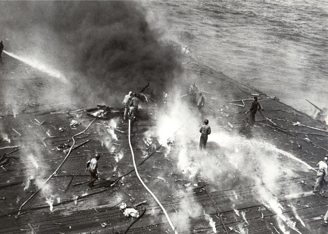
西元 1942 年 6 月 4 日至 7 日，中途島海戰：日本聯合艦隊以四艘航母（加賀、赤城、蒼龍、飛龍）企圖奪取中途島、殲滅美軍艦隊；美軍以三艘航母（企業、大黃蜂、約克鎮）迎擊。戰果：日軍四艘航母全滅、約百餘名精英艦載機飛行員陣亡；美軍損失約克鎮號。案件的兇手不是武器（雙方艦載機性能相近），而是**密電破譯**：美軍太平洋艦隊戰情站 HYPO 以 JN-25 密碼的局部破譯與「AF 缺水」誘餌，確認了日軍目標、時間與兵力——尼米茲以三艘航母在日軍偵察網外設伏。**中途島證明：情報優勢可以等於兵力優勢**——這是孫子「知己知彼」兩千五百年後最完美的實驗驗證。

[→ 對外連結：中途島：情報即戰力](https://chad-liu.github.io/books/html/1-6-3.武器與戰法/1942-中途島與情報戰.html)

## 1942 | 巴祖卡與鐵拳
1942 年，美軍列裝「巴祖卡」（Bazooka M1，斯金納與烏爾設計）；同年德國「鐵拳」（Panzerfaust，蘭格韋勒設計）問世並於 1943 年量產——**聚能裝藥＋火箭推進，讓步兵第一次擁有「口袋裡的坦克殺手」**。1943 年 3 月突尼西亞埃爾古塔爾，巴祖卡首開紀錄；諾曼第樹籬與柏林巷戰中，鐵拳成為盟軍裝甲的噩夢。本案偵破的問題是：一個 1888 年發現的物理效應，如何在五十年後把「坦克不可戰勝」的神話拆掉？

[→ 對外連結：巴祖卡與鐵拳：步兵反坦克平權](https://chad-liu.github.io/books/html/1-6-3.武器與戰法/1942-巴祖卡與鐵拳.html)

## 1943 | 大西洋狼群與反潛
西元 1939–1945 年的大西洋之戰，是史上最長的「貓鼠博弈」：德國潛艇以「狼群戰術」（Rudeltaktik）獵殺橫越大西洋的商船隊，1942 年 3 月單月擊沉逾 60 萬噸；盟軍以「護航體系＋雷達＋反潛機＋密電破譯」反制，1943 年 5 月（黑色五月）單月擊沉德軍 43 艘潛艇，鄧尼茲被迫撤出北大西洋。這樁案件的兇手是一組數學：**護航的周長數學（√n 律）＋密電破譯＋雷達與飛機的射程**——反潛戰的勝負不在單一武器，而在「體系的層層堆疊」。

[→ 對外連結：大西洋狼群與反潛：史上最長的貓鼠博弈](https://chad-liu.github.io/books/html/1-6-3.武器與戰法/1943-大西洋狼群與反潛.html)

## 1944 | StG44突擊步槍
1944 年，希特勒把 MP43 重新命名為「突擊步槍」（Sturmgewehr 44）：7.92×33 公厘中間威力彈、三十發彈匣、選擇射擊（單發／全自動）——**史上第一種突擊步槍**。約四十五萬支投入東線與西線。它的名字是政治，它的彈藥是革命：中間威力彈填補了「手槍彈太短、全威力彈太重」之間的火力空檔。本案偵破的問題是：為什麼步槍的未來不是「更遠更重」，而是「夠用＋可控」？

[→ 對外連結：StG44突擊步槍：中間威力的總原型](https://chad-liu.github.io/books/html/1-6-3.武器與戰法/1944-StG44突擊步槍.html)

## 1944 | 戰略轟炸與V武器
西元 1942–1945 年，盟軍對德國發動史上最大規模的戰略轟炸：杜黑的「轟炸決勝論」終於獲得實驗機會——但結果出人意料。1941 年的巴特報告顯示夜間轟炸只有三分之一炸彈落在目標五英里內；1943 年施魏因富特白日精確轟炸以 60 架 B-17 的代價證明「無護航的精確轟炸不可行」；P-51 戰鬥機（1943 年底）才使護航到位，1944 年的「大週」與石油戰役真正打斷德國空軍與戰爭經濟。同期德國以 V-1 巡弋飛彈（6 月）與 V-2 彈道飛彈（9 月）轟炸英國——**無法防禦、但也無法決勝**的武器登場。這樁案件確立了空權的極限與導彈時代的開端。

[→ 對外連結：戰略轟炸與V武器：空權的極限與火箭的登場](https://chad-liu.github.io/books/html/1-6-3.武器與戰法/1944-戰略轟炸與V武器.html)

## 1945 | 廣島與核時代
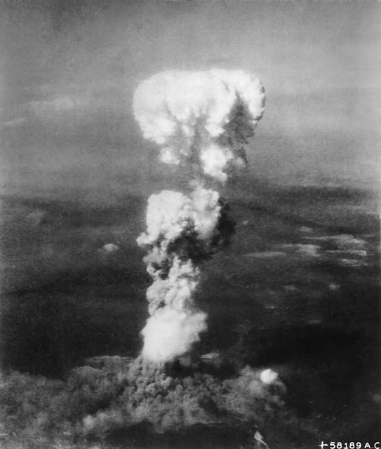
西元 1945 年 7 月 16 日，曼哈頓計畫在墨西哥沙漠的「三位一體」試爆成功——人類第一次釋放核裂變的鏈式反應。8 月 6 日，B-29「艾諾拉·蓋號」在廣島投下「小男孩」（槍式，約 64 公斤鈾-235，威力約 1.5 萬噸 TNT），當日死亡七至八萬人；8 月 9 日「胖子」（內爆式，鈽）在長崎爆炸；同日蘇聯對日宣戰；8 月 15 日日本投降。這樁案件的兇手是 E = mc² 與鏈式反應的臨界質量：**人類第一次在一件武器裡掌握了「無限毀滅」**。戰爭形態就此斷裂：核武大國之間的直接戰爭變成「相互自殺」——戰法從「如何使用武器」變成「如何不使用武器」（嚇阻）。

[→ 對外連結：廣島與核時代：戰爭形態的斷裂](https://chad-liu.github.io/books/html/1-6-3.武器與戰法/1945-廣島與核時代.html)

## 1947 | AK-47
1947 年，米哈伊爾·卡拉什尼科夫的 AK-47 定型、1949 年列裝蘇軍：7.62×39 公厘中間威力彈（[StG44突擊步槍](https://chad-liu.github.io/books/html/1-6-3.武器與戰法/1944-StG44突擊步槍.html) 的理念）、寬公差工程、沖壓機匣——**史上產量最大的槍械（約七千萬至一億支）**。它在越南戰場與 M16 的可靠性對比、在阿富汗山地的抗沙能力、在百餘國國旗與紋章上的形象，讓它成為不對稱戰爭的標配。本案偵破的問題是：為什麼「最不精密」的步槍，成為最成功的武器？

[→ 對外連結：AK-47：人民步槍的工程學](https://chad-liu.github.io/books/html/1-6-3.武器與戰法/1947-AK-47.html)

## 1948 | 國防統一與軍事預算制度
1947 年《國家安全法》、1949 年改組、1958 年國防重組——美國把陸海空三軍塞進同一個「國防部」，1950 年代年軍費三百億美元（佔聯邦預算六成）。真正的破案不在五角大廈的走廊，而在 1961 年麥克納馬拉帶進來的**PPBS（計畫-方案-預算制度）**：每一顆螺絲都要回答「為嚇阻貢獻多少」。本案兇手是**預算官僚制**：軍工複合體（艾森豪威爾 1961 年告別演說警告）與成本效益分析同時誕生——國家第一次試圖用會計馴服戰爭。

三軍分立＋預算失控 —統一＋PPBS＋審計→ 國防即資源配置 ↔ 軍工複合體

[→ 對外連結：國防統一與軍事預算制度：五角大廈如何學會算帳](https://chad-liu.github.io/books/html/1-6-3.武器與戰法/1948-國防統一與軍事預算制度.html)

## 1950 | 韓戰與噴射機
西元 1950–1953 年的韓戰，是核時代第一場大國代理人戰爭，也是史上第一場噴射機大空戰：米格-15（蘇聯，後掠翼＋機炮）與 F-86 軍刀（美國，後掠翼＋雷達瞄準具）在「米格走廊」交手。案件的雙重真相：空戰方面，**噴射機時代的空戰由「能量狀態與射控」決定**——F-86 的雷達瞄準具與液壓操縱使老式瞄準失效；戰略方面，**核武器無法用於有限的戰爭目標**——麥克阿瑟要求使用核武與擴大戰爭，被杜魯門解職；韓戰在三十八度線結束（停戰至今無和約）。這樁案件確立了核時代的根本戰法：**戰爭重新變成「有限目標＋有限手段」的遊戲**。

[→ 對外連結：韓戰與噴射機：核武時代的「有限戰爭」](https://chad-liu.github.io/books/html/1-6-3.武器與戰法/1950-韓戰與噴射機.html)

## 1957 | 洲際飛彈與人造衛星
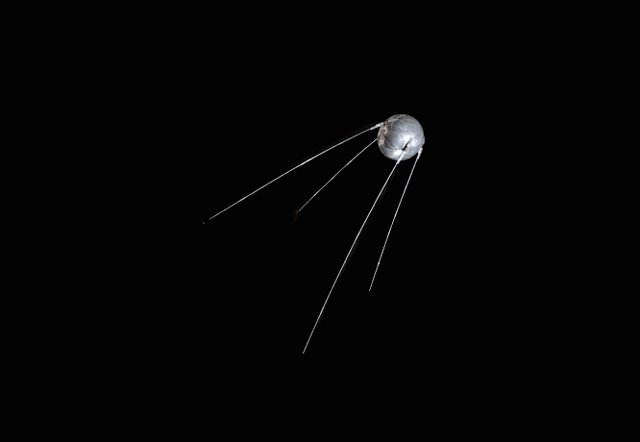
西元 1957 年 8 月 21 日，蘇聯 R-7 火箭完成史上第一次洲際飛彈（ICBM）測試；10 月 4 日，同一枚火箭把史普尼克一號送入軌道——**太空時代在 44 天內開幕**。這樁案件的兇手是「多級火箭＋軌道力學」：V-2 的技術（1944，[戰略轟炸與V武器](https://chad-liu.github.io/books/html/1-6-3.武器與戰法/1944-戰略轟炸與V武器.html)）加上核彈頭小型化（氫彈，1952），使「30 分鐘投送核彈」成為可能。但案件的深層後果在衛星：偵察衛星（1960 日冕計畫）使「先發制人的突襲」可以被查證——**透明化使嚇阻與軍備控制成為可能**；衛星通信、導航（GPS）使太空成為此後一切戰爭的基礎層。

[→ 對外連結：洲際飛彈與人造衛星：太空成為戰場的基礎層](https://chad-liu.github.io/books/html/1-6-3.武器與戰法/1957-洲際飛彈與人造衛星.html)

## 1961 | RPG-7
1961 年，蘇聯 RPG-7 列裝：85 公厘聚能裝藥彈頭、兩級推進（增程藥包＋火箭續推）、有效射程約 300 公尺——**冷戰中產量最大、服役最廣的反坦克火箭筒**。從越南叢林、贖罪日戰場到阿富汗山地，從 1993 年摩加迪沙擊落兩架黑鷹到 2003 年伊拉克街頭，RPG-7 讓「一枚數百美元的火箭」與「數百萬美元的坦克」站上了同一天平。本案偵破的問題是：為什麼一種 1961 年的武器，服役超過六十年仍未退役？

[→ 對外連結：RPG-7：人民戰爭的反坦克答案](https://chad-liu.github.io/books/html/1-6-3.武器與戰法/1961-RPG-7.html)

## 1962 | 相互保證毀滅與博弈論
西元 1945–1962 年間，核武器的毀滅力與投射系統（洲際飛彈、潛射飛彈）同時成熟；1962 年 10 月的古巴飛彈危機使兩個超級大國站在核戰邊緣十三天。案件的兇手是一組**賽局理論**：薛林《衝突的戰略》（1960）以博弈論分析核威懾——嚇阻的有效性取決於「報復能力」而非「攻擊能力」；「雞遊戲」（Chicken）的均衡依賴於「可信的承諾」。這樁案件確立了核時代的戰法：**相互保證毀滅（MAD）——以「確定會同歸於盡」的結構，換取「確定不使用」的均衡**。武器史上第一次，一種武器的戰法是「永遠不使用它」。

[→ 對外連結：相互保證毀滅與博弈論：以「不用」為戰法的武器](https://chad-liu.github.io/books/html/1-6-3.武器與戰法/1962-相互保證毀滅與博弈論.html)

## 1965 | 直升機空騎革命
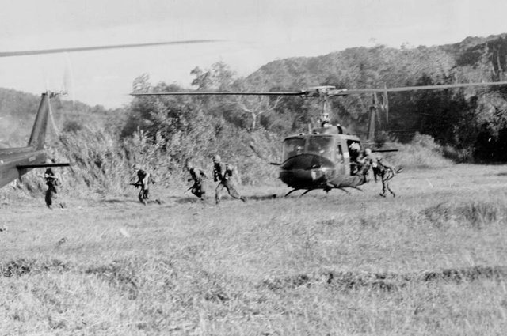
西元 1939 年，西科斯基的 VS-300 完成史上第一架實用直升機；1959 年 UH-1「休伊」問世（渦輪軸引擎使直升機「輕而有力」）。1965 年 11 月 14–16 日，越南伊亞德朗谷（Ia Drang）：美軍第一騎兵師（空中機動）以直升機把步兵直接「放進」叢林戰場——**道路與地形第一次不再是部隊機動的邊界**，「垂直包圍」（vertical envelopment）誕生。但案件也同時暴露極限：登陸區（LZ）可被預測、北越軍以分散與叢林戰反制，直升機損耗驚人——**垂直機動解決了戰術問題，解決不了戰略與政治問題**。

[→ 對外連結：直升機空騎革命：垂直包圍的誕生與極限](https://chad-liu.github.io/books/html/1-6-3.武器與戰法/1965-直升機空騎革命.html)

## 1969 | ARPANET與軍事網路起源
西元 1969 年 10 月 29 日，加州大學洛杉磯分校（UCLA）的一台電腦向史丹佛研究所（SRI）的電腦送出兩個字母「LO」——原本要傳的是「LOGIN」，系統在傳到第三個字母時當機。這樁看似笨拙的「案發現場」，是人類戰爭指揮體系被重寫的第一秒：美國國防部高等研究計畫署（ARPA）出資的 ARPANET 通車了。它的兇手不是槍炮，而是一個數學思想——**分封交換（packet switching）**：把訊息切碎、各自尋路、到點重組。本案的結論：**從此指揮體系不再需要「中心」，打掉任何一個節點，訊息會自己繞路**——集中指揮的戰爭，從這一天開始走向分散式殺傷鏈。

[→ 對外連結：ARPANET與軍事網路起源：把指揮部拆成封包](https://chad-liu.github.io/books/html/1-6-3.武器與戰法/1969-ARPANET與軍事網路起源.html)

## 1972 | 精確制導革命
西元 1972 年 5 月 13 日，越戰「後衛一號」行動：14 架次的美軍戰機以雷射導引炸彈（Paveway I）炸毀了清化橋（哈梅龍橋）。這座橋此前的紀錄是：**1965–1972 年間 871 架次轟炸、損失 11 架飛機，橋仍屹立**。這樁案件的兇手是「雷射導引」：以半主動雷射尋標器追蹤照射雷達/雷射的反射光斑，使圓概率誤差從數百公尺降到數公尺。**精度提升一百倍 = 所需炸彈降為萬分之一**（平方律）。這樁案件宣告了「一彈一標」時代：武器從「以數量補精度」變成「以精度省數量」——精確制導革命改寫了空權、後勤、附帶損害與政治的每一個面向。

[→ 對外連結：精確制導革命：一彈一標的時代](https://chad-liu.github.io/books/html/1-6-3.武器與戰法/1972-精確制導革命.html)

## 1973 | 贖罪日戰爭與導彈平權
西元 1973 年 10 月 6 日（贖罪日），埃及、敘利亞突襲以色列：
開戰一週，以軍坦克損失近半、空軍出擊架次折損率飆升——
兇手是步兵手裡的蘇製 **Sagger 反坦克導彈**與運河岸邊的 **SA-2/SA-6 防空網**。
十九天後以軍靠預備役動員＋美軍空運逆轉，
但「坦克＋戰機無敵」的神話已碎：
**幾百美元的導彈可以打爆幾十萬美元的坦克，幾萬美元的導彈可以逼退幾百萬美元的戰機。**
本案是[精確制導革命](https://chad-liu.github.io/books/html/1-6-3.武器與戰法/1972-精確制導革命.html)的前傳血案——
導彈平權革命的第一場實戰期中考。

[→ 對外連結：贖罪日戰爭與導彈平權：貴平台一夜脆弱](https://chad-liu.github.io/books/html/1-6-3.武器與戰法/1973-贖罪日戰爭與導彈平權.html)

## 1981 | F-117隱形戰機
1981 年 6 月 18 日，洛克希德 F-117 隱形戰機首飛（1977 年 Have Blue 驗證機已證明概念）：多面體鑽石外形、雷達吸波材料——**讓防空雷達的探測距離壓縮到幾乎為零**。1989 年巴拿馬首戰、1991 年海灣戰爭首夜第一彈，F-117 以約 2% 的出動架次打擊了約 40% 的戰略目標。但 1999 年塞爾維亞，一架 F-117 被老式 SA-3 導彈擊落——**隱形與反隱形的貓鼠遊戲就此開場**。本案偵破的問題是：一架沒有武器掛架、沒有超音速、連空戰能力都沒有的飛機，憑什麼成為戰場規則的改寫者？

[→ 對外連結：F-117隱形戰機：讓雷達方程失效的幾何學](https://chad-liu.github.io/books/html/1-6-3.武器與戰法/1981-F-117隱形戰機.html)

## 1982 | 貝卡谷地電子戰
西元 1982 年 6 月 9 日，黎巴嫩貝卡谷地上空：以色列空軍執行「鼴鼠十九」行動，以**無人機誘餌**誘使敘利亞薩姆-6 防空網開雷達、以**反輻射飛彈**追蹤雷達波源、以**預警機**（E-2C）統一指揮、以**電子干擾**壓制敵方通信——數小時內摧毀敘軍防空陣地十九處中的絕大多數，並在接下來數日空戰中擊落敘機八十餘架，自身空戰損失近零。這樁案件是**體系戰**的誕生宣言：勝負不在飛機性能（敘軍米格-21 與薩姆-6 都是同代精品），而在**「偵測—欺騙—壓制—打擊」的資料閉環**。電子戰、無人機、預警機構成的體系，成為此後所有空戰的標準形態。

[→ 對外連結：貝卡谷地：電子戰與無人機的誕生](https://chad-liu.github.io/books/html/1-6-3.武器與戰法/1982-貝卡谷地電子戰.html)

## 1983 | GPS與定位戰爭
西元 1983 年，美國 GPS 星座完成早期組網，同年雷根總統宣布 GPS 向民用開放（導火線是韓航 007 偏航被擊落事件）。1991 年海灣戰爭中，美軍地面部隊在無特徵的沙漠裡靠 GPS 接收機完成「左勾拳」大迂迴——五十萬大軍在沙漠中夜行數百公里而不迷路。本案的兇手是一句話：**定位即戰力**。案件結論：**從此「知道自己在哪」不再是地圖與指北針的技藝，而是衛星原子鐘的數學服務**——導航戰（NAVWAR）誕生：能定位的一方打不能定位的一方，戰爭第一次出現「座標維度」的代差。

[→ 對外連結：GPS與定位戰爭：「我在哪裡」變成武器](https://chad-liu.github.io/books/html/1-6-3.武器與戰法/1983-GPS與定位戰爭.html)

## 1991 | 海灣戰爭與資訊化
西元 1991 年 1 月 17 日凌晨，海灣戰爭的空襲開始：F-117 隱形戰機穿過伊拉克防空網直插巴格達，戰斧巡弋飛彈與阿帕契直升機同時打擊預警節點——**伊拉克的指揮體系在第一夜被癱瘓**。此後 38 天空襲（約十萬架次）、100 小時地面戰，聯軍以極小代價（戰鬥死亡百餘人）殲滅世界第四大陸軍。這樁案件確立了「資訊化戰爭」範式：**隱形（不被偵測）＋精確（一彈一標）＋資訊（體系癱瘓）**的組合——軍事革命的（RMA）範式之戰。

[→ 對外連結：海灣戰爭與資訊化：隱形、GPS 與平行作戰](https://chad-liu.github.io/books/html/1-6-3.武器與戰法/1991-海灣戰爭與資訊化.html)

## 2001 | 反恐戰爭與武裝無人機
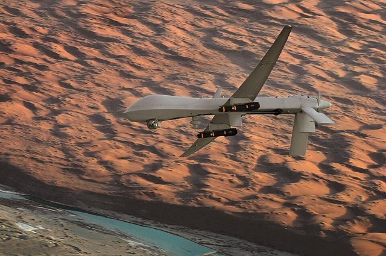
西元 2001 年 10 月 7 日，阿富汗戰爭開打；美軍以特種部隊＋空權＋北方聯盟擊垮塔利班政權。同年，武裝 Predator 無人機（掛地獄火飛彈）投入實戰；2002 年 2 月 4 日，無人機完成史上首次「獵殺式」打擊。這樁案件確立了無人機時代的兩個革命：**持久性（persistence）**——無人機可以在目標上空停留二十餘小時（戰機只有數分鐘），使「觀察」從「瞬間」變成「常態」；**人機分離**——操作員在內華達，目標在阿富汗，**殺傷鏈跨越半個地球**。阿富汗戰爭也暴露了精確制導的極限：**軍事的速勝打不贏政治的叛亂**——二十年戰爭以 2021 年喀布爾陷落告終。

[→ 對外連結：反恐戰爭與武裝無人機：殺傷鏈開始永遠在線](https://chad-liu.github.io/books/html/1-6-3.武器與戰法/2001-反恐戰爭與武裝無人機.html)

## 2007 | 震網與網路戰
西元 2010 年 6 月，白俄羅斯資安公司偵測到一隻前所未有的蠕蟲——震網（Stuxnet）。分析揭示了一樁戰爭史上的新案件：這隻約 500KB 的蠕蟲專門攻擊伊朗納坦茲核濃縮廠的西門子 PLC（可程式邏輯控制器），**以假感測器資料欺騙操作員，同時操縱離心機轉速劇烈變化**——上千台離心機因疲勞損毀，伊朗濃縮進度被拖慢約一至兩年；而操作員面前的儀表板一切正常。這是史上第一種**以軟體實體破壞戰略基礎設施**的武器。案件的兇手是「控制理論的攻擊」：**不是摧毀系統，而是讓系統「在你看來正常」地自我毀滅**——網路戰時代的開幕。

[→ 對外連結：震網與網路戰：以「假資料」實體破壞](https://chad-liu.github.io/books/html/1-6-3.武器與戰法/2007-震網與網路戰.html)

## 2014 | 克里米亞混合戰
西元 2014 年 2–3 月，烏克蘭革命推翻親俄總統後，
無標誌武裝人員一夜控制克里米亞議會、機場、軍營，
3 月公投、俄羅斯宣布吞併——
**不發一槍拿下一座半島、一個艦隊基地、200 萬人口。**
兇手不是坦克師，而是一套配方：
特種部隊＋資訊封鎖＋網路攻擊＋政治代理人＋閃電公投：
C混合 = SOF + 資訊戰 + 網攻 + 代理人 + 法理包裝 ≪ C常規入侵
本案是 2022 年全面戰爭（[俄烏戰爭與FPV無人機](https://chad-liu.github.io/books/html/1-6-3.武器與戰法/2022-俄烏戰爭與FPV無人機.html)）的前傳——
混合戰成功的那一次，以及失敗的那一次。

[→ 對外連結：克里米亞混合戰：小綠人、公投與資訊戰的無硝煙吞併](https://chad-liu.github.io/books/html/1-6-3.武器與戰法/2014-克里米亞混合戰.html)

## 2019 | 高超音速滑翔武器
西元 2019 年底，俄羅斯「先鋒」（Avangard）高超音速滑翔載具宣布戰鬥值班；此前中國東風-17 在建國 70 週年閱兵亮相，美國則重啟多個高超音速計畫。這樁案子的兇手是一個速度區間——**5 馬赫以上＋大氣層內滑翔＋全程機動**。傳統彈道飛彈快但軌跡可預測（拋物線），巡弋飛彈機動但慢（亞音速）；高超音速滑翔器兩者兼得：**快得攔不住，拐得算不準**。本案結論：**它壓縮的不是射程，而是決策時間**——從發現到命中只剩分鐘級，預警—決策—攔截的整條鏈被逼到物理極限。

[→ 對外連結：高超音速滑翔武器：把預警時間壓成灰](https://chad-liu.github.io/books/html/1-6-3.武器與戰法/2019-高超音速滑翔武器.html)

## 2020 | 納卡戰爭與無人機
西元 2020 年 9 月 27 日至 11 月 9 日，亞塞拜然與亞美尼亞在納哥諾卡拉巴克（納卡）開戰，44 天內亞塞拜然以**TB2 武裝無人機＋遊蕩彈藥（Harop 自殺無人機）＋精確炮兵**，擊毀亞美尼亞數百輛裝甲車輛、防空系統與火炮，戰爭以亞塞拜然勝利結束。這樁案件的兇手是一組成本數學：**五百萬美元的無人機系統可以逐一摧毀數百萬美元的坦克與防空系統**——「便宜演算法打敗昂貴平台」的時代開幕。這是第一次以無人機為主導、以社群媒體影片為「戰報」的戰爭——**開源情報（OSINT）使戰場第一次完全可查證**。

[→ 對外連結：納卡戰爭與無人機：便宜演算法打敗昂貴平台](https://chad-liu.github.io/books/html/1-6-3.武器與戰法/2020-納卡戰爭與無人機.html)

## 2022 | 俄烏戰爭與FPV無人機
西元 2022 年 2 月 24 日，俄羅斯全面入侵烏克蘭。這場戰爭是武器與戰法史上的一次「總復習＋總創新」：塹壕戰（一戰）＋鐵路時刻表的動員（普法）＋透明戰場（無人機偵察）＋FPV 自殺無人機（新的武器類別）＋星鏈（民用衛星成為戰場神經）＋精確導彈（海王星擊沉莫斯科號）＋電子戰（干擾與反干擾的週期賽）＋滑翔炸彈（JDAM 的廉價版）＋AI 輔助目標獲取。案件的核心結論：**在「透明戰場」上，任何大規模集結都會被看見並打擊**——進攻的機動性被偵察革命壓制，戰爭回到「工業化消耗」＋「無人機的微戰術」的雙層結構。

[→ 對外連結：俄烏戰爭與FPV無人機：透明戰場的工業化消耗戰](https://chad-liu.github.io/books/html/1-6-3.武器與戰法/2022-俄烏戰爭與FPV無人機.html)
