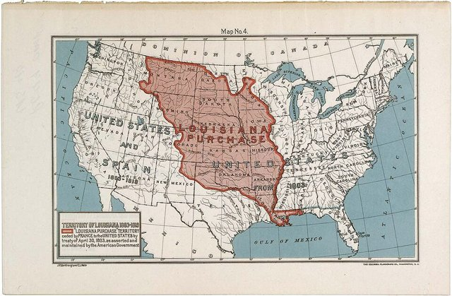
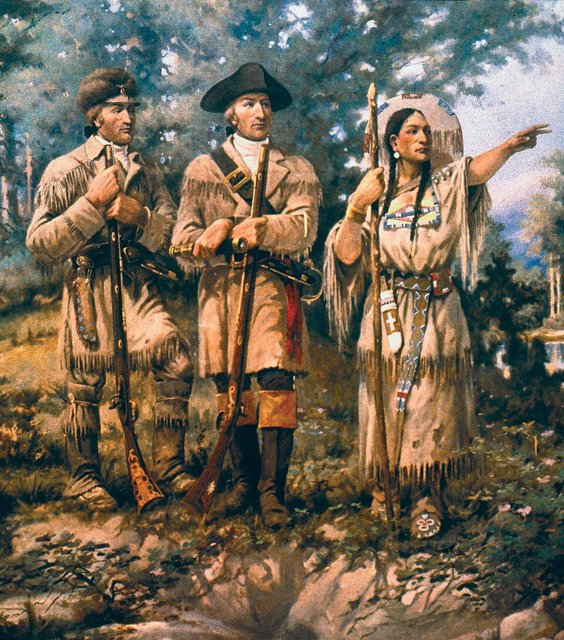
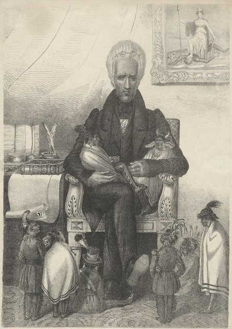
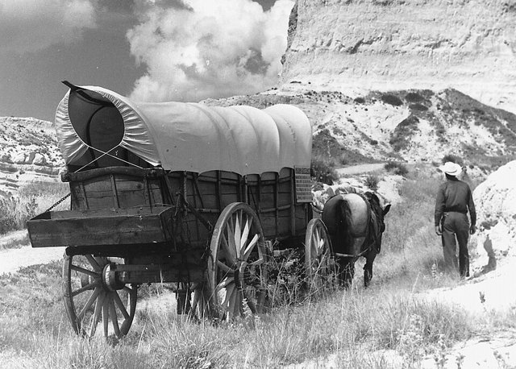
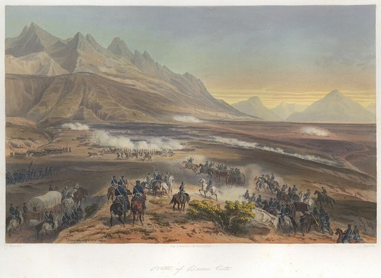
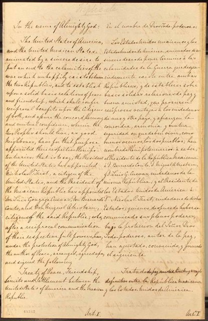
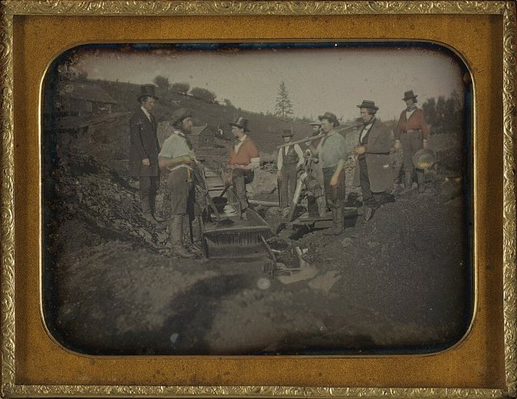
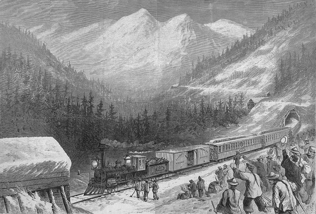
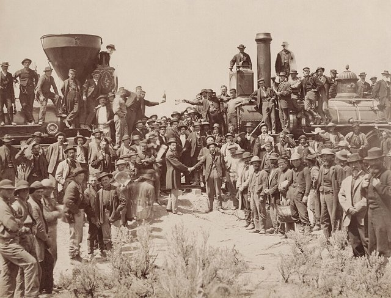
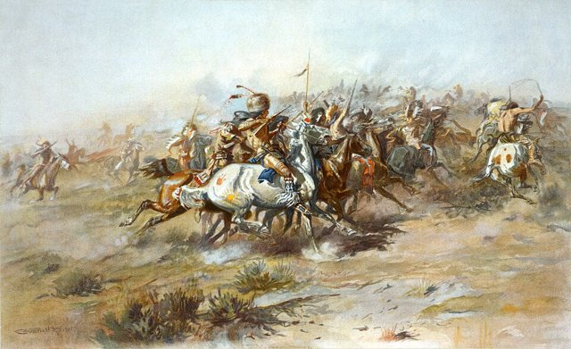

<!--
內容整合自「美國西進運動大事記（1803－1890）」（D:\Books\md\歷史\西方歷史\美國西進運動大事記（1803－1890）.md；html 版在 D:\Books\html\1-1.西方歷史），以自己的話改寫；另參考中文維基百科「西進運動」（奧勒岡、加利福尼亞、摩門等移民小徑）。
時期依大事記的六個階段，但第三、四階段都含1848年，第五、六階段的界線（1877）與事件的歸屬不一致（1876年小大角河戰役列在第六章），這裡改為不重疊的區間：1846－1848、1849－1860、1861－1876、1877－1890，事件依日期歸入。
處理方式：
- 《瓜達盧佩·伊達爾戈條約》，大事記寫美國參議院在1848年5月30日批准；依維基百科，參議院是3月10日批准，5月30日是兩國互換批准書、條約生效，這裡依後者改寫。
- 加茲登購地，大事記作1854年6月8日「簽訂」；條約是1853年12月30日簽訂，1854年6月8日互換批准書生效，這裡放在1853年12月30日，生效日寫進內文。
- 刺絲鐵網，大事記作1873年取得專利；格利登是1873年提出申請、1874年11月取得專利，這裡依後者。
- 德州《貝拉斯科條約》，大事記作「瓦爾斯科條約」，依通行譯名改。
- 大事記中重複出現的事件（1848年2月2日瓜達盧佩·伊達爾戈條約、1869年鐵路接通後的影響）各只列一次；沒有具體內容的年代條目（如「1820年代西部移民潮增加」「1880年代大平原農業開發加速」）寫進相鄰事件的內文。
- 1889－1890年六州加入聯邦合為一則。
- 密蘇里妥協、1850年妥協案與流血的堪薩斯，「美國南北戰爭」時間軸也有，這裡著重領土擴張與奴隸制的關係；橫貫大陸鐵路與1862年的立法，「美國工業革命」時間軸也有。
- 人名用·分隔（大事記作・）。
圖片來源（皆為 Wikimedia Commons 公有領域／CC0 作品，縮成最長邊 640px）：
- wex-progress.jpg：American Progress (1872) by John Gast.jpg（約翰·加斯特〈美國進步〉，1872，「昭昭天命」的經典意象）
- wex-louisiana.jpg：Map of the Louisiana Purchase Territory - NARA - 594889.jpg（路易斯安那購地範圍圖（美國國家檔案館））
- wex-lewisclark.jpg：Detail Lewis & Clark at Three Forks.jpg（〈路易斯與克拉克在三叉口〉壁畫局部（蒙大拿州議會大廈））
- wex-jackson.jpg：Andrew Jackson as the Great Father.jpg（諷刺畫〈安德魯·傑克森作為「偉大的父親」〉，1830年代）
- wex-oregon.jpg：Conestoga wagon on Oregon Trail - NARA - 286056 crop.jpg（奧勒岡小徑上的篷車（1961年重現，美國國家檔案館））
- wex-buenavista.jpg：Nebel Mexican War 03 Battle of Buena Vista.jpg（內貝爾〈布埃納維斯塔之役〉，1851年手工上色石版畫）
- wex-guadalupe.jpg：Treaty of Guadalupe Hidalgo.jpg（《瓜達盧佩·伊達爾戈條約》原件，1848）
- wex-goldminers.jpg：California gold miners with long tom.jpg（加州淘金者與長型淘金槽，約1850–1852年的銀版照片）
- wex-chinese.jpg：Chinese railroad workers sierra nevada.jpg（中央太平洋鐵路穿越內華達山脈的防雪棚與華工，1870年版畫）
- ain-lastrail.jpg：East and West Shaking hands at the laying of last rail Union Pacific Railroad - Restoration.jpg（1869年5月10日，橫貫大陸鐵路在普羅蒙特里峰接軌（與美國工業革命時間軸共用））
- wex-custer.jpg：Charles Marion Russell - The Custer Fight (1903).jpg（查爾斯·羅素〈卡斯特之戰〉，1903，從原住民族一方描繪小大角河之役）
-->

# Periods
- 1803 ~ 1819 | 領土擴張的起點 | #868e96
  傑佛遜向拿破崙買下路易斯安那，美國領土幾乎擴大一倍；路易斯與克拉克橫越大陸到太平洋，派克探索西南，毛皮商在太平洋西北設立據點；西班牙讓出佛羅里達。
- 1820 ~ 1845 | 昭昭天命 | #e67700
  密蘇里妥協讓奴隸制隨著西進成為政治爭議；傑克森的遷移法把東南部原住民族趕往密西西比河以西；美國移民在墨西哥的德州起事獨立。到1845年，「昭昭天命」成了擴張的口號，德州併入美國。
- 1846 ~ 1848 | 美墨戰爭與太平洋領土 | #c92a2a
  美國與英國以北緯49度劃分奧勒岡，又打贏美墨戰爭，取得加州與西南大片土地。戰爭結束前幾天，加州發現了黃金。
- 1849 ~ 1860 | 淘金熱與奴隸制之爭 | #f08c00
  淘金熱讓加州人口暴增，以自由州加入聯邦；每一塊新領土都要決定是否准許奴隸制，從1850年妥協案到流血的堪薩斯，西進與奴隸制的糾纏把國家推向內戰。
- 1861 ~ 1876 | 鐵路與大平原 | #1971c2
  內戰期間的宅地法與太平洋鐵路法，把西進變成國家主導的開發；橫貫大陸鐵路接通，牧牛業、礦業與農業湧入大平原。原住民族的抵抗與屠殺不斷，條約一再被撕毀，小大角河之役是他們最著名的勝利。
- 1877 ~ 1890 | 邊疆的終結 | #5f3dc4
  原住民族被迫進入保留地，寄宿學校與道斯法案瓦解他們的語言與土地；華工被排斥，西部各州相繼建立。1890年傷膝河大屠殺，人口普查宣告邊疆線已無法辨認。

# Events

## 1803-04-30 | 路易斯安那購地

法國在海地革命中損兵折將，又準備與英國再戰，拿破崙決定出售整個路易斯安那。原本只想買下紐奧良的美國談判代表當機立斷，以1,500萬美元買下約82萬8千平方英里的土地，約占今日美國國土的四分之一，領土幾乎擴大一倍。10月20日參議院批准，12月20日美國接收紐奧良，取得密西西比河的出海口，西部農產品從此可以經由河運出海。

## 1804-05-14 | 路易斯與克拉克探險

傑佛遜派梅里韋瑟·路易斯與威廉·克拉克率領探險隊，從聖路易附近出發，沿密蘇里河上溯，翻越落磯山脈，1805年11月抵達太平洋岸的哥倫比亞河口，1806年9月23日返回聖路易。肖肖尼族女子薩卡加維亞擔任嚮導與翻譯；探險隊帶回大量地理、動植物與原住民族的紀錄，讓美國東部第一次認識西部的樣貌。

## 1806 | 派克探險
澤布倫·派克奉命探索路易斯安那購地的西南邊界，在今日科羅拉多州看到後來以他命名的派克峰，1807年進入西班牙領土時被捕，獲釋後出版的報告引起東部對西南與大平原的注意。

## 1811 | 阿斯托里亞
紐約毛皮商約翰·雅各·阿斯托派人到哥倫比亞河口建立毛皮貿易站阿斯托里亞，是美國在太平洋西北的第一個據點，雖然在美英戰爭中被迫賣給英國人，卻成為日後美國主張奧勒岡的依據之一。1811年至1812年，密西西比河中游的新馬德里一帶發生一連串強烈地震。

## 1819-02-22 | 亞當斯—奧尼斯條約
1818年，安德魯·傑克森以追擊塞米諾爾人為由率軍進入西屬佛羅里達，攻占西班牙據點。西班牙無力防守，國務卿約翰·昆西·亞當斯與西班牙公使奧尼斯簽約，西班牙把佛羅里達割讓給美國，並劃定美國與西班牙在北美的邊界，西班牙放棄對奧勒岡的主張。美國在1821年7月正式接管佛羅里達。

## 1820-03-06 | 密蘇里妥協
1820年代，大批農民、商人與拓荒者越過密西西比河。密蘇里申請以蓄奴州加入聯邦，打破了南北州數的平衡。國會妥協：密蘇里以蓄奴州、緬因以自由州加入；路易斯安那購地範圍內北緯36度30分以北，除密蘇里外禁止奴隸制。密蘇里在1821年8月10日成為第24州。新領土能否實行奴隸制，從此成為西進過程中反覆爆發的爭議。

## 1830-05-28 | 《印第安人遷移法》

1828年當選總統的傑克森，主張把東南部的原住民族遷到密西西比河以西。遷移法授權總統以西部土地交換原住民族的祖居地，名義上是協商，實際上是強迫。切羅基族以訴訟抵抗，1832年最高法院在伍斯特訴喬治亞州案中判決喬治亞州無權管轄切羅基族的土地，但傑克森政府不予執行。同年，中西部的黑鷹戰爭讓索克族與福克斯族失去伊利諾與威斯康辛的土地。

## 1835-10-02 | 德州革命
1821年墨西哥脫離西班牙獨立，為開發北方邊疆，允許美國移民進入德州定居。美國移民很快多過當地的墨西哥人，許多人還帶著奴隸，墨西哥在1829年廢除奴隸制、1830年限制美國移民，又走向中央集權，雙方衝突升高，終於在岡薩雷斯爆發戰鬥。

## 1836-03-06 | 阿拉莫之役
德州在3月2日宣布獨立，成立德克薩斯共和國。墨西哥總統聖塔安那率軍圍攻聖安東尼奧的阿拉莫要塞，守軍近兩百人全數戰死，其中包括邊疆英雄大衛·克羅克特。「記住阿拉莫」成為德州人的戰鬥口號。

## 1836-04-21 | 聖哈辛托之役
山姆·休士頓率領的德州軍隊突襲聖塔安那的營地，不到二十分鐘就擊潰墨西哥軍，聖塔安那被俘。5月14日，他被迫簽署《貝拉斯科條約》，承諾撤軍，但墨西哥政府始終不承認德州獨立。此後近十年，德州以獨立國家存在，並尋求加入美國；美國北方擔心增加一個蓄奴州，併入一再延宕。

## 1838 | 切羅基族的「血淚之路」
大多數切羅基人不承認少數人簽下的遷移條約，聯邦軍隊在1838年把他們集中拘禁，再分批押送到今日奧克拉荷馬的印第安領地。途中因疾病、飢餓與嚴寒，估計約四千人死亡，到1839年才抵達。喬克托、克里克、奇克索與塞米諾爾等族也遭到類似的強制遷移，塞米諾爾人在佛羅里達則以長達七年的戰爭抵抗。

## 1843 | 奧勒岡小徑大移民

上千名移民組成馬車隊，從密蘇里州出發，沿奧勒岡小徑走上約3,500公里、歷時四到六個月，前往太平洋西北的威拉米特河谷，揭開大規模陸路移民的序幕。從密蘇里出發的奧勒岡小徑、加利福尼亞小徑與摩門小徑合稱「移民小徑」，此後二十多年間有數十萬人經由這些路線西行。1844年，主張擴張的詹姆斯·波爾克當選總統。

## 1845-12-29 | 德州加入聯邦
記者約翰·奧沙利文在這一年寫下「昭昭天命」（Manifest Destiny），宣稱美國有上天賦予的使命，要擴展到整個北美大陸。這個口號把擴張描繪成民族使命，也被用來合理化對墨西哥與原住民族土地的侵占。德州在年底成為第28州，墨西哥隨即與美國斷交。

## 1846-05-13 | 美墨戰爭爆發
美國與墨西哥對德州的南界各執一詞，美國主張格蘭德河，墨西哥主張更北的努埃塞斯河。波爾克派軍進入兩河之間的爭議地帶，4月25日雙方騎兵交火，波爾克宣稱「美國人的血灑在美國的土地上」，國會隨即宣戰。林肯等反對者認為這是一場為擴大奴隸制而發動的侵略戰爭。

## 1846-06-14 | 加州熊旗起義
加州的美國移民在索諾馬起事，升起畫有灰熊的旗幟，宣布成立「加利福尼亞共和國」；約翰·弗里蒙特率領的探勘隊隨即加入。7月美國海軍占領蒙特雷，加州很快落入美軍控制，熊旗後來成為加州州旗的圖案。同時，美軍也向新墨西哥推進，8月不戰而取聖塔菲。

## 1846-06-15 | 奧勒岡條約
美國與英國原本共管奧勒岡地區，擴張派喊出「北緯54度40分，不然就開戰」，要求整個地區。波爾克一面準備與墨西哥開戰，一面與英國妥協，以北緯49度為界劃分，美國取得今日的奧勒岡、華盛頓、愛達荷等地，太平洋沿岸的領土就此確定，避免了兩面作戰。1848年成立奧勒岡領地。

## 1847-02-22 | 布埃納維斯塔之役

扎卡里·泰勒率領的美軍在墨西哥北部，以寡擊眾擋住聖塔安那的大軍。此前美軍已在1846年9月攻下北部重鎮蒙特雷。泰勒因戰功成為全國英雄，1848年當選總統。

## 1847-07-24 | 摩門教徒抵達鹽湖谷
摩門教（耶穌基督後期聖徒教會）在東部屢遭迫害，創始人約瑟夫·史密斯在1844年被暴徒殺害。繼任的百翰·楊率領教徒長途西遷，抵達當時仍屬墨西哥的大鹽湖谷地，建立鹽湖城，以灌溉開墾沙漠，奠定了猶他地區的定居社群。

## 1847-09-14 | 美軍攻占墨西哥城
溫菲爾德·史考特率軍在韋拉克魯斯登陸，一路打到墨西哥城。9月13日的查普爾特佩克戰役中，墨西哥軍校的少年學員死守城堡，被墨西哥人尊為「少年英雄」。隔天美軍進入首都，墨西哥政府被迫求和。

## 1848-01-24 | 加州發現黃金
木匠詹姆斯·馬歇爾在為約翰·薩特興建的鋸木廠水道中發現金砂。九天後簽訂的和約讓加州正式成為美國領土，消息起初未被重視；12月5日，波爾克總統在國會證實加州發現黃金，淘金熱隨即席捲美國與全世界。

## 1848-02-02 | 瓜達盧佩·伊達爾戈條約

美墨戰爭結束。墨西哥承認格蘭德河為德州邊界，並把加州、新墨西哥等地割讓給美國，涵蓋今日加州、內華達、猶他的全部，以及亞利桑那、新墨西哥、科羅拉多、懷俄明的一部分，約占墨西哥原有領土的一半；美國支付1,500萬美元，並承擔美國公民對墨西哥政府的索賠。美國參議院在3月10日批准，5月30日兩國互換批准書。美國從此成為橫跨大陸、面向太平洋的國家，但新領土是否准許奴隸制，立刻成為激烈的政治爭議。

## 1849 | 四九年淘金者

來自美國東部、拉丁美洲、歐洲與中國的淘金者湧入加州，被稱為「四九年淘金者」。舊金山從幾百人的小港在幾年內變成數萬人的城市，成為太平洋岸的商業中心。少數人致富，更多人一無所獲，真正賺錢的往往是賣工具、衣物與食物的商人；淘金熱也帶來對加州原住民族的屠殺與驅逐，以及對華人、墨西哥人等外國礦工的歧視性課稅。

## 1850-09-09 | 加州加入聯邦
人口暴增的加州直接申請以自由州加入，南方擔心參議院的平衡被打破。亨利·克萊在1月提出的一連串方案，經過數月辯論，9月以《1850年妥協案》通過：加州以自由州成為第31州，德州邊界調整，新墨西哥與猶他領地的奴隸制交由當地居民決定，首都禁止奴隸買賣，並制定更嚴格的《逃奴法》（9月18日），激起北方廢奴人士強烈反彈。

## 1853-12-30 | 加茲登購地
為了修建一條經由南方通往太平洋的鐵路，美國駐墨西哥公使詹姆斯·加茲登與墨西哥簽約，以1,000萬美元買下今日亞利桑那南部與新墨西哥西南部約29,670平方英里的土地，1854年6月8日生效。今日美國本土的西南疆界由此大致底定。

## 1854-05-30 | 堪薩斯—內布拉斯加法案
參議員史蒂芬·道格拉斯為了讓橫貫大陸鐵路走北方路線，推動成立堪薩斯與內布拉斯加兩個領地，由居民投票決定是否實行奴隸制，等於推翻了密蘇里妥協的界線。支持與反對奴隸制的移民湧入堪薩斯，爆發「流血的堪薩斯」：1856年5月21日，蓄奴派武裝洗劫自由派據點勞倫斯鎮；5月24日至25日，廢奴主義者約翰·布朗在波特瓦托米溪殺害五名蓄奴派移民。反對奴隸制擴張的人士也在這時組成共和黨。

## 1859 | 康斯托克銀礦
在今日內華達州維吉尼亞城一帶發現蘊藏豐富的銀礦，大批礦工從加州翻山而來，內華達在1864年就成為州。同年，科羅拉多的派克峰也掀起淘金熱；2月14日，奧勒岡成為第33州。到內戰爆發前，鐵路與電報已逐漸向西延伸，美國取得了大部分的太平洋沿岸領土。

## 1862-05-20 | 《宅地法》
南北戰爭在1861年4月爆發，南方議員退出國會，北方得以通過過去被南方擋下的西部開發法案。凡年滿21歲、未曾與聯邦為敵的公民或申請入籍者（包括女性與獲得自由的黑人），在160英畝的公有土地上居住並耕作五年，就能取得所有權。5月15日，聯邦農業部成立；7月2日的《莫里爾法案》撥地給各州設立農業與機械學院。宅地法最終讓約160萬人取得土地，但也有不少土地落入投機者與鐵路公司手中。

## 1862-07-01 | 《太平洋鐵路法》

聯邦以土地與公債資助中央太平洋與聯合太平洋兩家公司興建橫貫大陸鐵路。中央太平洋在1863年1月從加州沙加緬度向東動工，在內華達山脈的峭壁與嚴冬中開鑿隧道，主力是上萬名華工；聯合太平洋在1863年底從內布拉斯加的奧馬哈向西鋪設，多用愛爾蘭移民與退伍軍人。西進從個人拓荒轉變為國家主導的開發計畫。

## 1862-08 | 達科他戰爭
明尼蘇達州的達科他族因政府拖欠條約款項、商人拒絕賒售糧食而陷入飢荒，一名商人甚至說「讓他們吃草」，憤而起事，數百名白人定居者喪生。亂事平定後，12月26日有38名達科他人在曼卡托被同時絞死，是美國史上規模最大的一次集體處決；達科他族隨後被逐出明尼蘇達。

## 1864-11-29 | 沙溪大屠殺
科羅拉多領地的民兵在約翰·奇文頓率領下，攻擊在沙溪紮營、已表明和平意向的夏安族與阿拉帕霍族營地，殺害約一百五十人，多數是婦女、兒童與老人。國會調查譴責了這場屠殺，卻沒有人受到懲處；大平原的戰事因此擴大。

## 1866-12-21 | 費特曼之役
拉科塔族領袖紅雲為阻止美軍沿波茲曼小徑修建堡壘、穿越他們的獵場，發動「紅雲戰爭」。誘敵出擊的拉科塔、夏安與阿拉帕霍戰士在懷俄明全殲威廉·費特曼率領的81名美軍，是大平原戰爭中美軍的重大挫敗。

## 1868-04-29 | 第二次拉勒米堡條約
1867年國會成立印第安和平委員會，改以條約與保留地處理原住民族問題。在這份條約中，美國放棄波茲曼小徑沿線的堡壘，承認包括黑山在內的大蘇族保留地，紅雲贏得了戰爭。但不到十年，美國就因黑山的黃金違反了條約。

## 1869-05-10 | 橫貫大陸鐵路接通

兩條鐵路在猶他州普羅蒙特里峰會合，打下最後一根金色道釘。原本需要數月的陸路旅程縮短到約一週，移民、牛隻、礦產與農產品大量往來；1870年代鐵路支線持續擴建，西部的城市、農業聚落與礦區逐漸接上全國市場。鐵路也把大平原切割開來，獵人搭著火車大量獵殺野牛，原住民族賴以為生的野牛群在二十年間幾乎絕跡。

## 1872-05-10 | 《一般礦業法》
規定公民可以在聯邦公有地上自由探勘，發現礦藏後登記即取得採礦權，並能以每英畝幾美元的低價買下土地，至今仍大致有效。同年3月，國會設立世界第一座國家公園黃石國家公園。

## 1874 | 黑山的黃金與刺絲鐵網
喬治·卡斯特率領的探勘隊證實黑山有金礦，大批礦工不顧條約湧入拉科塔人的聖地，政府試圖收購遭拒後，轉而以武力逼迫原住民族進入保留地。同年11月，約瑟夫·格利登取得刺絲鐵網的專利，在缺乏木材與石材的大平原上，農場與牧場終於能以低成本圍起土地。1870年代也是德州長角牛的全盛期，牛仔沿著奇瑟姆小徑等路線把牛群趕到堪薩斯的鐵路站，再運往東部；隨著圍籬增加，開放牧場的時代逐漸結束。

## 1876-06-25 | 小大角河之役

在蒙大拿的小大角河畔，坐牛與瘋馬等領袖率領的拉科塔、北夏安與阿拉帕霍戰士，全殲喬治·卡斯特直接率領的第七騎兵團約兩百人，這是原住民族抵抗中最著名的勝利。正值美國建國百週年，消息震驚全國，政府隨即大舉增兵，不到一年，大多數拉科塔人被迫投降，黑山也被收歸聯邦。8月1日，科羅拉多成為第38州。

## 1877-10-05 | 約瑟夫酋長投降
內茲珀斯族拒絕遷入縮小後的保留地，約瑟夫酋長帶領族人避戰，在數月間轉戰約1,900公里，想逃往加拿大，在距邊境約64公里處被美軍包圍而投降，留下「從太陽此刻所在之處起，我將永遠不再戰鬥」的名言。1878年，愛達荷的班諾克族與部分派尤特族也因保留地的糧食短缺起兵，遭到鎮壓。

## 1879 | 卡萊爾印第安工業學校
前軍官理查·普拉特在賓州卡萊爾創辦第一所聯邦出資的原住民族寄宿學校，口號是「殺死他身上的印第安人，拯救這個人」。孩子被帶離家庭，剪去長髮、改取英文名字，禁止說母語。此後各地陸續設立數百所類似的學校，對原住民族的語言與文化造成深遠的破壞。

## 1882-05-06 | 《排華法案》
華工在鐵路完工後轉往礦場、農場與城市，西部白人勞工指責他們壓低工資，加州出現以「華人必須滾」為口號的工人黨，排華暴力層出不窮。國會通過法案，十年內禁止華工入境，並禁止在美華人歸化，後來一再延長，直到1943年才廢除；這是美國第一部針對特定族群的移民禁令。

## 1883-09-08 | 北太平洋鐵路通車
從明尼蘇達的五大湖區經過北部大平原通到太平洋西北的北太平洋鐵路全線接通。1885年，加拿大太平洋鐵路也完工，北美大陸的跨洲鐵路網更加完整。1880年代，鐵路、農業機械、刺絲鐵網與耐旱的耕作方法，讓農民在大平原上建立更大規模的農場。

## 1886-09-04 | 傑羅尼莫投降
阿帕契族領袖傑羅尼莫長期在亞利桑那與墨西哥北部抵抗美墨兩國的軍隊，1885年再度帶領一小群族人逃離保留地，美軍動員約五千人追捕。他投降後與族人被送往佛羅里達與阿拉巴馬拘禁，再也沒有回到故鄉。1886年至1887年冬天，大平原遭遇極端嚴寒，大批牛隻凍死，開放牧場的牧牛業大受打擊。

## 1887-02-08 | 《道斯法案》
把保留地分割給原住民族家庭個人所有，每戶通常160英畝，剩下的「多餘土地」開放給白人定居。法案以「文明化」原住民族為名，實際上瓦解了部落的集體土地制度；到1934年廢止時，原住民族擁有的土地從約1億3,800萬英畝減少到約4,800萬英畝。

## 1889-04-22 | 奧克拉荷馬土地奔馳
政府開放印第安領地中未分配的約200萬英畝土地，中午一聲槍響，約五萬人騎馬、駕車衝進去搶占地塊，一天之內就出現了奧克拉荷馬市等城鎮；搶先偷跑進去的人被稱為「搶先者」（Sooners）。1889年11月，北達科他、南達科他、蒙大拿與華盛頓相繼成為州，1890年7月愛達荷與懷俄明也加入聯邦，懷俄明是第一個讓女性投票的州。

## 1890-12-29 | 傷膝河大屠殺
主張舞蹈儀式能讓白人消失、野牛重返的「鬼舞」運動在保留地流傳，當局視為叛亂的前兆。12月15日，坐牛在保留地警察逮捕時遭射殺。兩週後，第七騎兵團在南達科他的傷膝河解除一群拉科塔人的武裝時爆發槍戰，美軍以機關砲掃射，殺害約250到300名拉科塔人，多數是婦女與兒童。這通常被視為西部印第安戰爭的終點。同年的人口普查報告宣布，連續的拓荒邊疆線已無法辨認；1893年，歷史學家特納據此提出「邊疆論」，主張開拓邊疆塑造了美國的民主與個人主義。西進運動讓美國成為橫跨大陸的國家，代價是原住民族失去土地、人口與文化，以及華人等移民遭受的歧視與排斥。
