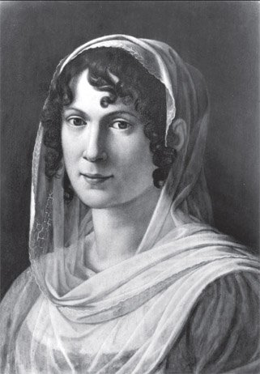
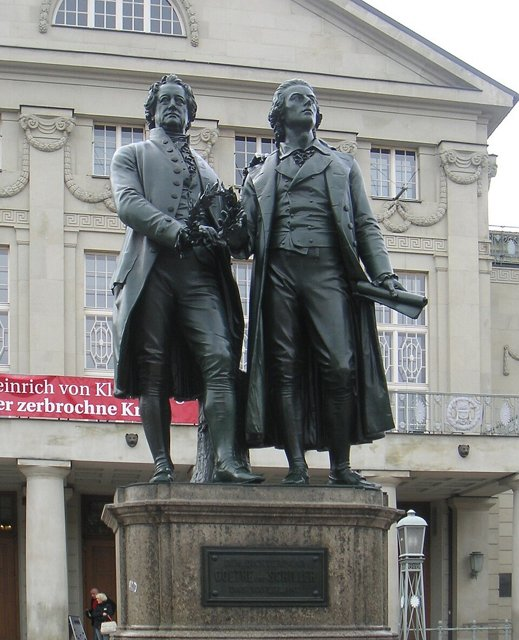
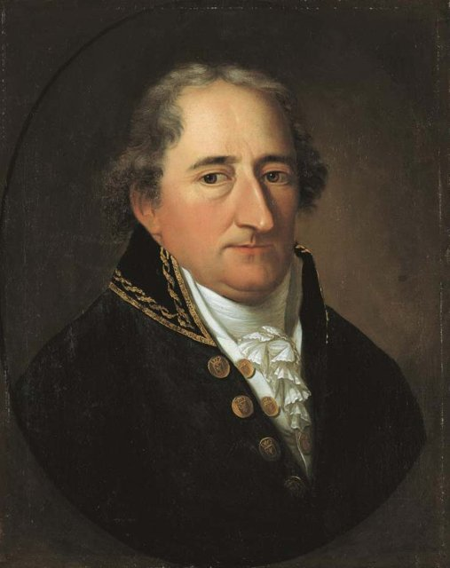
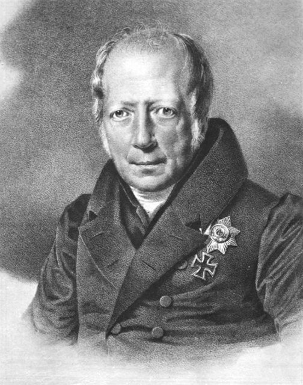
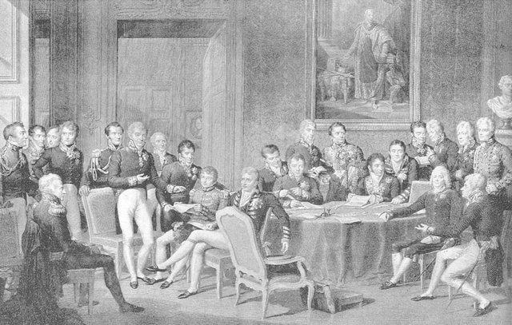
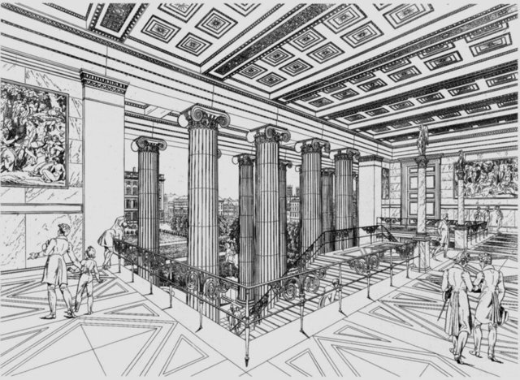
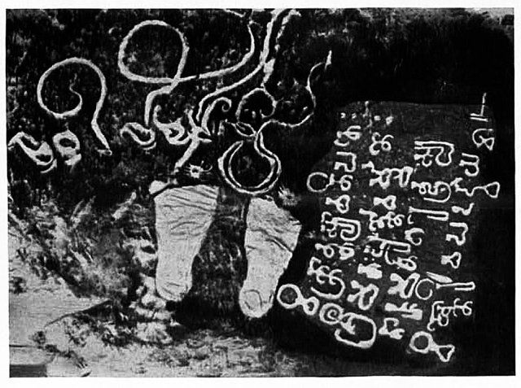
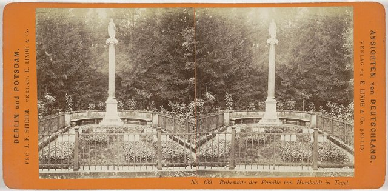

<!--
內容整理自 D:\Books\md\歷史\人物\思想家\威廉・馮・洪堡（Wilhelm von Humboldt）生平大事記.md（Books 的人物頁為 D:\Books\html\2-2.哲學家\威廉・馮・洪堡（Wilhelm von Humboldt）生平大事.html，檔名的中點用「・」），並整合中文維基百科〈威廉·馮·洪堡〉條目，以自己的話改寫。
時期依筆記的章節歸納：出生與家庭教育、大學與早期思想、耶拿與巴黎、西班牙與語言研究、羅馬外交官、普魯士教育改革與柏林大學、維也納與歐洲外交、晚年語言哲學。筆記的「重要思想與學術貢獻」（語言與思想、Energeia、語言結構與世界觀、比較語言學、Bildung、教學與研究合一的大學理念、國家權力與個人自由）「重要著作」「與其他人物的關係」「與亞歷山大的比較」「歷史地位」寫進時期說明與相關事件，不另立事件。人名的分隔號用「·」，亞歷山大·馮·洪堡與「洪堡大學」放入 notNames：亞歷山大有自己的時間軸，洪堡大學則是以兄弟兩人命名，避免人名索引把這些算成提到威廉本人。
兩份資料出入與處理方式：
- 譯名：筆記作「威廉·馮·洪堡」，維基百科頁名同，另有「洪堡特」的譯法，列入 aliases；維基百科全名為弗里德里希·威廉·克里斯蒂安·卡爾·費迪南·馮·洪堡。
- 生卒：筆記與維基百科一致：1767年6月22日生，1835年4月8日在特格爾逝世，享年67歲。出生地：筆記寫普魯士波茨坦。
- 家世：維基百科補充祖父是普魯士軍官，1738年因軍功升為貴族，父親亞歷山大·格奧爾格曾任伊莉莎白太子妃的大管家，1766年與信奉喀爾文派胡格諾教的富有寡婦（母親瑪麗·伊莉莎白）結婚而成為特格爾宮的主人，兄弟在特格爾長大，冬季才搬到柏林，照此併入。
- 家庭教師：筆記寫1771年移居特格爾、家庭教師有教育家坎佩；維基百科寫從1777年起，戈特洛布·約翰·克里斯蒂安·孔特負責協調與監督各門課程十多年，後來成為洪堡夫人的親信顧問與管家，坎佩則在1789年陪同威廉前往革命中的巴黎，這裡兩者併寫。威廉十三歲就能流利說希臘語、拉丁語與法語，十分用功，使身邊的人擔心（維基百科）。
- 父親去世：筆記與維基百科同寫1779年父親去世，母親負責兄弟的教育。
- 大學：筆記寫1787年與弟弟一同進入法蘭克福（奧得河畔）大學學法律、1788年轉入哥廷根大學；維基百科補充母親希望兄弟成為有勢力的大臣，威廉學法學、亞歷山大學國家經濟學，一個學期後（1788年春）威廉離開法蘭克福，進入哥廷根；1788年他在赫茲夫人的沙龍結識後來的妻子卡羅琳，並在旅行中結識福斯特與雅各比，照此。
- 巴黎與婚約：筆記寫1789年旅行法國與比利時、12月16日與卡羅琳·馮·達赫羅登訂婚；維基百科補充他不但關心革命，也到巴黎孤兒院參訪，並在1789年聖誕節與未婚妻在魏瑪度過，認識了席勒與歌德，照此。
- 政府與婚姻：筆記寫1790年進入普魯士外交部門、1791年離開、同年6月29日結婚；維基百科寫他在司法部任職，將接受成為法官的教育，也獲得外交經驗，1791年5月以家庭事務為由辭職（可能反感法官的訓練或有其他興趣），6月29日在埃爾福特與卡羅琳結婚，此後兩年半住在圖林根卡羅琳父母的莊園，一起研究古希臘語、文化、藝術與哲學，照此。
- 《試論國家活動範圍的界限》：筆記寫1792年發表；維基百科補充這部作品被視為德國自由主義的先驅，他寫道人的目的是將他所有的能力作最高、最完整的教育，自由是首要的條件，照此。
- 耶拿：筆記寫1794年移居耶拿、與席勒結為摯友、1795年參與席勒的《時代女神》期刊；維基百科補充除1795至1796年短暫中斷外，到1797年洪堡與席勒在耶拿關係密切，對席勒與後來的歌德來說，他是敏銳的分析家、有益的批評家與顧問，照此。
- 母親去世與巴黎：維基百科寫母親伊莉莎白去世後，兄弟繼承財產，威廉繼承特格爾宮，亞歷山大則得以資助他的美洲之旅；威廉最希望去義大利，但因拿破崙的義大利戰役而無法成行，改搬到巴黎，與西哀士、斯塔爾夫人與大衛有密切交流，並在1799年與1801年兩次從巴黎前往西班牙長期旅行，對巴斯克語的語言學研究有很大成果；筆記寫1797年移居巴黎、1800年前往西班牙，這裡寫「1799–1801年兩次」並採維基百科的說法，筆記另寫1801年8月返回柏林、已有四名子女。
- 羅馬：筆記與維基百科同寫1802年出任普魯士駐教廷代表；維基百科補充這個職務事務不多，他與妻子把使館變成羅馬的社交中心，法國駐教廷代表是拿破崙的弟弟呂西安，1805年夏亞歷山大從美洲回來後，在羅馬哥哥家待了三個月，1804年8月23日洪堡寫給歌德的信中說明羅馬對他的吸引力，照此；筆記寫1806–1807年撰寫《拉丁姆與希臘》，照此。
- 普魯士戰敗：筆記與維基百科同寫1806年耶拿—奧爾施泰特戰役普魯士戰敗，維基百科補充他在羅馬經歷神聖羅馬帝國解體與法國占領柏林，1806年秋寫信給外交部長，說自己無法為受威脅的祖國出力而感到慚愧；筆記寫1808年返回普魯士，維基百科寫他待到1808年10月，請假回國處理財產與被劫掠的特格爾宮，聽說在施泰因的改革中被派管理「文化與公共教育」，照此。
- 教育改革：筆記寫1808–1809年進入施泰因改革政府，擔任內政部宗教與教育部門主管；維基百科補充他猶豫是否接受，因為職務只是內務部長手下的局長，擔心沒有足夠自由，最後接受，在同事的幫助下很快在哥尼斯堡進行迅速但仔細考慮的改革，包括小學、中學、高級中學與大學的課程、教師培訓與考試制度；1809年秋他提出兩份教育系統的設計，主張普及教育，不是階層教育；1809年12月向國王提出建立終身學習的市民社會的報告；1810年引入教師考試、1812年引入統一的中學畢業考試（到1834年才完全執行），照此。
- 柏林大學：筆記與維基百科同寫1810年創立柏林大學（今洪堡大學）；維基百科補充大學一開始就獲得施萊爾馬赫、費希特等人，這裡簡述。洪堡的理想教育有人批評來自他本人貴族優越的生活，財政與社會實際使它難以普及（維基百科），照此。
- 維也納：筆記寫1810年出任普魯士駐維也納大使；維基百科補充1810年秋妻子與孩子從羅馬搬到維也納，他通過少年時期的朋友了解奧地利外交部長梅特涅的政策，正確預言奧地利對拿破崙俄羅斯戰爭的態度，並協助促使奧地利加入反拿破崙聯盟，被認為是他最大的外交成果，照此。
- 維也納會議：筆記與維基百科同寫1814–1815年維也納會議，洪堡是普魯士首相哈登堡的副手，他寫的許多備忘錄後來成為德意志邦聯協約的內容；維基百科補充他的自由主義與梅特涅的復辟傾向越來越對立，到會議結束時對立已使他無法再待在維也納。
- 倫敦與法蘭克福：筆記寫1816年出任駐倫敦大使、1817–1818年參與歐洲外交會議；維基百科寫1816年先被派到法蘭克福談判德意志邦聯的領土糾紛，然後被派為駐倫敦大使（實際上是被架空），在倫敦待了半年就以家庭原因請求調離，哈登堡不希望他回柏林，沒有批准，他直接向國王要求，再次被派為普魯士駐法蘭克福德意志邦聯的代表，照此。
- 卡爾斯巴德決議與解職：筆記寫1819年重新進入政府、擔任管理地方等級制度相關的部長，因反對政府過度限制言論、出版與學術自由而退出；維基百科寫1819年1月被任命為部長（管理階層事務），也許希望實現腓特烈·威廉三世許諾的君主立憲，與哈登堡的憲法計畫有分歧，普魯士與奧地利政府首腦同時達成《卡爾斯巴德決議》，迫害與鎮壓大學與公共生活的自由運動，普魯士決定不立憲法，洪堡的鬥爭徒勞，1819年12月31日因強烈反對警察對「煽動者」的迫害而被解職，照此。
- 晚年：筆記寫1820年向柏林科學院提交比較語言研究論文、1821年《論歷史學家的任務》、1822年《論語法形式的起源及其對觀念發展的影響》、1826年研究《薄伽梵歌》、1827年《論雙數》、1828年南太平洋島嶼語言、1829年3月26日妻子卡羅琳逝世、1830–1835年研究爪哇卡維語、1835年4月8日在特格爾逝世，照此；維基百科補充他與建築師申克爾合作改建特格爾宮（1824年10月落成）、一起建造柏林的老博物館（1830年開幕，國王讚揚他並授權他參加內閣會議，但他很少出席），1825年成為新成立的藝術朋友協會主席，晚年症狀很像帕金森氏症，但每天晚上仍能寫成一首詩，作息時間非常嚴格，從1827年起亞歷山大回到柏林，經常到特格爾拜訪哥哥，照此。
- 身後：筆記寫1836年《論人類語言結構的差異及其對人類精神發展的影響》（身後出版）、1836–1839年《論爪哇島卡維語》陸續出版，照此。
- 人名與其他時間軸一致：亞歷山大·馮·洪堡（Data 的 Humboldt）、歌德（Goethe）、拿破崙（NapoleonicWars）；席勒、施泰因、哈登堡、梅特涅、申克爾沒有獨立時間軸。
圖片來源（皆為 Wikimedia Commons 公有領域／CC0 作品；肖像、版畫與照片不一定與事件同時，僅供對照）：
- wv-cover.jpg：Sir Thomas Lawrence (1769-1830) - Charles William, Baron von Humboldt (1767-1835) - RCIN 404936 - Royal Collection.jpg（威廉·馮·洪堡像（勞倫斯繪，英國皇家收藏））
- wv-caroline.jpg：Humboldt, Caroline von (1766-1829).jpg（妻子卡羅琳·馮·洪堡的肖像）
- wv-weimar.jpg：GoetheAndSchillerMonumentAtWeimar.jpg（魏瑪的歌德與席勒紀念像）
- wv-stein.jpg：Porträt des Freiherrn Karl vom und zum Stein als preußischer Minister.jpg（施泰因男爵像（普魯士改革的領導人））
- wv-portrait.jpg：W.v.Humboldt.jpg（威廉·馮·洪堡的肖像（石版畫））
- wv-vienna.jpg：Congres de vienne.png（維也納會議（版畫））
- wv-museum.jpg：Altes Museum Treppe Schinkel.jpg（申克爾設計的柏林老博物館（阿爾特斯博物館）內部）
- wv-kawi.jpg：One of earliest Sanskrit inscriptions in Java Indonesia.jpg（爪哇的早期梵文碑刻（卡維語受梵語深刻影響））
- wv-tegel.jpg：Familiegraf van de familie von Humboldt bij Schloss Tegel, Berlijn Ruhestätte der Familie von Humboldt in Tegel (titel op object) Ansichten von Deutschland Berlin und Potsdam (serietitel op object), RP-F-F13358.jpg（特格爾宮旁的洪堡家族墓園（19世紀立體照片））
-->

# Periods
- 1767-06-22 ~ 1786 | 出生與家庭教育 | #868e96
  生於波茨坦，在特格爾莊園與柏林長大，十二歲喪父，由母親安排家庭教師教育，學習古典語文與啟蒙思想。
- 1787 ~ 1793 | 大學、政府與思想形成 | #2f9e44
  學習法律，目睹法國大革命，短暫進入普魯士司法與外交部門後辭職，結婚並發表限制國家權力的政治論文。
- 1794 ~ 1801 | 耶拿、巴黎與巴斯克語 | #1971c2
  與席勒、歌德交往，移居巴黎，兩次赴西班牙研究巴斯克語，語言學研究的起點。
- 1802 ~ 1808 | 羅馬外交官 | #e8590c
  出任普魯士駐教廷代表，研究古希臘與古羅馬文化，普魯士在耶拿戰敗，國家陷入危機。
- 1808 ~ 1810 | 教育改革與柏林大學 | #c92a2a
  在施泰因的改革政府主管教育，建立三級學校制度，創立柏林大學。
- 1810 ~ 1819 | 維也納與歐洲外交 | #7048e8
  任駐維也納大使，參與維也納會議，因自由主義立場與保守政府對立，1819年被解職。
- 1820 ~ 1835-04-08 | 晚年的語言哲學 | #495057
  退出政治，在特格爾專心研究語言，提出比較語言學與語言哲學的理論，逝世後作品陸續出版。

# Events

## 1767-06-22 | 出生於波茨坦
威廉·馮·洪堡（Wilhelm von Humboldt）生於普魯士的波茨坦，父親亞歷山大·格奧爾格曾在普魯士宮廷任職（曾任伊莉莎白太子妃的大管家），母親瑪麗·伊莉莎白出身富裕的胡格諾派家庭，他們的婚姻使父親成為特格爾宮的主人。祖父是普魯士的軍官，1738年因軍功升為貴族。1769年9月14日，弟弟亞歷山大出生，兩人從小接受廣泛的人文與自然科學教育；他在特格爾莊園長大，冬季才搬到柏林。

## 1777 | 家庭教師孔特與啟蒙教育 {label="1777–1780年代"}
從1777年起，戈特洛布·約翰·克里斯蒂安·孔特負責協調與監督兄弟的各門課程十多年（坎佩等教育家也參與教學），兄弟倆在準備大學時還接受自然經濟、統計、自然法與哲學的私人教育，也進入醫生馬庫斯·赫茲的家，赫茲在家中教授哲學與物理。1779年父親去世，母親負責教育，聘請柏林啟蒙運動圈的知識分子擔任教師；威廉十三歲就能流利地說希臘語、拉丁語與法語，十分用功，使身邊的人擔心。1780年代他深入研究柏拉圖、亞里斯多德與古典希臘文化，閱讀萊布尼茲、洛克、休謨、盧梭與赫爾德，對語言、哲學、政治制度與人的自由產生濃厚興趣。

## 1787 | 進入大學 {label="1787–1788年"}
威廉與弟弟在孔特的指導下，進入奧得河畔的法蘭克福大學，主要學習法律（母親希望兄弟成為有勢力的大臣，威廉學法學，亞歷山大學國家經濟學）；一個學期後，1788年春他轉入哥廷根大學，繼續學習法律與古典語文，接觸當時德國重要的歷史學、哲學與自然科學研究。1788年他在赫茲夫人的沙龍結識了後來的妻子卡羅琳，並在旅行中結識福斯特與雅各比。

## 1789 | 巴黎與訂婚
威廉與過去的老師坎佩一起旅行，到法國大革命中的巴黎，他不但關心革命的發展，也到孤兒院探訪；他對革命所提出的自由、平等與公民權利問題產生興趣。12月16日，他與卡羅琳·馮·達赫羅登訂婚，聖誕節期間與未婚妻在魏瑪度過，結識了席勒與歌德，卡羅琳後來成為他重要的生活伴侶與學術交流的夥伴。

## 1790 | 進入普魯士政府
威廉結束大學的學業，進入普魯士政府，在司法部獲得職位，一邊接受成為法官的教育，一邊獲得外交方面的經驗，開始接觸國家行政、法律與政治制度；1791年5月他以家庭事務為由辭職，可能是對法官的訓練本身反感，或另有其他的興趣。

## 1791-06-29 | 與卡羅琳結婚

威廉與卡羅琳在埃爾福特結婚，此後兩年半住在圖林根卡羅琳父母的莊園，一起研究古希臘語、文化、藝術與哲學，並與哈雷的古典語言學家弗里德里希·沃爾夫交往，離開政府後，他把主要精力轉向哲學、政治理論與古典文化研究。他對古希臘極高的讚美，在當時是很正常的。

## 1792 | 《試論國家活動範圍的界限》
威廉寫成《試論國家活動範圍的界限》（Ideen zu einem Versuch, die Grenzen der Wirksamkeit des Staats zu bestimmen），這是他政治哲學最具代表性的早期著作：人的目的是將他所有的能力作最高、最完整的教育，自由是首要的條件；國家的權力應受到限制，不應過度干涉個人的生活。他被視為德國自由主義的先驅，這個見解也使他後來成為普魯士與其他地方君主制保守力量的對頭。

## 1794 | 移居耶拿

威廉與妻子移居耶拿，當時耶拿是德國古典主義、浪漫主義與德國觀念論的重要中心；他與詩人、劇作家席勒建立密切的友誼，對席勒與後來的歌德來說，洪堡是敏銳的分析家、有益的批評家與顧問。1795年他協助席勒的文學期刊《時代女神》（Die Horen），發表男女差異與藝術形式的文章，1796年與席勒、歌德討論文學、藝術與哲學，研究人的感性、理性與審美能力如何形成，逐漸發展出以人的全面發展為核心的人文主義思想；除1795至1796年短暫的中斷外，他與席勒在耶拿的關係一直持續到1797年。

## 1797 | 移居巴黎
母親伊麗莎白去世後，兄弟倆繼承財產，威廉繼承特格爾宮，弟弟亞歷山大則得以資助他的美洲之旅。威廉最希望去義大利，但因拿破崙的義大利戰役而無法成行，一家人便移居巴黎，當時巴黎是歐洲政治、文化與學術的中心，他與西哀士、斯塔爾夫人和畫家大衛有緊密而有成果的交流，也深入研究法國的歷史、語言、文學與藝術。

## 1799 | 西班牙與巴斯克語 {label="1799–1801年"}
威廉從巴黎出發，兩次（1799年與1801年）到西班牙長期旅行，調查巴斯克地區的語言、文化與社會生活，研究巴斯克語的語法、詞彙與語言結構。巴斯克語與周圍的印歐語系語言有明顯的差異，這幾次旅行為他的語言學研究帶來很大的成果。1801年夏天他帶著妻子和已有的四名子女回到特格爾，開始尋找新的外交職位，希望能在羅馬工作。

## 1802 | 駐教廷代表
威廉出任普魯士駐教廷（羅馬）的代表，這個職務事務不多，他與妻子把使館變成羅馬的社交中心，深入研究古希臘與古羅馬的藝術、雕塑、建築、歷史與文學，思考古典文化如何體現人的精神能力與自由，希臘文化成為他教育理念的重要基礎；1804年他寫信給歌德，說明羅馬為什麼對他有這麼高的吸引力。1805年夏，從美洲回來的亞歷山大在羅馬哥哥家待了三個月，兩人討論頻繁；1806至1807年，他寫下比較拉丁姆與希臘文化的研究《拉丁姆與希臘》。

## 1806 | 普魯士在耶拿戰敗
普魯士在耶拿—奧爾施泰特戰役中被拿破崙擊敗，普魯士的國家制度面臨重大危機，這場戰爭成為普魯士政治、軍事與教育改革的轉折點；威廉在羅馬經歷了神聖羅馬帝國的解體與法國占領柏林，1806年秋寫信給外交部長，說自己無法為受威脅的祖國出力而感到慚愧。他待到1808年10月，才請假回國處理財產與被劫掠的特格爾宮。

## 1808 | 主管普魯士教育

威廉回到普魯士，聽說在施泰因開始的改革中，他被指派負責「文化與公共教育」；施泰因與同仁認為，要給予市民階層由法國大革命所解放出來的自由的要求，促進他們的責任感，為國家贏得新的資源。威廉起初猶豫是否接受，因為職務只是內務部長手下的局長，擔心沒有足夠的自由余地，最後還是接受，擔任內務部宗教與教育事務部門主管，在哥尼斯堡進行迅速但仔細考慮的改革。

## 1809 | 教育改革
威廉系統性地改革普魯士的小學、中學與大學的課程、教師培訓與考試制度，強調教育應有普遍性，不應只服務貴族或特定階層，主張學校應培養學生獨立思考的能力，不是單純要求背誦；他設計三級的學校制度（小學、中學、大學），建議小學採用裴斯泰洛齊的教育方法，理想的中學是人文中學，利用古典語言來修養思想。1809年12月他向國王報告，建議建立一個終身學習的市民社會：「不論其職業，只有一個良好、正直、啟明的人與市民，才能成為一個好的手工業者、商人、士兵與企業家。」他的教育思想的核心是德文的 Bildung（「陶冶」、「人格形成」）：教育應使人形成完整的人格，不只是傳授知識。

## 1810 | 創立柏林大學

柏林大學（今洪堡大學）正式成立，洪堡是創校過程中的核心推動者，一開始就獲得施萊爾馬赫、費希特等人，他的大學理念包括：教學與研究結合（大學不只是傳授已經確定的知識，也要持續創造新知識）、學術自由（教師與研究者有研究的自主權）、學生自主、學科完整與人格發展，今日所說的「洪堡大學模式」就是指這種理念，對世界現代的大學制度影響深遠。有人批評他的理想教育來自貴族優越的生活，因財政與社會實際而難以普及。同年他因與政府內部部分官僚與保守勢力的意見分歧，離開教育行政職務；1810年教師考試開始實施，1812年引入統一的中學畢業考試（到1834年才完全執行）。

## 1810 | 駐維也納大使
威廉出任普魯士駐奧地利維也納大使，秋天妻子與孩子從羅馬搬來；他通過少年時期的朋友，了解奧地利外交部長梅特涅的基本政策，正確向柏林預言奧地利對拿破崙遠征俄羅斯的看法，以及俄羅斯戰爭失敗後奧地利的舉動，並協助促使奧地利加入反拿破崙的聯盟，被認為是他最大的外交成果。1813年他寫成《論德國未來的狀態》。

## 1814 | 維也納會議

拿破崙第一次退位後，洪堡參與普魯士的外交談判與歐洲政治的重整；1814年9月至1815年6月，歐洲各國召開維也納會議，重新安排拿破崙戰爭後歐洲的疆界與政治秩序，他代表普魯士參與談判，是普魯士首相哈登堡的重要副手，他寫的許多備忘錄後來成為德意志邦聯協約的內容。他與哈登堡在建設歐洲的展望上的一致性並沒有維持很久，洪堡的自由主義與梅特涅的復辟傾向越來越對立，到會議結束時，對立已使他無法再待在維也納；1815年滑鐵盧戰役後，他繼續參與歐洲各國之間的和平談判。

## 1816 | 法蘭克福與倫敦
威廉被派到法蘭克福，談判德意志邦聯未解決的領土糾紛，之後被派為駐倫敦的大使，這實際上是把他架空；他在倫敦待了半年就以家庭原因請求調離，哈登堡不希望他回柏林，沒有批准，他直接向國王請求，1817至1818年再次被派為普魯士駐法蘭克福德意志邦聯的代表，並參與亞琛等歐洲外交會議，關注德意志邦聯的政治架構，對保守勢力日益加強的政治控制感到憂慮。

## 1819 | 被解職
1819年1月，威廉被任命為部長，負責階層事務，他可能希望藉此實現腓特烈·威廉三世許諾的君主立憲，因此沒有提出改革內閣的條件就接受，這在公眾中獲得很大的支持；但是就在他上任的時候，普魯士與奧地利政府首腦達成《卡爾斯巴德決議》，迫害與鎮壓大學與公共生活中的自由運動，普魯士已決定不立憲法，他的鬥爭最後徒勞無功。12月31日，他因強烈反對警察對「煽動者」的迫害而被解職，從此退出政府。

## 1820 | 比較語言學的計畫
威廉向柏林科學院提交論文《論語言比較研究及其與語言發展不同時期的關係》，主張透過比較不同語言的語法、結構與歷史，理解人類思想與文化的多樣性；1821年他發表《論歷史學家的任務》，認為歷史研究不能只羅列事件，而應理解事件背後的思想、文化與人類精神活動；1822年發表《論語法形式的起源及其對觀念發展的影響》，研究語法結構如何影響人類表達與組織思想的方式。

## 1824 | 特格爾宮與老博物館 {label="1824–1830年"}

威廉與建築師申克爾合作改建特格爾宮（1824年10月落成），數年後又合作建造柏林的老博物館（阿爾特斯博物館），他對古代的知識在設立博物館時起了很大的作用；1825年他成為新成立的藝術朋友協會的主席，促進藝術發展並協助藝術家；1830年老博物館開幕，普魯士國王對他大加讚揚，授命他可以參加內閣會議，但他很少真正出席。

## 1826 | 《薄伽梵歌》與語言研究 {label="1826–1828年"}
威廉研究印度古典文學與梵文，翻譯並分析《薄伽梵歌》，把印度的語言、宗教思想與歐洲哲學比較；1827年他研究語言中的雙數（Dual）形式，比較不同語言如何以語法表達數量與概念；1828年發表有關南太平洋島嶼語言的研究，比較詞彙、語法與結構，持續探索語言差異與文化差異之間的關係。從1827年起，亞歷山大回到柏林，經常到特格爾拜訪哥哥。

## 1829-03-26 | 妻子卡羅琳逝世
卡羅琳去世，洪堡深受打擊，健康也迅速下降，症狀很像帕金森氏症，但他仍然能夠每天晚上立即寫成一首詩，作息時間非常嚴格；他逐漸減少社交活動，把更多精力投入語言研究。

## 1830 | 爪哇的卡維語

威廉在特格爾投入大量時間研究印度尼西亞爪哇島的卡維語（Kawi，爪哇歷史上的古典文學語言，受梵語深刻影響），他的資料部分來自旅行中的蒐集，部分來自他龐大的書信往來，還有部分來自弟弟旅行中蒐集的資料；他利用語言比較研究，分析語言結構與人類精神發展之間的關係，並提出他最重要的語言哲學觀點：語言不只是用來傳達已經存在的思想，也參與思想的形成；語言不是靜止不變的規則（Ergon，已經形成的成果），而是人類精神不斷創造意義的活動（Energeia）；不同語言的結構也影響人們理解世界的方式。

## 1835-04-08 | 逝世於特格爾

威廉·馮·洪堡在特格爾逝世，享年67歲，留下大量哲學、政治、教育與語言學的著作，並安葬在特格爾的家族墓園。弟弟亞歷山大在信中評價他。他的《論人類語言結構的差異及其對人類精神發展的影響》在1836年身後出版，《論爪哇島卡維語》也在1836至1839年陸續出版，對十九世紀比較語言學與二十世紀語言哲學產生深遠影響；他不僅是語言學家，也是現代教育制度的重要設計者，把「人的自由發展」作為哲學、政治與教育的核心。
