<!--
內容整理自本機筆記《世界簡史》（D:\Books\md\歷史\世界史\世界簡史，網頁版在知識圖譜的「1-6-0.世界簡史」）。
- 64個年份檔各成一則事件，說明採用該檔的「案件摘要」，數學式轉成文字；結尾以「→ 對外連結」連到知識圖譜上的完整案件卷宗（在新分頁開啟），摘要中提到同卷其他案件的連結也改連到知識圖譜。README 年表中沒有獨立案件檔的條目（如埃及統一、亞歷山大東征、美國內戰）未收錄。
- 時期依 README「案件卷宗」的九段。README 標示的年代範圍有重疊，這裡調整為首尾相接：第二段延伸到前27年（奧古斯都），第三段延伸到700年，使 README 列在第三段的605年科舉、622年伊斯蘭仍落在帝國與宗教時代；第四段到1450年，第七段到1945年。
- 世界發展史、社會結構史、金融經濟史等時間軸也有農業革命、黑死病、古騰堡、東印度公司、瓦特、大蕭條、布列頓森林等案件，各自保留。
圖片來源（皆為 Wikimedia Commons 公有領域／CC0 作品；註明「共用」者沿用其他時間軸已有的圖片，原始檔名見各該時間軸）：
- wb-earthrise.jpg：NASA-Apollo8-Dec24-Earthrise.jpg（阿波羅8號拍攝的〈地出〉，1968）
- ss-uruk.jpg（記錄大麥與二粒小麥分配的楔形文字帳目泥板（與其他時間軸共用））
- fe-hammurabi.jpg（羅浮宮的漢摩拉比法典石碑（與其他時間軸共用））
- wb-seapeoples.jpg：Medinet Habu Ramses III. Tempel Nordostwand Abzeichnung 01.jpg（梅迪奈特哈布神廟浮雕中拉美西斯三世對抗「海上民族」（摹繪））
- gre-academy.jpg（龐貝出土的〈柏拉圖學園〉鑲嵌畫（與其他時間軸共用））
- gre-pericles.jpg（福爾茨〈伯里克利的葬禮演說〉（與其他時間軸共用））
- wd-qin.jpg（秦始皇像（19世紀）（與其他時間軸共用））
- cs-zhangqian.jpg（敦煌莫高窟壁畫中的張騫出使西域圖（與其他時間軸共用））
- wb-augustus.jpg：Statue-Augustus.jpg（第一門的奧古斯都像）
- eu-milvian.jpg（拉斐爾工作室〈米爾維安橋之戰〉（與其他時間軸共用））
- eu-romulus.jpg（羅慕路斯·奧古斯都向奧多亞塞交出帝位（與其他時間軸共用））
- eu-justinian.jpg（拉溫納聖維塔教堂的查士丁尼一世鑲嵌畫（與其他時間軸共用））
- ss-keju.jpg（古畫中的科舉考場（與其他時間軸共用））
- wb-medina.jpg：Tomb of the Prophet at Medhina.jpg（19世紀描繪的麥地那先知清真寺）
- wb-diamond.jpg：Diamond Sutra of 868 AD - The Diamond Sutra (868), frontispiece and text - BL Or. 8210-P.2 (cropped).jpg（868年刊印的《金剛經》卷首插圖，敦煌出土）
- eu-jerusalem.jpg（1099年攻陷耶路撒冷，14世紀手抄本插圖（與其他時間軸共用））
- wb-genghis.jpg：YuanEmperorAlbumGenghisPortrait.jpg（元代帝后像冊中的成吉思汗像）
- renaissance-1352-plague-tournai.jpg（圖爾奈居民埋葬黑死病死者，1352（與其他時間軸共用））
- aod-giraffe.jpg（〈瑞應麒麟圖〉：鄭和船隊帶回明朝的長頸鹿（與其他時間軸共用））
- wd-gutenberg.jpg（古騰堡聖經的彩飾頁（與其他時間軸共用））
- aod-constantinople.jpg（勒塔維尼耶繪〈君士坦丁堡之圍〉（與其他時間軸共用））
- aod-columbus.jpg（范德林〈哥倫布登陸〉（與其他時間軸共用））
- eu-luther.jpg（克拉納赫工作室〈馬丁·路德像〉（與其他時間軸共用））
- modernworld-1543-copernicus.jpg（哥白尼像（與其他時間軸共用））
- aod-voc.jpg（弗魯姆〈第二次東印度遠征船隊返抵阿姆斯特丹〉（與其他時間軸共用））
- wd-principia.jpg（牛頓《自然哲學的數學原理》1687年書名頁（與其他時間軸共用））
- eu-torbay.jpg（透納臨摹〈奧蘭治親王登陸托貝〉（與其他時間軸共用））
- modernworld-1769-watt.jpg（瓦特像（與其他時間軸共用））
- modernworld-1776-declaration.jpg（特朗布爾〈獨立宣言〉（與其他時間軸共用））
- wd-bastille.jpg（〈攻占巴士底獄〉，1789（與其他時間軸共用））
- wb-macartney.jpg：The reception of the diplomatique & his suite, at the court of Pekin (BM 1868,0808.6228).jpg（吉爾雷諷刺馬戛爾尼使團覲見乾隆的漫畫，1792）
- ss-railway.jpg（1830年利物浦–曼徹斯特鐵路通車典禮（與其他時間軸共用））
- wb-seneca.jpg：Declaration sentiments foote lrg.jpg（塞內卡福爾斯婦女權利大會《觀點宣言》簽署者名單）
- eu-1848.jpg（1848年柏林寬街的街壘（與其他時間軸共用））
- science-darwin.jpg（達爾文像（與其他時間軸共用））
- modernworld-1873-meiji.jpg（身穿西式軍服的明治天皇，1873（與其他時間軸共用））
- ro-suez.jpg（1869年蘇伊士運河在塞得港通航（與其他時間軸共用））
- eu-kaiser.jpg（維爾納〈德意志帝國的宣告〉（與其他時間軸共用））
- fe-fed.jpg（1913年12月24日報紙報導威爾遜總統簽署聯邦準備法（與其他時間軸共用））
- wb-somme.jpg：Cheshire Regiment trench Somme 1916.jpg（1916年索姆河戰役中英軍柴郡團的壕溝）
- wd-lenin.jpg（1920年列寧在莫斯科演說（與其他時間軸共用））
- eu-versailles.jpg（奧彭〈凡爾賽鏡廳的和約簽署〉（與其他時間軸共用））
- science-penicillin.jpg（在實驗室工作的弗萊明（與其他時間軸共用））
- fe-crash.jpg（1929年10月股災時聚集在紐約證交所外的人潮（與其他時間軸共用））
- fe-fdr.jpg（1933年3月12日羅斯福總統第一次爐邊談話（與其他時間軸共用））
- wd-arizona.jpg（1941年珍珠港事變中燃燒的亞利桑那號（與其他時間軸共用））
- fe-bretton.jpg（布雷頓森林會議開幕（與其他時間軸共用））
- eu-yalta.jpg（1945年2月雅爾達會議：邱吉爾、羅斯福、史達林（與其他時間軸共用））
- wd-nagasaki.jpg（1945年8月9日長崎原子彈的蕈狀雲（與其他時間軸共用））
- ss-partition.jpg（1947年印巴分治時旁遮普的難民列車（與其他時間軸共用））
- wb-marshall.jpg：Marshall Plan poster.JPG（馬歇爾計畫的宣傳海報）
- science-sputnik.jpg（史普尼克1號人造衛星（複製品）（與其他時間軸共用））
- modernworld-1969-aldrin.jpg（1969年艾德林在月球表面（與其他時間軸共用））
- ss-intel.jpg（Intel 4004 微處理器的電路佈局圖（與其他時間軸共用））
- fe-oil.jpg（1973年石油危機期間加油站以旗號標示供油狀況（與其他時間軸共用））
- modernworld-1989-brandenburg.jpg（1989年布蘭登堡門前正被拆除的柏林圍牆（與其他時間軸共用））
- fe-euro.jpg（歐元硬幣（與其他時間軸共用））
- cs-yangshan.jpg（上海洋山深水港的貨櫃碼頭（與其他時間軸共用））
-->

# Periods
- -9000 ~ -1200 | 農業與文明誕生 | #b08900
  農業革命帶來定居與剩餘，灌溉催生蘇美城邦，文字最早是為了記帳而發明；埃及統一、金字塔與漢摩拉比法典展現了早期國家的組織能力，青銅時代的貿易網最後在乾旱、斷鏈與戰亂中大崩潰。
- -1200 ~ -27 | 軸心與古典時代 | #e67700
  鐵器與字母降低了暴力與資訊的成本；佛陀、孔子、猶太先知與希臘哲人同處軸心時代，雅典以海權撐起民主，亞歷山大東征開啟希臘化時代，秦統一六國建立官僚帝國，漢武帝開西域打通絲路。
- -27 ~ 700 | 帝國與宗教時代 | #c92a2a
  奧古斯都建立元首制，基督教從受迫害到成為國教；造紙術降低知識載體的成本，西羅馬在多重壓力下崩潰，查士丁尼瘟疫重創地中海，隋朝開科舉，伊斯蘭在阿拉伯半島崛起。
- 700 ~ 1450 | 中世紀的體系 | #2f9e44
  怛羅斯之戰把造紙術帶到西方，金剛經的雕版印刷早於歐洲五百年；十字軍東征、蒙古世界體系把歐亞連成一片，黑死病重置歐洲的經濟與社會，鄭和下西洋之後中國轉身背向海洋。
- 1450 ~ 1700 | 近代早期的三重革命 | #1971c2
  古騰堡印刷、哥倫布大交換與宗教改革同時發生；哥白尼到牛頓完成科學革命，荷蘭東印度公司開啟金融革命，三十年戰爭之後的西發里亞和約奠定主權國家體系，光榮革命確立議會主權。
- 1700 ~ 1900 | 革命與工業 | #862e9c
  瓦特蒸汽機啟動工業革命，美國獨立、《國富論》與法國大革命重塑國家與市場；馬戛爾尼使團見證東西方的大分流，鐵路與電報壓縮時空，1848年革命、達爾文、明治維新、蘇伊士運河與德意志統一相繼登場。
- 1900 ~ 1945 | 總體戰與意識形態 | #495057
  聯準會把最後貸款人制度化，兩次世界大戰把整個社會捲入總體戰；俄國革命、凡爾賽和約、大蕭條與羅斯福新政接連改寫政治與經濟，青黴素則帶來人口革命，布列頓森林建立美元秩序。
- 1945 ~ 2000 | 冷戰與全球化 | #0c8599
  核武、去殖民化與馬歇爾計畫塑造戰後秩序；人造衛星與登月展開太空競賽，微處理器與全球資訊網開啟資訊時代，石油危機帶來滯脹，冷戰結束後歐元誕生。
- 2000 ~ 2026 | 網路與 AI 時代 | #5f3dc4
  中國入世成為世界工廠，2008年金融海嘯、AlphaGo、新冠疫情相繼為世界測壓，生成式 AI 則開始重塑資訊社會。

# Events

## -9000 | 農業革命
約一萬一千年前，新月沃地的人類開始馴化小麥、大麥、山羊與綿羊，從採集狩獵轉向農耕定居。這樁案件的「兇手」不是某個人，而是一組因素咬合：**氣候（冰期末的穩定溫暖）＋地理（肥沃月彎的可馴化物種）＋科技（馴化與磨石技術）→ 剩餘 → 定居 → 人口爆炸 → 階層與宗教**。農業革命是史上第一次「因素互動的大爆炸」：它創造了國家、文字、戰爭、疾病與神廟——文明的所有零件都在此誕生。

[→ 對外連結：-9000-農業革命：剩餘如何創造文明](https://chad-liu.github.io/books/html/1-6-0.世界簡史/-9000-農業革命.html)

## -3200 | 文字與最早國家

約西元前 3200 年，蘇美城市烏魯克的泥板上出現最早的文字——刻著的內容不是詩，不是禱詞，而是**穀物、牲畜與工資的帳目**。這樁案件的兇手是「剩餘的複雜化」：當神廟經濟需要追蹤數千筆穀物與數千人的勞務時，人腦的記憶不夠用了——**文字是官僚制度的工具，不是詩人的發明**。文字反過來又放大了組織：有記錄的帝國可以徵稅、立法、下達命令——協調半徑第一次跨越了人腦記憶的極限。

[→ 對外連結：-3200-文字與最早國家：為了會計而寫字](https://chad-liu.github.io/books/html/1-6-0.世界簡史/-3200-文字與最早國家.html)

## -1754 | 漢摩拉比法典

約西元前 1754 年，巴比倫王漢摩拉比在黑色玄武岩石柱上刻下 282 條法條，頂端刻著他從太陽神沙瑪什手中接過權杖的浮雕——**史上保存最完整的古代法典**。這樁案件的兇手是「帝國的規模」：當一個帝國含納多民族、多方言時，習慣法不夠用了——**成文法是帝國行政的工具**。石碑立在公共廣場：法不是祕密，是公開的承諾；神像在上：法的權威來自神授。法、神與公開性，三者把「暴力統治」轉化為「可預期的統治」。

[→ 對外連結：-1754-漢摩拉比法典：法、神與帝國行政](https://chad-liu.github.io/books/html/1-6-0.世界簡史/-1754-漢摩拉比法典.html)

## -1200 | 青銅時代大崩潰
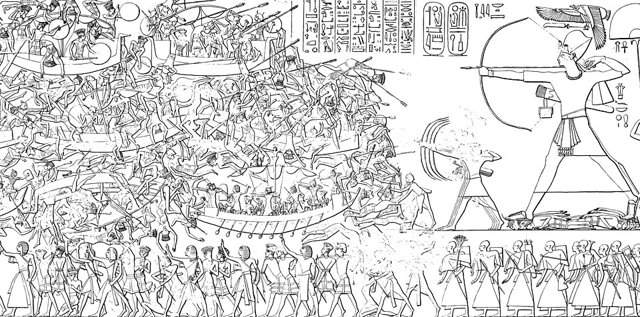
約西元前 1200–前 1150 年，半個世紀之內，東地中海的整個文明體系熄火：邁錫尼宮殿化為灰燼、赫梯帝國消失、烏加里特與其他城邦被棄、埃及勉強自保，書寫、貿易與外交系統（阿馬納書信世界）一併瓦解。這樁案件的兇手不是單一入侵者，而是一組因素咬合：**乾旱（氣候）＋錫貿易斷裂（經濟）＋海上民族（移民/武器）＋宮殿經濟的脆弱（組織）＋系統互連（資訊）**。它是史上第一次有充分證據的「系統性崩潰」——高度互連而無冗餘的網路，一點失效即級聯全毀。

[→ 對外連結：-1200-青銅時代大崩潰：一個系統如何整體熄火](https://chad-liu.github.io/books/html/1-6-0.世界簡史/-1200-青銅時代大崩潰.html)

## -800 | 軸心時代
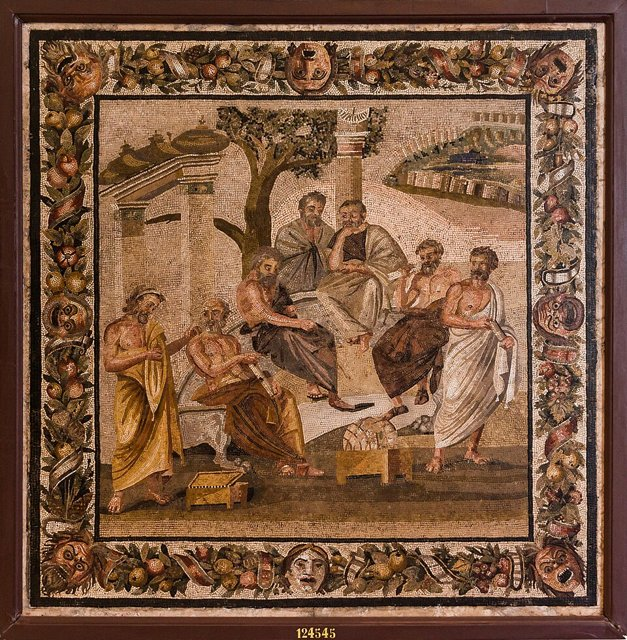
約西元前 800–前 200 年之間，歐亞大陸互相隔絕的幾個文明幾乎同時爆發思想革命：希臘的哲學與城邦辯論、中國的諸子百家、印度的佛陀與耆那教、猶太的先知運動、波斯的瑣羅亞斯德教。雅斯貝斯（Karl Jaspers）稱之為「軸心時代」——人類第一次提出**普遍倫理**：不再只對本部落負責，而是對「所有人」、對超越的神、對內在的良心負責。這樁案件的兇手是一組因素咬合：**鐵器經濟（剩餘）＋城市與識字階層（資訊）＋列國競爭（政治）＋動盪的時代心理**。

[→ 對外連結：-0800-軸心時代：普遍倫理的誕生](https://chad-liu.github.io/books/html/1-6-0.世界簡史/-0800-軸心時代.html)

## -508 | 雅典民主與海權

西元前 508 年，克利斯提尼（Cleisthenes）在雅典完成民主改革：以「區」取代「血緣部落」、擴大公民大會、引入陶片放逐。案件的深層驅動力不在議事廳，而在海港：**雅典海軍的主力是三列槳艦（trireme）的槳手——划槳不需要財產，只需要體力**。當波斯入侵（前 490、前 480）證明艦隊是雅典的命脈時，為命脈賣命的窮人得到了政治權。這樁案件證明：**政治制度是軍事技術與階級結構的函數**——「海權→民主」的因果鏈。

[→ 對外連結：-0508-雅典民主與海權：槳手創造的政治權](https://chad-liu.github.io/books/html/1-6-0.世界簡史/-0508-雅典民主與海權.html)

## -221 | 秦的統一與官僚帝國

西元前 221 年，秦王政統一六國，自稱始皇帝。他不只是打贏戰爭——他重寫了「統治」的定義：**廢封建、行郡縣、統一文字度量衡貨幣、以軍功爵打破血緣、修馳道與長城**。這樁案件的兇手是「標準化＋激勵制度」：秦把帝國從「血緣的聯盟」變成「可替換零件的機器」——官員可調任、土地可丈量、文書可傳達。這套「官僚帝國」成為中國此後兩千年的模板，也是人類最早的「標準化組織」實驗。

[→ 對外連結：-0221-秦的統一與官僚帝國：標準化統治兩千年](https://chad-liu.github.io/books/html/1-6-0.世界簡史/-0221-秦的統一與官僚帝國.html)

## -141 | 漢武帝與絲路

前 141 年，漢武帝劉徹即位。此後半個世紀，漢帝國向西打通河西走廊（前 121）、張騫二次出使（前 119–前 115）、設西域都護府（前 60）——**秦（[秦的統一與官僚帝國](https://chad-liu.github.io/books/html/1-6-0.世界簡史/-0221-秦的統一與官僚帝國.html)）統一了東方，漢武帝把帝國的邊界推到中亞**。東西方兩大帝國（漢與羅馬，見 [羅馬帝國的組織工程](https://chad-liu.github.io/books/html/1-6-0.世界簡史/-0027-羅馬帝國的組織工程.html)）第一次被一條商路連起來：絲綢向西，葡萄、苜蓿、佛教向東。

[→ 對外連結：-0141-漢武帝與絲路：帝國把手伸向西域](https://chad-liu.github.io/books/html/1-6-0.世界簡史/-0141-漢武帝與絲路.html)

## -27 | 羅馬帝國的組織工程

西元前 27 年，屋大維獲得「奧古斯都」尊號，羅馬從共和轉為帝國。但案件的真正兇手不是政治名號，而是羅馬三百年的組織工程：**八萬公里道路、羅馬法、軍團標準化、公民權的階梯式擴張**——羅馬把地中海變成「一個組織的內部網路」。奧古斯都的完成式是「羅馬和平」（Pax Romana）：兩百年無重大內戰，貿易、人口與城市化達到古代頂峰。這樁案件證明：**帝國的本質不是疆域，是組織**。

[→ 對外連結：-027-羅馬帝國的組織工程：道路、法與公民權](https://chad-liu.github.io/books/html/1-6-0.世界簡史/-0027-羅馬帝國的組織工程.html)

## 313 | 君士坦丁與基督教的勝利

西元 313 年，君士坦丁與李基尼烏斯頒布米蘭敕令，基督教合法化；380 年狄奧多西立為國教。從受迫害的少數派到帝國國教，只用了一百年。這樁案件的雙向真相：**宗教收編了帝國的靈魂，帝國收編了宗教的組織**——基督教以普世教義、互助網路與來世盼望贏得人心；君士坦丁以國教化贏得動員與合法性。這樁案件證明：**宗教是最強的組織技術，而組織技術終會被權力收編**。

[→ 對外連結：0313-君士坦丁與基督教的勝利：帝國收編宗教](https://chad-liu.github.io/books/html/1-6-0.世界簡史/0313-君士坦丁與基督教的勝利.html)

## 476 | 西羅馬的崩潰

西元 476 年 9 月 4 日，雇傭兵統帥奧多亞克廢黜少年皇帝羅慕路斯·奧古斯都路斯——西羅馬帝國正式落幕。但這樁案件沒有「兇手」：它是慢性多因系統的死亡——**瘟疫與氣候（疾病/氣候）、稅基萎縮與通膨（經濟）、雇傭兵化（組織/武器）、內戰與繼承危機（政治）、移民壓力（匈人推擠）**——每個因素都參與，每個因素都不是唯一死因。東羅馬以同樣的制度又活了一千年——**崩潰是「因素組合」的產物，不是「制度」的宿命**。

[→ 對外連結：0476-西羅馬的崩潰：慢性多因系統的死亡](https://chad-liu.github.io/books/html/1-6-0.世界簡史/0476-西羅馬的崩潰.html)

## 541 | 查士丁尼大瘟疫

541 年，鼠疫從埃及佩魯修姆登陸，隨 grain 船隊抵達君士坦丁堡——普羅科匹厄斯記載，首都每天死亡上萬人，查士丁尼本人染病倖存。這場瘟疫在 541–549 年席捲地中海，**人口損失估計達四分之一到一半**，東羅馬帝國的光復大業（收復北非、義大利）被釜底抽薪。

這是疾病因素鏈上失落的一環：**安東尼瘟疫（165–180）打擊盛期羅馬，查士丁尼瘟疫（541）打斷帝國中興，黑死病（[黑死病](https://chad-liu.github.io/books/html/1-6-0.世界簡史/1347-黑死病.html)）重置中世紀歐洲**——三場瘟疫，同一劇本，缺了中間這一場，疾病史就斷了線。

[→ 對外連結：0541-查士丁尼大瘟疫：地中海的第一場人口腰斬](https://chad-liu.github.io/books/html/1-6-0.世界簡史/0541-查士丁尼大瘟疫.html)

## 605 | 科舉與中國官僚帝國
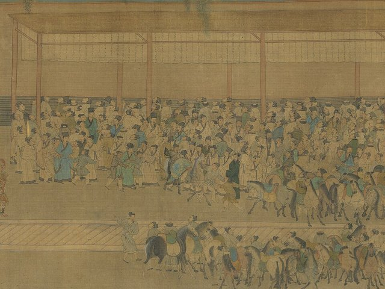
西元 605 年前後，隋煬帝開設進士科——科舉制度的誕生。這樁案件的兇手是「委託代理問題」：皇帝要管理數百萬平方公里的帝國，需要官員；但官員有自己的利益——**如何確保官員忠於皇權而非自己的門第？**隋唐的答案是考試：以「標準化的知識考核」取代「血緣與門第」的官員選拔。科舉運轉了一千三百年（至 1905），成為人類史上最長壽的文官制度，也是「以流動性換忠誠」的極致工程。

[→ 對外連結：0605-科舉與中國官僚帝國：以考試換忠誠](https://chad-liu.github.io/books/html/1-6-0.世界簡史/0605-科舉與中國官僚帝國.html)

## 622 | 伊斯蘭的崛起
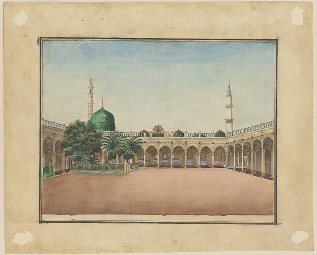
西元 622 年，穆罕默德從麥加遷往麥地那（聖遷，Hijra）——伊斯蘭共同體（烏瑪）的誕生。此後一百年，阿拉伯軍隊從半島出發，征服波斯薩珊帝國、奪取拜占庭的敘利亞與埃及、直抵西班牙與中亞——史上擴張速度最快的宗教政治體。這樁案件的兇手是「宗教作為組織技術」：**統一信仰（一神）＋簡單教義（五功）＋共同體（烏瑪）＋戰利品分配＋阿拉伯語**——五個零件組成一部高效率的動員機器。伊斯蘭證明：宗教不只是信仰，是**史上最強的組織操作系統**。

[→ 對外連結：0622-伊斯蘭的崛起：宗教作為組織技術](https://chad-liu.github.io/books/html/1-6-0.世界簡史/0622-伊斯蘭的崛起.html)

## 751 | 怛羅斯之戰與紙西傳
751 年 7 月，唐安西節度使高仙芝率軍在怛羅斯河（今哈薩克境內）與阿拔斯軍決戰——葛邏祿臨陣倒戈，唐軍大敗。戰役本身在中原史書中只是邊疆小挫，但在世界史上是超級樞紐：**被俘唐軍中的造紙工匠把紙技術帶到撒馬爾罕，紙從此西傳伊斯蘭世界**，鋪就 868 年雕版印刷（[金剛經與印刷革命](https://chad-liu.github.io/books/html/1-6-0.世界簡史/0868-金剛經與印刷革命.html)）西傳段與 830 年智慧宮翻譯運動的物質地基。

[→ 對外連結：0751-怛羅斯之戰：幾個造紙工匠改變世界](https://chad-liu.github.io/books/html/1-6-0.世界簡史/0751-怛羅斯之戰與紙西傳.html)

## 868 | 金剛經與印刷革命
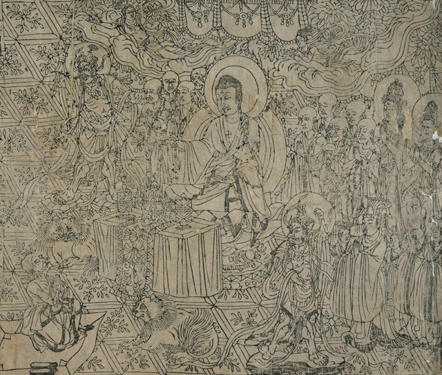
西元 868 年，中國雕版印刷的《金剛經》卷（現藏大英圖書館）成為現存最早有明確日期的印刷書——卷末刻著「咸通九年四月十五日王玠為二親敬造普施」。這樁案件的兇手是一組因素咬合：**紙的量產（科技）＋佛經的複製功德（宗教動機）＋科舉與政府文書（制度市場）**——印刷在東亞首先被「宗教與考試」兩個市場養大。這是知識複製革命的東亞版：比古騰堡早六百年，但走了不同的技術與制度路徑。

[→ 對外連結：0868-金剛經與印刷革命：東亞的知識複製工程](https://chad-liu.github.io/books/html/1-6-0.世界簡史/0868-金剛經與印刷革命.html)

## 1096 | 十字軍東征

西元 1095 年 11 月，教宗烏爾班二世在克萊蒙以「解救聖墓、赦免罪愆」號召東征——次年數萬騎士與農民向東出發，1099 攻陷耶路撒冷。這樁案件的兇手是一組因素咬合：**宗教（贖罪的無形報酬）＋心理（榮譽與救贖）＋經濟（無地貴族與次子）＋政治（教宗權威與拜占庭求援）＋組織（騎士軍事體系）**。十字軍是「以無形報酬換有形服務」的動員實驗——史上最大規模的「救贖經濟學」；而它的副產品（威尼斯與熱那亞的貿易、修道院的知識）比聖地本身影響更深遠。

[→ 對外連結：1096-十字軍東征：救贖經濟學的動員實驗](https://chad-liu.github.io/books/html/1-6-0.世界簡史/1096-十字軍東征.html)

## 1206 | 蒙古世界體系
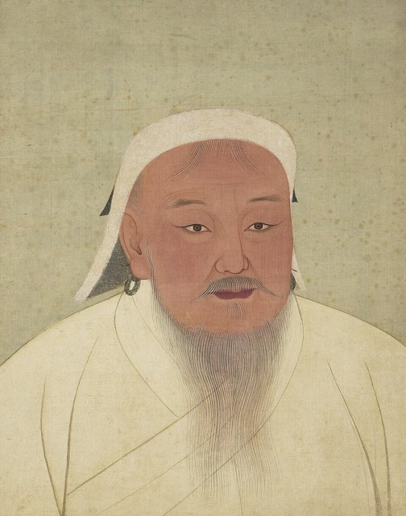
西元 1206 年成吉思汗統一草原後的六十年，蒙古建立了人類史上最大的連續帝國。這一卷看的是**世界體系的層面**（武器的層面見 [武器與戰法/1206-蒙古軍事體系]）：蒙古以驛站（Yam）接通歐亞、以宗教寬容降低統治成本、以低稅催活貿易——「蒙古和平」使馬可波羅得以東行、技術得以西傳；但同一條通道，也把黑死病從中亞送到歐洲（1347，[黑死病](https://chad-liu.github.io/books/html/1-6-0.世界簡史/1347-黑死病.html)）。這樁案件證明：**貿易通道同時是疾病通道——連接是財富也是傳染**。

[→ 對外連結：1206-蒙古世界體系：絲路、寬容與疾病通道](https://chad-liu.github.io/books/html/1-6-0.世界簡史/1206-蒙古世界體系.html)

## 1347 | 黑死病
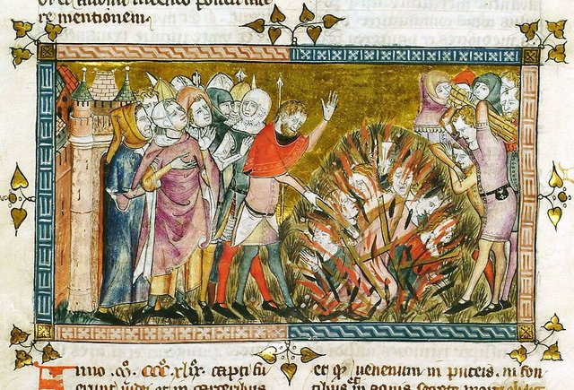
西元 1347 年 10 月，一艘熱那亞商船從卡法（Kaffa，黑海）駛入西西里墨西拿，船上水手帶著黑死病。四年內，歐洲人口三分之一到一半死亡（約 2,500 萬人）。但這樁案件的最深層後果不在醫學，在經濟：**勞動力砍半 → 工資翻倍 → 地租下跌 → 封建義務瓦解**——疾病成為史上最強的「勞動議價」事件。英國 1351 年的《勞工法令》試圖凍結工資，失敗——**市場力量打敗了王法**。黑死病證明：外生衝擊可以重置整個社會契約。

[→ 對外連結：1347-黑死病：疾病如何重寫經濟與社會](https://chad-liu.github.io/books/html/1-6-0.世界簡史/1347-黑死病.html)

## 1405 | 鄭和下西洋與中國的轉向

西元 1405 年 7 月，鄭和率領 240 餘艘船、27,800 人的寶船艦隊首航西洋——人類史上最大規模的海上遠征。七次遠航（1405–1433）直抵東非；1433 年後，明朝轉向：禁海、拆船、檔案散失——**中國退出海洋，八十年後歐洲的小船隊填補了真空**。這樁案件的兇手是制度比較：**中國（統一帝國、朝貢邏輯、文官政治）vs 歐洲（競爭性國家體系、利潤邏輯、特許公司）**——同一片海洋，兩種制度的分岔。這是「大分流」的海洋前奏。

[→ 對外連結：1405-鄭和下西洋與中國的轉向：同一海洋、兩種制度](https://chad-liu.github.io/books/html/1-6-0.世界簡史/1405-鄭和下西洋與中國的轉向.html)

## 1450 | 古騰堡印刷革命

約西元 1450 年，美因茨的金匠古騰堡（Johannes Gutenberg）把四項技術組合起來：**金屬活字（鑄字模具）＋油墨＋壓印機（改自榨酒機）＋合金配方**——1455 年的《四十二行聖經》是第一個量產品。這樁案件的兇手是「複製成本」：手抄一冊聖經需要一名抄工約一年；印刷版一次印 180 冊——**知識複製成本下降一個量級以上**。此後六十年，印刷從拉丁聖經擴散到方言、小冊與異議——宗教改革（[宗教改革](https://chad-liu.github.io/books/html/1-6-0.世界簡史/1517-宗教改革.html)）與科學革命（[哥白尼與科學革命](https://chad-liu.github.io/books/html/1-6-0.世界簡史/1543-哥白尼與科學革命.html)）都是這樁案件的後果。

[→ 對外連結：1450-古騰堡印刷革命：知識複製成本的斷崖](https://chad-liu.github.io/books/html/1-6-0.世界簡史/1450-古騰堡印刷革命.html)

## 1453 | 君士坦丁堡陷落

1453 年 4–5 月，鄂圖曼蘇丹穆罕默德二世以約八萬兵、上百門炮圍攻君士坦丁堡，拜占庭守軍不足八千。5 月 29 日城破，千年帝國終結。本案追查：為何一座抵擋過二十二次圍攻的狄奧多西城牆，會在 53 天內倒塌？答案是**火藥、航海與制度的合謀**——軍事革命的第一次完整展示。

[→ 對外連結：1453-君士坦丁堡陷落：一座城牆與兩個時代的交界](https://chad-liu.github.io/books/html/1-6-0.世界簡史/1453-君士坦丁堡陷落.html)

## 1492 | 哥倫布大交換

西元 1492 年 10 月 12 日，哥倫布抵達加勒比。此後的「哥倫布大交換」（Crosby）重塑兩個半球：**病菌**（天花、麻疹）滅絕美洲原住民九成人口；**作物**（玉米、馬鈴薯、番薯）使舊大陸人口爆炸；**白銀**（波托西）使歐洲與中國通膨；**奴隸貿易**填補美洲勞動真空。這樁案件的兇手是「生物與地理的碰撞」：兩個隔絕五萬年的生態系接通——**接通的代價與紅利同時爆發**（蒙古通道的「連接是雙面刃」（[蒙古世界體系](https://chad-liu.github.io/books/html/1-6-0.世界簡史/1206-蒙古世界體系.html)）的全球放大版）。

[→ 對外連結：1492-哥倫布大交換：疾病、作物與白銀的全球化](https://chad-liu.github.io/books/html/1-6-0.世界簡史/1492-哥倫布大交換.html)

## 1517 | 宗教改革

西元 1517 年 10 月 31 日，路德在維滕貝格張貼《九十五條論綱》，反對贖罪券。若在印刷術之前，這只是又一場地方性神學爭議；但在 1517——**路德的著作三週傳遍德意志、兩個月傳遍歐洲，十四年內印行逾百萬份**。這樁案件的兇手是「印刷術（[古騰堡印刷革命](https://chad-liu.github.io/books/html/1-6-0.世界簡史/1450-古騰堡印刷革命.html)）＋贖罪券爭議（宗教）＋諸侯保護（政治）＋教會稅負（經濟）」的因素咬合——宗教改革證明：**異議的存活需要「傳播速度」與「政治保護」的雙重條件**。

[→ 對外連結：1517-宗教改革：印刷術加速的思想地震](https://chad-liu.github.io/books/html/1-6-0.世界簡史/1517-宗教改革.html)

## 1543 | 哥白尼與科學革命

西元 1543 年，哥白尼的《天體運行論》在臨終前出版——日心說首次完整提出。但案件的真正兇手不是勇氣，而是**條件的合流**：印刷術使觀測數據可比對（標準文本）、儀器（1557 十字標杆、1608 望遠鏡）擴展了感官、學者書信共和國（資訊網）使批評可流動、第谷的長期觀測（1572 新星、1577 彗星）累積了「天是可變的」證據。這樁案件證明：**科學革命不是一個天才，是一組條件**——印刷、儀器、通信、機構（大學與宮廷）的咬合。

[→ 對外連結：1543-哥白尼與科學革命：儀器、印刷與懷疑的合流](https://chad-liu.github.io/books/html/1-6-0.世界簡史/1543-哥白尼與科學革命.html)

## 1602 | 荷蘭東印度公司與金融革命

西元 1602 年，荷蘭聯省共和國特許成立「聯合東印度公司」（VOC）——史上第一家發行股票的股份公司；1609 年阿姆斯特丹匯兌銀行開業——**現代資本主義的制度工具箱（股份、交易所、銀行、保險）在阿姆斯特丹成形**。這樁案件的兇手是「風險的制度化」：遠洋貿易（單船沉沒=全損）的風險極大，股份制把風險切碎分攤——**「風險的金融工程」使全球貿易與帝國擴張成為可融資的項目**。

[→ 對外連結：1602-荷蘭東印度公司與金融革命：風險的制度化](https://chad-liu.github.io/books/html/1-6-0.世界簡史/1602-荷蘭東印度公司與金融革命.html)

## 1687 | 牛頓與科學革命頂點

西元 1687 年 7 月 5 日，牛頓的《自然哲學的數學原理》出版——以三條運動定律與萬有引力，**用同一套數學統一了「天」與「地」**：蘋果與月亮服從同一條定律。這樁案件的兇手是「機構＋數學＋儀器」的合流：皇家學會（1660）的同行批評、《哲學會刊》（1665）的公開出版、微積分（牛頓與萊布尼茨各自發明）、與哈雷雷根資助出版。這樁案件證明：**科學從個人天賦變成「機構化的公共事業」**——機械宇宙觀從此統治三百年。

[→ 對外連結：1687-牛頓與科學革命頂點：機械宇宙的誕生](https://chad-liu.github.io/books/html/1-6-0.世界簡史/1687-牛頓與科學革命頂點.html)

## 1688 | 光榮革命

1688 年，荷蘭執政威廉三世渡海登陸英格蘭，詹姆斯二世出逃——「光榮革命」。1689 年《權利法案》確立議會主權。但本案的真正兇手不在戰場，在帳本：**1694 年英格蘭銀行成立，政府借貸利率從 10% 以上跌到 3%**——議會主權把「國王的欠條」變成「國家的信用」，財政—軍事國家就此誕生。牛頓（[牛頓與科學革命頂點](https://chad-liu.github.io/books/html/1-6-0.世界簡史/1687-牛頓與科學革命頂點.html)）給了世界新宇宙，光榮革命給了世界新國家——**兩者只差一年**。

[→ 對外連結：1688-光榮革命：用一張國債單發明現代國家](https://chad-liu.github.io/books/html/1-6-0.世界簡史/1688-光榮革命.html)

## 1769 | 瓦特蒸汽機與工業革命

西元 1769 年，瓦特取得分離冷凝器蒸汽機專利；1776 首批商用。這一卷看的是**系統轉型的層面**（機器史細節見 [機器史/1769-瓦特蒸汽機]）：蒸汽機使人類第一次**脫離「有機經濟」**——此前所有能源（人力、獸力、水力、木柴）都受土地與生態限制；煤與蒸汽解除了這個天花板。這樁案件的兇手是「能源密度＋熱效率＋制度」的咬合：**煤（能源）＋蒸汽機（轉換）＋工廠（組織）＋市場（經濟）**——工業革命是「能源→組織→經濟→政治」的連鎖反應。

[→ 對外連結：1769-瓦特蒸汽機與工業革命：脫離有機經濟的斷點](https://chad-liu.github.io/books/html/1-6-0.世界簡史/1769-瓦特蒸汽機與工業革命.html)

## 1776 | 國富論與美國建國

西元 1776 年，兩份文件同年問世：美國《獨立宣言》（7 月 4 日）與亞當斯密《國富論》（3 月 9 日）——**政治與經濟的雙重革命同年誕生**。前者宣告「政府的正當性來自被治理者的同意」；後者宣告「分工與市場的自利協調」——兩者共享同一思想地基（啟蒙運動）：**制度是人設計的，且可以用理性重設計**。這樁案件的兇手是「思想＋制度實驗」的咬合：啟蒙思想（資訊）→憲政實驗（政治）＋經濟學（思想）→市場制度（經濟）。

[→ 對外連結：1776-國富論與美國建國：政治與經濟的雙重革命](https://chad-liu.github.io/books/html/1-6-0.世界簡史/1776-國富論與美國建國.html)

## 1789 | 法國大革命

西元 1789 年 7 月 14 日，巴黎群眾攻陷巴士底獄——法國大革命開始。這樁案件沒有單一兇手：**財政破產（經濟）＋歉收與麵包價（氣候/經濟）＋第三等級的怨恨（心理）＋小冊子與沙龍（資訊）＋啟蒙思想（思想）＋舊制度的矛盾（政治）**——所有因素在 1789 同時咬合。這樁案件證明：**革命是「財政危機×期望差距×資訊爆炸」的臨界組合**——而它的後果（民族國家、人權、恐怖統治）改寫了整個現代政治。

[→ 對外連結：1789-法國大革命：財政、心理與資訊的多因案件](https://chad-liu.github.io/books/html/1-6-0.世界簡史/1789-法國大革命.html)

## 1793 | 馬戛爾尼使團與大分流
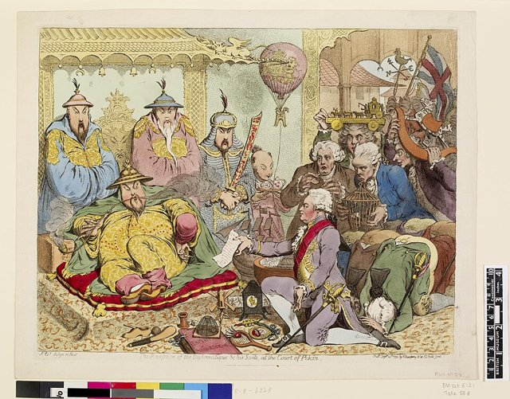
1793 年，英國派出史上最昂貴的外交使團——馬戛爾尼伯爵率七百箱禮物（天體儀、蒸汽機模型、連發槍）北上熱河，為乾隆皇帝祝八十大壽，實際訴求只有三條：開放通商口岸、設立使節、劃定商站。乾隆的回覆是史上著名的「天朝物產豐盈，無所不有」。這樁「禮儀之爭」表面是磕頭問題，實際是**兩個制度系統互相誤讀**的懸案——它標記了「大分流」的分水嶺：此後半個世紀，工業革命（[瓦特蒸汽機與工業革命](https://chad-liu.github.io/books/html/1-6-0.世界簡史/1769-瓦特蒸汽機與工業革命.html)）與鴉片貿易把誤讀變成炮艦。

[→ 對外連結：1793 馬戛爾尼使團與大分流：兩個世界對「平等」的誤讀](https://chad-liu.github.io/books/html/1-6-0.世界簡史/1793-馬戛爾尼使團與大分流.html)

## 1830 | 鐵路與電報
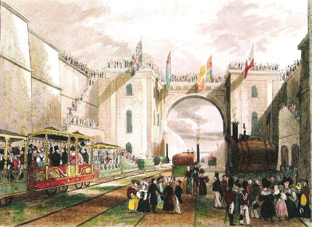
西元 1830 年 9 月 15 日，利物浦-曼徹斯特鐵路開通（史蒂芬遜的「火箭號」勝出，細節見 [機器史/1829]）；1837 年，摩斯申請電報專利——**兩項技術在五年內把「資訊」與「物質」的傳輸同時加速**。這樁案件的兇手是「時空壓縮」：鐵路使物質運輸成本斷崖下降；電報使資訊與物質運輸**第一次分離**（訊息不再需要靠車送）。這樁案件證明：**運輸與通信的成本下降 = 市場、國家與戰爭的重寫**。

[→ 對外連結：1830-鐵路與電報：時空的壓縮](https://chad-liu.github.io/books/html/1-6-0.世界簡史/1830-鐵路與電報.html)

## 1848 | 塞內卡福爾斯
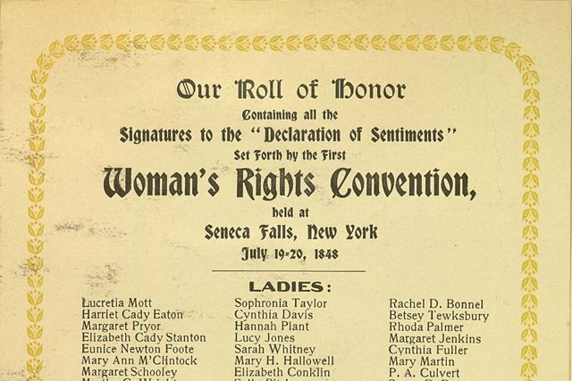
1848 年 7 月，美國紐約塞內卡福爾斯，300 人（多數女性）集會，通過《情感宣言》（模仿《獨立宣言》：「人人生而平等——男人和女人」），要求女性投票權。領袖：伊莉莎白·斯坦頓、盧克麗霞·莫特。報紙嘲笑（「老處女大會」），牧師譴責。但 72 年後（1920，第十九修正案），美國女性投票了。第一聲槍響後，為何走了 72 年？

> **一半人口沒有選票意味著什麼？從 1848 到 1920——女權的時鐘為何比廢奴慢兩代？**

[→ 對外連結：1848 塞內卡福爾斯：婦女參政權的第一聲槍響](https://chad-liu.github.io/books/html/1-6-0.世界簡史/1848-塞內卡福爾斯.html)

## 1848 | 歐洲革命之年

1848 年 1 月，西西里起義；2 月，巴黎，七月王朝被推翻；3 月，維也納梅特涅出逃、柏林街壘戰、米蘭威尼斯起義；4 月，德意志各邦召開法蘭克福議會。**半年之內，三十多個政權震動，一場沒有統一指揮的「歐洲同步革命」**。但到 1849 年底，革命幾乎全線退潮——除了兩個例外：法國的普選制與農奴制的廢除（哈布斯堡境內）。這是十九世紀最大的「未遂案」：它失敗了，卻寫好了此後七十年所有革命的劇本。

[→ 對外連結：1848 歐洲革命之年：被工業化與民族主義同時點燃的總預演](https://chad-liu.github.io/books/html/1-6-0.世界簡史/1848-歐洲革命之年.html)

## 1859 | 達爾文物種起源
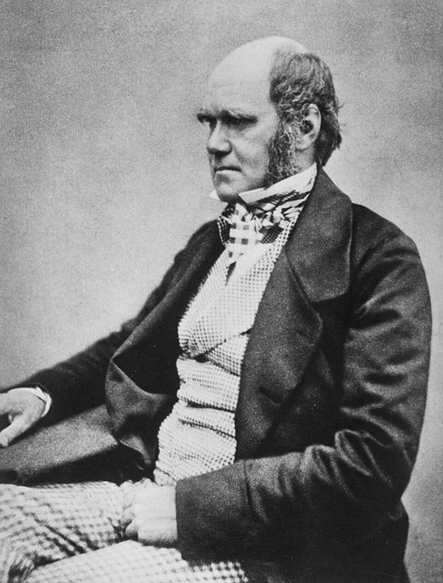
西元 1859 年 11 月 24 日，達爾文的《物種起源》出版——首印 1,250 冊首日售罄。天擇理論以一個**最小機制**（變異＋遺傳＋差異繁殖）解釋了物種的多樣性與人的起源。這樁案件的兇手是「科學條件的合流」：地質學的「深時」（賴爾）、馬爾薩斯的人口模型（經濟思想→生物學）、華萊士的獨立發現（通信網的科學驗證）、印刷的論述戰（[古騰堡印刷革命](https://chad-liu.github.io/books/html/1-6-0.世界簡史/1450-古騰堡印刷革命.html)）。這樁案件證明：**科學思想的誕生可以來自另一門學科（經濟學）的模型——知識的跨界移植**；而它的社會後果（宗教衝擊與社會達爾文主義的濫用）持續到二十世紀。

[→ 對外連結：1859-達爾文物種起源：科學、宗教與人的位置](https://chad-liu.github.io/books/html/1-6-0.世界簡史/1859-達爾文物種起源.html)

## 1868 | 明治維新

1868 年，日本宣布「王政復古」——一個被黑船開國十五年（1853）、內戰一年（戊辰戰爭）折騰過的島國，開始了史上最成功的後發追趕：四十年內，從武士佩刀的封建國家變成打敗俄國的海陸軍強國（1905）。這樁案件的驚人之處不是速度，而是**拼裝**：憲法學普魯士、海軍學英國、陸軍學法國（後改德國）、教育學美國、工業學全能——**誰贏學誰**。同時期的清朝洋務運動買了同樣的軍艦與機器，為何一個成功、一個失敗？

[→ 對外連結：1868 明治維新：後發國家的制度拼裝工程](https://chad-liu.github.io/books/html/1-6-0.世界簡史/1868-明治維新.html)

## 1869 | 蘇伊士與全球化

西元 1869 年 11 月 17 日，蘇伊士運河開通——倫敦到孟買的航程從 19,000 公里縮到 11,600 公里（省 40%）；三年前（1866）大西洋海底電纜貫通——**運輸與通信的雙重壓縮在同五年完成**。這樁案件的兇手是「基礎設施的全球化」：蒸汽船＋運河＋電纜＋金本位（1870s 起）＋格林威治標準時（1884）——**第一波全球化（1870–1914）的五大基礎設施**。這樁案件證明：**全球化不是思想，是基礎設施**——而它的斷裂（1914）證明：**連接的深度 = 斷裂的深度**。

[→ 對外連結：1869-蘇伊士與全球化：第一波全球化的基礎設施](https://chad-liu.github.io/books/html/1-6-0.世界簡史/1869-蘇伊士與全球化.html)

## 1871 | 德意志統一與民族主義時代

西元 1871 年 1 月 18 日，德意志帝國在凡爾賽鏡廳宣告成立。這樁案件的兇手是「民族主義」——**一種以印刷、教育與語言標準化鑄造的集體認同**（Anderson 的「印刷資本主義」）——加上普魯士的組織（軍隊、參謀部、關稅同盟）與俾斯麥的現實政治。這樁案件證明：**民族不是自然的，是被工程出來的**——印刷（[古騰堡印刷革命](https://chad-liu.github.io/books/html/1-6-0.世界簡史/1450-古騰堡印刷革命.html)）→方言標準化→教育（義務教育）→認同→動員——民族主義是「世俗宗教」的動員技術，而它直通二十世紀的總體戰與滅絕。

[→ 對外連結：1871-德意志統一與民族主義時代：想像的共同體](https://chad-liu.github.io/books/html/1-6-0.世界簡史/1871-德意志統一與民族主義時代.html)

## 1913 | 美聯儲與最後貸款人

西元 1913 年，美國《聯邦儲備法》通過——美聯儲（Fed）誕生。這樁案件的兇手是一組因素咬合：**1907 年恐慌的擠兌記憶（心理）＋無彈性貨幣的制度缺陷（組織）＋白芝浩「最後貸款人」理論（資訊／理論）＋進步主義對托拉斯的恐懼（政治）**。它證明：**現代央行的本質不是印鈔，而是「在恐慌時敢借錢」的承諾機器**（與 1694 英格蘭銀行（世界發展史/1694-英格蘭銀行.md）同一血脈的美國版）。

[→ 對外連結：1913-美聯儲：最後貸款人的誕生](https://chad-liu.github.io/books/html/1-6-0.世界簡史/1913-美聯儲與最後貸款人.html)

## 1914 | 第一次世界大戰
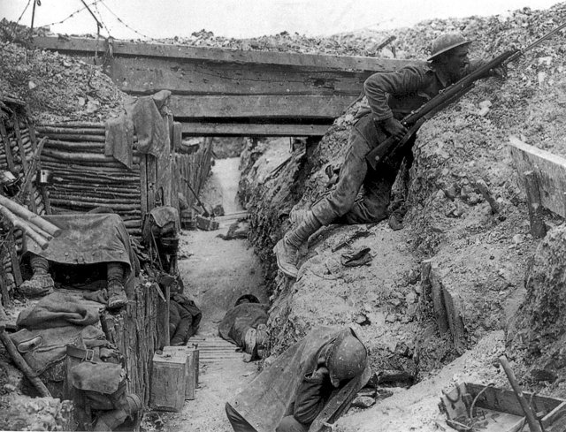
西元 1914 年 6 月 28 日，塞拉耶佛的槍聲引發聯盟鏈的多米諾；8 月起，歐洲四大帝國全數捲入總體戰。這樁案件（戰術層面見 [武器與戰法/1914-馬恩河會戰]）的兇手是一組因素的臨界咬合：**聯盟體系（政治）＋動員時刻表（組織）＋機槍與火炮（武器）＋八月狂熱（心理）＋全球化斷裂（經濟）＋宣傳（資訊）**——沒有任何單一因素能發動這場戰爭；所有因素一起才可能。這樁案件證明：**總體戰是「全因素」的產物**——而它的結局（四帝國瓦解、凡爾賽、意識形態時代）重寫了二十世紀。

[→ 對外連結：1914-第一次世界大戰：全因素咬合的總體戰](https://chad-liu.github.io/books/html/1-6-0.世界簡史/1914-第一次世界大戰.html)

## 1917 | 俄國革命

西元 1917 年，俄國在一年內經歷兩場革命：2 月（沙皇退位、臨時政府）與 10 月（布爾什維克奪權）。這樁案件的兇手是一組因素咬合：**戰爭崩潰（戰爭）＋糧食與前線崩解（經濟）＋沙皇體系的脆弱（政治）＋列寧式政黨（組織）＋馬克思主義（思想）＋「和平、土地、麵包」的口號（資訊/心理）**。這樁案件證明：**革命的勝負手是「組織技術」**——列寧的先鋒隊政黨（紀律、口號、傳播）在混亂中是唯一「有組織的力量」——而意識形態國家的百年實驗（蘇聯）自此開始。

[→ 對外連結：1917-俄國革命：組織技術與意識形態國家](https://chad-liu.github.io/books/html/1-6-0.世界簡史/1917-俄國革命.html)

## 1919 | 凡爾賽和約

1919 年 6 月 28 日，凡爾賽鏡廳——法國刻意選在 1871 年德國宣布帝國成立的同一個大廳。條約的核心條款：德國承擔戰爭罪責（231 條）、賠款 1,320 億金馬克（1921 年定額）、割讓 13% 領土與全部殖民地、陸軍上限十萬人、萊茵蘭非軍事化。凱恩斯作為英國代表團財政顧問當場辭職，寫下《和約的經濟後果》，預言這份和約將毀掉歐洲。二十年後（1939），他的預言以更兇殘的方式兌現。這樁案件要偵查的是：**和約到底是「太苛刻」還是「不夠徹底」？**

[→ 對外連結：1919 凡爾賽和約：勝利者如何寫出下一場戰爭的劇本](https://chad-liu.github.io/books/html/1-6-0.世界簡史/1919-凡爾賽和約.html)

## 1928 | 青黴素與人口革命

西元 1928 年 9 月，弗萊明在倫敦的實驗室注意到黴菌抑制細菌——青黴素的發現。但案件的真正兇手是一條更長的鏈：**公共衛生（下水道、清潔水）→ 死亡率下降 → 抗生素（1940s 量產）→ 預期壽命跳升 → 人口爆炸**。20 世紀全球人口從 16 億（1900）到 60 億（2000）——史上最大的人口革命。這樁案件證明：**死亡率是人口革命的開關——而公共衛生（工程）的貢獻大於醫療（藥）**（McKeown 論題）。

[→ 對外連結：1928-青黴素與人口革命：死亡率下降的連鎖](https://chad-liu.github.io/books/html/1-6-0.世界簡史/1928-青黴素與人口革命.html)

## 1929 | 經濟大蕭條
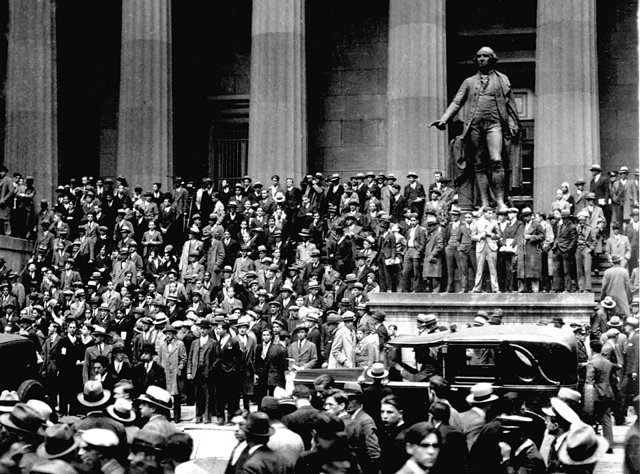
西元 1929 年 10 月 24 日（黑色星期四），華爾街崩盤；至 1933 年，美國工業產出腰斬、失業率 25%、銀行倒閉九千家——**大蕭條是全球性的**（金本位傳導到歐洲與日本）。這樁案件的兇手是一組因素咬合：**股市泡沫與槓桿（經濟）＋恐慌與信心的自我實現（心理）＋金本位的通縮傳導（金融制度）＋聯準會的緊縮失誤（組織）＋政治的極端化（政治）**。這樁案件證明：**金融系統的穩定是「信念」的問題——而制度決定信念能否自我實現為崩潰**。

[→ 對外連結：1929-經濟大蕭條：恐慌、信心與制度](https://chad-liu.github.io/books/html/1-6-0.世界簡史/1929-經濟大蕭條.html)

## 1933 | 新政與福利國家起源

西元 1933 年，羅斯福「百日新政」——政府在一百天內發明了現代國家的一半工具箱：**銀行假日＋存款保險（金融）＋公共工程（就業）＋社會保障立法前夜（社保）＋證券管制（資訊）**。這樁案件的兇手是：**大蕭條的崩潰（經濟）＋凱恩斯主義的供給（理論）＋民眾對行動的渴求（心理）＋聯邦權力的擴張（政治）**。它證明：**國家規模的跳變只發生在災難窗口——平時吵十年的事，恐慌中十天通過**。

[→ 對外連結：1933-新政與福利國家：政府什麼時候變大](https://chad-liu.github.io/books/html/1-6-0.世界簡史/1933-新政與福利國家起源.html)

## 1939 | 第二次世界大戰

1939 年 9 月 1 日，德軍閃擊波蘭；兩天後英法宣戰。六年戰爭，七千萬至八千五百萬人死亡——史上最昂貴的案件。它的特殊偵查價值在於：這是一場**所有因素同時到最高火力**的對決——雷達與密碼、總體動員與工廠、種族意識形態與地緣恐慌。而最耐人尋味的是：發動戰爭的三個軸心國（德、日、義）加起來的經濟產能不到同盟國一半——**它們為什麼敢開戰？又為什麼必敗？**

[→ 對外連結：1939 第二次世界大戰：科技、組織與意識形態的全因素決戰](https://chad-liu.github.io/books/html/1-6-0.世界簡史/1939-第二次世界大戰.html)

## 1944 | 布列頓森林與美元秩序
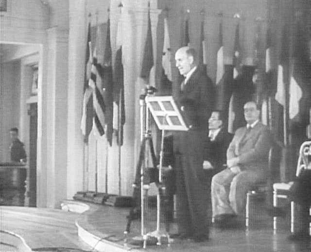
西元 1944 年 7 月，44 國代表在布列頓森林開會——美元與黃金掛鉤（35 美元＝1 盎司）、各國貨幣與美元掛鉤、成立 IMF 與世界銀行。這樁案件的兇手是：**1930s 競爭性貶值與貿易戰的記憶（經濟創傷）＋美國獨大的實力（政治）＋懷特與凱恩斯的設計競爭（理論）＋戰爭末期的議程控制（時機）**。它證明：**國際制度是上一場災難的解剖報告——條款的每一條都對應 1930s 的一個錯誤**。

[→ 對外連結：1944-布列頓森林：為1930年代設計的疫苗](https://chad-liu.github.io/books/html/1-6-0.世界簡史/1944-布列頓森林與美元秩序.html)

## 1945 | 戰後秩序

西元 1945 年，三份「制度遺產」同年成形：聯合國（10 月）、布列敦森林體系（7 月）與核時代的嚇阻結構（8 月廣島）。這樁案件的兇手是「災難的制度化」：兩次大戰與大蕭條的痛苦，被轉化為**制度設計**（安全理事會、IMF/世界銀行、關貿總協、核嚇阻）——「絕不再來」的心理＋戰勝國的權力＋經濟學的教訓——三者咬合。這樁案件證明：**痛苦可以換制度——制度是把博弈均衡寫進條約的工程**。

[→ 對外連結：1945-戰後秩序：三大支柱的制度工程](https://chad-liu.github.io/books/html/1-6-0.世界簡史/1945-戰後秩序.html)

## 1945 | 核武與絕對武器

1945 年 7 月 16 日，阿拉莫戈多（Trinity！）第一顆原子彈試爆——**核時代開幕**；8 月 6 日廣島（小男孩！鈾彈！死 14 萬！）、8 月 9 日長崎（胖子！鈽彈！死 7 萬！）——**絕對武器**；此前：1939 愛因斯坦—西拉德信（羅斯福！）、1942 曼哈頓計劃（格羅夫斯—奧本海默！洛斯阿拉莫斯！20 億美元！13 萬人！）、1945.7 波茨坦（杜魯門告知史達林！）——**科學動員的戰爭**。此後：1949 蘇聯首爆（RDS-1！）、1952氫彈（美國！）、1962古巴飛彈危機、1968核不擴散條約（NPT！）、冷戰嚇阻（MAD！）——**火力越大越不可用**。這樁案件是「武器的終極悖論」：**絕對火力＝絕對不可用**。

[→ 對外連結：1945-核武與絕對武器：火力越大越不可用](https://chad-liu.github.io/books/html/1-6-0.世界簡史/1945-核武與絕對武器.html)

## 1947 | 去殖民化與第三世界
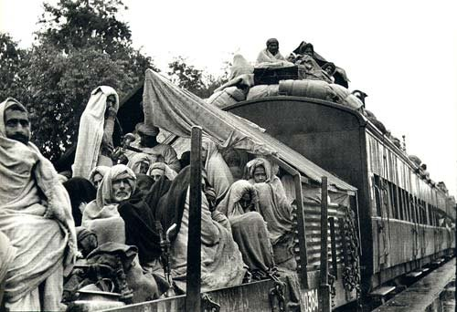
西元 1947 年 8 月 15 日，印度獨立——大英帝國「王冠上的寶石」脫手。此後三十年，亞洲與非洲約八十個新國家誕生。這樁案件的兇手是一組因素咬合：**二戰削弱宗主國（戰爭）＋民族主義動員（組織/心理）＋帝國的成本-收益失衡（經濟）＋「民族自決」的規範傳播（資訊/思想）＋甘地的非暴力（心理/宗教）**。這樁案件證明：**帝國的存續是「成本-收益」與「合法性」的函數——當統治成本超過收益、且「統治權」失去規範合法性，帝國退場**。

[→ 對外連結：1947-去殖民化與第三世界：帝國的會計與信念的勝利](https://chad-liu.github.io/books/html/1-6-0.世界簡史/1947-去殖民化與第三世界.html)

## 1947 | 馬歇爾計畫與歐洲麵包
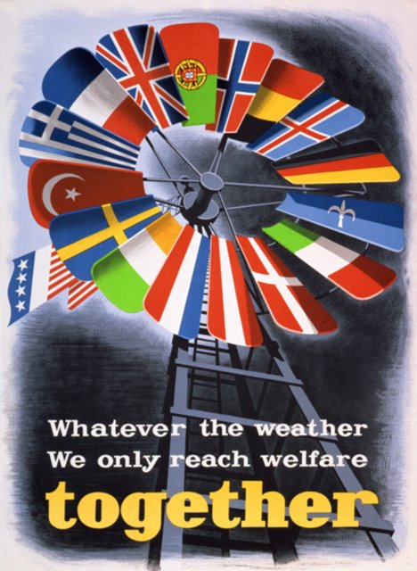
1947 年 6 月，國務卿馬歇爾宣布歐洲復興計畫：四年 130 億美元（佔美 GDP 約 1%），供糧食、機器、美元給西歐（16 國）。此前：歐洲 1947 年寒冬（糧荒）、英鎊危機、法義共產黨選舉聲勢大（法共一說曾達三成）。史達林禁止東歐參加（捷克被迫退出）。**援助是慈善，還是冷戰的預付款？**

> **麵包和鐵幕是什麼關係？當歐洲人在挨餓，美元和盧布同時伸手——誰的麵包，誰的政府？**

[→ 對外連結：1947 馬歇爾計畫：麵包與鐵幕](https://chad-liu.github.io/books/html/1-6-0.世界簡史/1947-馬歇爾計畫與歐洲麵包.html)

## 1957 | 人造衛星與太空競賽
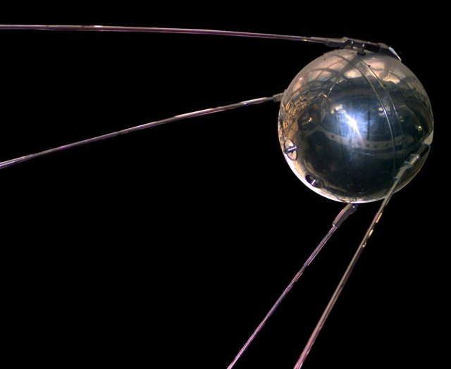
1957 年 10 月 4 日，蘇聯史普尼克一號（83 公斤鐵球）升空，每 96 分鐘繞地球一圈，發出「嗶—嗶—」無線電訊號。美國舉國震驚：蘇聯的火箭能把衛星送上天，就能把核彈頭送到紐約。這樁案件的兇手是「科技×心理×組織」的咬合：**一顆衛星同時是武器（洲際飛彈的驗證）、心理武器（制度優越的宣傳）與組織動員令（NASA 與 DARPA 的誕生）**。

[→ 對外連結：1957-人造衛星與太空競賽：嗶嗶聲改寫的冷戰](https://chad-liu.github.io/books/html/1-6-0.世界簡史/1957-人造衛星與太空競賽.html)

## 1969 | 登月與冷戰科技競賽

西元 1969 年 7 月 20 日，阿波羅十一號登月——40 萬人參與、250 億美元（時值）的「大科學」計畫達到頂點。這樁案件的兇手是「冷戰象徵資本＋系統工程＋軍事採購」的咬合：**政治（太空競賽的冷戰動機）＋組織（NASA 的系統工程）＋經濟（國防採購→積體電路的需求）＋心理（象徵與士氣）**。這樁案件證明：**冷戰的軍備競賽是科技起飛的燃料**——積體電路（晶片）的早期需求來自飛彈與太空——**軍事需求→技術→民用產業**的長期轉換鏈（矽谷的誕生條件）。

[→ 對外連結：1969-登月與冷戰科技競賽：大科學的頂點](https://chad-liu.github.io/books/html/1-6-0.世界簡史/1969-登月與冷戰科技競賽.html)

## 1971 | 微處理器
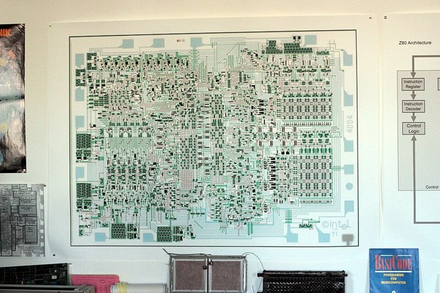
1971 年 11 月，英特爾發布 4004：2300 個電晶體、每秒 9 萬次運算、售價 30 美元。訂單來自日本計算機公司 Busicom——原本要做 12 顆客製晶片，英特爾工程師霍夫（Ted Hoff）提議「做一顆通用 CPU＋軟體定義功能」。這樁案件的兇手是「通用化」：**把硬體差異搬到軟體裡，複雜度從生產線轉移到程式碼**——電腦從此從設備變成平台。

[→ 對外連結：1971-微處理器：四位工程師把電腦縮成指甲](https://chad-liu.github.io/books/html/1-6-0.世界簡史/1971-微處理器.html)

## 1973 | 石油危機與滯脹

1973 年 10 月，第四次中東戰爭爆發，阿拉伯產油國對美國、荷蘭等國實施石油禁運，油價從每桶 3 美元飆到 12 美元（漲 4 倍）。西方同時患上兩種病：**高通膨＋高失業（滯脹）**——凱恩斯主義的藥方（刺激需求治失業、緊縮治通膨）第一次左右為難。**布列頓森林（[布列頓森林與美元秩序](https://chad-liu.github.io/books/html/1-6-0.世界簡史/1944-布列頓森林與美元秩序.html)）1971 年剛倒，1973 年就來了第一場大考**——美元—石油的新秩序在危機中成形。

[→ 對外連結：1973-石油危機與滯脹：兩個神話同時破滅](https://chad-liu.github.io/books/html/1-6-0.世界簡史/1973-石油危機與滯脹.html)

## 1989 | 冷戰結束

西元 1989 年 11 月 9 日，柏林圍牆在數小時內被人群打開；兩年後蘇聯解體。這樁案件的兇手是一組因素咬合：**計畫經濟的停滯（經濟：油價崩＋資訊失真）＋戈巴契夫的改革失控（政治）＋資訊的滲透（資訊：電視與傳真）＋東歐的組織動員（組織：教會與工會）＋蘇聯的克制（心理/政治：不鎮壓的決定）**。這樁案件證明：**計畫經濟的致命傷是「資訊問題」**——價格是分散知識的協調器，取消價格=取消協調（Hayek）；而帝國的崩潰常始於「改革的失控迴路」。

[→ 對外連結：1989-冷戰結束：計畫經濟的資訊問題與和平演變](https://chad-liu.github.io/books/html/1-6-0.世界簡史/1989-冷戰結束.html)

## 1991 | 全球資訊網
西元 1991 年 8 月，伯納斯李（Tim Berners-Lee）在 CERN 公開全球資訊網（WWW）——把網際網路（TCP/IP，1969 DARPA 的後代）變成「人人可用」的超文字系統。這樁案件的兇手是「資訊複製與傳播成本的趨零」：印刷（[古騰堡印刷革命](https://chad-liu.github.io/books/html/1-6-0.世界簡史/1450-古騰堡印刷革命.html)）把複製成本砍掉一個量級；網路把它砍到**零**——而且加上「檢索」與「雙向」。這樁案件證明：**邊際成本趨零的每一次，都重寫經濟、政治與心理**——這是印刷革命的數位兌現。

[→ 對外連結：1991-全球資訊網：邊際成本趨零的第二次革命](https://chad-liu.github.io/books/html/1-6-0.世界簡史/1991-全球資訊網.html)

## 1999 | 歐元誕生與貨幣讓渡
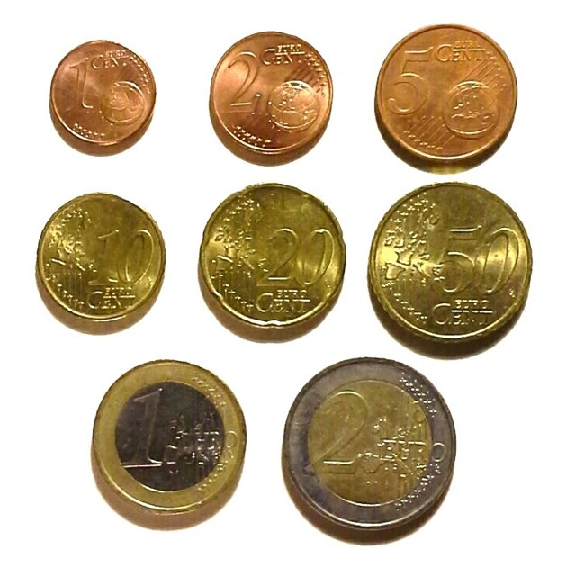
西元 1999 年 1 月 1 日，歐元記帳啟動；2002 年現鈔流通——11 國放棄本國貨幣。這樁案件的兇手是：**德法和解的政治工程（政治）＋單一市場需要單一貨幣的邏輯（經濟）＋德國以馬克換統一的外交交易（地緣）＋最適貨幣區理論的明知故犯（理論）**。它證明：**貨幣一體化是政治先行、經濟補考——先結婚，磨合留給危機**。

[→ 對外連結：1999-歐元：把貨幣主權交出去的實驗](https://chad-liu.github.io/books/html/1-6-0.世界簡史/1999-歐元誕生與貨幣讓渡.html)

## 2001 | 中國入世與世界工廠

西元 2001 年 12 月，中國加入 WTO——全球化最重要的一次擴員。這樁案件的兇手是：**中國改革的鎖定需求（政治）＋美國「接觸改變中國」的賭注（心理／戰略）＋關稅減讓與規則約束（經濟／法律）＋供應鏈的成本套利（科技／組織）**。它證明：**貿易制度不只是降關稅，更是「把改革承諾鎖進國際法」——開放用來倒逼內部改革**。

[→ 對外連結：2001-中國入世：把世界工廠寫進規則](https://chad-liu.github.io/books/html/1-6-0.世界簡史/2001-中國入世與世界工廠.html)

## 2008 | 金融海嘯
西元 2008 年 9 月 15 日，雷曼兄弟破產——全球金融海嘯爆發。這樁案件的兇手是一組因素咬合：**證券化與槓桿（金融工程）＋模型的失靈（相關性假設）＋評級機構的利益衝突（組織）＋「大而不能倒」的道德風險（制度）＋群體樂觀與恐慌（心理）＋全球化傳導（連接）**。這樁案件證明：**明斯基時刻——「長期穩定孕育不穩定」**——穩定使風險偏好上升→槓桿上升→系統脆弱→崩潰；**金融史的一半是心理史**（與 1929（[經濟大蕭條](https://chad-liu.github.io/books/html/1-6-0.世界簡史/1929-經濟大蕭條.html)）同一劇本的現代版）。

[→ 對外連結：2008-金融海嘯：穩定孕育不穩定](https://chad-liu.github.io/books/html/1-6-0.世界簡史/2008-金融海嘯.html)

## 2016 | AlphaGo
2016 年 3 月，首爾。DeepMind 的 AlphaGo 以 4:1 擊敗圍棋世界冠軍李世乭，第四局李世乭的神之一手（78 手斷）是人類最後的閃光，第五局機器不再給機會。圍棋被認為是 AI 十年內攻不下的堡壘——分支因子 250、棋形直覺無法窮舉。這樁案件的兇手是「深度學習×增強學習×算力」：**蒙地卡羅樹搜尋＋策略網路＋價值網路＋自我對弈**，直覺第一次被數學複製。

[→ 對外連結：2016-AlphaGo：李世乭輸掉的那局棋](https://chad-liu.github.io/books/html/1-6-0.世界簡史/2016-AlphaGo.html)

## 2020 | 新冠疫情與全球測壓
西元 2020 年 1 月，新型冠狀病毒（SARS-CoV-2）從武漢擴散；3 月 WHO 宣布大流行——全球封鎖。這樁案件的兇手是一組因素咬合：**病毒（疾病）＋全球連通（貿易與旅行：連接是雙面刃）＋基因定序與 mRNA 疫苗（科技）＋封鎖與選舉（政治）＋停擺與 QE（經濟）＋恐懼與陰謀論（心理）＋社群媒體的假訊息（資訊）**。這樁案件是「全因素」的實驗：**疾病的傳播由連接決定、疫苗由科技與組織決定、後果由制度與心理決定**——與 1347 黑死病（[黑死病](https://chad-liu.github.io/books/html/1-6-0.世界簡史/1347-黑死病.html)）相隔 673 年的對照實驗。

[→ 對外連結：2020-新冠疫情與全球測壓：疾病、科技與制度的全因素實驗](https://chad-liu.github.io/books/html/1-6-0.世界簡史/2020-新冠疫情與全球測壓.html)

## 2023 | 生成式AI與資訊社會
西元 2022 年 11 月 30 日，ChatGPT 上線——兩個月破一億用戶（史上最快）。這樁案件的兇手是三因素的合流：**演算法（Transformer，2017）＋算力（GPU 的軍事/遊戲採購存量，[登月與冷戰科技競賽](https://chad-liu.github.io/books/html/1-6-0.世界簡史/1969-登月與冷戰科技競賽.html) 的轉換鏈）＋資料（網路（[全球資訊網](https://chad-liu.github.io/books/html/1-6-0.世界簡史/1991-全球資訊網.html)）的人類文本存量）**。生成式 AI 使「內容的生產成本→零」——資訊的供給爆炸使**注意力更加稀缺、真實性更加稀缺**。這樁案件證明：**印刷（1450）→網路（1991）→AI（2023）是「資訊成本曲線」的三次斷崖——每次斷崖都重寫經濟、政治與心理**。

[→ 對外連結：2023-生成式AI與資訊社會：注意力的通膨與治理的賽跑](https://chad-liu.github.io/books/html/1-6-0.世界簡史/2023-生成式AI與資訊社會.html)
