<!--
內容整理自本機筆記《世界發展史》（D:\Books\md\歷史\世界史\世界發展史，網頁版在知識圖譜的「1-6.世界發展史」）。
- 109個年份檔各成一則事件，說明採用該檔的「案發現場」（1917潛艇戰與大西洋生命線的標題是「案發現場（前因）」；2個檔案有「案件摘要」則改用案件摘要），結尾以「→ 對外連結」連到知識圖譜上的完整案件卷宗（在新分頁開啟）；摘要中提到同卷其他案件的連結改為連到知識圖譜，連到其他分類（如工業革命史、國家滅亡史）的連結改為純文字。
- 時期只取 README 中依年代排列的幕：第一幕「古代國家與法律的起源」（併入「第二幕之補：印刷的前傳」）、第二幕「商業革命與人口衝擊」、第三幕「大航海與金融革命」、第四幕「工業革命與現代國家」、第五幕「帝國、企業與全球化」、第七幕「AI LLM 的跨域衝擊」，以下一幕的起始年為界首尾相接。第六、八至十四幕（制度與科技的互動、災難與治理、技術的暗面、科技與戰爭等）是橫跨各時代的主題線，年代彼此重疊，未做成色帶。
- 1453君士坦丁堡、1492哥倫布、1545波托西、1602東印度公司、1769瓦特等案件也出現在大航海時代與工業革命史時間軸，各自保留。
圖片來源（皆為 Wikimedia Commons 公有領域作品；多為後世繪畫或複製品，年份見括號；註明「共用」者沿用其他時間軸已有的圖片）：
- wd-cover.jpg：Blue Marble transparent.png（NASA〈藍色彈珠〉，阿波羅17號拍攝的地球，1972）
- gre-pericles.jpg（福爾茨〈伯里克利的葬禮演說〉（與希臘史共用））
- gre-library.jpg（19世紀想像的亞歷山大圖書館版畫（與希臘史共用））
- wd-qin.jpg：Portrait of Qin Shi Huang.jpg（秦始皇像（19世紀））
- wd-cailun.jpg：Cai-lun.jpg（蔡倫像（18世紀））
- wd-bayeux.jpg：Bayeux Tapestry 4.jpg（貝葉掛毯上的諾曼騎兵，11世紀）
- wd-fibonacci.jpg：Liber abbaci magliab f124r.jpg（《計算之書》抄本的一頁）
- wd-crecy.jpg：Bataille de Crécy (1346) - Français 2663.jpg（傅華薩《編年史》中的克雷西戰役，15世紀）
- pop-tournai.jpg（1349年圖爾奈埋葬黑死病死者（與世界人口共用））
- aod-constantinople.jpg（勒塔維尼耶繪〈君士坦丁堡之圍〉（與大航海時代共用））
- wd-gutenberg.jpg：An illuminated page of the...Gutenberg Bible... LCCN2006680004.jpg（古騰堡聖經的彩飾頁（美國國會圖書館藏））
- aod-columbus.jpg（范德林〈哥倫布登陸〉（與大航海時代共用））
- ind-pacioli.jpg（巴爾巴里〈帕喬利像〉（與工業革命史共用））
- aod-potosi.jpg（1553年《秘魯編年史》中的波托西銀山（與大航海時代共用））
- ind-voc.jpg（1606年荷蘭東印度公司的股票（與工業革命史共用））
- wd-londonfire.jpg：Great Fire London.jpg（〈倫敦大火〉，約1675）
- wd-principia.jpg：Newton's Principia title page.png（牛頓《自然哲學的數學原理》1687年書名頁）
- ind-southsea.jpg（霍加斯〈南海泡沫〉（與工業革命史共用））
- ind-watt.jpg（博爾頓–瓦特蒸汽機（與工業革命史共用））
- ind-wealth.jpg（《國富論》1776年初版（與工業革命史共用））
- wd-bastille.jpg：Prise de la Bastille.jpg（〈攻占巴士底獄〉，1789）
- wd-jenner.jpg：Edward Jenner by James Northcote.jpg（諾斯科特〈詹納像〉）
- wd-codecivil.jpg：Code civil des Français.jpg（《法國民法典》1804年版書名頁）
- ind-rocket.jpg（史蒂芬生的火箭號（與工業革命史共用））
- wd-ether.jpg：Ether Day, or The First Operation with Ether by Robert C. Hinckley.jpg（辛克利〈首次乙醚麻醉手術〉，19世紀末）
- wd-manifesto.jpg：Kommunistiska manifestet-1848.png（1848年《共產黨宣言》瑞典文版封面）
- japan-1854-perry.jpg（培里再訪時的日本繪卷（與日本歷史共用））
- ind-thames.jpg（《笨拙》雜誌漫畫：法拉第與泰晤士老爹（與工業革命史共用））
- japan-meiji-1873.jpg（1873年的明治天皇（與日本歷史共用））
- ind-suez.jpg（1869年蘇伊士運河通航典禮（與工業革命史共用））
- wd-berlin.jpg：Afrikakonferenz.jpg（1884年柏林會議）
- wd-titanic.jpg：1912 Titanic Departure.jpg（1912年4月10日鐵達尼號駛離南安普敦）
- ind-ford.jpg（1913年福特組裝線（與工業革命史共用））
- ind-tank.jpg（1916年索姆河戰役的Mark I戰車（與工業革命史共用））
- wd-lenin.jpg：After Lenin Speech 1920.jpg（1920年列寧在莫斯科演說後）
- ind-crash.jpg（1929年10月24日紐約證交所外的人群（與工業革命史共用））
- wd-arizona.jpg：The USS Arizona (BB-39) burning after the Japanese attack on Pearl Harbor - NARA 195617 - Edit.jpg（1941年12月7日遭攻擊後燃燒的亞利桑那號）
- ind-brettonwoods.jpg（1944年布雷頓森林會議開幕（與工業革命史共用））
- wd-nagasaki.jpg：Nagasakibomb.jpg（1945年8月9日長崎原子彈的蕈狀雲）
- ind-transistor.jpg（第一個電晶體的複製品（與工業革命史共用））
-->

# Periods
- -508 ~ 1157 | 古代國家與法律的起源 | #b08900
  雅典的槳手逼出民主，十二銅表法把法律從祭司手中公開，亞歷山大圖書館把知識收歸國家，秦以馳道、上計與律法統治六國；蔡倫造紙、查士丁尼法典、智慧宮的翻譯運動與畢昇活字，讓知識的複製與傳播一步步變便宜。
- 1157 ~ 1492 | 商業革命與人口衝擊 | #e67700
  香檳集市與匯票先建立商業信用，阿拉伯數字隨斐波那契進入歐洲商業；黑死病讓勞動力變得稀缺，瓦解了封建制度；古騰堡印刷讓知識複製的成本斷崖式下跌。
- 1492 ~ 1769 | 大航海與金融革命 | #1971c2
  哥倫布大交換合併兩個世界的生態與經濟，波托西白銀引發價格革命；荷蘭東印度公司開創股份公司，英格蘭銀行以國債建立可信承諾，牛頓完成科學革命，南海泡沫帶來投機與管制的第一次交鋒。
- 1769 ~ 1884 | 工業革命與現代國家 | #c92a2a
  瓦特蒸汽機與專利制度、《國富論》與美國獨立、法國大革命與拿破崙法典重塑了經濟與國家；鐵路與電報壓縮時空，《共產黨宣言》回應工業社會的矛盾，蘇伊士運河把世界對折。
- 1884 ~ 2022 | 帝國、企業與全球化 | #6741d9
  柏林會議瓜分非洲，反托拉斯法對抗壟斷，福特流水線與聯準會帶來大眾生產與大眾金融；兩次大戰、計劃經濟與大蕭條之後，布列頓森林與聯合國重建秩序，再經尼克森衝擊、改革開放、柏林牆倒塌與全球金融危機。
- 2022 ~ 2026 | AI 的跨域衝擊 | #0c8599
  生成式 AI 是「認知的印刷術」：預測成本的崩塌同時震動知識工作、著作權、教育評量、法規治理與職業階梯。

# Events

## -508 | 雅典民主
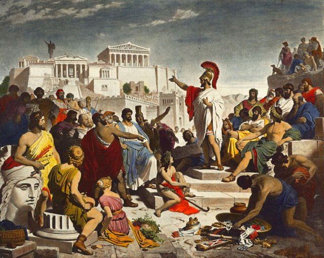
公元前 508 年，雅典的克利斯提尼（Cleisthenes）推行改革：按「村落」（demos）重新劃分公民單位、擴大公民大會——**民主**（demokratia，人民的權力）一詞誕生。

但雅典的民主有一個經濟與軍事地基：勞里昂（Laurium）的銀礦、以及一支以**三列槳戰艦**（trireme）為主的海軍——而戰艦需要 170 名槳手，槳手來自**最貧窮的公民**。

> **貧窮槳手、銀礦財富與公民權之間是什麼關係？為什麼海權國家雅典先走向民主，陸權的斯巴達卻維持寡頭？權力（politics）、財富（economy）與戰艦（technology）如何互相塑造？**

[→ 對外連結：雅典民主與海洋帝國：權力、銀礦與船槳的三角案](https://chad-liu.github.io/books/html/1-6.世界發展史/-0508-雅典民主.html)

## -451 | 十二銅表法
公元前 462 年起，羅馬的護民官（tribune）格拉古們在公民大會上反覆提出一個要求：**把法律寫下來**。當時的羅馬：法律存在（不缺乏規則），但法律的**知識被壟斷**——規則藏在祭司團（pontifices，貴族階層專屬）的口傳與密訓之中：**訴訟的程式、日期、口令——只有祭司知道**；平民打官司像蒙著眼睛走迷宮。

前 451–450 年，十人委員會（decemviri）受命編法：**十二銅表法**（Lex Duodecim Tabularum）——十二塊青銅板，立在羅馬廣場（Forum）公開陳列。

> **法律為什麼需要「寫下來」？成文法公開的深層意義是什麼——正當性、可預期性、還是權力的再分配？口傳的法律如何演變成羅馬法的推理傳統，最終總成為《民法大全》（[查士丁尼法典](https://chad-liu.github.io/books/html/1-6.世界發展史/0534-查士丁尼法典.html)）？**

[→ 對外連結：十二銅表法：把法律從祭司的手裡公開](https://chad-liu.github.io/books/html/1-6.世界發展史/-0451-十二銅表法.html)

## -283 | 亞歷山大圖書館
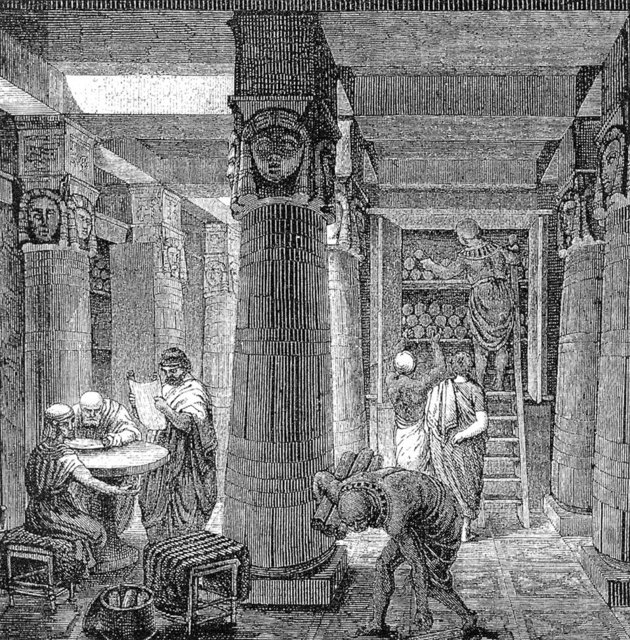
約前 283 年，亞歷山大港（埃及）。亞歷山大的繼業者托勒密一世與二世建起**博物館**（Mouseion——繆司的神殿：國家出錢的學者院，學者領俸、食宿由王宮）與**圖書館**——目標狂妄而明確：**蒐集世上所有的書**（宣稱藏卷四十萬至七十萬卷莎草紙卷）。

這是繼業者戰爭（Diadochi——亞歷山大死後諸將分裂帝國）的產物：各王朝以「文化」競爭正統性——誰擁有亞歷山大的知識遺產，誰就是繼承人。

> **為什麼「藏書」成為王朝的政治工程？索引（Pinakes）如何把幾十萬卷的死書變成可檢索的活知識？埃拉托色尼如何在圖書館裡量出地球的周長？**

[→ 對外連結：亞歷山大圖書館：把「所有的書」變成一座制度](https://chad-liu.github.io/books/html/1-6.世界發展史/-0283-亞歷山大圖書館.html)

## -221 | 秦統一

公元前 221 年，秦王嬴政滅六國，稱「始皇帝」。他面對的是人類史上最大的治理難題：**如何用一個中央政府直接統治數千萬人、數十萬平方公里**——周代靠封建（把權力分封給親屬），秦的答案是把權力**直接延伸到縣**。

配套的工程同時啟動：郡縣制、統一貨幣（半兩錢）、統一度量衡、統一文字（小篆）、修馳道與直道、遷徙豪富。

> **統治一個帝國的成本是什麼？為什麼秦要把錢、尺、字、路全部統一？中央集權的技術地基——資訊、標準與法律——如何互動？**

[→ 對外連結：秦統一與律法帝國：用資訊系統統治六國](https://chad-liu.github.io/books/html/1-6.世界發展史/-0221-秦統一.html)

## 105 | 蔡倫造紙
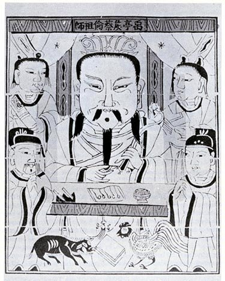
105 年，東漢和帝元興元年，尚方令**蔡倫**向朝廷獻上以樹皮、麻頭、破布、魚網為原料製成的紙——「用以代簡」。此前的書寫材料是兩條死路：竹簡木牘笨重（一部史書要幾車），縑帛絲織昂貴（只有貴族用得起）。

紙的出現提出一樁懸案：**為什麼一項 105 年的宮廷工藝，會在七百年後引爆巴格達的翻譯運動（[智慧宮翻譯運動](https://chad-liu.github.io/books/html/1-6.世界發展史/0830-智慧宮翻譯運動.html)），又在一千三百年後成為古騰堡印刷革命（[古騰堡印刷革命](https://chad-liu.github.io/books/html/1-6.世界發展史/1455-古騰堡印刷革命.html)）的前提？**

> **書寫材料的成本，如何決定一個文明能記住多少東西？**

[→ 對外連結：蔡倫造紙：把知識從殺牲畜變成種樹](https://chad-liu.github.io/books/html/1-6.世界發展史/0105-蔡倫造紙.html)

## 322 | 馬鐙與封建騎士

322 年（東晉，南京象山墓出土的**雙馬鐙**陶俑與實物——目前最早可靠的雙鐙考古證據）前後，雙馬鐙在中國定型：騎士的雙腳各踩一鐙，與馬鞍前橋後橋構成「三點固定」——騎手在馬背上**穩如礁石**。西傳的線索：突厥、阿瓦爾人把馬鐙帶入歐洲草原（7 世紀拜占庭的记载）。

白（Lynn White, 1962《中世紀技術與社會變遷》）的著名命題：馬鐙→**衝騎**（couched lance：夾緊長矛的正面衝鋒）→重裝騎士→**土地換兵役**→封建制度。

> **一對鐵環真的能「發明」封建制度嗎？衝騎的物理、騎士的經濟（馬的資本密集）與采邑的制度——這條鏈哪一環是真的？哪些被學界修正？**

[→ 對外連結：馬鐙與封建騎士：一對鐵環如何「發明」封建制度](https://chad-liu.github.io/books/html/1-6.世界發展史/0322-馬鐙與封建騎士.html)

## 534 | 查士丁尼法典
533–534 年，拜占庭皇帝查士丁尼一世（Justinian I）下令編成《民法大全》（Corpus Juris Civilis）——《法典》（Codex，皇帝敕令集）、《學說彙纂》（Digest，歷代法學家意見的總成，533 年）、《法學階梯》（Institutes，教科書）與《新律》。西羅馬帝國已亡（476），西方的羅馬法正在被日耳曼習慣法覆蓋——查士丁尼的目的是**把帝國的法律工程總成，防止失傳**。

> **一部為「垂死帝國」整理的法律，如何在八百年後復活，成為半個世界的民法法系源頭？法律、帝國與大學如何互相成就？**

[→ 對外連結：查士丁尼法典：羅馬法的總成與八百年後的復活](https://chad-liu.github.io/books/html/1-6.世界發展史/0534-查士丁尼法典.html)

## 830 | 智慧宮翻譯運動
830 年前後，巴格達。阿拔斯王朝哈里發馬蒙（al-Ma'mun）設立**智慧宮**（Bayt al-Hikma）——一座集圖書館、翻譯局與研究院於一體的機構。譯者把亞里斯多德、歐幾里得、托勒密、蓋倫從希臘文（經敘利亞文中介）譯成阿拉伯文；天文學家、數學家、醫學家在此工作。

智慧宮的物質地基耐人尋味：**紙**。751 年怛羅斯戰役（唐與阿拔斯之戰）中，阿拔斯軍擄獲唐軍**造紙工匠**——撒馬爾罕建起紙坊，紙技術傳入伊斯蘭世界；到 9 世紀，巴格達有紙市、抄書行業——**文書的成本下降了一個量級**（紙相對羊皮卷）。

> **一場軍事戰役的戰俘，如何變成一場知識革命的物質基礎？戰爭（politics）、紙（technology）與知識（culture）的鏈條如何形成？**

[→ 對外連結：智慧宮與翻譯運動：一場戰俘帶來的知識革命](https://chad-liu.github.io/books/html/1-6.世界發展史/0830-智慧宮翻譯運動.html)

## 1045 | 畢昇活字
1045 年前後，北宋慶曆年間，平民**畢昇**用膠泥燒製活字排印書籍——沈括《夢溪筆談》留下完整記錄：「若止印三二本，未為簡易；若印數十百千本，則極為神速。」這是世界最早的活字印刷，比古騰堡（[古騰堡印刷革命](https://chad-liu.github.io/books/html/1-6.世界發展史/1455-古騰堡印刷革命.html)）早了四百年。

懸案隨之而來：**最早發明活字的是中國，為什麼「印刷革命」卻在歐洲爆發？一項領先四百年的技術，為什麼沒有引爆自己家鄉的知識斷崖？**

> **發明與革命之間，差的是什麼？**

[→ 對外連結：畢昇活字：被紙耽誤四百年的印刷革命](https://chad-liu.github.io/books/html/1-6.世界發展史/1045-畢昇活字.html)

## 1157 | 香檳集市與匯票
12 世紀中葉，法國東北部的香檳地區（Champagne）出現了歐洲中世紀最著名的**定期國際集市**（fairs of Champagne）：每年六場、每場六週，輪流在特魯瓦（Troyes）等四個城市舉行。義大利熱那亞的商人在 1157 年前後已經常態性地北上赴會——香料、布匹、毛皮在這裡交換，而真正革命性的商品是**信用**。

> **沒有可靠的長途運輸、沒有統一貨幣、沒有公共法庭的歐洲，跨國貿易憑什麼成交？斐波那契 1202 年的《計算之書》為什麼剛好出現在這條商路成熟之後？**

[→ 對外連結：香檳集市與匯票：商業革命的前傳](https://chad-liu.github.io/books/html/1-6.世界發展史/1157-香檳集市與匯票.html)

## 1202 | 斐波那契計算之書
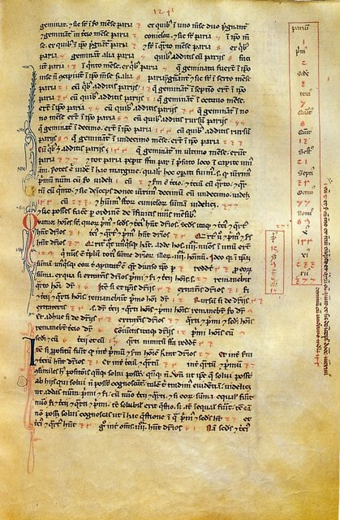
1202 年，比薩。里奧納多·斐波那契（Leonardo Fibonacci，約 1170–1250）——比薩商人之子，幼年隨父駐北非貿易殖民地布吉亞（今阿爾及利亞貝賈亞），在當地學會阿拉伯數字與印度計算法——出版《計算之書》（Liber Abaci）。

當時歐洲的商業計算用**羅馬數字與算盤**：加減尚可，乘除與分數幾乎無法筆算；商業記帳粗陋，信用記錄模糊。斐波那契的書把印度的位值記數法（經阿拉伯文獻傳入）系統引入歐洲：加減乘除、分數、比例、以及**複利與商業問題的例題集**。

> **一套記數符號的更換，如何改寫歐洲的商業、金融與記帳技術？為什麼數字改革需要三百年才完成？**

[→ 對外連結：斐波那契《計算之書》：阿拉伯數字如何改寫歐洲商業](https://chad-liu.github.io/books/html/1-6.世界發展史/1202-斐波那契計算之書.html)

## 1346 | 克雷西與長弓

1346 年 8 月 26 日，法國克雷西（Crécy）。英王的長弓兵——**約克夏與威爾斯的自由農民**——以每分鐘 6–10 箭的射速，把法國的重裝騎士（衝鋒十五次）射成刺蝟：法軍死傷上萬（含大量貴族與波希米亞國王），英軍傷亡極低。後續：普瓦捷（1356，法王被俘）、阿金庫爾（1415）——長弓連勝百年。

長弓的技術參數：拉力 100–150 磅、射速 6–10 箭/分鐘（弩約 2 箭/分鐘）、有效射程 200+ 米——**穿透板甲**（近距離）。

> **平民的廉價武器如何殺死資本密集的騎士？「誰從軍」的政治（[馬鐙與封建騎士](https://chad-liu.github.io/books/html/1-6.世界發展史/0322-馬鐙與封建騎士.html) 的鏈條）如何被反向重排？騎士制度與封建的軍事地基如何崩塌？**

[→ 對外連結：克雷西與長弓：平民的武器如何殺死騎士](https://chad-liu.github.io/books/html/1-6.世界發展史/1346-克雷西與長弓.html)

## 1347 | 黑死病

1347–1351 年，鼠疫（Yersinia pestis，經跳蚤與商路傳播）席捲歐洲：人口死亡約**三分之一到一半**（約 2500–5000 萬人）；部分城市過半。此前數世紀，歐洲人口增長而土地稀缺——**人口過剩、土地緊張**是封建制度的經濟地基：農民無處可逃，領主有議價權。

瘟疫把這個比例整個倒轉：人口銳減、土地與勞動力的比價翻轉——**勞動力稀缺、土地過剩**。

> **人口結構的逆轉，如何讓延續數百年的封建制度瓦解？為什麼西歐走向自由勞動，東歐卻走向「第二次農奴制」？一場瘟疫的政治經濟後果為何朝相反方向分裂？**

[→ 對外連結：黑死病：一場瘟疫如何瓦解封建制度](https://chad-liu.github.io/books/html/1-6.世界發展史/1347-黑死病.html)

## 1453 | 火藥與城堡的衰落

1453 年 4–5 月，君士坦丁堡。鄂圖曼的穆罕默德二世以匈牙利工匠烏爾班（Orban）鑄造的巨型火炮（炮口約 75 公分、發射 500 公斤石彈）——**每天七炮**地轟擊千年的狄奧多西城牆；53 天後城陷，拜占庭帝國滅亡。

**城牆的時代結束了。** 騎士的衝騎（[馬鐙與封建騎士](https://chad-liu.github.io/books/html/1-6.世界發展史/0322-馬鐙與封建騎士.html)）與貴族的城堡——中世紀封建的兩根軍事支柱——同時被火藥拆掉。

> **大炮如何殺死城堡與騎士？「軍事革命」（Military Revolution，Parker）如何造出現代國家？戰爭的成本爆炸與財政制度（[英格蘭銀行](https://chad-liu.github.io/books/html/1-6.世界發展史/1694-英格蘭銀行.html)）是什麼關係？**

[→ 對外連結：火藥與城堡的衰落：現代國家的軍事地基](https://chad-liu.github.io/books/html/1-6.世界發展史/1453-火藥與城堡的衰落.html)

## 1455 | 古騰堡印刷革命

1455 年前後，美因茨的金匠約翰內斯·古騰堡（Johannes Gutenberg）印出了《四十二行聖經》：約 180 部，每部 1282 頁。在此之前，一名抄寫員抄完這本書要三年；印刷作坊用壓印機，**一天能印數百頁**。知識複製的成本第一次出現數量級的下降——而這本書的「發明者」在 1455 年與合夥人福斯特對簿公堂、敗訴，作坊被奪走。

> **為什麼印刷革命發生在 1450 年代的德國，而不是更早的造紙技術持有者（中國 868 年已印《金剛經》、伊斯蘭世界 830 年後紙已普及）？為什麼一項如此賺錢的技術，發明者本人卻破產？**

[→ 對外連結：古騰堡印刷革命：知識複製成本的斷崖](https://chad-liu.github.io/books/html/1-6.世界發展史/1455-古騰堡印刷革命.html)

## 1492 | 哥倫布大交換
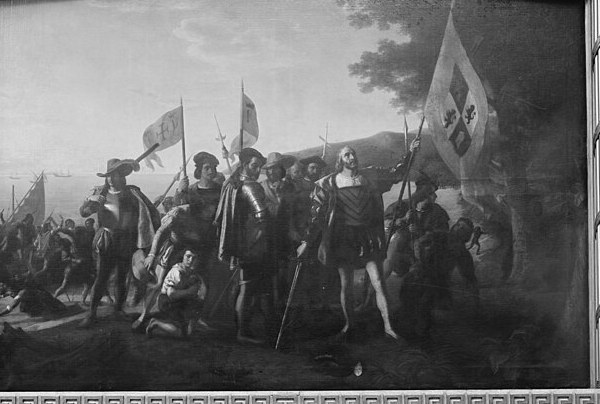
1492 年 10 月，哥倫布（Christopher Columbus）抵達加勒比。此前，美洲與歐亞非已隔絕約一萬五千年——兩個半球各有獨立的物種、疾病與農業。哥倫布的航程把兩個生態系統**重新接通**：史學家克羅斯比（Alfred Crosby）稱之為**哥倫布大交換**（Columbian Exchange，1972）。

交換是雙向且不對稱的：舊世界的**疾病**（天花、麻疹）讓美洲原住民人口在一世紀內崩潰約九成；美洲的**作物**（馬鈴薯、玉米、甘藷）讓舊世界人口在兩三個世紀內爆增；美洲的**白銀**讓歐洲與中國的貨幣體系同時改寫。

> **一場生態的合併，如何同時改寫兩個半球的農業、貨幣、人口與帝國政治？為什麼「作物→人口→國力」的鏈條決定了此後五百年的世界格局？**

[→ 對外連結：哥倫布大交換：兩個世界的生態與經濟合併](https://chad-liu.github.io/books/html/1-6.世界發展史/1492-哥倫布大交換.html)

## 1494 | 複式簿記與理性化

1494 年，威尼斯。修士帕奇奧利（Luca Pacioli）《數學大全》（Summa de arithmetica）中的簿記章節，把威尼斯商人實踐了數十年的**複式簿記**（double-entry bookkeeping）首次系統成書——「每筆交易記兩方、帳目自平衡」。

在馬克斯·韋伯（Max Weber，../宗教史/1905-韋伯新教倫理.md 的同一人）的社會學體系中（*《經濟與社會》《通用經濟史》*），複式簿記被置於**現代理性資本主義**（rational capitalism）發展史的核心位置——它不僅是記帳技術，是**理性化**（Rationalization）過程的樞紐。

> **現代資本主義與「傳統的貪婪或投機」的本質區別在哪裡？複式簿記為什麼被韋伯視為「重構人類經濟思維的認知工具」？與同時代的桑巴特（Werner Sombart）「形式與內容」的強命題相比，韋伯的謹慎版說了什麼？**

[→ 對外連結：複式簿記與理性化：韋伯眼中的「認知工具」](https://chad-liu.github.io/books/html/1-6.世界發展史/1494-複式簿記與理性化.html)

## 1545 | 波托西銀礦與價格革命
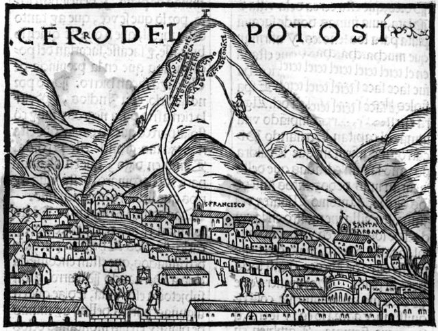
1545 年，西班牙殖民者在安第斯山海拔 4,000 公尺的波托西（Potosí，今玻利維亞）發現了史上最大的銀礦脈。到 1600 年，波托西人口超過 15 萬——比當時的馬德里還大。一個多世紀裡，美洲白銀經「西班牙大道」湧入塞維亞：美洲產出的白銀約佔全球的 80%。但耐人尋味的是：**拿到最多白銀的西班牙，是 16 世紀歐洲破產次數最多的國家**（1557、1575、1596、1607、1627）。

> **白銀=財富，為什麼白銀洪流反而讓物價翻倍、工資縮水、國家四度破產？1492 年哥倫布大交換（[哥倫布大交換](https://chad-liu.github.io/books/html/1-6.世界發展史/1492-哥倫布大交換.html)）打通的貿易線，其「金融後果」是如何傳導的？**

[→ 對外連結：波托西銀礦與價格革命：白銀如何燙傷舊歐洲](https://chad-liu.github.io/books/html/1-6.世界發展史/1545-波托西銀礦與價格革命.html)

## 1602 | 東印度公司
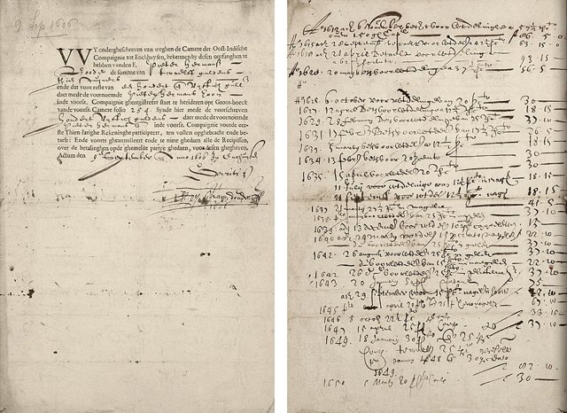
1602 年，荷蘭議會向一個新公司頒發特許狀：**荷蘭東印度公司**（VOC，Vereenigde Oostindische Compagnie）——世界第一家股份制公司。它的創新：把此前分散的遠洋貿易投資（一船一募資）合併為**永續資本**（參股即成為股東，資本不解散），並在**阿姆斯特丹交易所**（同年成立）交易其股份——股份可以轉賣，資本可以流動。

VOC 獲得的特許：好望角以東與麥哲倫海峽以西的**壟斷貿易權、開戰權、築城權、締約權**——一家公司擁有準國家的武力與外交權。

> **為什麼遠洋貿易需要「股份」？一家公司如何同時是商業機構、軍事組織與準國家？公司制度、金融市場與帝國政治如何互相誕生？**

[→ 對外連結：荷蘭東印度公司：第一家股份公司與金融革命](https://chad-liu.github.io/books/html/1-6.世界發展史/1602-東印度公司.html)

## 1623 | 獨占法與專利
伊莉莎白與詹姆斯一世時代的英國，**王室特許**氾濫成災：肥皂、鹽、玻璃、紙牌、皮革——國王把行業的壟斷特許當作**斂財工具**出售（「特許金」是王室歲入），結果物價暴漲、商人與國會同仇敵愾；1621 年國會公開抗議「濫發特許」。1623 年，詹姆斯一世被迫簽署《獨占法》（Statute of Monopolies）：**王室的一般性壟斷特許一概無效**——但留下一個關鍵例外：

> **第 6 條：新製造業的「真正且首要發明人」，可獨占 14 年。**

> **同一張「排他權」的紙，為什麼用在肥皂上叫掠奪、用在新發明上叫制度？專利與特許的區別是什麼，這個區分如何成為工業革命的法律地基？**

[→ 對外連結：英國《獨占法》與專利制度：把「斂財的特許」改造成「發明的引擎」](https://chad-liu.github.io/books/html/1-6.世界發展史/1623-獨占法與專利.html)

## 1666 | 倫敦大火與保險
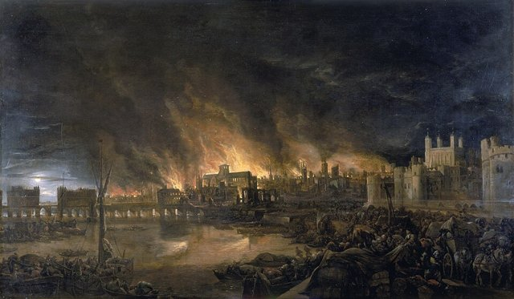
1666 年 9 月 2 日，倫敦布丁巷的麵包爐引發大火，四天燒毀約 **13,000 間房屋**、87 座教堂——中世紀倫敦的木造城區化為灰燼。災後重建以磚石為準，而**重建需要錢**：個人的積蓄在一次火災後歸零，互助的行會杯水車薪。

1671 年起，尼古拉斯·巴爾邦（Nicholas Barbon，醫師轉行的地產商人）開設英國第一家**火險辦公室**；1681 年「消防辦公室」（Fire Office）成立（自帶消防隊——保險公司自建滅火隊）；1688 年，愛德華·勞埃德（Edward Lloyd）的**泰晤士河畔咖啡館**成為船長、船東與承保人的交易場所——**勞合社**（Lloyd's of London）的海運保險市場由此誕生。

> **「風險」如何從個人命運變成可定價、可交易的商品？保險、精算與費率表——風險定價的數學基礎在哪裡誕生？**

[→ 對外連結：倫敦大火與保險：把風險變成可以定價的商品](https://chad-liu.github.io/books/html/1-6.世界發展史/1666-倫敦大火與保險.html)

## 1687 | 牛頓與科學革命
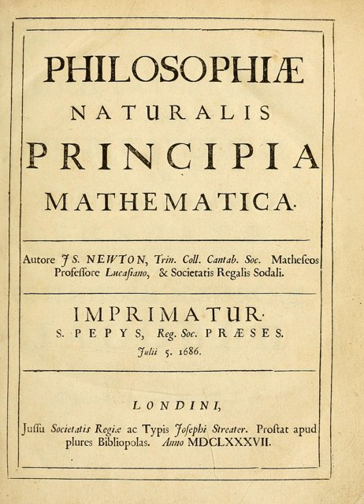
1687 年，牛頓出版《自然哲學的數學原理》：同一套數學（三條運動定律+萬有引力）同時解釋蘋果落地、潮汐、彗星與行星軌道——**天與地用同一部法典**。這本書的第一讀者哈雷（為它付了印刷費、說服了皇家學會）曾追問牛頓：橢圓軌道與平方反比力的關係是什麼？牛頓答「我早已算過」——但稿紙找不到。

> **1543 年哥白尼翻開了案卷（哥白尼與科學革命），開普勒給出了橢圓（1609），伽利略給出了落體（1638）——為什麼「綜合」等了四十四年才由一個劍橋的孤僻教授完成？科學革命缺的最後一塊是什麼？**

[→ 對外連結：牛頓《原理》：一個被法律與技術預約的宇宙](https://chad-liu.github.io/books/html/1-6.世界發展史/1687-牛頓與科學革命.html)

## 1694 | 英格蘭銀行
1694 年，倫敦。英格蘭銀行（Bank of England）成立：一群倫敦商人向政府貸款 **120 萬英鎊**（年息 8%），換取銀行特許權（發鈔、票據業務）。這筆交易的成本耐人尋味：8% 的年息在當時極高——國王詹姆斯二世時代的王室借貸常在 10% 以上、且經常**賴帳**（1672 年查理二世的「停付」）。

但六十年後（1750 年代），英國政府的借貸利率已降到 **3%** 上下——歐洲最低。同時，英國用這些債務資助了戰爭（九年戰爭、西班牙王位繼承戰爭）並成為歐洲強權。

> **為什麼同一個國家，借貸利率能從 10% 降到 3%？1688 年光榮革命、1689 年議會主權與 1694 年英格蘭銀行之間是什麼關係？「制度」如何改變一個國家的借貸成本？**

[→ 對外連結：英格蘭銀行：國債市場與「可信承諾」的誕生](https://chad-liu.github.io/books/html/1-6.世界發展史/1694-英格蘭銀行.html)

## 1710 | 安妮法規與版權
1710 年 4 月，英國《安妮法規》（Statute of Anne）通過——世界第一部現代意義的**著作權法**。背景：古騰堡印刷術（1455-古騰堡聖經.md）之後兩百年，翻印氾濫；1662 年的《許可法》（Licensing Act）以**審查制**管理印刷（印刷需官方許可），1695 年審查法到期失效——倫敦書商公會（Stationers' Company）主張其「普通法版權」**永久有效**（書商買下原稿即永久壟斷印行）。

《安妮法規》的設計反轉了主體：**「著作者」**——而非印刷商——享有 14 年版權（在世者可再續 14 年）；到期後作品進入**公共領域**（任何人可印）。

> **版權的主體為什麼從「書商」變成「作者」？14+14 年的期限是怎麼算出來的？「激勵創作」與「公共領域」的平衡由誰裁定？**

[→ 對外連結：《安妮法規》與版權：作者、書商與公共領域的三方案](https://chad-liu.github.io/books/html/1-6.世界發展史/1710-安妮法規與版權.html)

## 1720 | 南海泡沫與泡沫法
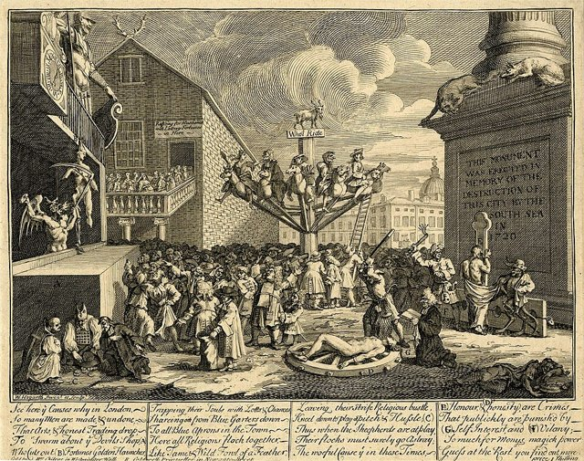
1720 年，倫敦。南海公司（South Sea Company）股價從年初的 128 鎊漲到 6 月的 1,050 鎊，八個月內暴漲八倍，隨後在秋天崩回 150 鎊。牛頓本人虧損兩萬鎊，留下名言：「**我能計算天體的運行，卻無法計算人性的瘋狂。**」同年 6 月，英國國會通過《泡沫法》（Bubble Act）——世界第一部針對「投機性公司」的管制立法。同一年，法國的密西西比泡沫（勞氏系統）同步崩潰，巴黎的約翰·勞亡命出逃。

> **1694 年英格蘭銀行剛證明「低息債務+可信承諾」的威力（[英格蘭銀行](https://chad-liu.github.io/books/html/1-6.世界發展史/1694-英格蘭銀行.html)），為什麼短短二十六年後，同一個金融市場就燒起來了？泡沫是制度的失靈，還是制度催生的產物？**

[→ 對外連結：南海泡沫與《泡沫法》：投機、公司與管制的第一次交鋒](https://chad-liu.github.io/books/html/1-6.世界發展史/1720-南海泡沫與泡沫法.html)

## 1763 | 普魯士義務教育
1763 年，腓特烈大帝頒布《一般鄉村學校規章》（General-Landschul-Reglement）：5–13 歲**強制就學**（此前 1717 年普魯士已有最早的義務教育令）。當時的教育現場：歐洲鄉村的識字率約 10–15%；教育的供給者是**教會與家庭**（教義問答+家內技能）——國家與教育幾乎無關。

普魯士的動機：**軍隊的讀寫**（士兵要讀命令與地圖）、**官僚的文書**（行政國家要文書吏）、**國民的形成**（從教會子民到國民）。

> **從「教育=教會的事」到「教育=國家的事」，組織的形式如何轉變？義務教育把什麼（軍隊、官僚、國民）造了出來？普魯士與英國（自由放任）的教育路線為何分岔？**

[→ 對外連結：普魯士義務教育：教育視角下的國家建造](https://chad-liu.github.io/books/html/1-6.世界發展史/1763-普魯士義務教育.html)

## 1769 | 瓦特蒸汽機
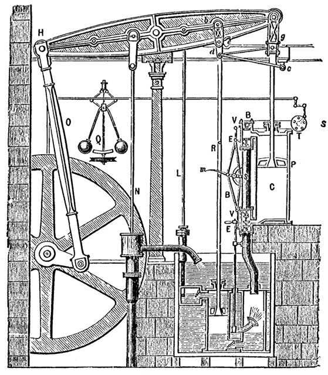
1769 年，蘇格蘭格拉斯哥。詹姆斯·瓦特（James Watt）取得**分離冷凝器**（separate condenser）的專利——紐科門蒸汽機（1712）的熱效率約 0.5–1%，大部分燃料用於**反覆加熱冷卻汽缸**；瓦特的解法：把冷凝分離出汽缸，汽缸保持常熱——效率提升數倍。

但瓦特當時是個窮儀器匠：沒有資金量產。1775 年，伯明罕製造商馬修·博爾頓（Matthew Boulton）入夥；同年，瓦特借議會把專利**延長到 1800 年**。

> **一項發明的問世需要什麼？靈感（瓦特）、資本（博爾頓）與法律（專利延長）缺一不可——但專利也帶來了一個反諷：專利保護期內，蒸汽機的改進反而被阻塞。專利是發明的引擎還是剎車？**

[→ 對外連結：瓦特蒸汽機與專利制度：發明、法律與資本的合夥案](https://chad-liu.github.io/books/html/1-6.世界發展史/1769-瓦特蒸汽機.html)

## 1776 | 國富論與獨立

1776 年是一個奇特的年份：3 月，亞當·斯密（Adam Smith）《國富論》（The Wealth of Nations）在倫敦出版；7 月，費城，《獨立宣言》簽署。兩件大事同年發生、互不相識（斯密與華盛頓沒有往來），卻共同標記了「舊秩序的鬆動」：**帝國的商業壟斷與王權的統治同時被挑戰**。

> **為什麼「經濟學的誕生」與「現代共和國的誕生」同年發生？兩者背後有沒有共同的原因？分工、市場與制衡——1776 年的兩份文件如何互相印證？**

[→ 對外連結：《國富論》與美國獨立：經濟學與政治革命的同年合流](https://chad-liu.github.io/books/html/1-6.世界發展史/1776-國富論與獨立.html)

## 1789 | 法國大革命

1789 年 5 月，凡爾賽。路易十六召集三級會議——不是為了理想，是為了**錢**：法國因資助美國獨立戰爭（1778–83）與舊制度的特權免稅結構，財政已破產（財政赤字約占收入一半）。貴族與教士免稅、第三階級納稅——加稅無路、舉債無門（參見 [英格蘭銀行](https://chad-liu.github.io/books/html/1-6.世界發展史/1694-英格蘭銀行.html)：法國王權缺乏議會的「可信承諾」，借貸成本高且最終信用崩潰）。

7 月 14 日巴士底獄陷落；8 月 26 日《人權與公民權宣言》發布——**「人生而自由，權利平等」**成為政治正當性的新公理。

> **一場財政危機如何變成政治重構？為什麼「錢的問題」會引爆「權的重構」？特權免稅、主權在民與人權宣言之間是什麼因果鏈？**

[→ 對外連結：法國大革命與《人權宣言》：財政危機如何變成政治重構](https://chad-liu.github.io/books/html/1-6.世界發展史/1789-法國大革命.html)

## 1795 | 公制
法國大革命前的測量現場：一國**約二十五萬種**地方單位——「pied（腳）」「toise（噚）」在不同城市長度不同（里昂的噚與巴黎的噚差數分）；**單位隨領主、隨市場、隨傳統**——交易的摩擦與領主的算計（單位=收稅的工具）。1790 年，革命政府委託科學院（博爾達、拉格朗日、**拉瓦錫**——../化學史/1777-Lavoisier氧化說.md 的同一人）設計新度量衡：**公制**。

1795 年，國民公會立法採用：**公尺**=巴黎到北極子午線象限的千萬分之一（德朗布爾與梅香 1792–99 年從敦克爾克到巴塞隆納的實地測量——橫越戰爭中的法國）；1799 年白金標準尺落地。

> **為什麼測量的標準化是革命的工程？「按國王的腳」與「按自然定義」的差別是什麼——正當性、交易成本、還是科學的地基？梅香為什麼為測量誤差自殺？**

[→ 對外連結：公制：從「國王的腳」到「自然的量」](https://chad-liu.github.io/books/html/1-6.世界發展史/1795-公制.html)

## 1796 | 牛痘疫苗與強制接種
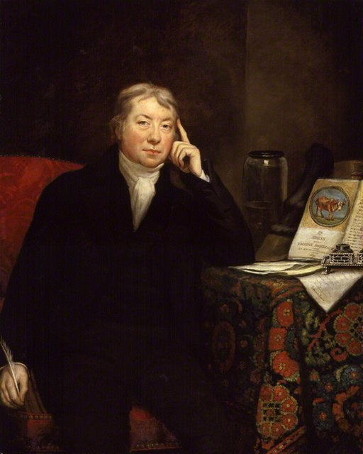
1796 年 5 月，英格蘭的鄉村醫師金納（Edward Jenner）為八歲的菲普斯（James Phipps）接種**牛痘**（cowpox——擠奶女工莎拉·尼爾姆斯的牛痘膿皰）；六週後，他以**人痘**（天花病毒）挑戰接種——菲普斯沒有發病。天花時代的現場：人痘接種（variolation——**故意感染**：1721 年蒙塔古夫人從鄂圖曼引進）死亡率 2–3%；天花的死亡率 30%+；牛痘（病毒的「表親」）≈零。

1798 年《探究》（Inquiry）出版；但**病毒理論未知**（傳染病學的理論要到巴斯德 1865——[倫敦下水道](https://chad-liu.github.io/books/html/1-6.世界發展史/1858-倫敦下水道.html) 的理論補票——金納在理論前七十年實踐）。

> **工程先跑通（牛痘）、理論後補票（病毒說）——強制接種（1853）與反疫苗運動（1853 同年誕生）是什麼關係？天花為什麼能在 1980 年被根除？**

[→ 對外連結：牛痘疫苗與強制接種：工程先跑通，感知後糾纏](https://chad-liu.github.io/books/html/1-6.世界發展史/1796-牛痘疫苗與強制接種.html)

## 1804 | 拿破崙法典

1804 年 3 月，《法國民法典》（Code civil des Français，拿破崙法典）頒布。背景：大革命十年，法國的法律是一片廢墟——南部（成文法區，承羅馬法）與北部（習慣法區）分治，封建法的殘餘、革命法令的堆疊，**一國數百種法**。拿破崙（1799 執政）的工程：把革命的成果——**平等、財產、契約**——編成一部可適用全國、可移植他國的法典。

> **一部法典如何把革命的混亂變成可移植的「代碼」？為什麼這部法典能傳播到德意志、義大利、日本與拉美？法典化（code）與判例（case）兩種法律工程有何差異？**

[→ 對外連結：拿破崙法典：把革命寫成可移植的代碼](https://chad-liu.github.io/books/html/1-6.世界發展史/1804-拿破崙法典.html)

## 1830 | 鐵路與電報
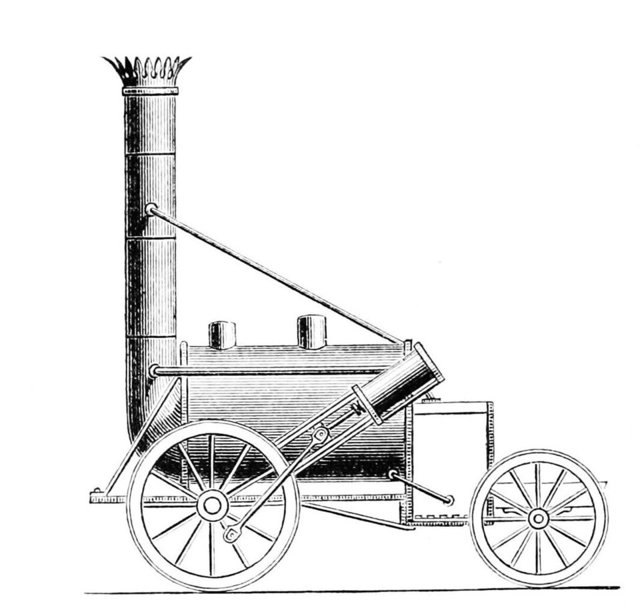
1830 年 9 月 15 日，利物浦—曼徹斯特鐵路通車——世界第一條全蒸汽動力的城際鐵路。同一個十年裡，電磁電報從實驗室走向線路（1837 惠斯通—庫克、1844 莫爾斯華盛頓—巴爾的摩）。**貨物與訊息第一次同時擺脫馬腿的速度**——此前三千年，陸上最快就是騎馬。

懸案：**為什麼瓦特 1769 年的蒸汽機（[瓦特蒸汽機](https://chad-liu.github.io/books/html/1-6.世界發展史/1769-瓦特蒸汽機.html)）要等六十年才變成鐵路？而鐵路一出現，標準時間（[標準時間](https://chad-liu.github.io/books/html/1-6.世界發展史/1884-標準時間.html)）、鐵路監管會計（[鐵路監管與會計](https://chad-liu.github.io/books/html/1-6.世界發展史/1887-鐵路監管與會計.html)）、柏林會議瓜分非洲（[柏林會議](https://chad-liu.github.io/books/html/1-6.世界發展史/1884-柏林會議.html)）會接連到來？**

> **速度翻倍之後，世界哪些東西必須重寫？**

[→ 對外連結：鐵路與電報：時空壓縮的第一個版本](https://chad-liu.github.io/books/html/1-6.世界發展史/1830-鐵路與電報.html)

## 1833 | 工廠法與視察制度
工業英格蘭的工廠現場：兒童一天工作 **12–16 小時**（紡織廠的童工巡夜班、通宵輪班）。法律早已存在：1802 年《學徒健康法》、1819 年《棉廠法》——**但沒有人執行**：無視察員、無查核、無稽核——「紙上的法律」。

1833 年《工廠法》的發明：童工工時限制（9–13 歲：8 小時；13–18 歲：12 小時）+**四位領薪的工廠視察員**（Factory Inspectors）——**有權進入工廠、有權起訴**的國家公務員。這是世界第一個現代視察制度。

> **為什麼「有法律沒視察」等於沒有法律？視察員制度（進入權+查核權+起訴權）如何成為現代監管的模板？童工的工時限制如何把教育與勞動法縫在一起？**

[→ 對外連結：英國工廠法與視察制度：「紙上的法律」如何長出眼睛](https://chad-liu.github.io/books/html/1-6.世界發展史/1833-工廠法與視察制度.html)

## 1844 | 羅虛戴爾合作社
1844 年 12 月，英格蘭羅虛戴爾（Rochdale）28 名紡織工人集資 28 英鎊，開出一家小雜貨店——「公平先鋒社」（Rochdale Pioneers）。背景：工業革命的工資被「公司商店」（company store）與摻假食品雙重盤剝；[工廠法與視察制度](https://chad-liu.github.io/books/html/1-6.世界發展史/1833-工廠法與視察制度.html)管得了工時，管不了物價；工人既無資本（見 [有限責任](https://chad-liu.github.io/books/html/1-6.世界發展史/1855-有限責任.html) 的資本瓶頸），也無信用。

> **沒有資本的窮人，如何辦一家「自己的公司」？合作社的八項原則為什麼此後一百年被全球複製上萬次？**

[→ 對外連結：羅虛戴爾合作社：窮人自己的公司制度](https://chad-liu.github.io/books/html/1-6.世界發展史/1844-羅虛戴爾合作社.html)

## 1846 | 乙醚麻醉
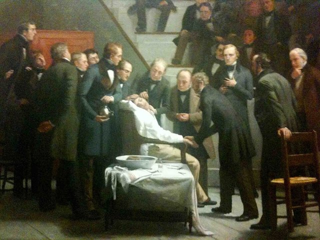
1846 年 10 月 16 日，波士頓馬薩諸塞總醫院的「乙醚穹頂」：牙醫出身的莫頓（William Morton）為病人雅伯特（Edward Abbott）以**乙醚**麻醉，摘除頸部腫瘤——**無痛完成**。外科的舊時代現場：手術=**速度的競賽**（利士頓 Liston 的「兩分半截肢」——史上最快的刀；傳說他一次截肢手術「死亡率 300%」——病人+助手+觀眾都被切到）、病人被按住、綁住、塞住——**疼痛=外科的極限**（只能做速度允許的：截肢、快速切除）。

> **麻醉如何把外科從「速度的競賽」變成「精準的工程」？疼痛的解除（1846）與感染的解除（1865 李斯特的消毒）為什麼相隔二十年？「快刀」與「慢刀」的手術技藝如何反轉？**

[→ 對外連結：乙醚麻醉：外科的時間革命](https://chad-liu.github.io/books/html/1-6.世界發展史/1846-乙醚麻醉.html)

## 1848 | 共產黨宣言
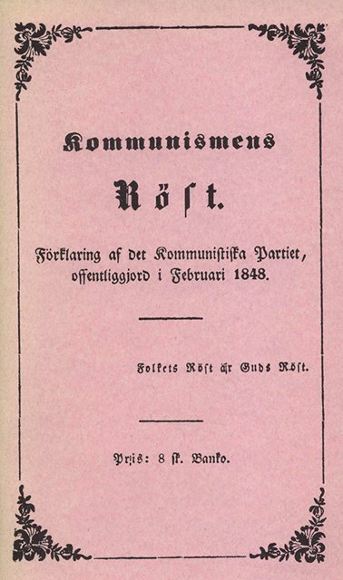
1848 年 2 月，倫敦。馬克思（Karl Marx）與恩格斯（Friedrich Engels）出版《共產黨宣言》。同年，革命浪潮席捲歐洲：法國二月革命（推翻七月王朝）、德意志各邦、奧地利、義大利——「民族之春」。

背景的社會現場：工業革命四十年（[瓦特蒸汽機](https://chad-liu.github.io/books/html/1-6.世界發展史/1769-瓦特蒸汽機.html)），工廠制把農村人口吸進曼徹斯特與里爾的貧民窟——工時 14 小時、童工、棚戶、霍亂（1832）；同時，新的工業資本家階層的財富爆增。

> **工業社會的矛盾（財富爆增與貧民窟並存）如何被理論化？1848 年的革命為什麼爆發又為什麼失敗？階級鬥爭史觀解釋了什麼、又沒解釋什麼？**

[→ 對外連結：《共產黨宣言》：工業社會的矛盾與革命浪潮](https://chad-liu.github.io/books/html/1-6.世界發展史/1848-共產黨宣言.html)

## 1853 | 黑船事件

1853 年 7 月，江戶灣。美國海軍培里（Matthew Perry）率四艘**黑船**（蒸汽軍艦）進入江戶灣，遞交菲爾莫爾總統的國書：開港通商的要求。德川幕府的秩序：**鎖國**（1630s 起——對外貿易限於長崎出島的荷蘭與中國商館）已維持兩百年。

黑船的技術現場：**蒸汽軍艦**（不依風力——進退自如，帆船的「風險」消失）+**開花彈炮**（Paixhans 爆炸彈——對木造艦與沿岸設施的毀滅性火力）——幕府的沿岸防禦（帆船+實心彈）**技術上過時**。1854 年 2 月，培里帶**更多**軍艦回來——「先禮後兵」的砲艦外交；幕府簽《神奈川條約》（下田、箱館開港+美國領事館）。

> **為什麼日本在 1853 年選擇開國，而沒有像清朝那樣拖到戰爭？技術差距如何變成外交差距？「黑船」的衝擊如何引爆幕府的正當性危機？**

[→ 對外連結：黑船事件：砲艦外交與開國的衝擊](https://chad-liu.github.io/books/html/1-6.世界發展史/1853-黑船事件.html)

## 1855 | 有限責任
1855 年，英國通過《有限責任法》（Limited Liability Act）；1856 年《公司法》（Companies Act 1856）讓**有限責任**成為任何人可註冊取得的普遍權利：股東的損失以**出資額為上限**——公司破產，債主碰不到股東的私產。

背景：1720 年南海泡沫後的《泡沫法》（[英格蘭銀行](https://chad-liu.github.io/books/html/1-6.世界發展史/1694-英格蘭銀行.html) 的副作用）讓股份公司需議會逐案特許達一百年——**辦一家公司像通過一項立法**。而 1840 年代的**鐵路狂熱**需要百萬鎊級的融資：無限責任（股東全財產擔保）讓小投資人不敢參股。

> **為什麼「破產不追到股東私產」這麼重要？有限責任是資本主義最偉大的發明還是最危險的補貼？誰承擔了被切下來的風險？**

[→ 對外連結：有限責任：把風險切成可買賣的份額](https://chad-liu.github.io/books/html/1-6.世界發展史/1855-有限責任.html)

## 1858 | 倫敦下水道
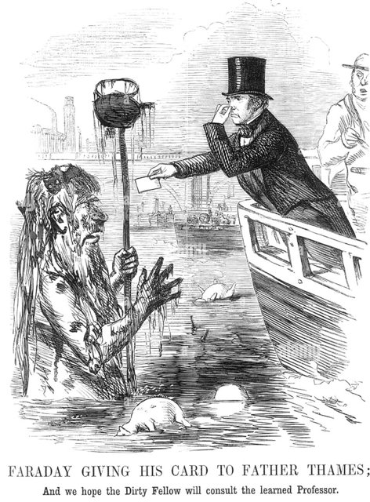
1850 年代的倫敦：霍亂反覆爆發（1832、1848–49、1854——每次數千至萬人死）；泰晤士河=**開放的污水溝**（家家戶戶的污水直排河中）；1858 年夏的**大惡臭**（Great Stink）：河的臭味讓國會的窗簾都被氯化液泡過——**三週內立法通過**（倫敦工程委員會的授權）——惡臭比流行病學更有說服力。

工程師巴扎爾吉特（Joseph Bazalgette）的下水道：1859–1875 年，**130 公里**的磚造隧道（重力自流——把污水送到下游入海）；造價 400 萬英鎊（當時最大單一工程）。

> **霍亂的病因（水 or 空氣）爭了二十年——為什麼工程先跑通（下水道），理論後補票（細菌說）？斯諾的地圖如何用「自然實驗」破案？**

[→ 對外連結：倫敦下水道：工程先跑通，理論後補票](https://chad-liu.github.io/books/html/1-6.世界發展史/1858-倫敦下水道.html)

## 1866 | 參謀本部與鐵路動員
1866 年 7 月，柯尼希格雷茨（Königgrätz，薩多瓦）。普魯士以**鐵路動員**（時刻表預排的軍列）、針發槍（Dreyse 後膛槍）與**總參謀部**的電報協調，三週內擊敗奧地利——軍事史的地震：歐洲各國（尤其法國）為之震動，總參謀部制度成為**標配**。

普魯士的制度發明：**總參謀部**（Generalstab）——職業化的參謀軍官團（毛奇 Moltke 領導）：**不靠天才、靠制度**——戰爭計畫、鐵路時刻表、電報網的預先工程。

> **「按時刻表打仗」的制度如何贏得戰爭？鐵路動員的不可逆性（1914 年的連鎖）是誰的教訓？軍事組織的「制度化」如何取代「天才」？**

[→ 對外連結：參謀本部與鐵路動員：按時刻表打仗的時代](https://chad-liu.github.io/books/html/1-6.世界發展史/1866-參謀本部與鐵路動員.html)

## 1866 | 大西洋電纜
1858–1866 年的跨大西洋賽跑：第一次（1857）電纜在深海斷裂、第二次（1858）通了數週即斷、第三次（1865）斷在半途、第四次（1866）——**大東方號**（Great Eastern，史上最大的船）成功鋪設**永久電纜**：倫敦與紐約的電報**瞬時互通**。

此前的資訊現場：跨大西洋的訊息延遲約**十天**（蒸汽船——金融的套利、外交的失誤、帝國的鬆散都在十天裡發生）；電報費從每詞 20 英鎊（1866）降到 1900 年的 1 美元。

> **「十天的延遲」承載了什麼（套利、外交、帝國）？延遲的終結如何重排金融、帝國與新聞的形狀？英國為什麼把海底電纜變成帝國的神經系統？**

[→ 對外連結：大西洋電纜：資訊延遲的終結](https://chad-liu.github.io/books/html/1-6.世界發展史/1866-大西洋電纜.html)

## 1868 | 明治維新

1868 年，明治政府取代德川幕府。面對的現場：黑船的技術代差（[黑船事件](https://chad-liu.github.io/books/html/1-6.世界發展史/1853-黑船事件.html)）、不平等條約的主權讓渡（領事裁判權+協定關稅）、幕藩體制的財政（260 個藩、各自的稅與軍）。

明治的綱領：**富國強兵**（國家目標）+**殖產興業**（產業的國家推動）+**文明開化**（社會的西化）。配合的工程：廢藩置縣（1871）、徵兵令（1873）、地租改正（1873）、義務教育（1872）、鐵路（1872 首線）、岩倉使節團（1871–73——**兩年的西方實地偵查**）、聘雇外國顧問（oyatoi gaikokujin）、憲法（1889，普魯士模型）、民法（1898）。

> **「拼裝」制度的國家工程如何運作——各領域分別「抄誰」、依什麼選擇？國家先建廠再賣給財閥的「殖產興業」是什麼邏輯？維新的陰影（殖民地與軍國）從哪來？**

[→ 對外連結：明治維新：制度「拼裝」的國家工程](https://chad-liu.github.io/books/html/1-6.世界發展史/1868-明治維新.html)

## 1869 | 蘇伊士運河
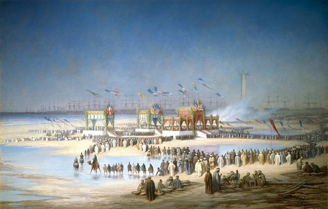
1869 年 11 月 17 日，蘇伊士運河通航——地中海與紅海第一次被人工水道連接，倫敦到孟買的航程從繞好望角的 18,000 公里縮到 12,000 公里，**時間砍掉三分之一**。與此同時，1866 年大西洋電纜接通（[大西洋電纜](https://chad-liu.github.io/books/html/1-6.世界發展史/1866-大西洋電纜.html)）——**貨物與訊息在同一個三年裡同時抄了近路**。

懸案：**一條 164 公里的溝，為什麼十五年後能長成 1884 年柏林會議（[柏林會議](https://chad-liu.github.io/books/html/1-6.世界發展史/1884-柏林會議.html)）瓜分非洲的物理地基？為什麼埃及為此亡國（1882 被英國占領），英國為此買下運河股份（1875 迪斯雷利閃購）？**

> **一條捷徑，如何變成帝國的咽喉？**

[→ 對外連結：蘇伊士運河：把世界對折的運河](https://chad-liu.github.io/books/html/1-6.世界發展史/1869-蘇伊士運河.html)

## 1884 | 柏林會議

1884 年 11 月–1885 年 2 月，柏林。俾斯麥召集歐洲十四國與美國（**非洲無一國與會**）開會，為「剛果問題」與非洲貿易自由定規則。會議的產物（柏林議定書）確立了**「有效占領」原則**：對非洲土地的主權主張，需實際占領與行政統治——**占領即權利**。

背景的引信：1869 年蘇伊士運河開通（紅海航線讓非洲內陸的戰略價值上升）、鑽石與金的發現（南非金伯利 1867/1886）、剛果河探險（史丹利 1877）。結果：1880–1914 年，非洲（除衣索比亞與賴比瑞亞）被歐洲列強瓜分殆盡。

> **為什麼非洲被瓜分發生在 1880 年代，而不是更早？「有效占領」的法律原則如何為瓜分背書？一張條線地圖的後果為何延續到今天？**

[→ 對外連結：柏林會議：用條線地圖瓜分非洲](https://chad-liu.github.io/books/html/1-6.世界發展史/1884-柏林會議.html)

## 1884 | 標準時間
1884 年 10 月，華盛頓。41 國代表開會決定**本初子午線**與全球時區。背景：鐵路與電報（../世界史/1830-鐵路與電報.md）讓「每城一個太陽時」崩潰——倫敦與布里斯托相差約 10 分鐘，列車時刻表無法制定；美國鐵路公司 1883 年**自行**劃出四個時區（「有兩個正午的星期天」——報紙的評語）；法國則堅持巴黎子午線（科學榮譽之爭）。

> **「時間」為什麼需要國際會議來決定？標準時間是誰的需求？一條看不見的線（子午線）如何成為全球的基礎設施？**

[→ 對外連結：國際子午線會議：時間的標準化與看不見的基礎設施](https://chad-liu.github.io/books/html/1-6.世界發展史/1884-標準時間.html)

## 1884 | 馬克沁機槍
1884 年，馬克沁（Hiram Maxim）的**自動機槍**（後座力裝填、彈鏈供彈、每分鐘約 600 發）問世——人類第一種「持續噴發火力」的武器。

**不對稱的十年（1890s）：** 1898 年恩圖曼（Omdurman）：英埃聯軍以約 50 人傷亡擊殺馬赫迪軍約 11,000 人——**機槍=殖民征服的降維打擊**；貝洛克（1898）：「無論發生什麼，我們有馬克沁機槍，他們沒有。」

**對稱的十五年後（1916）：** 索姆河：**雙方**都有機槍——英軍首日傷亡 57,000（19,000 死）；**壕溝的僵局**：攻守的機槍互相抵消——**不對稱的武器在對稱時變成互相屠殺的機器**。

> **同一種武器，為什麼十年間從「降維打擊」變成「互相屠殺」？不對稱→對稱的翻轉如何改寫戰爭的形狀？殖民的降維與歐洲的僵局是同一枚硬幣的兩面嗎？**

[→ 對外連結：馬克沁機槍：不對稱的殖民與對稱的壕溝](https://chad-liu.github.io/books/html/1-6.世界發展史/1884-馬克沁機槍.html)

## 1887 | 鐵路監管與會計
1887 年 2 月，美國《州際商務法》（Interstate Commerce Act）通過——設立**州際商務委員會**（ICC）：世界**第一個聯邦監管機構**。背景：鐵路（../世界史/1830-鐵路與電報.md）的雙面——規模經濟（跨大陸運輸）與濫權（價格歧視：大托運人折扣、小農戶補貼；短途運價高於長途的「短途悖論」）。1877 年最高法院 Munn 案允許**州**管鐵路運價；1886 年 Wabash 案推翻——跨州鐵路超出州權，**只能聯邦管**。

ICC 的兩件武器耐人尋味：**運價公開**（不得歧視）與**統一會計報表**——鐵路必須按聯邦規定的科目記帳、按季申報。

> **為什麼監管的第一件武器是「會計」？成本怎麼分攤（客運 vs 貨運的共同成本）？「公平報酬率」的公式管制如何運作、又如何被玩弄？**

[→ 對外連結：州際商務法與鐵路監管：會計成為監管的武器](https://chad-liu.github.io/books/html/1-6.世界發展史/1887-鐵路監管與會計.html)

## 1890 | 謝爾曼反托拉斯法
1882 年，洛克菲勒的標準石油（Standard Oil）以**信託**（trust）結構整合了約 90% 的美國煉油業：股東把股權交給一個受託人，換取證書——**跨州的企業可以像一個企業一樣行動**（繞開各州的公司法限制）。同時，鐵路的價格歧視（大戶折扣、小戶補貼）讓中小企業與農民憤怒。

1890 年 7 月，國會通過《謝爾曼反托拉斯法》（Sherman Antitrust Act）：第一條禁止「限制貿易的契約與合謀」；第二條禁止「壟斷化」。

> **為什麼「一家公司太大」成為法律問題？反托拉斯法如何界定「壟斷」？效率（規模經濟）與競爭（市場活力）之間的權衡由誰裁定？**

[→ 對外連結：謝爾曼反托拉斯法：壟斷與法律的對抗案](https://chad-liu.github.io/books/html/1-6.世界發展史/1890-謝爾曼反托拉斯法.html)

## 1906 | 純淨食品法
1906 年 6 月，美國同時通過兩法：**《純淨食品與藥物法》**（Pure Food and Drug Act）與**《肉品檢驗法》**（Meat Inspection Act）。引信有二：記者辛克萊（Upton Sinclair）的《叢林》（The Jungle，1906）——芝加哥肉廠的變質肉與腐敗衛生的寫實小說（總統羅斯福讀後派員實地查證）；農業部化學局局長威利（Harvey Wiley）率領的「毒物小隊」（Poison Squad）——**志願者試吃含硼砂防腐劑的餐食並記錄**（以自己的身體做實驗的化學家）。

當時的市場現場：**專利藥**（patent medicines）含嗎啡、可卡因、酒精——「嬰兒鎮靜糖漿」讓嬰兒成癮致死；標籤不標成分。

> **為什麼「標示成分」需要立法？市場失靈在哪裡？化學檢驗（科技）如何成為法律的執法工具？**

[→ 對外連結：純淨食品法：化學檢驗成為法律的執法工具](https://chad-liu.github.io/books/html/1-6.世界發展史/1906-純淨食品法.html)

## 1912 | 鐵達尼與無線電法
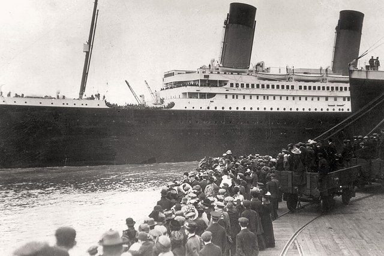
1912 年 4 月 15 日，鐵達尼號沉沒。事發當晚的無線電現場：附近約 20 公里的**加州人號**（Californian）——它的無線電報務員**下班就寢**，鐵達尼的求救訊號沒人收到；同時，大西洋上的**業餘電台**互相干擾——私人電台以過強功率傳訊，救難頻道一片混亂。1,500 人喪生。

> **無線電頻譜是公共財——誰都能發射、互相干擾。「公地悲劇」在頻譜上如何上演？一場災難如何把「看不見的資源」變成制度？**

[→ 對外連結：鐵達尼與無線電法：災難把頻譜變成制度](https://chad-liu.github.io/books/html/1-6.世界發展史/1912-鐵達尼與無線電法.html)

## 1913 | 福特流水線與美聯儲
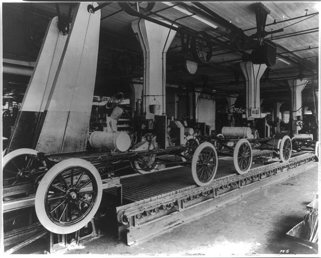
1913 年，美國的兩個機構同時誕生：4 月起，福特汽車的海蘭帕克廠啟用**流水線**（moving assembly line）——T 型車的底盤組裝時間從 **12.5 小時降到 1.5 小時**；12 月，《聯邦儲備法》通過——**美聯儲**（Federal Reserve）誕生。一個改寫了**生產**，一個改寫了**貨幣**。

背景的引信：1907 年金融恐慌（紐約銀行擠兌，靠摩根私人調度度過）——美國是最後一個沒有中央銀行的工業大國；同時，福特面前的問題：汽車昂貴（手工組裝，只有富人買得起）。

> **流水線與中央銀行——一個管生產、一個管貨幣，為什麼同年誕生？大眾生產與大眾金融如何互相需要？五美元日薪是「慷慨」還是「工程」？**

[→ 對外連結：福特流水線與美聯儲：大眾生產與大眾金融的同一年](https://chad-liu.github.io/books/html/1-6.世界發展史/1913-福特流水線與美聯儲.html)

## 1914 | 一次大戰與總體戰
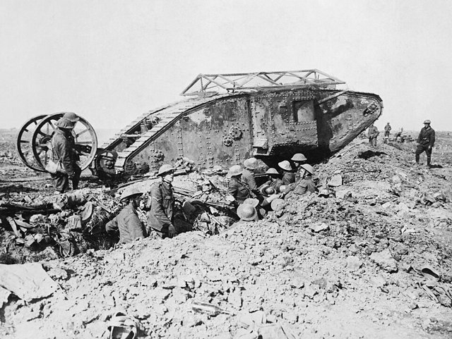
1914 年 7 月，一樁刺殺案（薩拉耶佛）在五週內升級為世界大戰。兇手不是塞爾維亞青年普林西普，而是一套「動員即開戰」的機器：鐵路時刻表、參謀本部、聯盟條約與民族主義心理互相咬合，讓任何一國都「來不及不開戰」。本案追查：為何外交還在談判，戰爭已經出發？

[→ 對外連結：一次大戰與總體戰：一張時刻表如何引爆世界](https://chad-liu.github.io/books/html/1-6.世界發展史/1914-一次大戰與總體戰.html)

## 1915 | 毒氣與日內瓦議定書
1915 年 4 月 22 日，伊普爾（Ypres）。德軍釋放**氯氣**（171 噸，5,730 鋼瓶）——風把黃綠色的氣體吹向法國殖民地部隊：數千傷亡（約 1,200 死）。哈伯（Fritz Haber——合成氨的諾貝爾獎得主，../化學史/1909-Haber合成氨與pH.md）主導——**化學的雙面**：合成氨養活一半世界人口、氯氣殺死戰壕裡的士兵。

續集：光氣（1915，更毒）、芥子氣（1917——皮膚與黏膜的潰爛，無防毒面具可擋）；WWI 的化學戰總帳：約 9 萬死、130 萬傷。1925 年，《日內瓦議定書》——**禁用化學武器**（第一步的國際法禁令）。

> **戰場化學如何催生國際法的禁令？「不可控的武器」（風吹的毒氣）為什麼先被禁止？哈伯的雙面（養活與殺死）告訴我們技術與道德的什麼關係？**

[→ 對外連結：毒氣與日內瓦議定書：戰場化學與法律的禁令](https://chad-liu.github.io/books/html/1-6.世界發展史/1915-毒氣與日內瓦議定書.html)

## 1917 | 俄國革命與計劃經濟

1917 年，彼得格勒。二月革命推翻沙皇，十月革命後布爾什維克——一個不到 25 萬人的政黨——接管了世界上面積最大的國家。隨後是史上最大膽的經濟實驗：**廢除私有制、用計劃取代市場**。這個實驗在七十四年後和平終結（[柏林牆倒塌](https://chad-liu.github.io/books/html/1-6.世界發展史/1989-柏林牆倒塌.html)），但它的起點需要單獨偵查：為什麼革命發生在俄國——馬克思預言中最不具備條件的國家？為什麼一個落後農業國的政黨，能把計劃經濟跑起來、又跑贏了二戰？

> **沒有市場價格，億萬種商品的生產與分配靠什麼協調？這個問題的答案，決定了二十世紀一半的人類命運。**

[→ 對外連結：俄國革命與計劃經濟：一場用國家取代市場的實驗](https://chad-liu.github.io/books/html/1-6.世界發展史/1917-俄國革命與計劃經濟.html)

## 1917 | 潛艇戰與大西洋生命線
1917 年 2 月，德國宣布**無限制潛艇戰**——擊沉一切駛向英法的船隻；此前：1914 英國遠程封鎖（北海！）、1915 盧西塔尼亞號被擊沉（1,198 死！美國震怒！）、1916 日德蘭海戰無結果（公海艦隊不敢再出！「艦隊存在」！）——**水面決戰無望，德國轉向水下**。背景：英國每周需進口 100 萬噸物資（糧食—硝石—鋼！島國！）、1916 年潛艇戰果（110 萬噸！）——**海軍參謀部計算：5 個月餓死英國**。

[→ 對外連結：潛艇戰與大西洋生命線：看不見的封鎖](https://chad-liu.github.io/books/html/1-6.世界發展史/1917-潛艇戰與大西洋生命線.html)

## 1921 | 含鉛汽油
1921 年，通用汽車的米基利（Thomas Midgley——就是後來發明 CFC 的同一人，參見 ../化學史/1938-Teflon與偶然發現.md）發現**四乙基鉛**（tetraethyl lead）可消除引擎爆震——含鉛汽油上市。好處：引擎效率提升（高壓縮比）；代價：**鉛是神經毒素**——全球大氣鉛濃度暴增、兒童血鉛與智商損失（後續研究：血鉛每上升 1 μg/dL，IQ 約降 0.5–1 分）、城市空氣的慢性中毒。

當時的現場：1924 年，新澤西工廠多名工人**急性鉛中毒死亡**（「loony gas building」的暱稱已流傳）——**毒性當時已知**；產業（通用/杜邦/標準石油組成的乙基公司）以內部研究反駁、阻擋獨立調查五十年——含鉛汽油直到 1970s–2000s 才分階段淘汰（美國 1970s 開始、歐盟 2000 全面禁、全球 2021 阿爾及利亞最後一國停用）。

> **一種已知有毒的技術為什麼存活了五十年？「產業的內部科學」如何對抗「公共的證據」？五十年延誤的帳本有多長？**

[→ 對外連結：含鉛汽油：明知有毒的五十年](https://chad-liu.github.io/books/html/1-6.世界發展史/1921-含鉛汽油.html)

## 1921 | 胰島素與一美元的專利
1921 年，多倫多。班廷（Frederick Banting）與貝斯特（Charles Best）分離出**胰島素**（胰腺摘除的狗、以胰島素續命 70 天）。此前的現場：糖尿病=**死刑**（「飢餓療法」——艾倫的 800 卡路里飲食、數月內死——身體在酮酸中毒中耗盡）；1922 年，14 歲的湯普森（Leonard Thompson）成為第一個被救活的病人——**死刑變成慢性病**。

1923 年諾貝爾獎（班廷與麥克勞德——貝斯特被排除、爭議；班廷分獎金給貝斯特）。本案的核心：1923 年，班廷、貝斯特與柯利普以**每人 1 美元**把胰島素專利賣給多倫多大學——「胰島素屬於世界」的公共精神；授權自由（非排他——所有藥廠可生產）。

> **「一美元的專利」為什麼與「今天的胰島素定價」（美國每瓶 300+ 美元）同存？藥物的公共性與專利的私有性如何拉鋸一百年？**

[→ 對外連結：胰島素與一美元的專利：藥物的公共性與私有性](https://chad-liu.github.io/books/html/1-6.世界發展史/1921-胰島素與一美元的專利.html)

## 1929 | 大蕭條與凱恩斯

1929 年 10 月，紐約股市崩潰。此後四年：美國 GDP 約 -30%、失業率約 25%、9000+ 家銀行倒閉；蕭條傳遍全球——歐洲更早（1929 年中已進入）。

官方的回應（胡佛、各國央行的經典處方）：**平衡預算、緊縮、守住金本位**——結果越緊縮越深。1933 年起，羅斯福新政（放棄金本位、存款保險、公共工程）；1936 年，凱恩斯（John Maynard Keynes）《就業、利息與貨幣通論》——**總需求管理**的理論誕生。

> **為什麼「經典處方」（緊縮+金本位）讓蕭條更深？金本位在傳染中扮演了什麼角色？凱恩斯如何把「蕭條」從命運變成政策可管理的現象？**

[→ 對外連結：大蕭條與凱恩斯革命：金本位、通縮與政策的誕生](https://chad-liu.github.io/books/html/1-6.世界發展史/1929-大蕭條與凱恩斯.html)

## 1929 | 禁酒令與黑幫
1920–1933 年，美國憲法第十八修正案禁酒。結果：喝酒沒停，黑幫崛起了——芝加哥艾爾·卡彭年入上億美元（一說），聖瓦倫丁大屠殺（1929），私酒、地下酒吧遍地。1933 年，第二十一修正案廢除禁酒——美國史上唯一被廢除的憲法修正案。一條法律，如何養大一個地下帝國？

> **禁酒令禁的是酒，養大的是誰？當需求不滅，禁止令的利潤流向哪裡？**

[→ 對外連結：禁酒令與黑幫：法律如何養大黑市](https://chad-liu.github.io/books/html/1-6.世界發展史/1929-禁酒令與黑幫.html)

## 1933 | 玻璃斯蒂格爾法
1933 年 6 月，美國《格拉斯-斯蒂格爾法》（Glass-Steagall Act, GSA）通過：**商業銀行與投資銀行分業**——吸收存款的銀行不得承銷證券、承銷商不得吸收存款；同年 **FDIC**（聯邦存款保險）誕生。背景：1929–33 年銀行倒閉 9,000+ 家；參議院**佩科拉聽證**（Pecora hearings，1933）揭露：商業銀行把**自家承銷的劣質證券賣給自己的存款人**——利益衝突的現場證據（國民城市銀行把不良拉丁美洲債券與自家股票捆綁銷售）。

> **「防火牆」的設計邏輯是什麼？分業犧牲了什麼（範圍經濟）、保住了什麼（風險隔離）？1999 年的廢除與 2008 年的危機之間，這條因果鏈成立嗎？**

[→ 對外連結：玻璃-斯蒂格爾法：銀行的防火牆](https://chad-liu.github.io/books/html/1-6.世界發展史/1933-玻璃斯蒂格爾法.html)

## 1934 | 證券交易法與SEC
1934 年，美國通過《證券交易法》（Securities Exchange Act），成立證券交易委員會（SEC）。背景：1929 年股災後，[玻璃斯蒂格爾法](https://chad-liu.github.io/books/html/1-6.世界發展史/1933-玻璃斯蒂格爾法.html)只管「銀行不能幹什麼」，沒管「上市公司說話要不要負責」；佩科拉聽證揭露：財報造假、內線交易、操縱拉抬是常態——**賣股票的人說什麼都行，買的人只能賭人品**。

> **資訊不對稱的市場如何不崩潰？「強制揭露」為什麼是證券市場的地基，而不是裝飾？**

[→ 對外連結：證券交易法與 SEC：把謊言變成可訴的 crime](https://chad-liu.github.io/books/html/1-6.世界發展史/1934-證券交易法與SEC.html)

## 1940 | 雷達與不列顛空戰
1940 年夏，不列顛空戰。皇家空軍（約 700–1,000 架戰機）對德國空軍（約 2,500 架）。決定性的差異不是飛機，是**資訊**：**本土鏈**（Chain Home）雷達網（20+ 座海岸高塔——偵測 100+ 英里外來襲機群）+道丁系統（Dowding System）：雷達+觀測員團+電話網+**過濾室**（filter room）——**世界第一套整合防空系統**：來襲機群的偵測→過濾→判定→命令→戰機在正確的時間與地點升空。

結果：英國守住（德國放棄空戰）。雷達的不對稱：**防禦者看得到攻擊者來**（資訊優勢）——攻方不知道防方什麼時候升空。

> **「資訊=武器」如何打贏空戰？作戰研究（Operational Research）——科學家分析戰術的新職業如何誕生？「過濾室」=防空的中央處理器是什麼結構？**

[→ 對外連結：雷達與不列顛空戰：資訊作為武器](https://chad-liu.github.io/books/html/1-6.世界發展史/1940-雷達與不列顛空戰.html)

## 1941 | 珍珠港與航艦時代
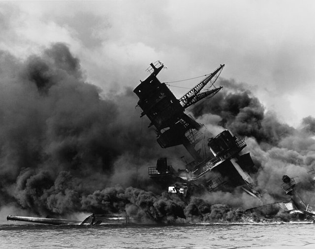
1941 年 12 月 7 日，珍珠港：日本六艘航艦、350+ 架戰機——兩小時內擊沉美國太平洋艦隊的戰鬥艦隊（亞利桑那號等）。但**航艦不在港**（出海執行任務）。

學說的賽跑：戰前正統——**戰鬥艦=主力艦**（馬漢 Mahan 的海權論：戰列線、大艦巨炮）；異論者——**米切爾**（Billy Mitchell，1921——以轟炸實驗擊沉繳獲的德國戰鬥艦——證明戰鬥艦對空襲脆弱——被降階、除役、法庭之爭）；**山本五十六**（策劃珍珠港——自己也懷疑與美國的持久戰）。證據的閉環：1941 珍珠港（戰鬥艦的沉沒）+1942 中途島（四艘日本航艦被**航艦飛機**擊沉）——**戰鬥艦的時代在一個早晨結束**。

> **為什麼技術的證據（米切爾 1921 的實驗）等了二十年才改變學說？「制度的慣性」如何拖延技術的承認？平台的更換（戰鬥艦→航艦）如何重排戰略？**

[→ 對外連結：珍珠港與航艦時代：學說與技術的二十-year 賽跑](https://chad-liu.github.io/books/html/1-6.世界發展史/1941-珍珠港與航艦時代.html)

## 1944 | 布列頓森林

1944 年 7 月，新罕布夏州的布列頓森林（Bretton Woods）——44 國（戰時盟國）的代表在避暑勝地開會，設計戰後的經濟秩序。會場上的兩位主角：美國的懷特（Harry Dexter White）與英國的凱恩斯——兩份方案（懷特計畫 vs 凱恩斯計畫）的競爭。

設計的目標極明確：**防止 1930s 重演**——1930s 的病例（[大蕭條與凱恩斯](https://chad-liu.github.io/books/html/1-6.世界發展史/1929-大蕭條與凱恩斯.html)）：金本位的傳染、競爭性貶值、貿易報復（斯穆特-霍利關稅）、以鄰為壑。

> **如何為「傳染」設計疫苗？布列頓森林的固定匯率+IMF+GATT 的制度結構，如何吸取 1930s 的反面教材？聯合國（1945）與馬歇爾計畫（1948）是同一場工程的哪些部分？**

[→ 對外連結：布列頓森林與戰後秩序：為 1930s 的錯誤設計疫苗](https://chad-liu.github.io/books/html/1-6.世界發展史/1944-布列頓森林.html)

## 1944 | 芝加哥公約
1944 年 12 月，二戰仍未結束，52 國在芝加哥簽署《國際民用航空公約》：**每國對其領土上空的空氣空間，擁有完全與排他的主權**——「領空」成為法律標的；國際民航組織（ICAO，1947 落地）誕生，統一飛航規則、機型認證、通訊語言（英語）。

> **海洋是自由的（格勞秀斯 1609），天空為什麼是排他的？「領空=領土」的主權邊界由什麼技術決定？主權的範圍為什麼隨著技術不斷加層（陸→海→空→太空→軌道）？**

[→ 對外連結：芝加哥公約：天空成為領土的技術史](https://chad-liu.github.io/books/html/1-6.世界發展史/1944-芝加哥公約.html)

## 1945 | 核武與嚇阻
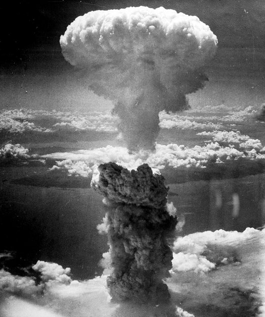
1945 年 7 月 16 日，三位一體試驗（Trinity）：人類第一枚核彈——廣島（8/6）、長崎（8/9）。續集：氫彈（1952，千倍當量）、洲際導彈（1957 史普尼克=ICBM 的證明——**任何城市都在射程內**）、潛射導彈（SLBM——**發射平台不可摧毀**）。

後果：**1945 年後大國之間再無直接戰爭**（史上最長的大國和平）；替代品是**嚇阻**（deterrence）——「相互保證毀滅」（MAD）與軍備管制（NPT 1968、限武條約 1972）。

> **核武為什麼「不能使用」？嚇阻的數學是什麼？「火力=力量」的公式（[馬克沁機槍](https://chad-liu.github.io/books/html/1-6.世界發展史/1884-馬克沁機槍.html)）如何在核武上被翻轉？**

[→ 對外連結：核武與嚇阻：讓「使用」變成「不可用」的武器](https://chad-liu.github.io/books/html/1-6.世界發展史/1945-核武與嚇阻.html)

## 1945 | 聯合國與戰後秩序
1945 年 6 月 26 日，50 國在舊金山簽署《聯合國憲章》。表面是一個和平組織的誕生，實際是一場「制度疫苗研發案」：設計者從 1919 國際聯盟的屍檢報告出發，逐條修補失效零件。本案追查：聯合國為何改了哪五個關鍵零件，而其中一個零件（否決權）至今仍在引發副作用？

[→ 對外連結：聯合國與戰後秩序：為兩場世界大戰設計疫苗](https://chad-liu.github.io/books/html/1-6.世界發展史/1945-聯合國與戰後秩序.html)

## 1946 | 矽谷創投制度
1946 年，波士頓。哈佛商學院教授多里奧（Georges Doriot）創立**美國研發公司**（ARD）——世界第一家**公開上市的創投**（VC）：以股權投資新創科技公司（不是放貸、不是買債——是**買股權、賭未來**）。1957 年，ARD 以 7 萬美元投資數位設備公司（DEC）——1968 年上市時價值 3.55 億美元（**5,000 倍**）——創投的收益證明。

同時代的西岸：1972 年克萊納-帕金斯（KPCB）與紅杉資本（Sequoia）在矽谷成立——**有限合夥**（limited partnership）結構成為創投的標準法律形式（GP 管理費+分成 20%、LP 出資不擔管理——**風險與管理的分工**）；1957 年「叛逆八人」（traitor eight）離開蕭克利實驗室創辦仙童（Fairchild）——**分拆（spin-off）文化的誕生**：仙童的後代（英特爾、AMD、國家半導體）=矽谷的家族樹。

> **創投與銀行放貸的本質區別在哪裡？「有限合夥」的法律結構如何把「賭未來」變成可管理的資產類別？分拆文化（仙童的家族樹）為什麼是矽谷的引擎？**

[→ 對外連結：矽谷創投制度：把「賭未來」變成一門法律與組織](https://chad-liu.github.io/books/html/1-6.世界發展史/1946-矽谷創投制度.html)

## 1947 | 電晶體的發明
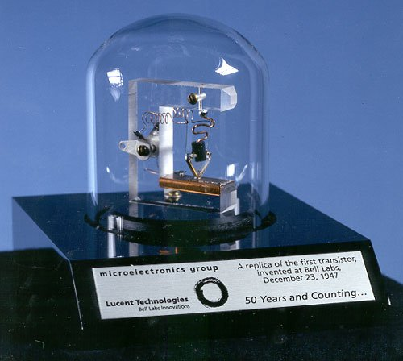
1947 年 12 月，貝爾實驗室。巴丁（Bardeen）、布拉頓（Brattain）在肖克利（Shockley）小組裡做出第一顆點接觸電晶體：指甲大小的鍺片，加電後竟能把微弱訊號放大一百倍。現場的真空管又大又燙、一台電腦要上萬支管子、開機像燒鍋爐。AT&T 本是電話公司，為何要養一群固態物理學家去追「水晶放大器」？

> **為何電話中繼器的維修帳單，會催生二十世紀最重要的發明？專利與軍事訂單在其中扮演什麼角色？**

[→ 對外連結：電晶體的發明：真空管帝國的掘墓人](https://chad-liu.github.io/books/html/1-6.世界發展史/1947-電晶體的發明.html)

## 1953 | DNA雙螺旋
1953 年 4 月 25 日，《自然》雜誌登出一篇一頁多的短文：沃森與克里克提出 DNA 雙螺旋結構，文末輕描淡寫——「我們注意到，這個結構立刻讓人想到遺傳物質可能的複製機制。」**二十世紀最重要的生物學發現，篇幅還不如一篇書評。**

懸案：**一個 1953 年的結構模型，如何在三十年後變成拜杜法（[拜杜法](https://chad-liu.github.io/books/html/1-6.世界發展史/1980-拜杜法.html)）的淘金對象、又在六十年後變成 Myriad 案（[Myriad案](https://chad-liu.github.io/books/html/1-6.世界發展史/2013-Myriad案.html)）的法庭戰場？為什麼胰島素一美元專利（[胰島素與一美元的專利](https://chad-liu.github.io/books/html/1-6.世界發展史/1921-胰島素與一美元的專利.html)）的公共性劇本，在基因時代完全反轉？**

> **一個分子結構，如何變成一場產權戰爭的標的？**

[→ 對外連結：DNA 雙螺旋：一篇一頁論文改寫的產權大戰](https://chad-liu.github.io/books/html/1-6.世界發展史/1953-DNA雙螺旋.html)

## 1960 | 科斯定理
1959–60 年，芝加哥。經濟學家科斯（Ronald Coase）在一場關於**無線電頻譜**的論戰中，拋出《社會成本問題》（The Problem of Social Cost，1960）——經濟學史上被引用最多的論文之一。當時的正統：**外部性**（externality）=一方加害另一方（工廠排煙害了鄰居）→政府應課稅或管制（庇古 Pigou 的傳統）。

科斯的反轉：他的例子是**牧牛者與農夫**——牛越界吃了農作物。誰是加害者？科斯說：**不是單向的加害**——限制牛（牧牛者受害）或不種作物（農夫受害），是**互惠的妨害**（reciprocal harm）：問題是「兩種有價值的活動如何共存」。

> **如果外部性是互惠的，政府該站哪一邊？科斯的定理說了什麼、沒說什麼？「交易成本」為什麼成為理解一切制度的鑰匙？**

[→ 對外連結：科斯定理：外部性、產權與交易成本的偵探案](https://chad-liu.github.io/books/html/1-6.世界發展史/1960-科斯定理.html)

## 1960 | 避孕藥與女性革命
1960 年 5 月，美國 FDA 批准 Enovid——世界第一款**口服避孕藥**。技術的現場：激素化學（黃體酮的合成，馬克爾 1951 的低成本合成——參見 [../化學史/](../化學史/) 類固醇合成化學）讓避孕從「事後/被動」變成「事前/女性自主控制」。

但法律的現場：避孕資訊在美國多州是**非法的**（康斯托克法 1873——避孕為「淫穢」）；藥物上市≠可自由取得——各州的合法化、已婚/未婚的區分、1965 年最高法院**格里斯沃爾德案**（已婚夫婦的避孕隱私權）、1972 年擴及未婚——**一顆藥丸的合法化走了十二年**。

> **一顆藥丸如何同時改寫法律（隱私權）、經濟（女性職業）與人口（生育率）？「藥丸先於墮胎合法化」的順序為何重要？**

[→ 對外連結：避孕藥與女性革命：一顆藥丸的法律、經濟與人口](https://chad-liu.github.io/books/html/1-6.世界發展史/1960-避孕藥與女性革命.html)

## 1962 | 寂靜的春天
DDT（滴滴涕）——二戰的有效殺蟲劑：瘧疾控制的神器（部隊與平民的救命藥）、1948 年諾貝爾生理學獎（Müller 因 DDT 的殺蟲效力）。戰後的農業大規模噴灑——**神器的陰影**：1962 年卡遜（Rachel Carson）《寂靜的春天》的鑑識報告：DDT 的**生物累積**（食物鏈層層放大——鳥蛋殼變薄、猛禽崩潰）、環境殘留（半衰期數年）。1972 年美國禁用（農業用途）。

但故事的續集耐人尋味：2000s 起，WHO **重新**推薦 DDT 的**室內殘效噴灑**（IRS）——瘧疾肆虐的非洲，DDT 的益處/害處比反轉。

> **同一種化學物，為什麼先是諾貝爾神器、再是環境公敵、再被部分正名？「益處/害處」的比例由什麼決定？禁用與再正名的邊界如何劃？**

[→ 對外連結：寂靜的春天與 DDT：好技術、外部性與再正名](https://chad-liu.github.io/books/html/1-6.世界發展史/1962-寂靜的春天.html)

## 1965 | 移民法案與美國人口革命
1965 年《移民與國籍法》（哈特—塞勒法案）：廢除 1924 年國籍配額制（北歐西歐優先），改按技能+家庭團聚，亞洲、拉美移民開閘。此前：美國白人近九成；此後：2020s 白人不足六成，西班牙語裔、亞裔成長最快。**一紙法律，如何改寫一個國家的臉？**

> **移民是人力，還是選票？當配額制把「最好的移民」定義成「最像我們的人」，誰在定義美國？**

[→ 對外連結：移民法案：美國人口結構的改寫](https://chad-liu.github.io/books/html/1-6.世界發展史/1965-移民法案與美國人口革命.html)

## 1969 | 協和客機
1969 年，協和號（Concorde）首飛——英法合作的超音速民航客機：2 馬赫（約 2,150 公里/小時）、倫敦—紐約 3.5 小時（次音速 8 小時）。**技術成功、商業失敗**：只造了 14 架量產機、載客三十年（1969–2003）虧損連連，2003 年退役。

殺手有二：**法律**——音爆（sonic boom）問題：美國 1973 年 FAA 禁止民用超音速在**陸地上空**超音速飛行（音爆的擾民與破壞——民怨與玻璃損害），協和只能在**大西洋上空**超音速（航程大半被限速）；**經濟**——油耗（人均油耗為次音速的約 7 倍）、油價（[石油危機](https://chad-liu.github.io/books/html/1-6.世界發展史/1973-石油危機.html) 的四倍漲價正中協和）、噪音（起降的次音速噪音讓紐約等機場受限）——票價十倍於次音速頭等艙，市場薄如紙。

> **技術上成功的飛機，為什麼被「法律+經濟」合殺？音爆禁令是合理的管制還是殺死了產業？超音速民航的「卡死」與核能的「停滯」是同一類死法嗎？**

[→ 對外連結：協和客機：被法律與經濟合殺的超音速民航](https://chad-liu.github.io/books/html/1-6.世界發展史/1969-協和客機.html)

## 1969 | 阿帕網與網際網路誕生
1969 年 10 月 29 日，加州大學洛杉磯分校（UCLA）。研究生試著向史丹佛傳送「LOGIN」，才敲出「LO」系統就當機——人類史上第一個封包交換網路訊息，只有兩個字母。幕後金主是五角大廈高等研究計畫署（ARPA）：為何國防部要花錢讓大學電腦互相「聊天」？當時主流是電路交換電話網，另起爐灶的封包交換被 AT&T 斥為「行不通」。

> **去中心、分組、容錯——這張網的設計哲學從何而來？為何冷戰的恐懼反而生出最開放的架構？**

[→ 對外連結：阿帕網與網際網路誕生：核戰陰影下織出的去中心之網](https://chad-liu.github.io/books/html/1-6.世界發展史/1969-阿帕網與網際網路誕生.html)

## 1971 | 尼克森衝擊
1971 年 8 月 15 日，尼克森在電視上宣布：美元**停止兌換黃金**——布列頓森林體系（[布列頓森林](https://chad-liu.github.io/books/html/1-6.世界發展史/1944-布列頓森林.html)）的核心承諾（35 美元/盎司）關閉。「臨時措施」成為永久——1973 年起，主要貨幣浮動匯率；**人類史上第一次，全球貨幣沒有任何實物錨**。

背景的現場：美國逆差擴大（越戰軍費+大社會計畫）、黃金儲備從 1950s 的 2 萬噸級滑落（美國黃金儲備從 1949 年的約 2.2 萬噸降到 1971 年的約 0.9 萬噸）、倫敦金市投機（1968 金池崩潰）、法國戴高樂用軍艦運黃金兌換（「美國的過分特權」）。

> **黃金窗口為什麼必然關閉？特里芬兩難如何按 1960 年的預言精確引爆？沒有實物錨的貨幣世界，憑什麼運轉？**

[→ 對外連結：尼克森衝擊：黃金窗口的關閉與特里芬兩難的引爆](https://chad-liu.github.io/books/html/1-6.世界發展史/1971-尼克森衝擊.html)

## 1973 | 石油危機
1973 年 10 月，贖罪日戰爭。OPEC 的阿拉伯成員對支持以色列的國家**禁運**並減產：油價從約 3 美元漲到 12 美元（四個月四倍）；美國加油站大排長龍、限速 55 英里、奇偶日加油制。1974 年，國際能源總署（IEA）誕生——**戰略石油儲備**成為制度。

> **整個西方經濟為什麼會被一場中東戰爭癱瘓？「油」是怎麼成為經濟的血液的？供給衝擊為什麼讓凱恩斯的需求管理失靈？**

[→ 對外連結：石油危機：內燃機時代的供給衝擊](https://chad-liu.github.io/books/html/1-6.世界發展史/1973-石油危機.html)

## 1974 | ERISA與退休金
1963 年，美國 Studebaker 汽車公司關廠：7,000 名工人的退休金一夜歸零——公司把退休金當「口頭支票」，錢從未真正提撥。1974 年《僱員退休收入保障法》（ERISA）通過：**退休金承諾從道德變成法律**——強制提撥標準、歸屬權（vesting）、信託隔離、PBGC 保險。

> **「做到退休就養你」這句話，為什麼需要一部 1,000 頁的法律來保證？長壽社會的錢從哪裡來？**

[→ 對外連結：ERISA 與退休金：把承諾寫成法律](https://chad-liu.github.io/books/html/1-6.世界發展史/1974-ERISA與退休金.html)

## 1978 | 改革開放
1978 年 12 月，中共十一屆三中全會。鄧小平主導的決議：工作重心轉向經濟建設——「改革開放」。當時的現場：計劃經濟二十年（人民公社、計劃配給）的結果——1978 年人均 GDP 約 200 美元（世界最低之一）、農民吃不飽（公社體制下，安徽小崗村的農民在 1978 年冬秘密按下紅手印，分田到戶——**自下而上的制度創新**）。

> **計劃經濟的問題是什麼？為什麼中國選擇「漸進」（雙軌制）而蘇聯選擇「震盪療法」——結局為何天壤？市場如何從「體制外」長出來？**

[→ 對外連結：改革開放：從計劃到市場的漸進工程](https://chad-liu.github.io/books/html/1-6.世界發展史/1978-改革開放.html)

## 1978 | 解除管制
1978 年 10 月，美國《航空解除管制法》（Airline Deregulation Act）通過；1984 年，民航局（CAB）——航空定價與航線的監管者——**自己被廢除**。背景：CAB 自 1938 年起管制機票價格與航線准入——結果：機票貴（約為成本加成）、航線稀疏、載客率低（飛機半空飛）；同時卡車（ICC）、電信（AT&T 壟斷）、金融（利率上限 Q 規則）皆被管制。

攻擊者不是政客，是**經濟學家**：斯蒂格勒的**俘虜理論**（1971，[鐵路監管與會計](https://chad-liu.github.io/books/html/1-6.世界發展史/1887-鐵路監管與會計.html) 的病理分析）、可爭議市場理論（Baumol, 1982——**進入威脅**就足以約束價格，不需在位者競爭）、以及主持解套的卡恩（Alfred Kahn，康乃爾經濟學家——CAB 主席，自嘲「我是個潛伏的市場經濟學家」）。

> **監管是誰的需求（1887 ICC 誕生於農民、也誕生於鐵路的歡迎）？解除管制靠什麼證據推動？「監管者如何退出監管」是什麼樣的工程？**

[→ 對外連結：解除管制運動：監管者如何學會退出](https://chad-liu.github.io/books/html/1-6.世界發展史/1978-解除管制.html)

## 1979 | 核能停滯
1979 年 3 月 28 日，賓州三哩島（Three Mile Island）：冷卻系統故障+人為操作失誤（儀表誤導操作員關閉緊急冷卻）→爐心部分熔毀——**但圍阻體守住**：釋放的輻射量極低（周邊居民平均劑量約 0.01 mSv，相當於一次胸片）——**無一人急性死**。

但後果不是物理的，是**感知的**：三哩島後美國核電訂單**全數取消**（1978 後無新核電廠完工至今的世代斷層）；1986 年車諾比（蘇聯 RBMK 無圍阻體——**不同的爐型**）造成 31 人急性死+大面積污染——兩場事故合起來把全球核能凍結三十年：核電占比（美國）停在約 20%、法國（逆勢擴張）約 70%。

> **技術上守住的三哩島（無人死）為什麼殺死了美國核能？「感知的成本」如何變成真實的成本？同時代的法國為什麼逆勢擴張？**

[→ 對外連結：三哩島與核能停滯：好技術被感知殺死的三十年](https://chad-liu.github.io/books/html/1-6.世界發展史/1979-核能停滯.html)

## 1980 | 拜杜法
1980 年前，美國聯邦資助的研究（NIH、NSF 經費）產出了一座「死檔案」：約 28,000 件政府持有的專利，**授權率不到 5%**——成果在論文與檔案裡死去。更糟的是產權混亂：每個資助單位有不同授權條款，大學與產業都不知道「誰能拿什麼」。

1980 年 12 月，**拜杜法**（Bayh-Dole Act）通過：受聯邦資助的大學與小企業可**取得發明專利**、並授權商業化（政府保留介入權）。同年，最高法院**Chakrabarty 案**裁定：基因改造細菌「可專利」——「太陽下任何人造物」皆可申請專利（專利標的的擴張）。

> **為什麼聯邦出錢的研究，成果卻「死在檔案裡」？產權歸誰（政府、大學、研究者）為何決定技術的生死？大學-產業的迴路如何被法律接通？**

[→ 對外連結：拜杜法與生物科技專利：讓大學的發明走出實驗室](https://chad-liu.github.io/books/html/1-6.世界發展史/1980-拜杜法.html)

## 1986 | 英國大爆炸
1986 年 10 月 27 日，倫敦金融城「大爆炸」（Big Bang）：固定佣金取消、單一職能（經紀 vs 自營）廢除、外資可收購英資券商——塵封百年的紳士俱樂部一夜變成全球戰場。背景：倫敦市占被紐約、東京蠶食；柴契爾政府認定**管制保護的是既得者，不是投資人**（與 [解除管制](https://chad-liu.github.io/books/html/1-6.世界發展史/1978-解除管制.html) 的美國航空、貨運同一波）。

> **一套管制可以在一天內廢除，一個金融中心可以在十年內重生嗎？自由化的代價由誰支付？**

[→ 對外連結：英國大爆炸：解除管制如何一日重寫金融城](https://chad-liu.github.io/books/html/1-6.世界發展史/1986-英國大爆炸.html)

## 1987 | 台積電與代工模式
1987 年，新竹。張忠謀（Morris Chang）創立台積電（TSMC）——世界第一家**純代工**（pure-play foundry）：**只做製造、不做設計**——與客戶（fabless 設計公司）承諾**不競爭**。

此前的產業結構：**IDM**（整合元件製造商——英特爾、TI、飛利浦：設計+製造+銷售一體）；張忠謀的觀察：晶圓廠的資本密集化（一座先進廠數十億美元——[鐵路監管與會計](https://chad-liu.github.io/books/html/1-6.世界發展史/1887-鐵路監管與會計.html) 的「成本曲線上移」同構）+設計的人才密集——**設計與製造的經濟學分家**。

> **「只做製造、承諾不競爭」的制度發明如何重排半導體產業？fabless（無廠設計）的誕生讓誰受益？信任（不競爭承諾）為什麼是代工模式的核心資產？**

[→ 對外連結：台積電與代工模式：把晶圓廠與設計分家的制度發明](https://chad-liu.github.io/books/html/1-6.世界發展史/1987-台積電與代工模式.html)

## 1987 | 蒙特婁議定書
1987 年 9 月，蒙特婁。24 國簽署《蒙特婁議定書》：**CFC（氟氯碳化物）分階段淘汰**——史上最成功的環境條約（198 國批准、臭氧層在 2020s 確認恢復中）。

科學的鏈條：1974 年莫里納與羅蘭的預測（CFC 的氯會催化破壞平流層臭氧——純理論計算，無觀測證據，產業反駁）→1985 年 NASA 的**南極臭氧洞**（衛星與地面觀測的物證——比預測嚴重得多）→1987 年議定書。

> **為什麼臭氧條約成功了、氣候條約（巴黎）難得多？「科學預測→衛星物證→條約→技術替代」的閉環哪一環是關鍵？**

[→ 對外連結：蒙特婁議定書：科學、衛星與條約的完整閉環](https://chad-liu.github.io/books/html/1-6.世界發展史/1987-蒙特婁議定書.html)

## 1989 | 柏林牆倒塌
1989 年 11 月 9 日，柏林。東德政府發言人夏博夫斯基在記者會上讀錯了文件（「立即、毫不延遲」過境），當晚數萬東柏林人湧向邊界；哨兵沒有開槍——**柏林牆倒塌**。1991 年 12 月，蘇聯解體——冷戰在不流一彈的情況下結束。

背景的現場：蘇聯經濟停滯（計劃體制的資訊失靈+軍費占 GDP 約 15–20%）、1986 年切爾諾貝利（體制的掩蓋文化）、油價暴跌（1986，石油是蘇聯外匯命脈）、戈巴契夫（1985 執政：公開性+重建——政治改革先於經濟改革的順序）、1989 年夏匈牙利開放對奧地利邊界（東德人的逃亡通道）、波蘭團結工聯選舉獲勝（6 月）。

> **冷戰為什麼以「不流血的破產」結束？蘇聯帝國的死因是意識形態、經濟還是軍備競賽？「槍炮對奶油」的帳本如何決定了一場對抗的終局？**

[→ 對外連結：柏林牆倒塌：帝國的財政破產與和平瓦解](https://chad-liu.github.io/books/html/1-6.世界發展史/1989-柏林牆倒塌.html)

## 1991 | 開放原始碼與GPL
1991 年 9 月，芬蘭赫爾辛基。21 歲的托瓦茲（Linus Torvalds）釋出 Linux 核心——與史托曼（Richard Stallman）1985 年的 **GPL**（GNU 通用公共授權）結合：**「版權保護自由」**（copyleft）——**任何人可以自由使用、修改、再發布，但衍生作品必須同樣自由**（病毒式的自由：與 [安妮法規與版權](https://chad-liu.github.io/books/html/1-6.世界發展史/1710-安妮法規與版權.html) 的「排他權」對稱：**GPL 是「排他」的鏡像**——把「傳染」的方向反轉：專利傳染排他、GPL 傳染自由）。

續集：GitHub（2008）、安卓（Linux 核心）、雲端的 Linux、超級電腦的 Linux（500 強全數）——**開源成為全球軟體的基礎設施**。

> **「用版權保護自由」的制度悖論如何運作？「病毒式條款」為什麼讓開源能對抗閉源？「免費的軟體」的商業模式從哪來？**

[→ 對外連結：開放原始碼與 GPL：用「版權保護自由」的制度悖論](https://chad-liu.github.io/books/html/1-6.世界發展史/1991-開放原始碼與GPL.html)

## 1994 | 開羅人口會議
1994 年 9 月，開羅。聯合國**國際人口與發展會議**（ICPD）——179 國通過《行動綱領》，宣布了一個政策轉向：**人口政策的目標從「生育率數字」轉為「女性賦權」**——避孕、教育、醫療是權利，不是控制人口的工具；「數量目標」與強制手段被揚棄。

背景的辯論：1960s–80s 的**人口控制**範式（布加勒斯特 1974 的對立——發展中國家說「發展是最好的避孕藥」、西方說「人口炸彈需控制」；中國的一胎化 1980、印度的強制結紮 1975–77 的教訓）vs 女性運動與發展經濟學的新證據（**女性教育是生育率最強的預測變數**）。

> **為什麼「控制人口」失敗、「賦權女性」有效？教育→生育率的機制是什麼？開羅的轉向如何被三十年的證據驗證？**

[→ 對外連結：開羅人口與發展會議：從人口控制到女性賦權的轉向](https://chad-liu.github.io/books/html/1-6.世界發展史/1994-開羅人口會議.html)

## 1998 | 網路長城與內部生態
1998 年起，中國的「金盾工程」與 **GFW**（防火長城——Great Firewall）：對境外網路的**過濾與封鎖**（關鍵詞、平台、協議的層層過濾——Google、Facebook、Twitter 被擋）；「圍牆之內」的生態：**BAT**（百度 2000、阿里巴巴 1999、騰訊 1998）——**中國版的每一個全球平台**。

吊詭的結果：圍牆（封鎖）不但沒有扼殺中國網路，反而**保護**了內部生態——**沒有全球競爭者的內部市場**+**巨大的內部需求**=生態的爆炸（微信的超級應用 2011、支付寶的支付 2004、抖音的演算法 2016）——**圍牆內的創新**（行動支付的領先：現金社會跳到行動支付——與 [M-Pesa與跳蛙式發展](https://chad-liu.github.io/books/html/1-6.世界發展史/2007-M-Pesa與跳蛙式發展.html) 的跳蛙同構）。

> **封鎖為什麼反而催生了生態？「圍牆」的代價與收益如何分配？「內部創新」與「外部隔離」的張力如何演變？**

[→ 對外連結：中國網路長城：圍牆之內的生態爆炸](https://chad-liu.github.io/books/html/1-6.世界發展史/1998-網路長城與內部生態.html)

## 1999 | Y2K與印度IT外包
1996–1999 年的全球恐慌：**千禧蟲**（Y2K bug）——1960s 的節省（日期用兩位數年份：1970 存成 "70"）讓 2000 年 1 月 1 日「00」被讀成 1900——**數十年前的一個省略**變成全球的系統風險；估計的修正成本：**數千億美元**（美國約 1,000 億）。

受益者：**印度 IT 外包**——1990s 的印度（1991 年經濟自由化、1999 IT 政策）：Infosys（1981）、TCS（1968/2004 上市）、Wipro——**Y2K 的修正是印度 IT 的起飛引擎**（大量英文+低薪+衛星/電訊的普及——與 [大西洋電纜](https://chad-liu.github.io/books/html/1-6.世界發展史/1866-大西洋電纜.html) 的電纜譜系：衛星讓「外包」可能）。

> **「三十年前的一個省略」如何造就一個產業？Y2K 的恐慌與印度的機會是什麼關係？「舊的問題」為什麼有時是「新的機會」？**

[→ 對外連結：Y2K 與印度 IT 外包：一個 bug 造就一個產業](https://chad-liu.github.io/books/html/1-6.世界發展史/1999-Y2K與印度IT外包.html)

## 1999 | 黃金米
1999 年，黃金米（Golden Rice）的技術誕生：瑞士與德國的科學家以**基因改造**讓稻米產生β-胡蘿蔔素（維生素 A 前體）——目標：解決發展中國家的**維生素 A 缺乏**（每年數十萬兒童失明、數十萬死）。技術的前景：黃金米將免費提供給小農——「救助的技術」。

但黃金米卡了**二十餘年**：歐盟的管制（嚴格的基改法規+標示）、反基改運動（綠色和平的破壞田間試驗）、專利與管理混亂、菲律賓的核准拖延（2021 才核准種植——技術問世 22 年後）。

> **一種「救命的技術」為什麼被卡死二十餘年？管制、文化感知與專利如何合力卡死它？「預防原則」的成本誰來付？**

[→ 對外連結：黃金米與基改作物：被卡死的好技術](https://chad-liu.github.io/books/html/1-6.世界發展史/1999-黃金米.html)

## 2000 | 加州電力危機
1996 年，加州「解除」電力管制——設計是**半套**的：發電端市場化（批發電價浮動、成立電力交易所 PX）、**零售電價凍結**（公用事業不得調價，以償還過去投資的「擱淺成本」）。2000 年夏：批發電價暴漲約十倍；2001 年初：**輪流停電**、最大公用事業 PG&E 破產（美國史上最大公用事業破產）。

同時曝光的：安隆（Enron）的交易策略——「死星」（Death Star）與「大衛銀行」（Load Shift）：**虛構擁塞**（申報不存在線路的迂迴費用）、把電力**移出**加州再移回以收取「傳輸補償」——市場操縱的現場。

> **為什麼航空解除管制（1978）成功、電力解除管制失敗？「半套管制」夾死了誰？電網的物理學如何讓市場設計失靈？**

[→ 對外連結：加州電力危機：解除管制的失敗對照組](https://chad-liu.github.io/books/html/1-6.世界發展史/2000-加州電力危機.html)

## 2002 | 沙賓法案
2001 年，安隆（Enron）用特殊目的實體（SPE）藏債 30 億美元後破產；2002 年 WorldCom 虛增利潤 38 億；審計師安達信（五大之一）銷毀文件、解體。2002 年《沙賓-歐克斯利法案》（SOX）通過：CEO/CFO 親簽財報擔刑責、404 條款要求內控審計、成立 PCAOB 管審計師。

> **公司說謊、審計師放水——誰來審計審計師？一份財報的可信度，到底由什麼生產出來？**

[→ 對外連結：沙賓法案：安隆之後，審計師還能相信嗎](https://chad-liu.github.io/books/html/1-6.世界發展史/2002-沙賓法案.html)

## 2007 | M-Pesa與跳蛙式發展
2007 年 3 月，肯亞。薩法利通訊（Safaricom）推出 **M-Pesa**（M=行動、Pesa=斯瓦希里語的錢）：**以手機簡訊轉帳**——沒有銀行帳戶、沒有分行、沒有信用卡——**以手機作為貨幣的帳本**。

肯亞的現場：銀行分行密度極低（多數人無帳戶）、ATM 幾乎不存在、現金社會（轉帳的摩擦=實體現金的攜帶風險）；M-Pesa 的增長：2007 年上線、2010s 覆蓋**九成以上**的肯亞成人——**沒有銀行的社會直接跳到行動貨幣**（跳蛙，leapfrogging）。

> **為什麼「沒有銀行」反而是 M-Pesa 的機會？跳蛙的機制是什麼（舊基礎設施薄=新基礎設施無阻力）？行動貨幣的監管（電信 vs 銀行的管轄）如何解？**

[→ 對外連結：M-Pesa 與跳蛙式發展：沒有銀行的社會直接跳到行動貨幣](https://chad-liu.github.io/books/html/1-6.世界發展史/2007-M-Pesa與跳蛙式發展.html)

## 2007 | 智慧型手機時代
2007 年 1 月 9 日，賈伯斯舉起第一代 iPhone：「iPod＋電話＋上網機，三合一。」現場譁然，諾基亞工程師卻冷笑——沒有鍵盤、電池不可換、3G 都沒有，憑什麼賣 499 美元？十八個月後，App Store 上線；十年後，諾基亞手機部門被賤賣給微軟。真正的兇器不是觸控螢幕，而是一紙分成合約：蘋果與開發者三七分帳。

> **為何觸控早就存在，革命卻發生在 2007？手機如何從通話工具變成抽稅的平台？**

[→ 對外連結：智慧型手機時代：把電腦塞进口袋的平台革命](https://chad-liu.github.io/books/html/1-6.世界發展史/2007-智慧型手機時代.html)

## 2008 | SpaceX與商業太空
2008 年 12 月，NASA 把**商業軌道運輸服務**（COTS）的合約給了 SpaceX——**政府出錢買服務**（不買硬體）：獵鷹 9 號（2010 首飛）+天龍號太空船（2012 對接國際太空站）——**商業公司第一次對接太空站**。

馬斯克的現場：2002 年創辦 SpaceX、三次失敗（2006–08 的獵鷹 1 號——**破產的邊緣**）、第四次成功（2008/9）——NASA 的 COTS 合約救了公司（**政府的合約=新創的救命**）。

> **「政府買服務、不買硬體」的制度與「殖產興業」（政府建廠、私人接手）是什麼關係？可回收火箭（2015）如何把發射成本砍掉一個量級？**

[→ 對外連結：SpaceX 與商業太空：政府示範、私人接手的太空版](https://chad-liu.github.io/books/html/1-6.世界發展史/2008-SpaceX與商業太空.html)

## 2008 | 全球金融危機
2008 年 9 月 15 日，雷曼兄弟破產（負債 6,000 億美元，美國史上最大破產案）——全球金融市場凍結。此前：次級房貸（subprime）經**證券化**（MBS 抵押債券、CDO 擔保債務憑證）滲透到全球銀行體系；房價 2007 年轉跌→違約潮→評級崩潰→市場對「誰持有毒資產」失去信任——**銀行間市場凍結**。

官方回應：TARP（7,000 億美元紓困）、各國央行零利率+量化寬鬆（QE）；立法：2010 年多德-弗蘭克法（Dodd-Frank）、巴塞爾 III。

> **金融工程（MBS/CDO/信用違約交換）為什麼把風險放大而非分散？高斯連接函數（Gaussian copula）與 VaR 的模型錯在哪裡？為什麼「分散風險」的設計製造了系統性風險？**

[→ 對外連結：全球金融危機：模型的失效與風險的傳染](https://chad-liu.github.io/books/html/1-6.世界發展史/2008-全球金融危機.html)

## 2009 | 比特幣
2009 年 1 月 3 日，比特幣創世區塊誕生——區塊內嵌入當日《泰晤士報》頭版標題：「財政大臣處於第二次救助銀行的邊緣」——**時間戳就是宣言**：這套系統是 2008 年危機（[全球金融危機](https://chad-liu.github.io/books/html/1-6.世界發展史/2008-全球金融危機.html)）信任崩潰的回應。此前（2008 年 10 月），化名中本聰（Satoshi Nakamoto）的白皮書《比特幣：一種點對點的電子現金系統》已定義了目標：**無需可信第三方的電子支付**。

> **會計的千年問題——誰記帳、誰稽核、誰防竄改——如何被密碼學解掉？「去中心化」的代價是什麼？比特幣是貨幣、資產還是帳本工程？**

[→ 對外連結：比特幣：去中心化帳本與「誰來記帳」的千年問題](https://chad-liu.github.io/books/html/1-6.世界發展史/2009-比特幣.html)

## 2010 | 閃電崩盤
2010 年 5 月 6 日下午，紐約。道瓊指數在**五分鐘內**暴跌近 1,000 點（約 9%）又急速彈回——史上最大的盤中閃電崩盤（Flash Crash）；寶潔（P&G）股價瞬跌；部分股票成交價低至 1 美分（埃森哲）。起因：一檔共同基金的**演算法賣單**（7.5 萬份 E-mini 契約，「跟著成交量賣」——不管價格），吞噬買盤；高頻交易商（HFT）在壓力下**同時撤單**——流動性蒸發，價格自由落體。

> **高頻演算法在正常期提供流動性，壓力期為什麼同時撤單？「演算法的羊群」是什麼結構？熔斷機制如何降溫？**

[→ 對外連結：閃電崩盤：演算法的羊群與流動性蒸發](https://chad-liu.github.io/books/html/1-6.世界發展史/2010-閃電崩盤.html)

## 2012 | 交友軟體與婚戀市場
2012 年，Tinder 上線——以**滑動**（swipe）與演算法推薦重寫了交友：此前，婚戀市場的媒人是親屬、同儕、地理（同學、同事、鄰里）；此後，**演算法是媒人**——配對池從「一城」擴到「全球」，選擇以滑動完成。2020s 的數據：交友軟體成為異性伴侶相識的主要管道之一（美國異性新婚伴侶經網路相識的比例從 1995 年約 2% 升到 2020s 的約 40%+）；同時，結婚率與生育率持續下探（南韓 2023 總和生育率 **0.72**——全球最低；東亞與歐美同步）。

> **演算法改寫了婚戀市場的哪一層（相識、選擇、還是承諾）？選擇的爆炸（全球配對池）為什麼反而讓「承諾」變難？交友軟體與低生育率之間是因果還是共因？**

[→ 對外連結：交友軟體與婚戀市場：演算法、配對與生育意願](https://chad-liu.github.io/books/html/1-6.世界發展史/2012-交友軟體與婚戀市場.html)

## 2013 | Myriad案
1990s，Myriad Genetics 公司定位並**申請了 BRCA1/2 基因的專利**——乳癌與卵巢癌易感基因。效果：Myriad 壟斷了 BRCA 的基因檢測（每例 3,000+ 美元），並**禁止**其他實驗室進行檢測——第二意見（second opinion）不存在：病人無法確認檢測結果，研究者的改進被阻塞。

2013 年 6 月，最高法院在 *ACLU v. Myriad*（Association for Molecular Pathology v. Myriad Genetics）裁定：**天然存在的 DNA 序列不可專利**——「分離」不等於「發明」；但人工合成的 cDNA（互補 DNA，無內含子）**可以**專利。

> **把基因「從身體分離出來」是發現還是發明？「太陽下任何人造物」（Chakrabarty 1980）的邊界在哪裡？壟斷基因如何卡死了檢測與研究？**

[→ 對外連結：Myriad 案：自然的產物不可擁有](https://chad-liu.github.io/books/html/1-6.世界發展史/2013-Myriad案.html)

## 2018 | GDPR
2018 年 5 月 25 日，歐盟《通用資料保護規則》（GDPR）全面生效。引信：2018 年 3 月的**劍橋分析事件**（Cambridge Analytica）——臉書約 8,700 萬用戶的資料被第三方應用蒐集，用於選舉定向宣傳——**資料被用作政治武器的現場曝光**。

當時的經濟現場：**資料經濟**——免費服務（搜尋、社交、地圖）換個人資料；資料是「新石油」：平台的定價、定向、授信、保險都以資料為原料；但**用戶不知道自己被賣了什麼、賣給誰**。

> **個人資料是誰的財產？「免費服務換資料」的交易為何不公平？「同意」的機制為何失效？GDPR 的「被遺忘權」在技術上如何可能？**

[→ 對外連結：GDPR：個人資料的產權與「被遺忘權」](https://chad-liu.github.io/books/html/1-6.世界發展史/2018-GDPR.html)

## 2022 | ChatGPT與知識工作
2022 年 11 月 30 日，OpenAI 釋出 ChatGPT——**兩個月內使用者破億**（史上最快的消費級應用）。技術的現場：2017 年 Transformer 架構（《Attention Is All You Need》）+ 縮放定律（Scaling Laws，2020——模型能力隨算力/資料/參數可預測地上升）+ RLHF（人類回饋強化學習，InstructGPT 2022——把「補全機」變成「助手」）。

衝擊的現場：**知識工作**——文案、翻譯、程式碼（Copilot 研究顯示程式設計任務提速約 50%）、報告起草——白領任務首次被大規模自動化。

> **生成式 AI 的本質是什麼（預測機）？「預測成本崩塌」之後，什麼變得更有價值？知識工作的分工如何重排？**

[→ 對外連結：ChatGPT 與生成式 AI：預測成本的崩塌](https://chad-liu.github.io/books/html/1-6.世界發展史/2022-ChatGPT與知識工作.html)

## 2023 | AI與教育
2023 年春，全球的教室同時陷入混亂：**作業與論文可以用 ChatGPT 寫**——學生交出 AI 起草的文章，教師用偵測工具反制，而偵測工具**不可靠**（誤判率高、且對非母語者有系統性誤判——OpenAI 自己 2023 年下架了 AI 文字偵測器，因為「太不可靠」）。

教育系統的兩難：**評量的地基（書面作品=學生能力的證據）塌了**——但學習沒有消失。

> **書面作業原本是什麼（能力的證據還是學習的過程）？評量的崩潰暴露了教育的哪一層功能？信號如何重造？**

[→ 對外連結：AI 與教育：評量的崩潰與信號的重造](https://chad-liu.github.io/books/html/1-6.世界發展史/2023-AI與教育.html)

## 2023 | AI與著作權
2023 年，AI 的法律戰場爆發：12 月，《紐約時報》起訴 OpenAI 與微軟——指控其以數百萬篇報導**訓練模型**，且模型會**逐字輸出**訓練內容；此前，蓋蒂（Getty）起訴 Stability AI、作家公會（Authors Guild）集體起訴——**訓練資料是否侵權**成為法律的核心戰場。

被告的核心辯護：**合理使用**（fair use）——訓練是「學習語言規律」不是「複製作品」；輸出是「轉化性」的（transformative）。

> **「讀」與「抄」的法律界線在哪裡？模型權重（數十億參數）算不算「複製品」？版權的四百年平衡（激勵 vs 公共領域）如何被一台預測機重新洗牌？**

[→ 對外連結：AI 與著作權：訓練資料的法律邊界](https://chad-liu.github.io/books/html/1-6.世界發展史/2023-AI與著作權.html)

## 2024 | AI法案與治理
2024 年 8 月，歐盟《人工智慧法》（EU AI Act）生效——**全球第一部 AI 全面立法**。設計的核心：**風險分級**（risk-based）的金字塔——不可接受風險（禁止：社會評分、即時生物辨識的濫用）→高風險（醫療、招聘、執法——義務加身：透明、人類監督、資料品質）→有限風險（透明義務：告知「你在和 AI 說話」、標示深偽）→最低風險（自由）；通用模型（GPAI——大型語言模型）另有義務（訓練資料摘要——呼應 [AI與著作權](https://chad-liu.github.io/books/html/1-6.世界發展史/2023-AI與著作權.html) 的透明妥協）。

此前：2023 年 10 月美國行政命令（EO 14110，安全測試與報告義務）、NIST 的 AI 風險管理框架（2023）、中國的演算法推薦與生成式 AI 管理辦法（2022/2023）。

> **為什麼 AI 管制採用「風險分級」？科靈格里奇困境（技術可控制時看不出影響、影響明顯時已控制不了）如何處理？監管的速度追得上技術嗎？**

[→ 對外連結：AI 法案與治理：風險分級與科靈格里奇困境](https://chad-liu.github.io/books/html/1-6.世界發展史/2024-AI法案與治理.html)

## 2024 | AI與勞動市場
2023–24 年的勞動現場：**初階職缺緊縮**——翻譯、文案、客戶服務、初階程式的招聘放緩；同時，「會用 AI」成為招聘的新關鍵字。研究現場：Eloundou 等（2023）的暴露研究——**約八成勞動力的 10% 以上任務**可被 LLM 加速或替代；高暴露職業（翻譯、寫作、程式）的招聘量與薪資出現結構變化。

> **自動化的歷史先例（織布機、流水線、機器人）教了什麼？「任務模型」如何預測這一輪？初階職缺的消失，斷掉了什麼（職業階梯）？**

[→ 對外連結：AI 與勞動市場：初階職缺的消失與職業階梯的重組](https://chad-liu.github.io/books/html/1-6.世界發展史/2024-AI與勞動市場.html)
