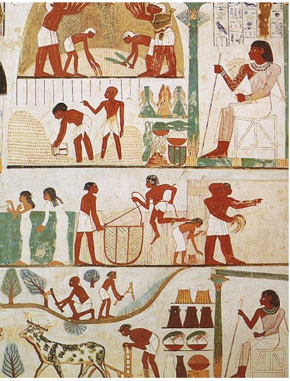
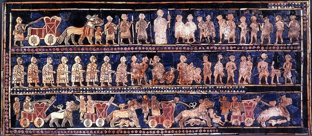
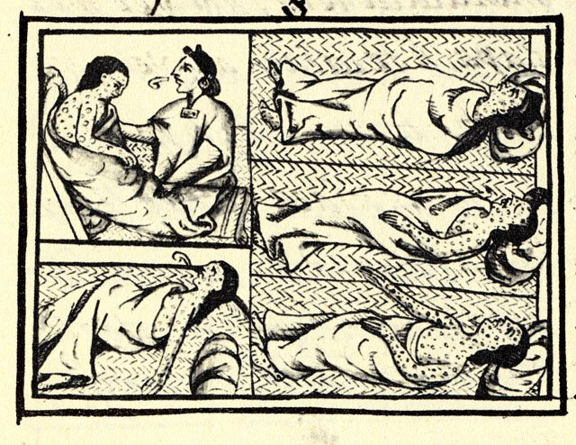
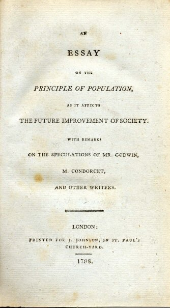

<!--
內容整理自本機筆記〈從古至今：世界人口與主要國家、區域人口的變化〉（D:\Books\md\歷史\年表\世界人口.md）與知識圖譜的互動頁〈世界人口歷史時間軸＋各國人口比較圖〉（D:\Books\html\1-7.年表\世界人口.html），兩者的資料來源為美國人口普查局歷史估計、Our World in Data、Gapminder 與聯合國《World Population Prospects 2024》。
- 事件年份取兩份資料的聯集：md 的長期時間表（22個年份）與 html 的人口曲線（另有1850、1925、1960、2000、2030、2050、2060、2085、2100年）；說明合併 md 的「歷史意義」與 html 的事件說明和「主要力量」。
- 兩份資料的人口數有出入時，以 md 的範圍為準，括號註明 html 的點估計（如公元元年「約1.9億至2億（點估計2億）」）；1999年 md 為約60億，html 另有2000年約61億，兩個年份都保留。
- 1800、1900、1950、2000、2025、2050、2100年附上主要國家與區域的人口（百萬人），取自 html 的比較資料（md 的國家表數值相同，但沒有2000、2100年與德、英、各區域）。國家多以現代疆界回推，早期數字不確定性大（巴基斯坦1950年前、奈及利亞早期尤其如此）。
- 時期依 md 的「各歷史時期的人口變化與原因」；第一段「史前時代：狩獵採集社會」在公元前1萬年以前，沒有對應的人口數字，未做成色帶；另加上 html 的「未來預測」（2026年以後）。
- 古代人口為學者依考古、文獻與農業承載力推估的數字，不同研究差異可能很大；2026年以後為預測值。
圖片來源（皆為 Wikimedia Commons 公有領域作品；多為表現該時代人口處境的圖像，年份不一定與事件相同，見括號）：
- pop-cover.jpg：Bruegel, Pieter I - De volkstelling te Bethlehem - Koninklijke Musea voor Schone Kunsten van België, Brussel.jpg（老彼得·布勒哲爾〈伯利恆的人口普查〉，1566）
- pop-nakht.jpg：Tomb of Nakht (2).jpg（古埃及納赫特墓壁畫中的耕作與收穫（約前1400年，1907年摹本））
- pop-ur.jpg：Standard of Ur - War.jpg（烏爾王軍旗，約前2600年）
- pop-census.jpg：Altar Domitius Ahenobarbus Louvre n1.jpg（多米提烏斯·阿赫諾巴布斯祭壇上的羅馬人口普查浮雕，前2世紀末）
- pop-tournai.jpg：Burying Plague Victims of Tournai.jpg（1349年圖爾奈埋葬黑死病死者的手抄本插圖）
- aod-smallpox.jpg：FlorentineCodex BK12 F54 smallpox.jpg（《佛羅倫斯手抄本》中的天花病患，約1585（與大航海時代時間軸共用））
- pop-malthus.jpg：An Essay on the Principle of Population.jpg（馬爾薩斯《人口論》1798年初版書名頁）
- pop-ellis.jpg：Ellis island 1902.jpg（1902年抵達埃利斯島的移民）
- pop-vaccine.jpg：Children waiting to be vaccinated for smallpox and their pre-school examination in outer room of doctor's office.... - NARA - 540701.jpg（1946年等候接種天花疫苗的兒童）
-->

# Periods
- -10000 ~ -500 | 農業革命與早期文明 | #b08900
  農業、畜牧、灌溉與定居生活逐步普及，兩河流域、尼羅河流域、印度河流域與中國黃河、長江流域形成早期文明；糧食供應增加，人口與城市隨之擴張，但成長仍非常緩慢。
- -500 ~ 500 | 古典文明與帝國時代 | #c92a2a
  羅馬帝國、漢帝國與印度諸王朝擁有大量人口，灌溉、道路、貿易與國家治理支持人口集中；但戰爭、瘟疫與政治動盪也可能讓人口快速下降。
- 500 ~ 1500 | 中世紀與區域人口重組 | #862e9c
  亞洲部分地區的農業與商業持續發展，歐洲人口起伏不定；14世紀黑死病重創歐洲與地中海周邊，蒙古擴張、戰爭與疫病也影響歐亞多地。
- 1500 ~ 1800 | 早期近代與全球交流 | #1971c2
  跨洋交流改變全球人口分布：美洲原住民因舊大陸傳入的疾病、殖民暴力與社會破壞而人口銳減；玉米、馬鈴薯等作物的傳播則改變了其他地區的糧食供應。
- 1800 ~ 1950 | 工業革命與人口爆發 | #e67700
  農業機械化、交通改善、糧食流通與公共衛生降低了死亡率，人口開始加速成長；歐洲人口大增並大量移民美洲與大洋洲，北美逐漸成為重要的人口與經濟中心。
- 1950 ~ 2000 | 戰後人口快速增長 | #2f9e44
  抗生素、疫苗、公共衛生與糧食生產進步，讓許多發展中國家的死亡率快速下降，生育率卻沒有同步下降，形成「人口爆炸」；全球年增長率在1960年代末達到高峰。
- 2000 ~ 2026 | 21世紀：人口轉型與老齡化 | #0c8599
  東亞、歐洲與部分美洲國家生育率下降，老齡化與人口減少逐漸成為問題；撒哈拉以南非洲仍是年輕且快速增長的人口，全球人口重心持續移動，印度在2020年代成為人口最多的國家。
- 2026 ~ 2100 | 未來預測 | #868e96
  聯合國中方案預測全球人口在2080年代中期達到約103億的高峰，2100年約102億。東亞多國人口下降，南亞增速放緩，歐洲整體老化，北美靠移民與自然增長持續增加，撒哈拉以南非洲將是主要增長來源。這是預測而非定局，會隨生育率、死亡率與移民的假設改變。

# Events

## -10000 | 農業革命（0.05億以下）
**世界人口：0.05 億以下（點估計 0.05 億）**

狩獵採集社會，人口稀少。農業與畜牧逐漸普及，人口承載能力提高。（主要力量：農業與定居）

## -5000 | 農業與定居擴展（0.05億）

**世界人口：0.05 億**

農業與定居生活逐漸擴展。

## -3000 | 早期城市文明（0.14億）

**世界人口：0.14 億**

早期城市與文明出現。兩河流域、尼羅河流域及亞洲早期文明發展。（主要力量：灌溉與城市）

## -1000 | 鐵器時代（0.5億）
**世界人口：0.5 億**

鐵器時代，農業文明擴張。

## -500 | 古典文明興起（約1億）
**世界人口：約 1 億**

地中海、印度與中國文明發展。

## 1 | 古典帝國時代（約1.9億至2億）

**世界人口：約 1.9 億至 2 億（點估計 2 億）**

羅馬、漢帝國等大型國家支撐龐大人口。（主要力量：農業帝國）

## 500 | 古典帝國轉型（約2億至2.5億）
**世界人口：約 2 億至 2.5 億（點估計 2.3 億）**

政權更替、衝突與疾病造成區域人口波動。（主要力量：戰爭與疫病）

## 1000 | 中世紀人口恢復（約2.7億至3億）
**世界人口：約 2.7 億至 3 億（點估計 2.8 億）**

部分地區農業與商業發展，人口逐步增加。（主要力量：農業擴張）

## 1300 | 中世紀高峰前期（約4億至4.5億）
**世界人口：約 4 億至 4.5 億（點估計 4 億）**

農業擴張與城市成長推動人口上升。（主要力量：土地開墾）

## 1400 | 黑死病衝擊後（約3.5億至4億）

**世界人口：約 3.5 億至 4 億（點估計 3.7 億）**

黑死病重創歐洲及地中海周邊人口。（主要力量：傳染病）

## 1500 | 跨洋交流時代（約4.5億）

**世界人口：約 4.5 億（點估計 4.6 億）**

跨洋航行改變美洲、歐亞與非洲的人口分布。（主要力量：全球交流）

## 1600 | 亞洲人口恢復（約5.4億）
**世界人口：約 5.4 億（點估計 5.5 億）**

亞洲人口恢復與歐洲擴張。

## 1700 | 前工業時代（約6億）
**世界人口：約 6 億**

全球仍以農業社會為主，人口成長相對緩慢。（主要力量：農業生產）

## 1800 | 人口突破約十億（約10億）

**世界人口：約 10 億**

現代人口快速成長的轉折點。農業、交通、衛生與醫療進步逐步降低死亡率。（主要力量：工業革命）

主要國家（百萬人）：中國 330、印度 200、俄羅斯 35、日本 30、德國 24、英國 16、奈及利亞 12、印尼 8、墨西哥 6、美國 5、巴西 3。

各區域（百萬人）：亞洲 600、歐洲 200、非洲 100、拉丁美洲 20、北美洲 7。

## 1850 | 工業化加速（約12.6億）
**世界人口：約 12.6 億**

## 1900 | 工業化擴張（約16.5億）

**世界人口：約 16.5 億**

工業化、城市化與糧食流通帶動人口成長。（主要力量：公共衛生）

主要國家（百萬人）：中國 400、印度 238、美國 76、俄羅斯 67、德國 56、日本 44、印尼 40、英國 38、巴西 17、奈及利亞 16、墨西哥 13。

各區域（百萬人）：亞洲 930、歐洲 408、非洲 133、北美洲 82、拉丁美洲 74。

## 1925 | 兩次大戰之間（約20億）
**世界人口：約 20 億**

## 1950 | 戰後人口轉折（約25億）

**世界人口：約 25 億**

戰後人口快速增加。疫苗、抗生素與公共衛生改善，人口快速增加。（主要力量：醫療進步）

主要國家（百萬人）：中國 544、印度 357、美國 158、俄羅斯 103、日本 84、印尼 70、德國 69、巴西 54、英國 50、巴基斯坦 40、奈及利亞 38、墨西哥 28。

各區域（百萬人）：亞洲 1,402、歐洲 549、非洲 229、北美洲 172、拉丁美洲 167。

## 1960 | 人口爆發開始（約30億）
**世界人口：約 30 億**

## 1974 | 世界人口四十億（約40億）
**世界人口：約 40 億**

人口增長速度顯著加快。許多發展中國家死亡率下降，生育率仍偏高。（主要力量：人口爆發）

## 1987 | 世界人口五十億（約50億）
**世界人口：約 50 億**

亞洲人口大幅增加。

## 1999 | 世界人口六十億（約60億）
**世界人口：約 60 億**

全球化與醫療普及。

## 2000 | 全球化時代（約61億）
**世界人口：約 61 億**

人口仍增加，但不同國家的生育率差異擴大。（主要力量：人口慣性）

主要國家（百萬人）：中國 1,267、印度 1,059、美國 282、印尼 214、巴西 175、俄羅斯 147、巴基斯坦 138、日本 127、奈及利亞 123、德國 82、英國 59。

各區域（百萬人）：亞洲 3,710、非洲 811、歐洲 727、拉丁美洲 519、北美洲 315。

## 2011 | 世界人口七十億（約70億）
**世界人口：約 70 億**

發展中國家人口持續增加。

## 2022 | 世界人口八十億（約80億）
**世界人口：約 80 億**

聯合國確認世界人口達到八十億。（主要力量：增長放緩）

## 2025 | 當代人口格局（約82億至83億）
**世界人口：約 82 億至 83 億（點估計 82.3 億）**

增長速度放緩，區域差異擴大。全球人口仍增加，部分國家已開始人口下降。（主要力量：生育率下降）

主要國家（百萬人）：印度 1,464、中國 1,416、美國 347、印尼 286、巴基斯坦 255、奈及利亞 238、巴西 213、俄羅斯 144、墨西哥 132、日本 123、德國 84、英國 70。

各區域（百萬人）：亞洲 4,800、非洲 1,540、歐洲 744、拉丁美洲 668、北美洲 388。

## 2030 | 近期預測（預測 約85億）
**世界人口：約 85 億**（聯合國《World Population Prospects 2024》中方案預測）

## 2050 | 人口接近百億（預測 約97億）
**世界人口：約 97 億**（聯合國《World Population Prospects 2024》中方案預測）

非洲人口增長與多地老齡化同時發生。（主要力量：區域分化）

主要國家（百萬人，預測）：印度 1,680、中國 1,260、美國 381、巴基斯坦 372、奈及利亞 359、印尼 321、巴西 217、墨西哥 149、俄羅斯 136、日本 105、德國 80、英國 75。

各區域（百萬人，預測）：亞洲 5,200、非洲 2,500、拉丁美洲 730、歐洲 703、北美洲 425。

## 2060 | 人口突破百億（預測 約100億）
**世界人口：約 100 億**（聯合國《World Population Prospects 2024》中方案預測）

## 2085 | 預測人口高峰（預測 約103億）
**世界人口：約 103 億**（聯合國《World Population Prospects 2024》中方案預測）

聯合國中方案預測全球人口在 2080 年代中期達峰。（主要力量：人口轉型）

## 2100 | 世紀末預測（預測 約102億）
**世界人口：約 102 億**（聯合國《World Population Prospects 2024》中方案預測）

全球人口可能略低於預測高峰，區域差異持續。（主要力量：人口老化）

主要國家（百萬人，預測）：印度 1,505、中國 633、巴基斯坦 487、奈及利亞 477、美國 421、印尼 296、巴西 163、俄羅斯 126、日本 77、德國 75、英國 75。

各區域（百萬人，預測）：亞洲 4,600、非洲 3,800、拉丁美洲 650、歐洲 592、北美洲 500。
