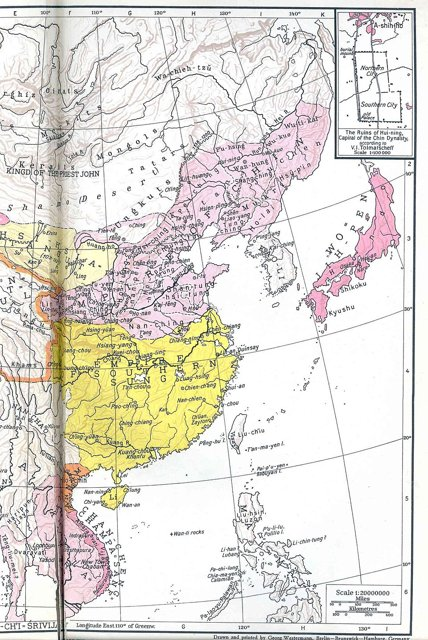

<!--
內容整理自 D:\Books\md\歷史\人物\中國\辛棄疾生平大事記（1140—1207）.md（Books 的人物頁為 D:\Books\html\1-2-1.中國歷史人物\辛棄疾(1140~1207).html），並整合中文維基百科〈辛棄疾〉條目，以自己的話改寫。
時期依筆記的八個階段：金國治下的少年、抗金起義與南歸、南宋初仕、地方治理、帶湖閒居、短暫復出與瓢泉、晚年起用、病逝；前兩段與最後兩段各合為一段。
兩份資料出入與處理方式：
- 生卒：筆記只寫1140年、1207年；維基百科寫1140年5月28日（紹興十年五月十一日）生，1207年10月3日（開禧三年九月十日）卒，born、died 依維基百科。
- 《九議》：筆記的總表寫1160年代；《九議》是1170年（乾道六年）上給宰相虞允文的，這裡依此。
- 滁州、江西提刑平茶寇、湖南飛虎軍、江西賑災：依維基百科補充年代（1172、1175、1180、1181年）。
- 稼軒：筆記寫1182年開始長期閒居、號稼軒；維基百科寫1181年冬被御史王藺彈劾罷官，1182年起隱居帶湖，取「人生在勤，當以力田為先」之意自號稼軒，照此。
- 鎮江：筆記寫1205年任鎮江知府、登北固亭寫〈永遇樂〉；辛棄疾1204年三月改知鎮江府，〈永遇樂·京口北固亭懷古〉作於1205年，同年六月被彈劾去職，這裡依此。筆記寫1206年再遭彈劾，與此不合，依後者。
- 卒後：維基百科補充1208年被倪思彈劾追削爵秩，1233年追贈光祿大夫，宋末謝枋得為他上疏洗冤，追諡「忠敏」，照此。
- 人名與其他時間軸一致：李清照（LiQingzhao）、朱熹（ZhuXi）、蘇軾（SuDongpo）；陳亮、陸游、韓侂胄沒有獨立時間軸。
圖片來源（皆為 Wikimedia Commons 公有領域／CC0 作品，縮成最長邊 640px）：
- xqj-cover.jpg：Xin Qiji calligraphy of Qu Guo Tie, Song dynasty.jpg（辛棄疾書法〈去國帖〉，宋代（國立故宮博物院））
- lqz-map.jpg：Jin Dynasty ,Sourthen Song Dynasty and Western Xia Dynasty 1141.jpg（1141年前後金、南宋與西夏疆域圖（與李清照生平時間軸共用））
-->

# Periods
- 1140 ~ 1160 | 金國治下的少年 | #868e96
  生於靖康之變十三年後的濟南，由祖父辛贊撫養，兩度赴燕京應試、暗中觀察山川形勢，從小立志恢復中原。
- 1161 ~ 1171 | 起兵南歸與獻策 | #c92a2a
  金主完顏亮南侵，他聚眾投入耿京義軍；耿京被殺後率五十騎闖入敵營擒拿叛將，渡淮南歸。此後上〈美芹十論〉〈九議〉，卻只任通判、主簿等小官。
- 1172 ~ 1181 | 地方治理 | #1971c2
  知滁州、提點江西刑獄平定茶寇，歷任湖北、湖南、江西帥臣，創建飛虎軍、賑濟饑荒，政績卓著，卻屢遭彈劾。
- 1182 ~ 1202 | 帶湖與瓢泉 | #2f9e44
  罷官後閒居上饒帶湖，自號稼軒，與陳亮再會鵝湖；中間短暫起任福建提刑、安撫使，又被罷，移居鉛山瓢泉，寫下大量愛國、田園與抒懷的詞。
- 1203 ~ 1207 | 晚年起用 | #5f3dc4
  韓侂胄籌備北伐，起用他知紹興府、鎮江府，他整軍備戰，寫下〈永遇樂·京口北固亭懷古〉，又遭彈劾罷歸；開禧北伐失敗，他病逝鉛山。

# Events

## 1140-05-28 | 出生於濟南 {label="1140年（宋紹興十年、金天眷三年）五月十一日"}
辛棄疾字幼安，濟南府歷城縣（今濟南歷城區）人，出生時家鄉已淪陷金國十三年。父親早逝，由祖父辛贊撫養。辛贊是北宋末年的進士，因家口眾多來不及南遷，被迫在金國做官，卻常帶著孫子登高望遠、指畫山河，教導他不忘恢復中原。

## 1154 | 兩赴燕京 {label="約1154–1157年"}
辛棄疾兩度以參加金國科舉為名前往燕京，實際上受祖父之託觀察金國的虛實與北方的山川形勢，為日後起事作準備。他與同鄉黨懷英同學，十八歲時娶妻。

## 1161 | 投入耿京義軍 {label="1161年（紹興三十一年）"}
金主完顏亮大舉南侵，北方各地抗金義軍蜂起。二十二歲的辛棄疾在濟南南部山區聚集兩千人，加入耿京的義軍，任掌書記，並力勸耿京「決策南向」，與南宋朝廷聯合。義軍中的和尚義端偷了大印逃走，辛棄疾追上斬殺，取回大印。同年完顏亮在采石之戰受挫，被部下所殺。

## 1162 | 擒張安國南歸 {label="1162年（紹興三十二年）"}

辛棄疾奉耿京之命南下建康，晉見宋高宗，接洽歸附事宜。回程得知叛將張安國殺了耿京、投降金國，他率五十多名騎兵直闖五萬人的金營，生擒張安國，渡過淮河押回建康斬首，「壯聲英概，懦士為之興起」。此後他留在南宋，任江陰簽判。晚年的〈鷓鴣天〉「壯歲旌旗擁萬夫，錦襜突騎渡江初」，回憶的就是這段經歷。

## 1165 | 〈美芹十論〉 {label="1165年（乾道元年）"}
隆興北伐失敗、宋金簽訂隆興和議後，辛棄疾上〈美芹十論〉給宋孝宗，分析敵我形勢，主張練兵備戰、徐圖恢復，但沒有被採納。

## 1170 | 〈九議〉 {label="1170年（乾道六年）"}
辛棄疾又上〈九議〉給宰相虞允文，進一步陳述恢復中原的具體策略，後來他說的「萬字平戎策」即指這些奏議。南歸的頭十年，他只做過江陰簽判、建康府通判、司農寺主簿等小官，抱負無從施展。〈水龍吟·登建康賞心亭〉「把吳鉤看了，欄干拍遍，無人會，登臨意」，寫的正是報國無門的悲憤。

## 1172 | 知滁州 {label="1172年（乾道八年）"}
滁州（今安徽滁州）因長年兵亂而凋敝，辛棄疾到任後減輕賦稅、招撫流民、訓練民兵，半年就讓地方恢復生機。

## 1175 | 平定茶寇 {label="1175年（淳熙二年）"}
以賴文政為首的茶商武裝在湖南、江西擊敗官軍，辛棄疾經宰相葉衡推薦任江西提點刑獄，親率精兵追剿，迫使茶寇投降。此後他歷任京西轉運判官、江陵知府、隆興知府兼江西安撫使、湖北與湖南轉運副使等職，〈摸魚兒·更能消幾番風雨〉以惜春傷春寄託政治感慨，作於1179年由湖北轉任湖南之際。

## 1180 | 創建湖南飛虎軍 {label="1180年（淳熙七年）"}
辛棄疾任湖南安撫使，以湖南民風強悍、武備空虛為由，奏請建立地方軍隊「飛虎軍」，招募步兵兩千、騎兵五百。營建時遇上連日陰雨無法燒瓦，他下令每戶人家送瓦二十片，兩天就湊足；朝廷有人告他聚斂，下令停工，他把金牌藏起來，限期一個月完工，再一併報告。飛虎軍日後成為江南諸軍中最精銳的一支。

## 1181 | 江西賑災與罷官 {label="1181年（淳熙八年）"}
辛棄疾改任江西安撫使，江西大饑荒，他在路口張貼「閉糴者配，強糴者斬」，禁止囤積與搶購糧食，並撥出官錢派人到外地運糧，平抑了糧價，受到孝宗嘉獎。同年冬天，御史王藺彈劾他「用錢如泥沙，殺人如草芥」，他被罷官。辛棄疾一生被彈劾七次，多半因為他行事果斷、不避權貴，又是「歸正人」（從北方歸附的人），朝廷始終不敢放手重用。

## 1182 | 帶湖閒居，自號稼軒 {label="1182年（淳熙九年）"}
辛棄疾回到上饒城外帶湖新建的莊園，取「人生在勤，當以力田為先」之意，自號「稼軒」。此後近二十年大多閒居，詞成為他抒發忠憤的出口：〈清平樂·村居〉「最喜小兒亡賴，溪頭臥剝蓮蓬」、〈西江月·夜行黃沙道中〉「稻花香裡說豐年，聽取蛙聲一片」寫農村的溫馨；〈醜奴兒·書博山道中壁〉「而今識盡愁滋味，欲說還休」寫年少與年長的愁；〈青玉案·元夕〉「眾裡尋他千百度，驀然回首，那人卻在，燈火闌珊處」，寄託不肯隨俗的孤高。

## 1188 | 鵝湖之會 {label="1188年（淳熙十五年）冬"}
好友、主戰派思想家陳亮到上饒拜訪，兩人在鵝湖寺一帶同住十天，「長歌相答，極論世事」，共商恢復大計，是繼朱熹與陸九淵之後的第二次鵝湖之會。別後兩人以〈賀新郎〉往復唱和，辛棄疾又寫〈破陣子·為陳同甫賦壯詞以寄之〉：「醉裡挑燈看劍，夢回吹角連營……了卻君王天下事，贏得生前身後名。可憐白髮生！」

## 1192 | 起任福建 {label="1192–1194年（紹熙年間）"}
辛棄疾起任福建提點刑獄，後兼福建安撫使，整頓軍備、儲備錢糧，準備練兵，1194年又被彈劾罷官。在福建期間，他曾與朱熹同遊武夷山。

## 1196 | 移居瓢泉 {label="1196年（慶元二年）"}
帶湖的居所失火，辛棄疾移居鉛山（今江西鉛山）期思渡的瓢泉。〈賀新郎·甚矣吾衰矣〉「我見青山多嫵媚，料青山見我應如是」，感嘆年老與知音漸少。他的詞融合經史子集的語言與典故，「以文為詞」，擴大了詞的表現範圍，被譽為豪放派的巔峰。

## 1200 | 祭朱熹 {label="1200年（慶元六年）"}
朱熹在慶元黨禁中去世，舊友門生多不敢送葬，辛棄疾親自前往弔祭，祭文說：「所不朽者，垂萬世名。孰謂公死，凜凜猶生！」

## 1203 | 知紹興府 {label="1203年（嘉泰三年）"}
韓侂胄籌劃北伐，起用主戰派，六十四歲的辛棄疾受命知紹興府兼浙東安撫使，「單車就道，風采凜然」。在紹興，他與當地的陸游往來，陸游作長詩相送，期許他建立功業。

## 1205 | 〈永遇樂·京口北固亭懷古〉 {label="1205年（開禧元年）"}
前一年辛棄疾改知鎮江府，鎮江是抗金前線，他派人到北方偵察金國的虛實，準備招募士兵。登上北固亭，他寫下〈永遇樂〉：「千古江山，英雄無覓孫仲謀處」，又以劉宋元嘉北伐倉促失敗的教訓，提醒朝廷不可輕舉妄動，結尾「憑誰問：廉頗老矣，尚能飯否？」〈南鄉子·登京口北固亭有懷〉「天下英雄誰敵手？曹劉。生子當如孫仲謀」也作於此時。六月，他再度被彈劾，降職罷歸鉛山。

## 1207-10-03 | 病逝鉛山 {label="1207年（開禧三年）九月十日"}
前一年韓侂胄倉促發動開禧北伐，宋軍大敗，金國要求以韓侂胄的人頭換取議和。朝廷再召辛棄疾出山，任命送到鉛山時他已病重，九月十日去世，享年六十八歲，相傳臨終還大呼「殺賊」。死後一度被追削爵秩，宋末謝枋得為他上疏申冤，才追諡「忠敏」。他存詞六百多首，是兩宋存詞最多的詞人，與蘇軾並稱「蘇辛」，與同鄉李清照並稱「濟南二安」。
