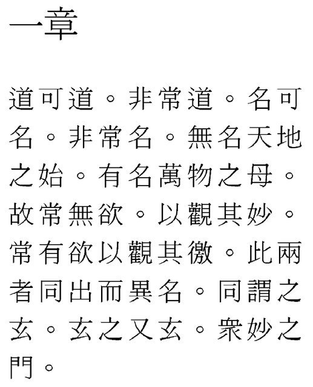
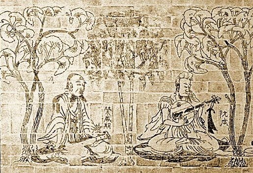
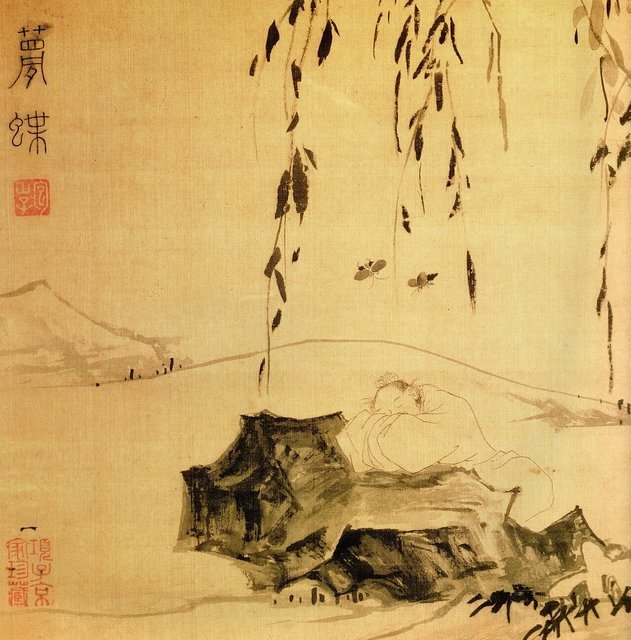
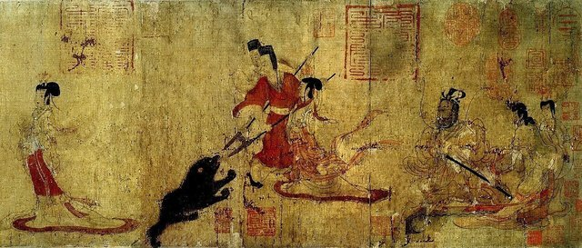
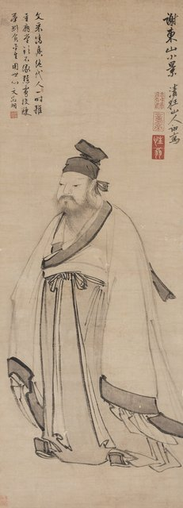
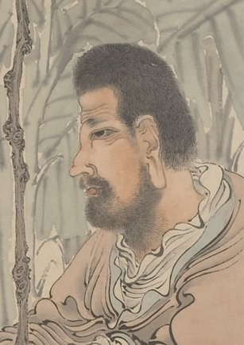

<!--
內容整理自本機筆記〈魏晉玄學大事記：從正始清談到玄佛合流〉（D:\Books\md\歷史\東方歷史\魏晉玄學大事記.md），以自己的話改寫；只依這份筆記，沒有另外合併其他資料。
時期：筆記把玄學分成四個階段（正始、竹林、西晉、東晉），另加筆記第二部分談的歷史背景，共五段。竹林玄學筆記只寫「3世紀中葉」，這裡取 250–264 年，涵蓋高平陵之變之後到阮籍、嵇康相繼離世；這是整理時的取捨，不是筆記的年份。
處理方式：
- 筆記的許多年代是概數（「約240年代」「3世紀中葉」「4世紀前半」等），用 label 保留筆記的說法；時間軸上為了排序才放在相近的年份（例如「4世紀前半」放在320年、「4世紀中葉」放在350年），不代表確切年份。
- 嵇康的卒年：筆記總表寫260年，人物對照表與第二階段標題寫223—262年，兩處不一致。這裡依人物表採262年，另標示「約」，請之後視需要對照原稿修正。
- 筆記的人物生卒年另列表格；這裡只把何晏、阮籍、嵇康、王弼四位的出生，以及阮籍的離世放進時間軸，其餘人物的生卒年寫進相關事件的內文。
- 筆記第七部分（五大哲學問題）、第八部分（人物與著作對照表）、第九部分（對後世的影響）、第十部分（總結）是整理與評論，不單列事件；五大問題與四階段的核心命題寫進各時期的說明，對後世的影響寫進最後一則。
- 筆記中的網頁引用連結（含追蹤參數）未收錄。
- 圖片皆為 Wikimedia Commons 上的公有領域（含 CC0）作品，縮成最長邊 640px 的 JPEG。
- xuanxue-sages.jpg：Seven Sages in the Bamboo Grove.jpg（日本浮世繪師八島岳亭的多色木版畫〈竹林七賢〉，19世紀，大都會博物館藏，封面）
- sanguo-caopi.jpg：魏文帝曹丕像（與漢末三國大事記共用）
- xuanxue-wangbi.jpg：Daodejing (Wang Bi) 01.png（王弼本《道德經》第一章）
- sanguo-simayi.jpg：司馬懿像（與漢末三國大事記共用）
- xuanxue-rong.jpg：Rong Qiqi and Ruan Xian.JPG（南京西善橋南朝墓〈竹林七賢與榮啟期〉磚畫中的榮啟期與阮咸）
- sanguo-simayan.jpg：晉武帝司馬炎像（與漢末三國大事記共用）
- xuanxue-butterfly.jpg：Dschuang-Dsi-Schmetterlingstraum-Zhuangzi-Butterfly-Dream.jpg（莊周夢蝶圖）
- xuanxue-admon.jpg：Admonitions Scroll Scene 4.jpg（傳顧愷之〈女史箴圖〉第4段，大英博物館藏唐代摹本；顧愷之是東晉畫家）
- xuanxue-xie.jpg：Guo Xu - Portrait of Xie An (undated).jpg（明代郭詡繪謝安像）
- xuanxue-zhidun.jpg：The Monk Zhidun Admiring a Horse, by Ren Yi (cropped).jpg（清代任頤〈支遁賞馬圖〉局部）
-->

# Periods
- 180 ~ 239 | 玄學興起的背景 | #868e96
  東漢末年政治動盪，士人不再滿足於章句訓詁，開始追問禮教的根本、萬物的根源、語言能否表達真理；老莊與《周易》成為重新詮釋的思想資源。
- 240 ~ 249 | 正始玄學 | #1971c2
  何晏、王弼以老莊思想重新理解儒家經典，核心問題是「天地萬物的根本是什麼」，提出貴無、本末與言意之辨。
- 250 ~ 264 | 竹林玄學 | #2f9e44
  高平陵之變後，阮籍、嵇康等竹林名士把哲學帶進生命實踐與政治批判，核心問題是社會規範與個人本性如何相處。
- 265 ~ 316 | 西晉玄學 | #e8590c
  裴頠《崇有論》批判貴無，向秀、郭象重新詮釋《莊子》，圍繞「有無之辯」與「獨化」重新思考存在與名教。
- 317 ~ 420 | 東晉玄學與玄佛合流 | #862e9c
  士族南遷後，清談成為名士交往與政治文化的一部分，玄學與佛教般若思想深入交流，為佛教中國化提供條件。

# Events

## 180 ~ 220 | 傳統經學受到反思 {label=東漢末年（約180—220年）}
兩漢時期，儒家經學在政治與教育中具有重要地位。到了東漢末年，政治動亂、黨錮之禍與社會秩序崩解，使士人重新思考傳統政治倫理是否合理。部分思想家不再滿足於經典的章句訓詁，開始追問：儒家禮教的根本依據是什麼？天地萬物的根源是什麼？人如何面對政治壓迫與生命無常？語言和經典能否完整表達真理？這些問題為魏晉玄學的興起提供了思想背景。

## 190 | 何晏出生 {label=約190年}
何晏後來成為正始玄學的重要先驅，喜好老莊思想，並嘗試以道家觀念重新理解儒家經典；他的《論語集解》與儒家經典的解釋有關，也有傳統文獻記載的玄學論著。

## 210 | 阮籍出生
阮籍後來成為竹林七賢的重要人物，以《詠懷詩》表達對現實政治、禮教秩序與生命困境的反思。

## 220 | 曹魏建立

漢朝結束，政治秩序重組，為新的學術思潮提供歷史背景。曹魏時期，曹氏與司馬氏之間的權力鬥爭日益激烈，士人既要面對仕途與政治責任，也得考慮如何保全自身，因此玄學不只是抽象的哲學思辨，也與政治選擇、個人自由及生命態度密切相關。

## 220 ~ 239 | 玄學思想逐漸醞釀
老莊思想、人物品評與清議文化相互影響。玄學家重新閱讀《老子》《莊子》，並以《周易》為重要思想資源（三者合稱「三玄」），他們關心的不只是隱居或逍遙，而是試圖建立一套能夠解釋宇宙、社會與人生的哲學，也使玄學成為儒道思想交流的重要形式。

## 223 | 嵇康出生
嵇康後來成為魏晉玄學中最具個人風格的思想家之一，尤其重視人的自然本性、精神自由與生命修養。

## 226 | 王弼出生
王弼年少即以哲學才思聞名，後來成為中國哲學史上極具影響力的思想家，他的《老子注》《周易注》《周易略例》是正始玄學的核心著作。

## 240 ~ 249 | 正始玄學興起
正始是曹魏齊王曹芳的年號，通常以240—249年作為正始玄學的主要年代。何晏、王弼以老莊思想重新詮釋儒家經典，核心問題是：天地萬物的根本是什麼？「無」與「有」之間存在什麼關係？主要命題包括貴無（思考萬物的根本與「無」的哲學地位）、本末關係（根本與具體事物的關係）、言意之辨（語言、文字與思想能否完全對應）和儒道關係（以老莊重新解釋儒家倫理與政治秩序）。正始玄學使中國哲學從傳統經學的既有框架中，進一步發展出本體論、語言哲學與儒道融合的問題意識。

## 240 | 何晏的玄學思想受到重視 {label=約240年代}
何晏探討「無」的意義，以及儒道思想之間的關係，有助於推動漢魏之際的思想轉變，讓哲學討論不再局限於傳統經學的訓詁。

## 240 | 王弼注《老子》《周易》 {label=約240年代}

王弼透過解釋《老子》與《周易》建立較為系統的哲學論述，發展以「無」為本的哲學，並提出言意關係等重要問題。他的思想通常被歸入「貴無論」，但這裡的「無」不應簡單理解為什麼都不存在，而是指不能以具體、有限的事物完全限定的根本原理。

## 249 | 高平陵之變，何晏遭誅

司馬懿發動高平陵之變，曹爽集團失勢，何晏等人遭到清算，曹魏的政治格局劇變，士人面臨更嚴峻的政治環境。不過不能把竹林玄學的興起完全歸因於這場政變，它同時與漢末以來的思想變化、士人文化及個人生命意識有關。

## 249 | 王弼去世
王弼年紀輕輕就離世，正始玄學的重要代表人物相繼退出歷史舞臺。

## 250 | 竹林名士活動 {label=3世紀中葉}

阮籍、嵇康等人透過哲學、文學與生活態度反思名教秩序，把玄學從宇宙本體與經典解釋的討論，帶向生命實踐、政治批判與個人精神自由，核心問題是：當社會要求人們遵守固定的禮教規範時，個人是否仍然能夠依照自己的本性生活？傳統上的竹林七賢包括嵇康、阮籍、山濤、向秀、劉伶、阮咸與王戎，但他們並不是哲學主張完全相同的學派，政治態度、人生選擇與思想重點各有不同。

阮籍並非簡單否定一切道德規範，而是對虛偽的道德表演、政治權力與僵化的社會評價提出質疑。嵇康的重要作品有《養生論》《聲無哀樂論》《與山巨源絕交書》《釋私論》，他提出「越名教而任自然」：不能讓外在的名分與規範完全壓抑人的自然本性，但這並不表示所有社會規範都該被否定，而是要反思規範的正當性。在《聲無哀樂論》裡，他探討音樂與情感的關係；在《與山巨源絕交書》裡，他表達了不願勉強適應官場生活的態度。

## 255 | 毌丘儉起兵反司馬氏
嵇康的好友毌丘儉起兵反對司馬氏，政治鬥爭加劇，名士的政治立場與個人處境日益緊張。

## 262 | 嵇康遭司馬氏政權處死 {label=約262年}
嵇康遭司馬氏政權處死，他的思想與人格成為後世討論精神自由的重要象徵。

## 263 | 魏滅蜀漢；阮籍去世
三國政治格局改變，西晉統一的條件逐漸形成。同一年，竹林七賢的阮籍離世。

## 265 | 司馬炎建立西晉

政治上逐漸恢復統一，玄學進入新的士族政治與文化環境。清談成為部分士人交流思想、評價人物與建立社會聲望的重要方式；但清談並不等於玄學本身，清談是當時的談論風尚，玄學則是一種具有特定哲學問題與思想傳統的思潮。西晉玄學最重要的問題是：如果「無」是萬物的根本，具體存在的事物是否因此變得不重要？萬物能否不依靠外在的創造者而自行存在？

## 280 | 西晉統一中國
士族社會發展，清談風氣逐漸擴大。

## 291 ~ 306 | 西晉元康時期玄學發展 {label=約291—306年}
裴頠（約267—300年）寫下《崇有論》批判貴無思想：他認為不能因為強調「無」的重要性，就忽略具體事物的存在與作用，也強調社會秩序與現實事物具有不可忽略的意義，這是西晉「有無之辯」的重要一環。向秀（約227—272年）是竹林七賢之一，也是《莊子》注釋史上的重要人物，嘗試以玄學觀點探討人的自然本性、精神自由與現實生活的關係；傳世的《莊子注》與向秀、郭象的注釋傳統密切相關，但郭象注的形成過程與向秀原注的保存情況涉及複雜的文獻問題。

## 300 | 郭象《莊子注》形成並流傳 {label=約300年前後}

郭象（約252—312年）是魏晉玄學後期最重要的思想家之一。他提出「獨化」，強調萬物各自依其性分而存在與變化，不需要假設一個位於萬物之外的創造者；這不是說萬物完全不受其他事物影響，而是說不能把萬物的生成簡單歸結為外在、獨立的主宰。他也重新思考自然與名教的關係：如果名分與制度能順應各種事物的性分，名教就可以被理解為自然秩序的一種表現。西晉玄學因此從以「無」為本的思考，進一步轉向對具體存在、萬物差異、個體性分及社會秩序的探討。

## 311 ~ 316 | 永嘉之亂與西晉滅亡
北方政治秩序崩解，大量士族南遷，思想文化中心逐漸南移。

## 317 | 東晉建立

西晉滅亡後，司馬睿在江南建立東晉。大量北方士族南遷，帶動江南政治、文化與思想活動的發展，玄學在江南士族社會中延續發展，與士族政治密切結合，清談也成為名士交往的重要形式。這時玄學不再只以儒道關係及有無之辯為核心，也成為理解佛教般若思想、討論生命與存在問題的重要思想資源。

## 320 | 王導、庾亮等士族名士活躍 {label=4世紀前半}
清談、玄學與政治實踐密切結合。王導（276—339年）協助東晉政權在江南建立統治，與士族社會的形成密切相關；他的歷史意義主要在政治實踐，而不是以建立一套獨立的玄學哲學體系著稱，也顯示玄學所處的思想環境與士族政治密不可分。

## 350 | 殷浩、司馬昱、謝安等人活躍 {label=4世紀中葉}

清談文化興盛，玄學成為士族交往與思想交流的重要形式。殷浩（約303—356年）是東晉著名的清談名士，曾參與玄學辯論並從事政治活動，他的經歷顯示哲學思辨可以提升士人的文化聲望，卻不必然保證政治實踐成功。謝安（320—385年）以從容的名士風度聞名，後來在淝水之戰前後的政治與軍事決策中扮演重要角色，說明玄學文化並非必然導向逃避現實，名士也可能把修養與處世方式帶入政治實踐。

## 350 | 支遁等佛教思想家活躍 {label=4世紀}

支遁（314—366年）與名士文化密切交流，並以《莊子》等思想資源思考佛教義理，佛教般若思想與玄學語彙相互交流，促進佛教哲學的中國化。不過佛教般若思想中的「空」不能直接等同於玄學中的「無」，兩者雖然在語言與問題意識上有交流，思想背景與理論內涵仍有差異。

## 380 | 韓康伯注《周易繫辭傳》 {label=4世紀後半}
韓康伯是東晉重要的《周易》注家，他的工作延續王弼以義理解釋《周易》的傳統，深化《易》學與玄學的結合。

## 390 | 張湛注《列子》 {label=4世紀後半至5世紀初}
張湛的《列子注》延續玄學對自然、生命與精神自由的探討，也反映玄學與道家思想在後期的持續互動。

## 420 | 東晉結束，南朝宋建立
傳統魏晉玄學逐漸轉化，與佛教及其他思想傳統的交流持續。東晉時期玄學與佛教的交流逐漸深化，影響包括推動佛教般若思想在中國文化環境中的理解與詮釋、促進名士文化與哲學辯論和士族政治的結合、延續有無、本末、言意等玄學問題；但玄學與佛教並非簡單合而為一，而是在交流與辯論中逐漸形成新的思想成果。

## 421 ~ 907 | 玄學思想持續影響佛教、道教及文學 {label=南北朝至隋唐}
玄學的有無、本末、言意等議題，成為後世思想發展的重要資源。對佛教：玄學是佛教中國化的重要思想背景之一，但佛教隨著經典翻譯與教理研究深化，逐漸建立自身的概念體系，不能由玄學取代。對道教：玄學重新詮釋老莊思想，提升了道家哲學的地位，隋唐時期道教思想家也進一步發展與「有無」「重玄」相關的理論，但玄學與道教的宗教實踐並不相同。對文學：阮籍的詠懷詩、嵇康的哲理文章，以及後來山水詩與人物品藻的發展，都可以放在這個思想背景下理解；玄學所重視的精神自由、自然與個體性，也影響了後世文人的審美趣味與人格理想。對中國哲學史：它把存在的根本、語言與思想的關係、個體與整體、自然秩序與社會制度、有限生命中的精神自由等長期存在的問題，發展成更有系統的討論，是中國思想從傳統經學走向多元哲學探索的重要轉折。
