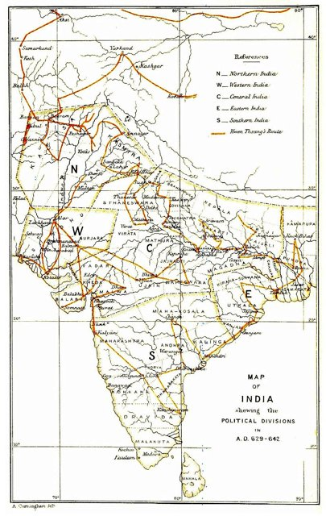
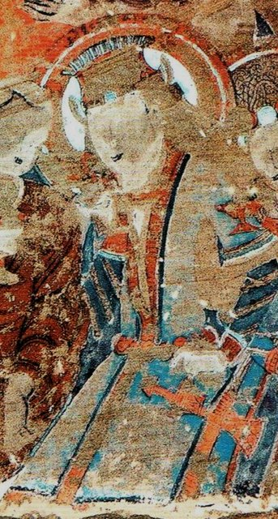
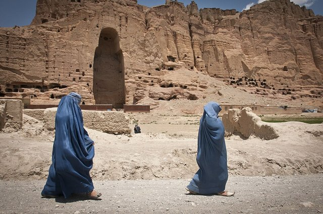
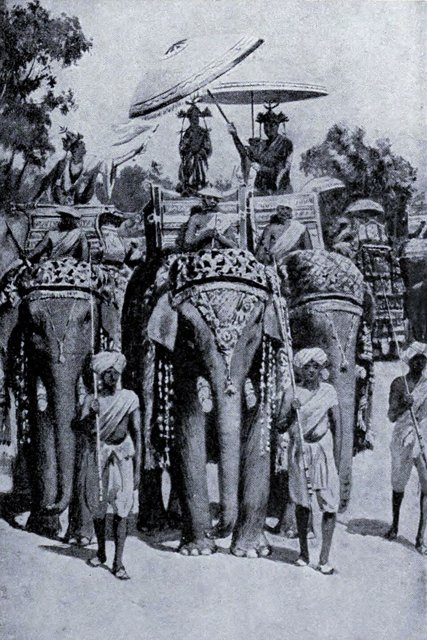
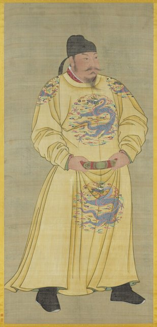
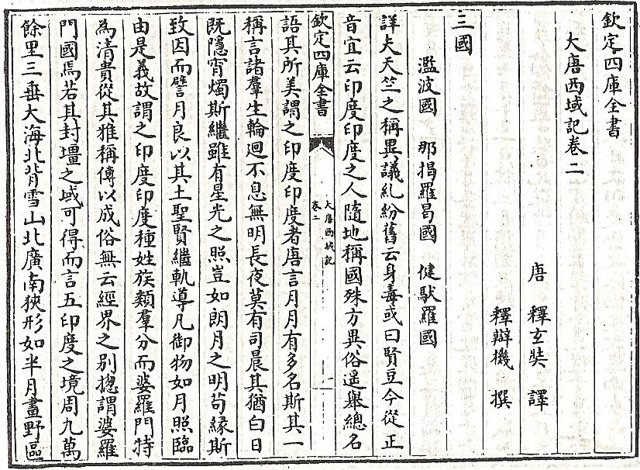
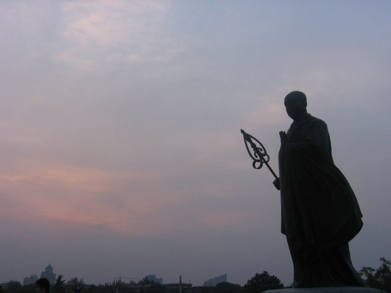
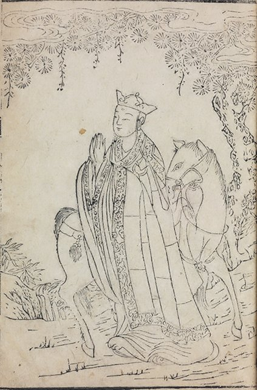

<!--
內容整理自 D:\Books\md\歷史\人物\中國\玄奘（602－664）生平大事記.md（網頁版為 D:\Books\html\1-2-1.中國歷史人物\玄奘(602~664).html），並整合中文維基百科〈玄奘〉條目，以自己的話改寫。
時期依筆記的三個階段歸納：早年求學、西行求法與印度留學、返國譯經；另加身後影響。筆記的「重要著作與翻譯成果」「玄奘與中國佛教發展」「重要貢獻」「西行路線」「核心時間軸」寫進時期說明與相關事件，不另立事件。
兩份資料出入與處理方式：
- 生卒：筆記寫602年（一說600年）出生、664年圓寂；維基百科寫602年4月6日—664年3月7日（正文另寫二月六日子時，即664年3月8日），照維基百科寫月日，採3月7日；維基百科並說明《大慈恩寺三藏法師傳》的一處記載（659—663年間玄奘自稱六十五歲）推算，生年不晚於596—599年，享壽也有六十二或六十五之說，這裡寫「享壽約62歲，一說65歲」，born 採602年。
- 早年：筆記寫約612年（11歲）進入寺院、約615年（14歲）在洛陽出家；維基百科寫613年（11歲）熟讀《法華經》與《維摩詰經》、615年（13歲）因洛陽度僧被鄭善果破格錄取，照維基百科的年代。
- 成都與具足戒：筆記寫620–624年到成都等地參學、622年受具足戒（核心時間軸）；維基百科寫618年隋亡後改往成都、622年在成都受具足戒、624年與商人沿江東下參學，照此；627年筆記把它寫成「西行出發年」，維基百科寫「貞觀元年（627年）重遊長安學習外文與佛學」。
- 西行年份：筆記的「歷史資料與年代考證」說627年說是部分東亞佛教文獻、629年說是《大慈恩寺三藏法師傳》與許多現代研究所採，建議寫「627或629年啟程（一般採629年說）」；維基百科寫貞觀三年（629年）出發，這裡採629年，627年寫進內文說明。
- 西行沿途的年份：筆記的表格以627為起點（628年出玉門、628–629年到高昌、629年過龜茲凌山碎葉、630年撒馬爾罕、630–631年越興都庫什入北印、約631年到那爛陀）；因為這裡採629年啟程，各站年份是依筆記的相對順序，在內文寫「約」並說明年份各書不一，不寫成確切日期。
- 曲女城辯論：筆記表格寫約641年，核心時間軸寫643年（戒日王主持的辯論大會）；維基百科寫貞觀十七年（643年）在曲女城無遮法會上等了十八天無人辯難、被稱為「大乘天」「解脫天」，採643年。
- 返國：筆記與維基百科都寫645年正月回到長安，筆記補充路線經於闐、敦煌；維基百科補充太宗歡迎，玄奘想到少林寺譯經卻被安排住長安弘福寺，當年6月開始譯經，照此。
- 大唐西域記：筆記表格寫646年口述、由辯機整理，648年完成；寫成一則事件。
- 大慈恩寺與大雁塔：維基百科寫648年依皇太子（後來的唐高宗）之請建大慈恩寺並任上座、652年在西院增築五層塔（大雁塔前身），筆記沒有，照維基百科補充。
- 譯經：筆記寫646–647年《瑜伽師地論》、647年譯《道德經》為梵文、651–660年《阿毘達磨俱舍論》、653年日本僧人道昭前來學習、659–660年《成唯識論》、661–663年《大般若波羅蜜多經》；維基百科寫顯慶四年（659年）高宗讓他到玉華宮譯經、663年10月譯完《大般若經》、664年正月開譯《大寶積經》只翻一段便停筆，照兩者。筆記寫玉華宮；維基百科寫玉華宮（今銅川）。
- 圓寂與葬地：筆記寫葬白鹿原、669年弟子窺基繼續弘揚唯識學；維基百科寫669年遷葬少陵原、建舍利塔與興教寺，照維基百科，窺基法相宗的傳承取自筆記。
- 舍利：維基百科寫1944年頂骨舍利在南京被意外發現，後部分被掠到日本；1955年台灣玄奘寺與印度那爛陀大學迎回；1981年奈良藥師寺的玄奘三藏院落成；筆記沒有，只收一則「身後」事件。
- 《西遊記》：筆記說明明代吳承恩的小說以唐僧西行為背景，8世紀起西行故事成為民間文學題材，照此，一般認為《西遊記》是明代中期寫成，不寫確切年份。
- 與絲路：〈絲綢之路大事記〉寫「629–645年玄奘西行求法」，與這裡一致。
- 人名：頁面作戒賢、麴文泰、辯機、窺基、道昭、戒日王，照筆記；分隔號一律用·。
圖片來源（皆為 Wikimedia Commons 公有領域／CC0 作品；繪畫、版畫與插圖多為後世作品，不代表事件當時的樣貌）：
- silk-xuanzang.jpg：Portrait of Xuanzang (Genjō) with Attendant MET DP-15580-007.jpg（日本畫〈玄奘三藏像〉，大都會藝術博物館藏（與絲綢之路大事記時間軸共用））
- xz-route.jpg：Xuanzang route.jpg（玄奘西行路線圖）
- xz-kucha.jpg：King Suvarnapusa of Kucha, Cave 69, Kizil.jpg（克孜爾石窟壁畫中的龜茲國王，龜茲是玄奘西行必經之地）
- xz-bamiyan.jpg：Flickr - DVIDSHUB - Giant standing Buddhas of Bamiyan still cast shadows (Image 2 of 8).jpg（巴米揚大佛的壁龕（大佛於2001年被毀））
- xz-harsha.jpg：King Harsha pays homage to Buddha.jpg（戒日王向佛陀致敬（版畫））
- xz-taizong.jpg：TangTaizong.jpg（唐太宗像）
- xz-record.jpg：大唐西域記（四庫）.jpg（《大唐西域記》（四庫全書本））
- xz-dayan.jpg：Xuanzang Da Yan Ta statue.jpg（大雁塔前的玄奘像）
- xz-xiyou.jpg：Xuanzang - Xiyou Zhenquan (A Complete Narrative of Travels in the West).jpg（《西遊真詮》中的玄奘（明清刊本插圖））
-->

# Periods
- 602-04-06 ~ 629 | 出生與早年求學 | #868e96
  生於河南洛州緱氏的陳姓官宦之家，少年出家，隋末離開洛陽到成都，二十歲受具足戒，遊歷荊州、相州、趙州與長安向各地高僧請益，發現各家對佛典的說法不一，決定直接去印度尋求《瑜伽師地論》。
- 629 ~ 645 | 西行求法與印度留學 | #1971c2
  違反唐朝禁止出境的規定，經涼州、玉門關、高昌、龜茲、撒馬爾罕與興都庫什進入印度，在那爛陀寺從戒賢學習唯識學，遊歷各地並在曲女城辯論會上聲名大噪，645年返回長安。
- 645 ~ 664-03-07 | 返國譯經 | #2f9e44
  在太宗、高宗的支持下主持長安的譯場，口述《大唐西域記》，翻譯《瑜伽師地論》《成唯識論》《大般若經》等，創立法相唯識宗，在玉華宮圓寂。
- 664-03-07 ~ 2026 | 身後影響 | #495057
  窺基繼承唯識學，法相宗傳到日本與朝鮮半島，西行故事演變為《西遊記》，舍利與紀念建築散布海內外。

# Events

## 602-04-06 | 出生於洛州緱氏
玄奘本名陳褘（又作陳禕），出生於隋朝洛州緱氏縣（今河南偃師一帶）的陳姓家庭。他的生年不完全一致：筆記說一說是600年，《大慈恩寺三藏法師傳》的記載更推算他生於596至599年之間，一般採602年。

## 613 | 讀《法華經》與《維摩詰經》 {label="約613年（11歲）"}
玄奘自幼聰慧，對儒家經典與佛教義理都有興趣，隨出家的兄長（長捷法師）學習佛法，約十一歲就熟讀《妙法蓮華經》與《維摩詰經》，也在寺院中生活、研讀經論。

## 615 | 洛陽出家
隋朝在洛陽度僧，十三歲的玄奘向前來考查的大理卿鄭善果表示出家的目的是「意欲遠紹如來，近光遺法」，因而被破格錄取，正式成為僧人。

## 618 | 隋亡唐立，轉往成都
隋朝滅亡、唐朝建立。玄奘與長捷法師到長安參學，得知當時名僧多在蜀地，改往成都，在那裡聽寶暹講《攝大乘論》、道基講《雜心論》、惠振講《八犍度論》，研習《涅槃經》等經典。

## 622 | 在成都受具足戒
二十歲的玄奘受具足戒，成為正式的比丘，學律五篇七聚，繼續研究佛教各派的教理。624年他與商人結伴沿江東下參學，遊歷荊州、相州、趙州與長安，向不同的高僧請益。

## 627 | 重回長安，決心西行 {label="貞觀元年（627年）"}
玄奘重遊長安，學習外文與佛學。他發現當時中國佛教各派對經典的理解差異很大，尤其流行的攝論師與地論師對法相的說法多有相左，部分佛經譯本也有文字與義理的疑問，因此渴望得到總賅三乘學說的《瑜伽師地論》，決心上表朝廷前往天竺求法，卻一直拿不到出境的過所（通行證）。他的西行年份有不同說法：部分東亞佛教文獻採627年，《大慈恩寺三藏法師傳》與許多現代研究採629年，一般採629年說。

## 629 | 違禁出關，西行求法

玄奘不顧唐朝對民間出境的限制，在貞觀三年（629年）毅然從長安出發，傳統記載說他沒有獲得官方許可。他經涼州、瓜州，穿過玉門關外的戈壁沙漠，進入西域。這是他一生最重要的階段，歷時約十七年的西行與留學。

## 629 | 高昌王麴文泰的禮遇 {label="約628–629年"}

玄奘經伊吾到高昌，受到高昌王麴文泰的禮遇，獲得旅費與通關的協助。此後他經焉耆、龜茲、凌山（天山一帶）、碎葉，繼續向西，約630年到撒馬爾罕、鐵門等地，了解當地的佛教與社會文化。這些年份在不同史料中有出入，這裡依筆記的相對順序。

## 631 | 進入那爛陀寺 {label="約630–631年"}

玄奘經吐火羅越過興都庫什山脈進入北印度，約631年抵達印度佛教學術中心那爛陀寺，向著名的大師戒賢學習，631至635年在那裡研習瑜伽行派的唯識學與其他經論，並學習梵文。

## 635 | 遊歷印度各地 {label="約635–640年"}
玄奘離開那爛陀寺，遊歷印度各地，參訪佛教聖地與學術中心，與各派學者交流，642至643年又遊歷東部與南部，考察佛教遺跡、寺院與各地風俗。他在這段期間所見所聞，成為《大唐西域記》的內容。

## 643 | 曲女城辯論

玄奘在戒日王主持的曲女城無遮法會上，立「真唯識量」的論旨，等了十八天無人辯難，由此名聲大噪，被大乘行者譽為「大乘天」，被小乘行者譽為「解脫天」。他的筆記把這場辯論寫在約641年，更常見的年份是643年。

## 644 | 啟程返國，經于闐 {label="約643–644年"}
玄奘整理所取得的佛教經典、佛像與其他文物，啟程返國，路線經中亞、于闐、敦煌，回到長安。主要路線可概括為：長安→涼州→瓜州→伊吾→高昌→龜茲→碎葉→撒馬爾罕→吐火羅→北印度→那爛陀寺→印度各地→中亞→于闐→敦煌→長安，是研究唐代絲綢之路、中亞歷史與古印度佛教的重要參考。

## 645 | 返回長安

貞觀十九年（645年）正月，玄奘回到長安，帶回大量梵文佛經、佛像與文物，結束約十七年的西行，受到唐太宗與佛教界熱烈的歡迎。太宗希望他參與政務，他謝絕，想專心譯經；他想到嵩山少林寺譯經，卻被安排住在長安弘福寺，當年6月起在太宗的大力支持下開始譯經。

## 646 | 《大唐西域記》

奉唐太宗之命，玄奘口述西行見聞，由弟子辯機整理，到648年完成《大唐西域記》，記錄沿途各國的地理、政治、宗教、風俗與物產，是研究7世紀中亞與印度的重要文獻。同時他在長安弘福寺等處組織僧俗學者展開大規模的譯經，646至647年譯出《瑜伽師地論》等重要的唯識學經論。

## 647 | 《道德經》譯成梵文
玄奘把老子的《道德經》譯成梵文傳往印度，促進中印思想文化的交流。

## 648 | 大慈恩寺
應皇太子（後來的唐高宗）之請，在長安城內另建大慈恩寺，設翻經院，玄奘出任上座，把譯場遷到這裡。649年唐太宗去世，玄奘繼續在皇室的支持下譯經。

## 652 | 大雁塔前身

唐高宗永徽三年（652年），玄奘在慈恩寺西院增築五層塔，用來貯藏從印度帶回的經像，就是今日大雁塔的前身。653年日本僧人道昭前來中國向玄奘學習，後來把唯識學傳入日本。

## 659 | 前往玉華宮譯經
顯慶四年（659年），唐高宗讓玄奘到銅川的玉華宮（後改玉華寺）專心譯經，同年10月他從長安出發。他翻譯《阿毘達磨俱舍論》等重要論典（651–660年間），並在659至660年譯出《成唯識論》，以護法等論師的思想為核心，系統整理印度瑜伽行派與八識理論，成為中國法相唯識宗最重要的典籍。

## 661 | 《大般若經》 {label="661–663年"}
玄奘集中翻譯六百卷的《大般若波羅蜜多經》，於龍朔三年（663年）10月完成主要的翻譯工作，感慨「吾來玉華，本緣《般若》，今經事既終，吾生涯亦盡」。他一生翻譯佛典約75部、1335卷（不同統計略有差異），其譯經的總量與品質在中國佛教翻譯史上占有重要的地位，與鳩摩羅什、真諦並稱譯經大師。

## 664-03-07 | 圓寂
麟德元年（664年）正月，玄奘再開譯《大寶積經》，但只譯了第一段就感到力不從心而停筆；正月九日他在屋後水溝摔倒，病情急轉直下，二月六日子時（約3月7日至8日）圓寂於玉華宮，享壽約62歲（一說65歲），唐高宗深表哀悼。初葬白鹿原。

## 669 | 遷葬與法相宗
唐高宗總章二年（669年），玄奘遷葬少陵原，建舍利塔與興教寺。他的弟子窺基繼續弘揚唯識學，逐步形成中國法相宗的重要傳承。7世紀後期，玄奘的譯經與唯識思想傳到朝鮮半島與日本。

## 800 | 西行故事成為文學題材 {label="8世紀以後"}

玄奘西行取經的事蹟逐漸成為佛教文化與民間文學的重要題材，到了明代，吳承恩的《西遊記》以唐僧西行取經為背景，融入大量神話與文學想像，使玄奘成為中國最家喻戶曉的僧人之一。

## 1944 | 頂骨舍利與紀念建築
1944年玄奘的頂骨舍利在南京被意外發現，部分後來被掠到日本，安放在東京的增上寺，後改置埼玉慈恩寺；1953年日本落成玄奘塔。台灣玄奘寺的頂骨舍利在1955年自日本迎回，印度那爛陀大學的舍利也在1955年自中國迎去，1981年日本奈良藥師寺的玄奘三藏院落成。玄奘被視為中國佛教史、翻譯史與中印文化交流史上的重要人物。
