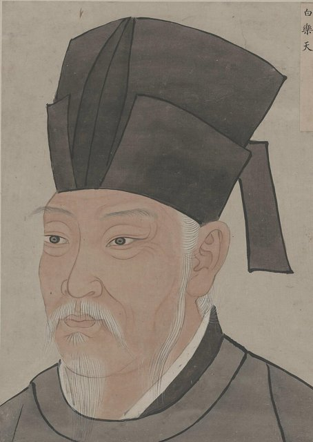

<!--
內容整理自 D:\Books\md\歷史\人物\中國\元稹生平大事記（779—831）.md（Books 的人物頁為 D:\Books\html\1-2-1.中國歷史人物\元稹(779~831).html），並整合中文維基百科〈元稹〉條目，以自己的話改寫。
時期依筆記的六個階段：家世與童年、早期仕途、貶謫、重新得勢與宰相、地方治理、晚年。
兩份資料出入與處理方式：
- 卒日：筆記只寫831年；維基百科寫大和五年七月二十二日（831年9月2日）發病，次日（9月3日）去世，died 依此。
- 校書郎與書判拔萃科：筆記寫803年通過書判拔萃科、授校書郎；白居易的維基百科條目寫兩人在802年同登書判拔萃科，這裡寫802年及第、803年授校書郎，與白居易時間軸一致。
- 鶯鶯傳：筆記只說是他最重要的傳奇作品，沒有寫年代；一般認為作於約804年（貞元二十年），這裡依此放在早期，內文註明。
- 韋叢：筆記寫803年前後成婚、早逝；韋叢在809年去世，這裡依此補充，〈遣悲懷三首〉〈離思五首〉的悼亡背景寫進809年。
- 依附宦官：筆記說他在江陵與宦官交往、立場受後世批評；維基百科補充811年裴垍去世後依附藩鎮嚴綬與監軍宦官崔潭峻，820年經崔潭峻推薦升任知制誥，821年因與魏弘簡阻撓討伐幽州被裴度彈劾，照此。
- 虢州長史依維基百科補充，與白居易兄弟在三峽相遇是819年春赴虢州途中；822年二月與裴度同時拜相、六月罷相出為同州刺史，依通行說法。
- 浙東觀察使約823年到829年，任內與白居易（杭州、蘇州刺史）隔江唱和。
- 人名與其他時間軸一致：白居易（BaiJuyi）、劉禹錫（LiuYuxi）、杜甫（DuFu）；韋叢、裴度、薛濤沒有獨立時間軸。
圖片來源（皆為 Wikimedia Commons 公有領域／CC0 作品，縮成最長邊 640px）：
- yz-cover.jpg：Yuan Chen.jpg（元稹像（線描））
- bjy-cover.jpg：唐名臣像-21-白樂天.jpg（《唐名臣像》中的白居易像（與白居易生平時間軸共用））
-->

# Periods
- 779 ~ 792 | 幼孤家貧 | #868e96
  北魏拓跋氏的後裔，八歲喪父，隨母親鄭氏投靠鳳翔的舅家，由母親親自教讀，九歲能文。
- 793 ~ 809 | 明經入仕與元白訂交 | #1971c2
  十五歲明經及第，與白居易同登書判拔萃科、同任校書郎，娶韋叢；制科第一任拾遺，與白居易共倡新樂府，任監察御史出使東川。
- 810 ~ 819 | 江陵、通州貶謫 | #c92a2a
  與宦官爭驛舍正廳被打，反被貶江陵；此後為求仕進依附藩鎮與宦官，再貶通州司馬，與白居易隔地唱和不絕。
- 820 ~ 822 | 知制誥與拜相 | #e67700
  經宦官崔潭峻推薦升任知制誥、翰林學士承旨，深受穆宗寵信，一度官至宰相，卻為朝臣所輕，數月即罷相外放。
- 823 ~ 831 | 浙東與武昌 | #5f3dc4
  任浙東觀察使多年，與杭州的白居易隔江唱和；晚年回朝任尚書左丞，再出為武昌軍節度使，突然病逝任所。

# Events

## 779 | 出生 {label="779年（唐代宗大曆十四年）"}
元稹字微之，河南府河南縣（今洛陽）人，先世是北魏拓跋氏的皇族，孝文帝漢化後改姓元。籍貫通常寫作洛陽，但也有資料說他生在長安一帶。

## 786 | 八歲喪父 {label="約786年"}
父親元寬去世，家境陷入困頓，元稹隨母親鄭氏遠赴鳳翔，依靠舅家生活。出身書香世家的母親無力送他入學，便親自教他讀經史，元稹九歲就能寫文章。

## 793 | 明經及第 {label="793年（貞元九年）"}
十五歲考中明經科，這一科以背誦、理解儒家經典為主，比以詩賦策論為主的進士科容易，社會評價也較低。隔年他讀到陳子昂的〈感遇〉與杜甫的詩，深受啟發，開始寫詩；杜甫關懷現實的精神，影響了他日後的諷諭詩。

## 799 | 河中府任職 {label="799年（貞元十五年）"}
元稹在河中府（今山西永濟一帶）任職，累積行政經驗。傳奇小說《鶯鶯傳》（又名《會真記》）的故事就以河中府的普救寺為背景，描寫張生與崔鶯鶯相戀又離棄，一般認為作於804年前後，帶有作者自身經歷的影子。元代王實甫的《西廂記》即取材於此，但改寫成反抗禮教、有情人終成眷屬的結局。

## 802 | 與白居易訂交 {label="802年（貞元十八年）"}

元稹與白居易同時考取書判拔萃科，兩人從此結為終身好友。隔年同授秘書省校書郎，負責校勘宮廷藏書，同年元稹娶太子少保韋夏卿的女兒韋叢為妻，婚後家境清貧，夫妻相互扶持。

## 806 | 制科第一 {label="806年（元和元年）"}
元稹與白居易閉門準備，應「才識兼茂明於體用科」制舉，元稹對策名列第一，授左拾遺（一說右拾遺），屢次上疏議論朝政，得罪權貴，不久被外放河南縣尉，又因母喪去職。

## 809 | 出使東川與韋叢之死 {label="809年（元和四年）"}
元稹任監察御史，奉命出使劍南東川，彈劾地方官員的不法，名震一時；相傳他在蜀中與女詩人薛濤相識。同年七月，妻子韋叢病逝，年僅二十七歲。元稹寫下〈遣悲懷三首〉，以「誰知偏念我無衣」「泥他沽酒拔金釵」等生活細節回憶共度的貧困歲月，「誠知此恨人人有，貧賤夫妻百事哀」；又作〈離思五首〉，「曾經滄海難為水，除卻巫山不是雲」成為千古愛情名句。這前後他與白居易、李紳倡導新樂府運動，主張詩歌應反映現實、諷諭時政。

## 810 | 爭驛舍被貶江陵 {label="810年（元和五年）"}
元稹從洛陽奉召回京，途經華州敷水驛時，與宦官仇士良等人爭住驛舍的正廳，被宦官以馬鞭打傷臉部；朝廷反而以他「輕樹威」為由貶為江陵府士曹參軍，白居易等人上書替他申辯也無效。這是他政治生涯的重大轉折。

## 811 | 依附嚴綬與崔潭峻 {label="811–814年"}
支持他的宰相裴垍去世後，元稹為求仕進，轉而依附荊南節度使嚴綬與監軍宦官崔潭峻，為當時輿論所鄙；814年嚴綬奉命討伐淮西吳元濟，元稹隨崔潭峻同行。早年與宦官抗爭、後來依附宦官的轉變，是後世評價他時最受批評之處。

## 815 | 通州司馬 {label="815年（元和十年）"}
元稹一度奉召回京，不久又被貶為通州（今四川達州）司馬。同年白居易也被貶江州，元稹聽到消息寫下〈聞樂天授江州司馬〉：「垂死病中驚坐起，暗風吹雨入寒窗。」兩人隔地以詩筒往來唱和。〈連昌宮詞〉約作於這個時期，藉老宮人回憶連昌宮昔日的繁華與安史之亂後的荒廢，反思統治者奢侈與國家衰亡的關係。

## 819 | 三遊洞與回朝 {label="819年（元和十四年）"}
元稹改任虢州長史，春天從通州赴任途中，在三峽的夷陵與轉任忠州刺史的白居易、白行簡兄弟不期而遇，三人同遊的山洞後稱「三遊洞」。同年冬天，他奉召回朝任膳部員外郎。

## 820 | 知制誥 {label="820年（元和十五年）"}
憲宗去世、穆宗即位，回朝述職的監軍宦官崔潭峻把元稹的詩獻給穆宗，穆宗大為欣賞，宮中稱他「元才子」。元稹升任祠部郎中、知制誥，負責起草詔書，文風清新，受到稱讚。

## 821 | 翰林學士承旨 {label="821年（長慶元年）"}
元稹任中書舍人、翰林學士承旨，深受穆宗寵信，卻為朝臣所輕視：中書省同僚一起吃瓜時，武儒衡一面揮扇驅蠅，一面說「這些東西從哪裡來，竟然一下子聚集在這裡」，暗諷他靠宦官得官。十月，裴度上表彈劾元稹與宦官魏弘簡阻撓討伐幽州的軍事，元稹被改任工部侍郎。

## 822 | 拜相與罷相 {label="822年（長慶二年）"}
二月，元稹與裴度同時拜相，官至同中書門下平章事，是他政治生涯的頂點。但他與裴度互相攻訐，又捲入有人企圖刺殺裴度的流言，六月兩人同時罷相，元稹出為同州刺史。

## 823 | 浙東觀察使 {label="823–829年"}
元稹轉任越州刺史兼浙東觀察使，治所在今日浙江紹興，在任六年。這時白居易在杭州、蘇州任刺史，兩人隔著錢塘江頻繁唱和。824年元稹替白居易編成《白氏長慶集》，並為之作序；自己的詩文後來也編為《元氏長慶集》，他們的詩風被稱為「元和體」或「元白體」。

## 829 | 尚書左丞與武昌軍節度使 {label="829年（大和三年）"}
元稹回朝任尚書左丞，整頓吏治，罷免了一些不稱職的官員；830年出為武昌軍節度使，駐鄂州（今湖北武漢一帶）。

## 831-09-03 | 病逝武昌 {label="831年（大和五年）七月二十三日"}
元稹在武昌任所突然發病，隔天去世，享年五十三歲（虛歲）。唐文宗為之哀悼，追贈尚書右僕射，隔年葬於咸陽洪瀆原。白居易為他撰寫墓誌銘，並把元家致贈的潤筆費捐給洛陽香山寺。元稹以悼亡詩、豔詩最為動人，《鶯鶯傳》則為後世戲曲留下重要的題材；他早年批判宦官、後來依附宦官的經歷，使他的人品在史上評價不一。
