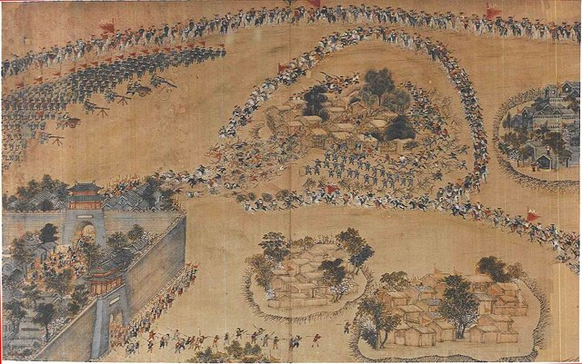
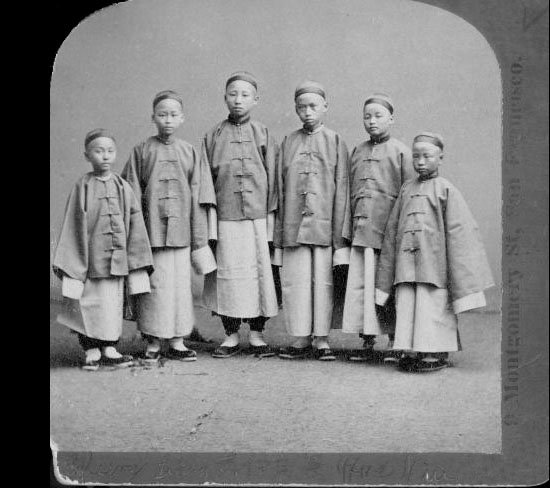

<!--
內容整理自 D:\Books\html\1-2-1.中國歷史人物\曾國藩(1811~1872).html（沒有對應的 md 筆記），並整合中文維基百科〈曾國藩〉條目，以自己的話改寫。
時期依頁面的七個階段歸納：早年與科舉、北京任官、湘軍的建立與早期作戰、兩江總督與攻陷天京、戰後與剿捻、直隸總督與天津教案、晚年。
兩份資料出入與處理方式：
- 生卒：兩份一致，嘉慶十六年十月十一日（1811年11月26日）生於湘鄉白楊坪，同治十一年二月初四（1872年3月12日）卒於南京。享年頁面寫「約60周歲、虛歲62」，維基百科寫六十一歲，這裡寫實歲60歲、虛歲62歲。
- 頁面多以年份敘述，維基百科補上月份：1853年1月接幫辦團練之旨、1854年2月發布《討粵匪檄》、4月靖港之敗與湘潭大捷、10月攻陷武昌、1855年九江湖口水師敗績、1858年5月占領九江、11月三河鎮之敗、1860年8月授兩江總督、1861年9月攻陷安慶、1868年8月改任直隸總督、1870年6月天津教案、9月調回兩江。頁面沒有的靖港投水、三河鎮之敗、九江湖口之敗取自維基百科，補足頁面說的「湘軍成立初期並非戰無不勝」。
- 北京任官：頁面寫1847年前後取得較高官職；維基百科補充1840年授翰林院檢討、隨唐鑑與倭仁講習程朱理學、1849年授禮部右侍郎，採維基百科。
- 淮軍：頁面寫1862年支持李鴻章建立淮軍；維基百科沒有明載淮軍成立年份，只寫李鴻章攻取蘇南，照頁面寫1862年。
- 封侯：頁面寫1864年封一等侯（毅勇侯）；維基百科只寫同治年間，採頁面的1864年。裁撤湘軍：維基百科寫1864年8月奏准裁撤兩萬五千人，頁面只說「逐步裁撤」，採維基百科的數字。
- 剿捻：頁面寫1865年奉命處理捻軍、1866–1867年受挫；維基百科補充是1865年5月僧格林沁被捻軍擊斃之後。江南製造總局（1865年與李鴻章在上海創辦）頁面沒有寫名稱，只說支持製造近代軍事裝備，取自維基百科。
- 1871年與李鴻章聯名奏請選派幼童赴美留學：頁面與維基百科摘要都沒有確切年份，依常見記載補充（第一批幼童1872年出發）。
- 太平天國的死亡人數：頁面提醒各研究估計差異很大，不宜採單一數字，照此不寫數字；天京城破後的屠城，頁面與維基百科都有記載。
- 頁面的「重要歷史成就與爭議」「總表」寫進時期說明與相關事件，不另立事件。《曾國藩家書》出版年份兩份都沒有，只在最後一則事件提及。
- 人名與其他時間軸一致：洪秀全、楊秀清、李鴻章、左宗棠、胡林翼、曾國荃、僧格林沁。
圖片來源（皆為 Wikimedia Commons 公有領域／CC0 作品；註明「共用」者沿用其他時間軸已有的圖片）：
- zg-cover.jpg：Zeng Guofan Photograph.jpg（曾國藩的照片）
- zg-taiping.jpg：Taiping breaking out of Shuoheng.jpg（清代戰圖：太平軍自朔橫突圍）
- zg-cem.jpg：Six First Detachment students on arrival in California.jpg（第一批留美幼童抵達加州時的合影，1872）
-->

# Periods
- 1811-11-26 ~ 1838 | 早年與科舉 | #868e96
  生於湖南湘鄉的士紳家庭，祖父曾玉屏重視家族發展，父親曾麟書長年應考；他自幼讀經、屢試受挫，1833年考取秀才，次年中舉。
- 1838 ~ 1852 | 北京任官 | #1971c2
  中進士入翰林院，隨唐鑑、倭仁講習程朱理學，重視修身、立志與克己，升至禮部右侍郎，累積行政經驗與政治人脈。
- 1852 ~ 1860 | 湘軍的建立與苦戰 | #e8590c
  母喪返鄉時奉命辦理湖南團練，把團練發展成指揮完整、水陸兼備的湘軍；靖港投水、九江湖口敗績，經過多年苦戰才逐漸取得優勢。
- 1860 ~ 1864-07-19 | 兩江總督與攻陷天京 | #c92a2a
  受任兩江總督、欽差大臣，統籌東南軍務，攻下安慶、設內軍械所，支持李鴻章建立淮軍，最終攻破天京。
- 1864-07-19 ~ 1868 | 戰後與剿捻 | #7048e8
  封一等毅勇侯、裁撤湘軍，奉命剿捻卻屢屢受挫，與李鴻章創辦江南製造總局。
- 1868 ~ 1872-03-12 | 直隸總督與晚年 | #495057
  調任直隸總督，查辦天津教案時的妥協招致輿論譴責；調回兩江後繼續推動洋務，在南京去世。

# Events

## 1811-11-26 | 出生於湖南湘鄉
曾國藩生於湖南長沙府湘鄉縣白楊坪（今雙峰縣荷葉鎮），原名子城，字伯涵，號滌生。家族不是顯赫世家，但靠長期累積的經濟資源與教育投入，逐步具備向上發展的條件；祖父曾玉屏重視家族發展，父親曾麟書長年投入科舉。
成長環境讓他養成重視勤勉、自律、家族責任與儒家道德的觀念，這些日後都成為他管理軍隊、選拔人才與治理地方的依據。

## 1833 | 考取秀才
曾國藩自幼讀儒家經典，多次應試受挫，1833年秋才在湘鄉縣試考取秀才。這段經歷讓他更重視持續努力與日常的自我約束。

## 1834 | 中舉人
曾國藩在湖南鄉試中第三十六名舉人，取得到京師參加會試的資格，這是家族多年教育投入的重要成果。

## 1838 | 中進士，入翰林院
曾國藩會試中式，殿試三甲第四十二名，賜同進士出身，授翰林院庶吉士，從湖南地方士人正式進入以北京為中心的政治體系。1840年散館，授翰林院檢討。
在京期間，他持續研究儒家經典，與官員、學者建立關係，這些人脈後來成為他組建湘軍、推動地方軍政的重要支持。

## 1845 | 講習理學 {label="1840年代"}
曾國藩隨唐鑑、倭仁講習程朱理學，思考官員該如何修身、如何履行政治責任，把個人修養與政治責任結合起來。他持續升遷，此時仍以文官身分發展，還不是軍事統帥。

## 1849 | 禮部右侍郎
曾國藩授禮部右侍郎，不久兼署兵部右侍郎，成為清朝官僚體系中受到重視的人物。1850年，他上《敬陳聖德三端預防流弊疏》。
同一時期，洪秀全的拜上帝會在廣西發展，1851年建立太平天國。清朝的綠營等正規軍在大規模戰爭中暴露出許多問題，地方不得不尋求新的軍事組織方式。

## 1852 | 母喪返鄉，奉命辦團練
曾國藩的母親江氏去世，他依禮返鄉守制。太平軍勢力擴張到湖南，地方情勢緊張，1853年1月清廷命他幫辦湖南團練，利用地方士紳與民間力量補充正規軍的不足。
一名中央文官，因戰爭與政治需要轉向地方軍事，這個轉變為湘軍的形成創造了條件，也讓他日後擁有遠超一般文官的政治與軍事影響力。

## 1853 | 組建湘軍
曾國藩在長沙、衡州招募兵員、訓練士卒，把原本維持地方治安的團練，發展成指揮體系完整的軍隊。他重視軍官的選拔與士兵的紀律，強調將領與部屬之間的信任，以及由地方士紳提供的資源支持。
湘軍不只有陸軍，也逐步建立水師，以適應長江流域的戰爭環境。

## 1854-04 | 靖港之敗與湘潭大捷

1854年2月，湘軍練成，在湘潭集結，發布《討粵匪檄》，出省作戰。4月，曾國藩親率水師在靖港大敗，羞憤投水，被幕僚救起；同月27至30日，湘軍在湘潭大捷，湖南戰局逆轉。10月，湘軍攻陷湖北武昌。
早期的挫敗讓他體認到，建軍不能只靠道德訓誡，還需要可靠的補給、訓練、指揮與戰略規劃。

## 1855 | 九江、湖口之敗
湘軍進攻江西九江、湖口，水師敗績，武漢再度失守，曾國藩困守南昌。太平軍在長江流域仍掌握主動權，湘軍面臨水師作戰與後勤供應的困難。他的成功不是單靠個人才能，而是建立在長期戰爭、組織調整與將領協作之上。

## 1856 | 天京事變
太平天國內部爆發嚴重的權力鬥爭，東王楊秀清等人被殺，大量人員死亡，太平天國的領導核心與凝聚力受到重大打擊，為清軍反攻提供了機會。

## 1857 | 父喪返鄉
曾國藩的父親曾麟書去世，他再度返鄉服喪，再次面對軍事責任與傳統禮制的衝突。地方軍隊與中央之間的權力分配也是難題，但湘軍已逐漸成為清朝平亂不可或缺的力量。

## 1858-05 | 復出，攻占九江
曾國藩重新主持湘軍事務，1858年5月占領九江；11月，他派出的李續賓部在安徽三河鎮被太平軍殲滅，是湘軍的一大挫敗。湘軍逐步改善指揮、補給與水陸協同，與左宗棠、胡林翼等人的關係也在戰爭中發展，成為晚清地方軍事力量崛起的基礎。

## 1860-08 | 授兩江總督、欽差大臣
這一年清朝內外交困：太平天國控制長江流域，英法聯軍攻入北京。清廷任命曾國藩為兩江總督、欽差大臣，督辦江南軍務，管轄江蘇、安徽、江西等經濟與交通要地。
湘軍不再只是湖南的團練，而成為清廷倚重的主要軍事力量；他從地方軍事組織者，變成能影響東南政局的大員。清廷必須依賴地方督撫與他們掌握的軍隊維持統治，中央與地方的關係從此改變。

## 1861-09 | 攻下安慶，設內軍械所
曾國藩之弟曾國荃所部經長期圍攻，在1861年9月攻陷安慶。安慶是太平天國在長江中游的重要據點、天京以西的屏障，攻下安慶為進攻天京創造了條件。11月，他奉命統轄蘇、皖、贛、浙四省軍務。
同年他在安慶設立內軍械所，嘗試以西方技術製造槍炮。這反映一個重要的轉變：在維護傳統政治秩序的同時，也可以吸收西方的科學技術，這個思路後來成為洋務運動的基礎。

## 1862 | 支持李鴻章建立淮軍
曾國藩任協辦大學士。他的部將李鴻章在他支持下建立淮軍，赴上海一帶作戰，攻取蘇南地區；清廷在江南因此多了一支重要的地方軍事力量。曾國藩、李鴻章與其他地方官員的合作，成為晚清軍事政治的重要特徵。1863年，湘軍持續逼近天京，以包圍、切斷補給的方式削弱守軍，自身也付出極大傷亡。

## 1864-07-19 | 攻陷天京
經長期圍攻，湘軍攻破太平天國的首都天京（今南京）。洪秀全已在同年6月去世，太平天國中央政權覆滅，城破後湘軍屠城，殺戮與破壞極為嚴重。整場太平天國戰爭造成極其龐大的生命損失，各研究的死亡人數估計差異很大。
曾國藩封一等毅勇侯，聲望達到頂峰，也反映漢人官僚與軍事領袖在晚清政治中地位上升。從清廷立場，天京陷落代表秩序恢復；從受戰爭波及的民眾立場，湘軍的鎮壓伴隨大量傷亡與破壞，評價他不能只看軍事勝利。
一支由地方官員建立、將領直接掌握的軍隊，平亂後該如何處置？8月，他奏准裁撤湘軍兩萬五千人，以回應清廷的疑慮。

## 1865-05 | 奉命剿捻
僧格林沁被捻軍擊斃後，曾國藩奉命剿捻，督辦直隸、山東、河南軍務。捻軍流動性強，在廣大地區轉移，他擅長的長期圍攻與固定戰線在這裡難以奏效，1866到1867年戰事屢屢受挫，軍事聲望受到影響。能擊敗太平天國的作戰模式，不一定適用於所有敵人。
同時，他與李鴻章在上海創辦江南製造總局，繼續推動近代軍事工業。

## 1868-08 | 調任直隸總督
曾國藩改任直隸總督，負責京畿周邊的行政、財政與治安。第二次鴉片戰爭後，外國在華享有多項條約權利，傳教、領事保護與司法管轄經常引發衝突，地方官員必須同時面對外交壓力、民間疑慮與清廷維持秩序的要求。

## 1870-06 | 天津教案
天津民間流傳教會拐帶幼童的指控，疑慮擴大成暴力事件，法國人與其他外國人遇害，也有中國教民被殺。法國要求追究責任，曾國藩奉命查辦。
他必須在維持秩序、回應外交要求、追究犯罪責任與處理民眾對外國特權的不滿之間作選擇，最後採取較妥協的方式，懲處相關中國人員，避免與法國爆發更大衝突，卻被批評在外國壓力前過度退讓，招致輿論譴責。天津教案暴露了晚清國家主權與外交能力的不足。
9月，他調回兩江總督。

## 1871 | 推動洋務與幼童留美

曾國藩晚年在兩江總督任內，處理戰後重建、財政與外交，支持製造近代軍事裝備、引進技術與培養人才；1871年，他與李鴻章聯名奏請選派幼童赴美留學，第一批幼童在他去世後的1872年出發。
他支持的改革著眼於軍事、技術與實用層面，並不主張全面改變清朝的傳統政治制度；他的洋務實踐為李鴻章等人後來的近代工業奠定基礎。

## 1872-03-12 | 病逝於南京
同治十一年二月初四，曾國藩在南京兩江總督任內病逝，實歲60歲（虛歲62歲），追贈太傅，諡文正。他留下的《曾國藩家書》成為後世流傳甚廣的修身與治家讀物。
他的政治遺產具有雙重性：協助清廷維持了統治秩序，也在客觀上推動地方督撫與區域軍事力量的擴張；地方軍權崛起、財政困難、列強壓力與傳統制度的限制，仍是清朝無法迴避的問題。
