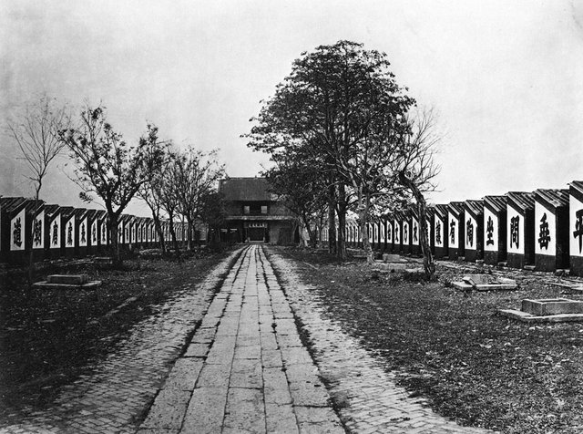
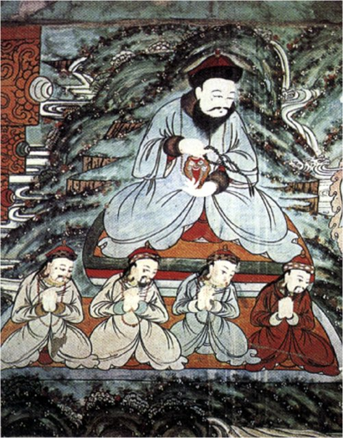
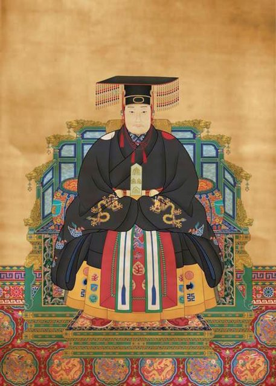
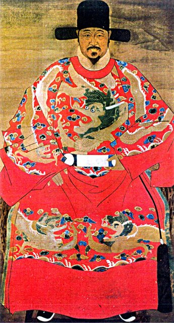

<!--
內容整理自 D:\Books\html\1-2-1.中國歷史人物\張居正(1525~1582).html（沒有對應的 md 筆記），並整合中文維基百科〈張居正〉條目，以自己的話改寫。
時期依頁面「總結」的五個階段：少年求學與科舉入仕、累積政治經驗、掌握朝政與推動改革、萬曆新政的高峰、去世與身後清算。
兩份資料出入與處理方式：
- 出生：頁面只寫1525年；維基百科作嘉靖四年五月初五（1525年5月26日），born 採此日期。去世兩份一致：萬曆十年六月二十日（1582年7月9日），享年57歲（虛歲58）。
- 科舉：頁面的小節標題寫「1540年：考中秀才」，但總表寫1536年（嘉靖十五年）參加童試取得生員資格、1540年中舉人；維基百科作十二歲投考生員、1540年十六歲中舉人。採總表與維基百科：約1536年取得生員資格、1540年中舉。
- 年號：頁面總表把1572年標為「萬曆元年」；1572年是隆慶六年，萬曆元年是1573年，這裡更正。
- 1554–1557年告病回鄉、1557年回京：頁面與維基百科摘要都沒有提到，依常見記載補充，並在事件中說明。
- 首輔：頁面寫1572年；維基百科補充是隆慶六年六月，事件以「1572-07」表示。張居正與馮保合作促使高拱去職的經過，頁面與維基百科都說記載不一、有學者質疑，照此謹慎寫法。
- 隆慶和議（1571年俺答封貢）：頁面強調不是張居正一人完成，而是朝廷多名官員共同推動，照頁面。
- 一條鞭法：頁面寫1581年在全國推廣，並說明不是張居正首創；維基百科寫清丈三年後在全國推行，兩者一致。
- 身後清算：頁面寫1584年下令清算抄家；維基百科補充萬曆十一年（1583年）正月起先被追奪官爵、「革職為民」，之後才籍沒其家，長子張敬修寫下血書後自縊。這裡分成1583年追奪與1584年抄家兩則。1622年（天啟二年）平反，兩份一致。
- 頁面的「主要改革及其歷史影響」「如何評價張居正」「與其他明朝重要人物的關係」「五個階段」寫進時期說明與相關事件，不另立事件。《帝鑑圖說》併入1572年帝師的事件。
圖片來源（皆為 Wikimedia Commons 公有領域／CC0 作品；註明「共用」者沿用其他時間軸已有的圖片）：
- zj-cover.jpg：張居正-清晰版 (cropped).jpeg（張居正像）
- keju-cells.jpg（貢院號舍，1873年攝；借來說明明清的鄉試考場（與中國科舉制度大事記時間軸共用））
- zj-altan.jpg：Altankhan.jpg（俺答汗像）
- zj-wanli.jpg：Wanli-Emperor.jpg（明神宗萬曆皇帝像）
- zj-qi.jpg：Qi Jiguang Portrait.jpg（戚繼光像）
-->

# Periods
- 1525-05-26 ~ 1547 | 少年求學與科舉入仕 | #868e96
  生於湖廣江陵，自幼接受儒家經典教育，少年取得生員資格，十六歲中舉，二十三歲中進士、選入翰林院。
- 1547 ~ 1572-07 | 累積政治經驗 | #1971c2
  在嘉靖朝觀察嚴嵩當政與官僚的因循推諉，與徐階建立關係，擔任裕王講官；隆慶元年入閣，參與北方邊防與俺答封貢。
- 1572-07 ~ 1578 | 掌握朝政與推動改革 | #e8590c
  萬曆帝年幼即位，張居正以帝師身分取得李太后信任，與馮保合作取代高拱成為首輔，推行考成法、整頓吏治與財政；父喪奪情，引發倫理爭議。
- 1578 ~ 1582-07-09 | 萬曆新政的高峰 | #c92a2a
  清丈全國田畝、推廣一條鞭法，支持潘季馴治河、戚繼光整頓北方邊防，財政與行政有所改善，但改革高度依賴他個人的權威。
- 1582-07-09 ~ 1622 | 身後清算與平反 | #495057
  去世後萬曆皇帝收回權力，反對者群起攻擊，追奪官爵、抄家，長子自縊；直到天啟二年才獲平反。

# Events

## 1525-05-26 | 出生於湖廣江陵
張居正出生於湖廣荊州府江陵（今湖北荊州），字叔大，號太岳，出身有讀書傳統的家庭，自幼接受儒家經典教育。他成長於明朝嘉靖年間，朝廷權力鬥爭、財政壓力與行政效率下降的問題正逐漸浮現。

## 1536 | 取得生員資格 {label="約1536年"}
大約十二歲時，張居正參加童試，取得生員（秀才）資格，進入地方士人階層，踏上傳統的仕進之路。傳統史料常以他的早慧作為生平的開端；但理解他的政治成就，更該注意他後來如何把經學教育、行政經驗與政治判斷結合起來。

## 1540 | 十六歲中舉

嘉靖十九年，十六歲的張居正考中舉人，取得進一步進入仕途的資格。科舉不只是他晉身的途徑，也讓他進入以儒家經典、官僚倫理與皇權政治為核心的制度環境。

## 1547 | 考中進士，選入翰林院
嘉靖二十六年，張居正考中進士，選為庶吉士，後授翰林院編修。翰林院是明代培養高級文官的機構，許多官員在這裡累積資歷，日後進入中樞。
明代內閣雖然沒有法定的丞相職權，卻因協助皇帝處理奏章、草擬詔令而逐漸成為決策核心；張居正日後能掌控政令傳達、官員考核與財政政策，與他早年在翰林院的經驗有關。

## 1554 | 觀察嘉靖朝政治
張居正任官時，嘉靖皇帝長居深宮，嚴嵩等權臣長期影響朝政，官僚因循推諉、效率低落。一般記載他在1554年告病回鄉，1557年再回北京任職。
這段經歷讓他體會到：政策再好，官員不執行就沒有效果；財政與賦稅需要可靠的統計；朝廷必須有有效的考核與獎懲；邊防、河道與地方行政都要有能力的官員負責。這些都成為日後考成法與財政改革的思想基礎。

## 1562 | 嚴嵩失勢，徐階主政
嚴嵩失勢，徐階成為嘉靖朝後期的重要閣臣，並在隆慶初年繼續影響朝政。徐階是張居正仕途上的重要前輩，張居正在這段時間學習如何在複雜的官僚關係中推動政務，重視人事安排、政治聯盟與皇帝的支持。
他也擔任裕王朱載坖（後來的隆慶帝）的講官，與皇室建立長期的師生關係。

## 1567 | 入閣
明穆宗即位，年號隆慶。張居正升任吏部左侍郎兼東閣大學士，進入內閣，成為中央決策圈的重要成員。隆慶年間朝廷面對北方邊防、財政與吏治等問題，他展現出務實的政治風格，傾向以調整制度、改善邊防、提高執行力來解決長期積弊。

## 1571 | 隆慶和議，俺答封貢

明朝與蒙古俺答汗的關係緩和，俺答獲明朝封號，雙方建立較穩定的邊境互市。這項政策是朝廷多名官員共同推動的結果，不是張居正一人完成，但他是隆慶朝重要的參與者。
明朝開始以較務實的方式處理北方邊境，減輕長期衝突對財政與邊防的壓力；他後來重用戚繼光、李成梁整頓北方防務，也與這時形成的邊防布局有關。

## 1572-07 | 萬曆即位，成為首輔

1572年，明穆宗去世，年幼的朱翊鈞即位，是為明神宗萬曆皇帝。內閣的權力競爭隨即加劇，張居正與司禮監太監馮保合作，促使首輔高拱離開權力中樞，由他接任首輔；這段經過的史料記載與後世評價並不一致。
李太后需要能維持秩序、輔佐幼帝的大臣，張居正的帝師身分讓他取得信任。他為萬曆帝講授經史與治國之道，編纂《帝鑑圖說》，以歷代帝王的事例配圖說明治國得失。這段師生關係埋下了矛盾：張居正以嚴格的方式約束皇帝，皇帝成年後勢必要收回完整的統治權。

## 1573 | 推行考成法
萬曆元年，張居正推行考成法，這是萬曆新政最重要的行政改革。各級官署把收發的公文、待辦事項與執行情形登記在冊，設定期限，逐級核查未完成的事項，並把結果和官員的考績、升遷與懲處連結起來，內閣得以掌握政令是否真正落實。
它的精神是：不只看官員說了什麼，更要查明他實際做了什麼。考成法提高了行政的可追蹤性，也強化了中央與首輔對官僚的控制，官員的自主空間縮小、壓力加大。
1573到1575年，他還裁汰冗員、追究行政責任，整頓財政與漕運，督促各地補繳拖欠的賦稅，為後來的清丈與賦役改革創造條件。

## 1577 | 父喪奪情
張居正的父親去世。依儒家禮制，官員遭父母之喪應離職回鄉守制三年，稱為「丁憂」；但他身為首輔，離職可能使改革中斷、引發權力競爭，於是在皇帝與朝廷的安排下留任，稱為「奪情」。
這件事引起很大的反彈：高官不依禮服喪容易被批評違背孝道；他權力已大，留任讓反對者質疑他戀棧權位；改革觸動的利益也藉機發難。奪情之爭顯示他的改革牽涉的不只是制度，還有傳統倫理、政治權力與官僚利益的衝突。

## 1578 | 清丈全國田畝
萬曆六年，張居正下令清丈全國田地，重新測量、登記並核查土地的面積、所有權與應繳稅額。明朝的土地登記長期失實，大地主隱匿田地，稅負轉嫁到其他納稅人身上。
清丈的目的是增加稅收、改善財政資料、調整稅負分配。它遭到地主與地方官員的阻力，各地執行程度不一，不能理解成所有地區的土地問題都因此徹底解決。

## 1579 | 治河與邊防

張居正重用潘季馴治理黃河與淮河，以堤防與河道工程約束水流、促使泥沙下移；水患影響農田、漕運與財政，治河需要專業官員、地方組織與大量人力長期投入。
他也支持戚繼光整訓薊鎮等北方防區的軍隊、修築防禦工事，李成梁在遼東扮演重要角色。他的軍事政策不是追求對外戰爭，而是希望降低國防壓力，讓政府能集中資源處理內政。1580年，他又裁減部分冗員，壓縮行政成本。

## 1581 | 推廣一條鞭法
萬曆九年，張居正在全國推廣一條鞭法，把分散的田賦、徭役與雜項合併，並提高以白銀折納的比重。一條鞭法不是他首創，在他主政前已在部分地區推行，他的貢獻是擴大推行範圍，把它納入整體財政改革。
它簡化了徵收程序、改善政府對稅收的掌握，也反映明代白銀經濟的發展；但各地實施方式不一，以白銀納稅也可能讓缺乏白銀的農戶承受新的壓力。到這時，萬曆新政在財政、吏治與邊防都取得了成果，但成果高度依賴他個人的權威。

## 1582-07-09 | 病逝於北京
長年繁重的政務使張居正健康惡化，萬曆十年六月二十日，他在北京去世，享年五十七歲，獲贈上柱國，諡文忠。
他的死是萬曆新政的轉折點：生前皇帝、太后與內閣之間的政務多由他協調，死後權力平衡迅速改變。他沒有解決「改革者離開後，改革如何繼續」的問題。

## 1583 | 追奪官爵
張居正死後，萬曆皇帝逐步擺脫這位老師與首輔留下的安排，被他壓制的官員重新取得發言空間，批評他專權、利用皇帝年幼擴張權力、奪情違背倫理、用人與施政過於強硬。萬曆十一年起，朝廷陸續追奪他的官爵與諡號。
這些批評並非全無根據，但也和晚明的政治鬥爭密切相關。

## 1584 | 抄家，長子自縊
萬曆十二年，萬曆皇帝下令查抄張居正的家產，家族受到嚴重牽連，長子張敬修寫下血書後自縊。清算一方面宣示皇權重新居於最高地位，一方面被包裝成對官員品行的追究。
並不是所有改革都隨之消失，一條鞭法等財政措施有較長的制度背景；明朝後來的衰退也有更長期的根源，不能完全歸咎於他死後的政策變化。

## 1622 | 天啟二年平反
明熹宗天啟二年，朝廷恢復張居正的官職與名譽，對他的評價有所回復。後世史家逐漸不再以忠奸二分評斷他，而是討論他在行政、財政、軍事與國家治理上的成就與限制：他既不是毫無缺點的改革英雄，也不能只用「專權」概括。
他的經驗揭示了一個深刻的問題：改革者即使能在短時間集中權力、提高執行效率，如果改革缺乏穩固的制度基礎與持續的政治支持，成果仍可能在他離開後受到衝擊。
