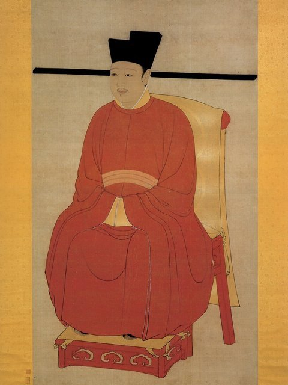

<!--
內容整理自 D:\Books\md\歷史\人物\中國\周邦彥生平大事記.md（Books 的人物頁為 D:\Books\html\1-2-1.中國歷史人物\周邦彥(1056~1121).html），並整合中文維基百科〈周邦彥〉條目，以自己的話改寫。
時期依筆記的階段：家世與早年、太學與〈汴都賦〉、地方任官、重返汴京、徽宗朝與大晟府、晚年外放。
處理方式：
- 中文維基百科〈周邦彥〉條目篇幅短，只補充了「詞家之冠」「詞中老杜」等稱號、「繼柳永、開姜夔」的評價，以及他與名妓李師師的野史；生平年代都依筆記的大事記總表。
- 李師師與宋徽宗、〈少年遊·並刀如水〉的故事，維基百科列為野史，這裡寫進內文並註明是傳說。
- 筆記在1111–1115年列了知河中府（未赴任）、知隆德軍府、知明州三則，合為一則。
- 1120年改任處州、因方臘起義未能赴任，與罷職後提舉南京鴻慶宮，合為一則。
- 〈蘇幕遮〉〈蘭陵王·柳〉〈六醜〉等名作的寫作年代多不確定，〈滿庭芳·夏日溧水無想山作〉依題目放在溧水知縣任內。
- 人名與其他時間軸一致：柳永（LiuYong）、蘇軾（SuDongpo）、李清照（LiQingzhao）；王安石、宋徽宗、李師師沒有獨立時間軸。
圖片來源（皆為 Wikimedia Commons 公有領域／CC0 作品，縮成最長邊 640px）：
- jingkang-qingming.jpg：Along the River During the Qingming Festival (detail of original).jpg（張擇端《清明上河圖》局部，北宋汴京的繁華（與北宋靖康之變大事記共用））
- dangzheng-huizong.jpg：Huizong.jpg（宋徽宗像，國立故宮博物院藏（與北宋新舊黨爭大事記共用））
-->

# Periods
- 1056 ~ 1078 | 錢塘少年 | #868e96
  生於錢塘（今杭州），少年個性疏散不羈，卻博覽百家之書，打下詩文與音律的深厚基礎。
- 1079 ~ 1086 | 太學與〈汴都賦〉 | #1971c2
  到汴京入太學，正值王安石變法；獻七千字的〈汴都賦〉頌揚新法，受宋神宗賞識，由太學生升為太學正。
- 1087 ~ 1095 | 州縣小官 | #2f9e44
  神宗死後舊黨當政，他離開汴京任廬州教授，又到荊州、溧水，長期在地方任小官，羈旅與江南景物大量進入詞中。
- 1096 ~ 1116 | 重返汴京 | #e67700
  哲宗親政後回朝，再進〈汴都賦〉；徽宗朝歷任校書郎、考功員外郎、衛尉宗正少卿，中間外任河中、隆德、明州，詞名日盛。
- 1117 ~ 1121 | 提舉大晟府與晚年 | #5f3dc4
  任徽猷閣待制、提舉大晟府，主持審訂古調、創製新曲；晚年外放真定、順昌、處州，方臘起事時避亂，卒於南京鴻慶宮任上。

# Events

## 1056 | 出生於錢塘 {label="1056年（宋仁宗至和三年）"}
周邦彥字美成，號清真居士，錢塘（今浙江杭州）人。史書說他少年時個性疏散、不太受鄉里看重，卻博覽百家之書，對詩文、經史與音樂都有廣泛的涉獵。

## 1079 | 入太學 {label="1079年（元豐二年）"}
二十四歲的周邦彥到汴京進入太學。當時正值王安石變法的後期，朝廷推行新法、擴充太學，首都的政治與學術充滿改革氣氛；他也在汴京接觸到繁華的音樂與宴飲文化。

## 1083 | 獻〈汴都賦〉 {label="1083年（元豐六年）"}
周邦彥寫成約七千字的長篇〈汴都賦〉，描寫汴京的宮殿、城市與商業繁榮，並歌頌新法政績。宋神宗讀後十分讚賞，命大臣在邇英閣宣讀，並召見他；隔年他從太學生破格升為太學正，負責太學的教學與管理。

## 1087 | 廬州教授 {label="1087年（元祐二年）"}
神宗去世後，高太后與舊黨當政，支持新法的人紛紛外放。周邦彥離開汴京出任廬州（今安徽合肥）教授，此後約十年在地方擔任小官，又到過荊州一帶，旅途奔波與遠離京城的感受，成為他羈旅詞的重要題材。

## 1093 | 溧水知縣 {label="1093年（元祐八年）"}
周邦彥出任溧水（今南京溧水區）知縣，寫下〈滿庭芳·夏日溧水無想山作〉：「風老鶯雛，雨肥梅子，午陰嘉樹清圓」，結尾「憔悴江南倦客，不堪聽、急管繁弦」，透過江南的季節景物寄託仕途漂泊的倦意。他的詞很少直接說出個人遭遇，而是借花木、流水與旅途場景間接表現。

## 1096 | 回朝任國子監主簿 {label="約1096–1098年（紹聖年間）"}
哲宗親政後新黨重新得勢，周邦彥回到汴京，任國子監主簿；1098年（元符元年）他再次進呈〈汴都賦〉，獲任秘書省正字，負責典籍的校勘。

## 1100 | 徽宗即位 {label="1100年（元符三年）"}

哲宗去世，愛好書畫、音樂的宋徽宗即位，宮廷藝術活動空前興盛。周邦彥任校書郎，接觸大量古代詩文、樂府與音樂文獻；1104年升任考功員外郎，1107年任衛尉宗正少卿，兼議禮局檢討，參與整理禮制。

## 1111 | 外任河中、隆德、明州 {label="1111–1115年（政和年間）"}
周邦彥以直龍圖閣的身分出知河中府（今山西永濟），但沒有赴任，改知隆德軍府（今山西長治），1115年改任明州（今浙江寧波）知州，在中央與地方之間多次調動。

## 1115 | 李師師的傳說 {label="野史，年代不詳"}
宋人筆記流傳：周邦彥與汴京名妓李師師相好，一夜宋徽宗也來到師師家，周邦彥躲在床下，事後把兩人的對話寫成〈少年遊〉：「並刀如水，吳鹽勝雪，纖指破新橙」，徽宗知道後大怒，把他貶出京城。這個故事流傳很廣，但與周邦彥的年齡、仕歷多有不合，只能當作傳說。

## 1116 | 秘書監 {label="1116年（政和六年）"}
周邦彥回到汴京出任秘書監，主管國家的典籍與文獻，此時他已是北宋詞壇極具聲望的詞人與音樂家。

## 1117 | 提舉大晟府 {label="1117年（政和七年）"}
周邦彥升任徽猷閣待制，並提舉大晟府。大晟府是宋徽宗設立的宮廷音樂機構，他主持審訂古調、討論古音、整理樂曲，並創製新的詞調。他精通音律，能自度曲，詞作格律嚴整、音調和諧，善於鋪敘與融化前人詩句，〈蘭陵王·柳〉以柳寫別情、〈六醜·薔薇謝後作〉借花寫人、〈蘇幕遮〉「葉上初陽乾宿雨，水面清圓，一一風荷舉」，結構精密、時空轉換曲折。後人說他「繼柳永、開姜夔」，被南宋格律派尊為「詞家正宗」。

## 1118 | 出知真定府 {label="1118年（重和元年）"}
周邦彥離開大晟府，出知真定府（今河北正定），不久改知順昌府（今安徽阜陽）。

## 1120 | 方臘起事 {label="1120年（宣和二年）"}
周邦彥改任處州（今浙江麗水），正逢方臘在睦州起事，迅速席捲浙江，他未能赴任，避亂輾轉各地，隨後罷職，提舉南京鴻慶宮（一個領俸祿的閒職）。

## 1121 | 逝世 {label="1121年（宣和三年）"}
周邦彥在南京（今河南商丘）去世，享年六十六歲，詞集名《清真集》（又名《片玉詞》）。幾年後北宋就在靖康之變中滅亡。他集北宋婉約詞之大成，被尊為「詞家之冠」「詞中老杜」，南宋的姜夔、吳文英等格律派詞人都深受他的影響。
