<!--
事件取材自 Snapask 學習專欄〈高中歷史圖表一次看 近代世界史〉（IvyShen，2021-04-01）的年表，以自己的文字改寫、拆分並補充細節。
https://academy.snapask.com/zh-tw/post/高中歷史圖表一次看%20近代世界史-d1307afe50d6
與原圖表不同之處（依一般公認的史實修正或補充）：
- 克倫威爾以「護國公」身分主政是1653～1658年（1649～1653年為共和國時期）。
- 普魯士1818年頒布關稅法，德意志關稅同盟正式成立於1834年。
- 希特勒1933年出任總理，1934年興登堡死後才兼任元首。
- 原圖「蘇俄成立1919年」一句有誤：蘇維埃俄國成立於1917年十月革命後，蘇聯成立於1922年。
- 北大西洋公約組織成立於1949年（原圖列在1950年）。
- 第二次石油危機始於1979年伊朗革命。
- 1954年「我國」指中華民國。
各時期劃分與精確日期為補充。
圖片皆為 Wikimedia Commons 上的公有領域（含CC0）作品（封面：大衛〈拿破崙加冕〉）。部分配圖年份與事件不完全相同：啟蒙運動配勒莫尼耶所繪1755年喬芙蘭夫人沙龍、明治維新配1873年的明治天皇、俄國革命配1920年的列寧、墨索里尼配1922年進軍羅馬、柏林圍牆倒塌配1989年12月拆除布蘭登堡門旁圍牆的照片。
-->

# Periods
- 1543 ~ 1688 | 科學革命與專制王權 | #4c6ef5
  哥白尼、伽利略、牛頓推翻中世紀宇宙觀，建立新的科學方法；歐陸君主以君權神授為據強化王權，英國則在內戰中探索國會與國王的權力界線。
- 1688 ~ 1789 | 啟蒙運動與開明專制 | #15aabf
  英國確立君主立憲，啟蒙思想家高舉理性與天賦人權；普、俄、奧君主推行開明專制，英國展開工業革命，北美殖民地獨立建國。
- 1789 ~ 1815 | 法國大革命與拿破崙時代 | #e8590c
  法國推翻君主制、建立共和，拿破崙稱帝後征服大半個歐洲，最後在半島戰爭與遠征俄國中由盛轉衰。
- 1815 ~ 1871 | 維也納體系與民族主義 | #2b8a3e
  列強以維也納會議恢復舊秩序，但自由主義與民族主義的革命浪潮不斷；義大利與德意志先後完成統一，日本明治維新。
- 1871 ~ 1914 | 帝國主義與同盟對峙 | #862e9c
  德國崛起改變歐洲均勢，列強向海外擴張；三國同盟與三國協約兩大陣營逐漸成形。
- 1914 ~ 1918 | 第一次世界大戰 | #c92a2a
  塞拉耶佛事件點燃大戰，俄國革命退出戰局、美國參戰，最終協約國獲勝，四大帝國崩潰。
- 1919 ~ 1939 | 兩次大戰之間 | #f59f00
  凡爾賽體系與國際聯盟建立新秩序，經濟大恐慌後極權主義興起，義大利法西斯、蘇聯史達林、德國納粹相繼掌權。
- 1939 ~ 1945 | 第二次世界大戰 | #7b2d26
  德國進攻波蘭引爆大戰，軸心國與同盟國在歐洲、北非與太平洋激戰，最後以德、日投降與原子彈的使用告終。
- 1945 ~ 1991 | 冷戰 | #1864ab
  美蘇兩大陣營在政治、軍事、經濟與太空競賽中對峙，柏林、韓國、古巴、越南成為熱點；亞非新興國家另成一股力量。
- 1991 ~ 2001 | 後冷戰時代 | #495057
  蘇聯解體、兩德統一，歐洲走向整合，南非終結種族隔離；美國成為唯一超強，直到九一一事件開啟新的安全挑戰。

# Events

## 1543 | 哥白尼提出日心說
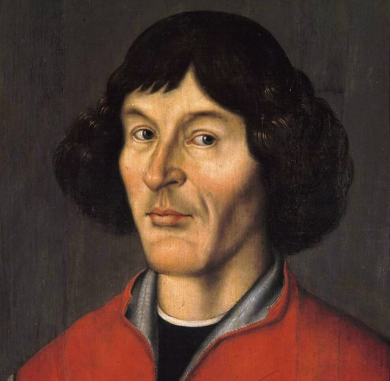
哥白尼在臨終前出版《天體運行論》，主張地球繞著太陽轉，挑戰教會支持的地心說，揭開科學革命的序幕。後來克卜勒發現行星以橢圓軌道運行，伽利略用望遠鏡觀測天象支持日心說。

## 1620 | 培根與笛卡兒：新的科學方法
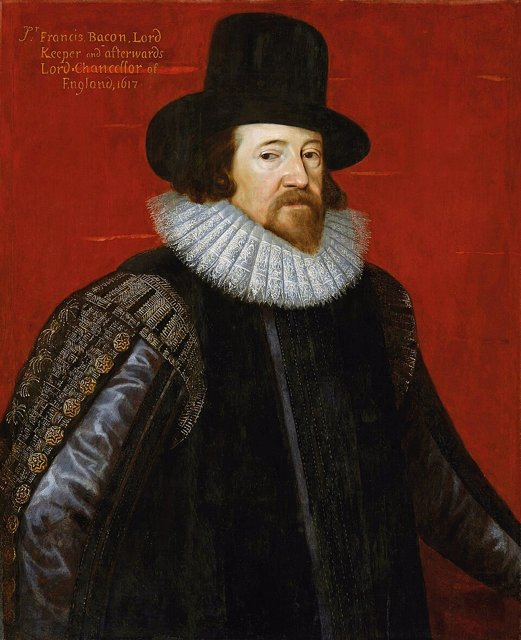
英國的培根在《新工具》中提倡從觀察與實驗出發的歸納法；法國的笛卡兒則主張從無可懷疑的原理推論的演繹法（1637年《方法論》）。兩者共同奠定了近代科學方法。

## 1628 | 英國《權利請願書》
國會迫使查理一世簽署《權利請願書》，規定未經國會同意不得徵稅、不得任意逮捕人民。但查理一世隔年就解散國會，此後11年不召開國會，獨斷統治。

## 1642 | 英國清教徒革命
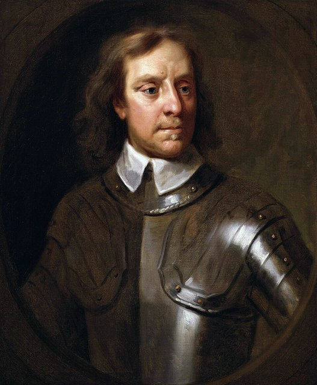
國王與國會的衝突演變成內戰，以清教徒為主力的國會軍由克倫威爾率領擊敗王軍。1649年查理一世被處死，英國成為共和國；1653～1658年克倫威爾以「護國公」身分獨裁統治，死後王室於1660年復辟。

## 1643 | 法王路易十四即位
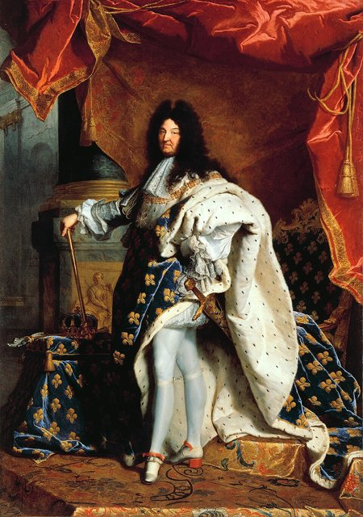
以「君權神授」為理論基礎，路易十四在位長達72年（1643～1715），自稱「太陽王」，興建凡爾賽宮，把貴族集中在宮廷中，建立歐洲專制王權的典範。

## 1682 | 俄國彼得大帝即位
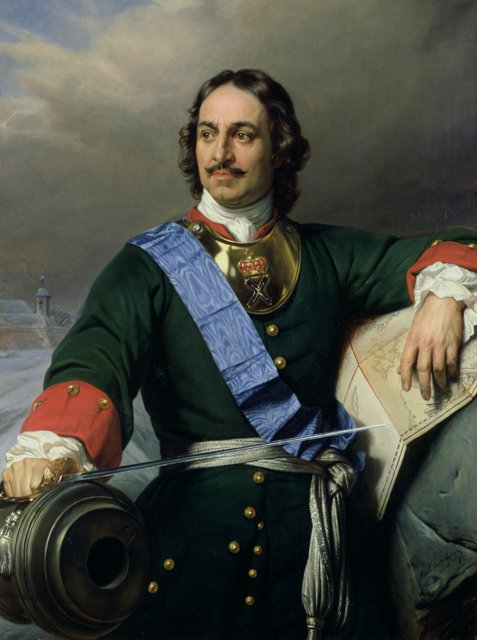
彼得大帝在位期間（1682～1725）親自到西歐考察，推動西化政策：改革軍隊、建立海軍、整頓行政，並興建新都聖彼得堡，鞏固沙皇的專制皇權，使俄國躋身歐洲強國。

## 1687 | 牛頓提出萬有引力定律
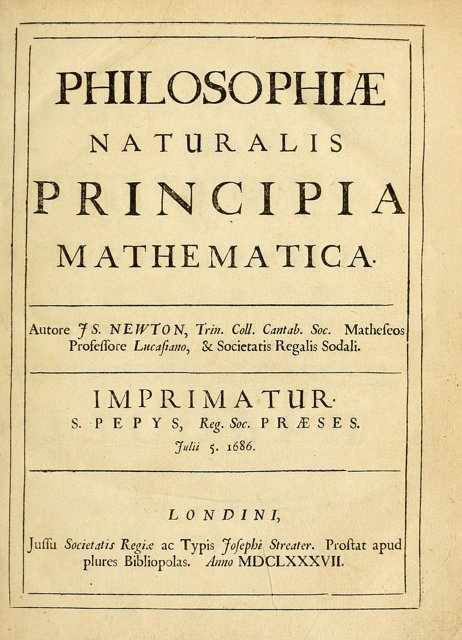
牛頓出版《自然哲學的數學原理》，以萬有引力與三大運動定律解釋天上與地上的運動，集科學革命之大成。

## 1688 | 英國光榮革命
國會迎立信奉新教的威廉與瑪麗，不流血地逼走信奉天主教的詹姆士二世，史稱「光榮革命」。

## 1689 | 英國《權利法案》
國會通過《權利法案》，規定國王不得違背國會制定的法律、不得自行徵稅或在平時維持常備軍，確立君主立憲制。同年洛克發表《政府論》，提倡生命、自由、財產的天賦人權。

## 1748 | 啟蒙運動
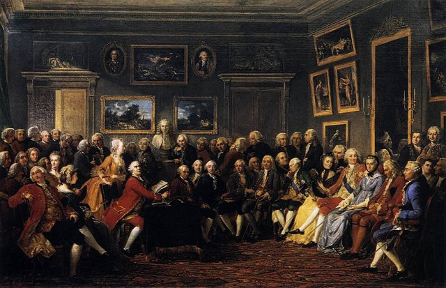
啟蒙思想家崇尚理性、批判傳統權威。孟德斯鳩在1748年的《法意》中提出三權分立；伏爾泰提倡宗教寬容與言論自由；盧梭在《社約論》（1762）中主張主權在民；狄德羅主編《百科全書》，傳播新知。

## 1756 | 七年戰爭
英、普與法、奧、俄等國在歐洲、北美與印度爆發七年戰爭（1756～1763）。英國贏得法國在北美的殖民地，卻因此負債累累，轉而向殖民地加稅。

## 1765 | 《印花稅法》引發北美反彈
繼1764年的《糖稅法》之後，英國又以《印花稅法》向北美殖民地的報紙、文件課稅。殖民地人民以「無代表不納稅」抗議，抵制英貨。

## 1769 | 瓦特改良蒸汽機
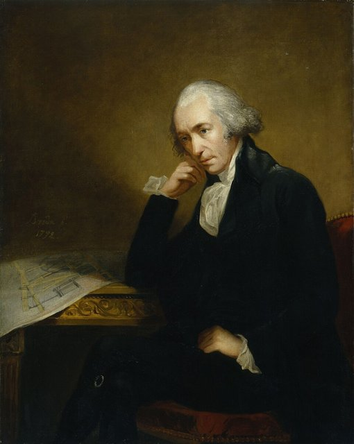
瓦特取得改良蒸汽機的專利，大幅提高效率，蒸汽動力被用在紡紗廠、織布廠與礦場，並帶動交通運輸的革新，工業革命從英國展開。

## 1772 | 開明專制
18世紀中葉，部分君主受啟蒙思想影響，以改革法律、宗教寬容、推廣教育來富國強兵，但仍保有絕對王權，稱為「開明專制」。代表人物是普魯士的腓特烈大帝、俄國的凱薩琳大帝與奧地利的約瑟夫二世，三國在1772年也首度瓜分了波蘭。

## 1773-12-16 | 波士頓茶葉黨事件
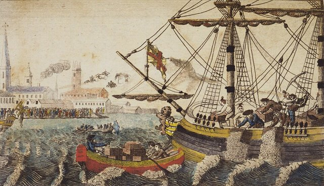
不滿英國的茶葉專賣，波士頓居民喬裝成印地安人，把東印度公司的茶葉倒進港口。英國隨後以高壓法令懲罰麻薩諸塞。

## 1774-09-05 | 第一次大陸會議
北美13個殖民地中有12個派代表在費城召開大陸會議，要求英國廢除高壓法令，並決議抵制英貨。

## 1775 ~ 1783 | 美國獨立戰爭
列星頓與康科德的槍聲揭開戰爭序幕，華盛頓出任大陸軍總司令。法國、西班牙等國先後支持殖民地，1781年英軍在約克鎮投降。

## 1776-07-04 | 《獨立宣言》
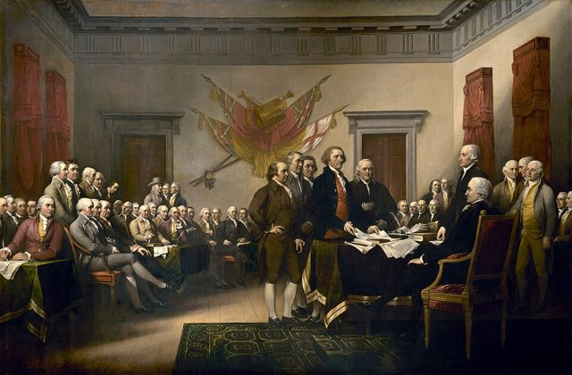
第二次大陸會議通過由傑佛遜起草的《獨立宣言》，宣告人人生而平等，享有生命、自由與追求幸福的權利，美國正式宣布獨立。

## 1783 | 《巴黎條約》
英國在《巴黎條約》中承認美國獨立。1787年美國制定聯邦憲法，實行三權分立。

## 1789-04-30 | 華盛頓就任美國首任總統
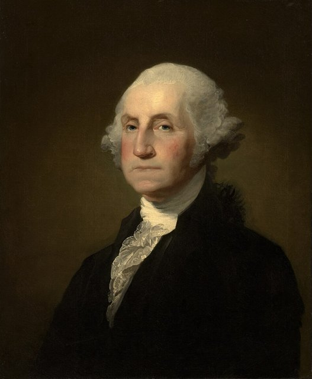
獨立戰爭的英雄華盛頓當選並就任美國第一任總統，連任兩屆後主動卸任，樹立了和平交接政權的典範。

## 1789-07-14 | 法國大革命：攻陷巴士底獄
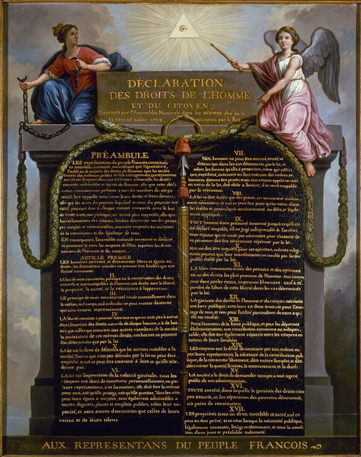
法國財政破產，路易十六召開三級會議，第三階級另組國民議會。巴黎市民攻陷象徵專制的巴士底獄，法國大革命爆發；8月國民議會發表《人權宣言》。

## 1792-09 | 法蘭西第一共和
革命政府廢除君主制，成立第一共和。隔年（1793年1月）路易十六被送上斷頭台，羅伯斯比主導的恐怖統治隨之而來。

## 1795 | 督政府成立
恐怖統治結束後，法國通過新憲法，由五位督政官組成督政府，但政局不穩、對外戰爭不斷。

## 1799-11-09 | 拿破崙發動霧月政變
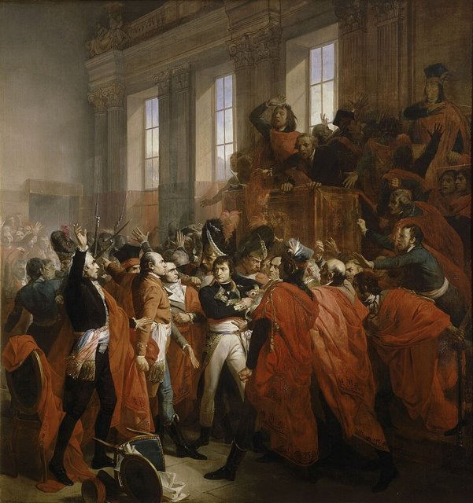
在義大利與埃及戰役中嶄露頭角的拿破崙推翻督政府，自任第一執政，實行軍人獨裁。1804年頒布的《拿破崙法典》影響了歐洲許多國家的民法。

## 1804-12-02 | 拿破崙稱帝
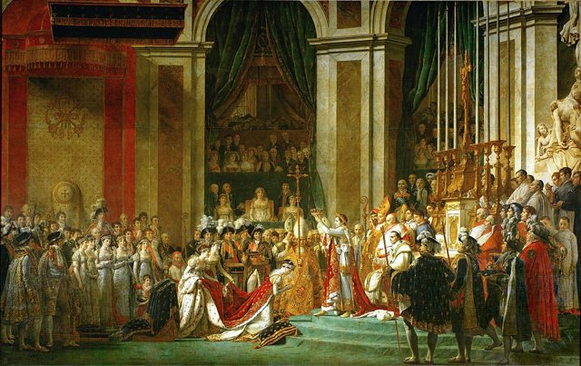
拿破崙在巴黎聖母院加冕為法蘭西皇帝，持續對外擴張，1805年在奧斯特里茲大敗奧、俄聯軍。

## 1806 | 解散神聖羅馬帝國；大陸封鎖
拿破崙組織萊茵邦聯，延續近千年的神聖羅馬帝國正式解散。他下令歐陸各國不得與英國貿易，企圖以「大陸政策」封鎖英國，卻因走私盛行而失敗，反而傷害了歐陸經濟。

## 1808 ~ 1814 | 半島戰爭
拿破崙立其兄為西班牙國王，西班牙人民以游擊戰抵抗，英國派兵支援，最終把法軍逐出伊比利半島，長期消耗了法國的國力。

## 1812 | 拿破崙遠征俄國
俄國不遵守大陸封鎖，拿破崙率60萬大軍遠征，攻入莫斯科卻遇上焦土戰術與嚴冬，撤退時幾乎全軍覆沒，帝國由盛轉衰。

## 1814 | 拿破崙退位；維也納會議
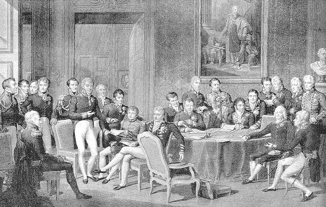
反法聯軍攻入巴黎，拿破崙退位、被流放到厄爾巴島，波旁王朝復辟。列強在奧地利首相梅特涅主導下召開維也納會議（1814～1815），以「正統原則」恢復舊秩序、維持均勢。1815年拿破崙一度復辟「百日王朝」，在滑鐵盧戰敗後被流放聖赫勒拿島。

## 1814 | 史蒂芬生的蒸汽火車頭
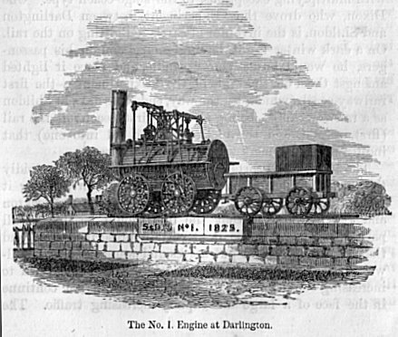
英國的史蒂芬生造出第一台蒸汽火車頭，1825年世界第一條公共鐵路通車。工業革命讓生產力大增，也帶來城市擁擠、勞工處境惡劣與貧富差距擴大等問題。

## 1818 | 普魯士關稅改革
普魯士頒布新關稅法，取消境內關卡，進而在1834年主導成立德意志關稅同盟，為日後德意志的統一奠定經濟基礎。

## 1823-12-02 | 門羅宣言
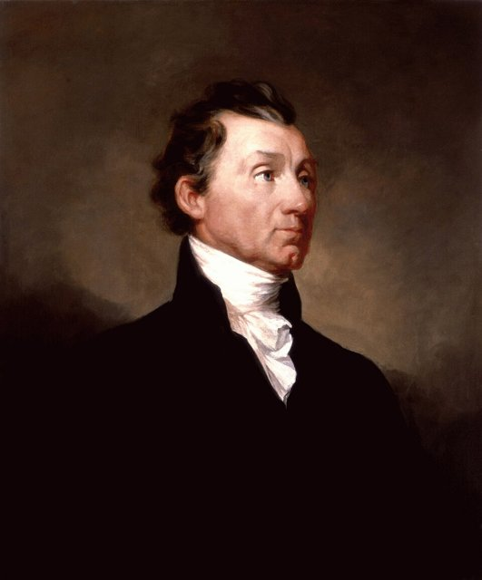
美國總統門羅宣布，歐洲列強不得干涉美洲事務、不得再在美洲建立殖民地，以支持中南美洲國家的獨立。

## 1830-07 | 法國七月革命
查理十世企圖恢復專制，巴黎民眾起義推翻波旁王朝，擁立路易腓力成立七月王朝，實行君主立憲。

## 1831 | 馬志尼組「青年義大利」
馬志尼成立「青年義大利黨」，以建立統一的義大利共和國為目標，從事革命活動，喚起義大利的民族意識。

## 1840 | 鴉片戰爭
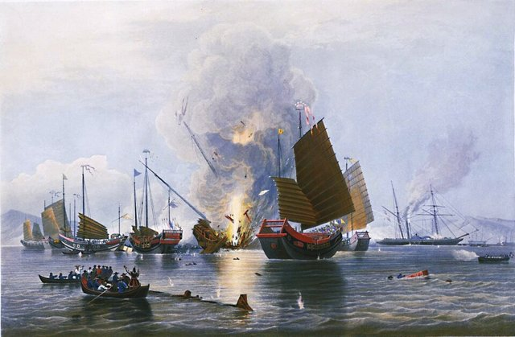
英國以保護鴉片貿易為由對清朝開戰，1842年簽訂《南京條約》，清朝割讓香港、開放五口通商，中國被迫打開門戶。

## 1848-02 | 法國二月革命
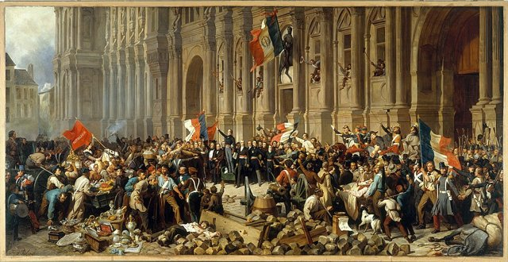
巴黎民眾推翻七月王朝，成立法蘭西第二共和；革命浪潮隨即擴散到奧地利、普魯士與義大利各地，史稱「民族之春」。同年馬克思與恩格斯發表《共產黨宣言》。12月，拿破崙的姪子路易拿破崙當選總統。

## 1852-12-02 | 法蘭西第二帝國
路易拿破崙發動政變後稱帝，稱拿破崙三世，法國進入第二帝國。

## 1853 | 培里叩關；克里米亞戰爭
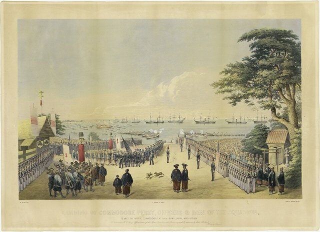
美國海軍准將培里率艦隊駛入日本江戶灣（今東京灣），要求開港通商，隔年日本被迫簽約，結束鎖國。同年俄國與土耳其爆發克里米亞戰爭（1853～1856），英、法支援土耳其，俄國戰敗。

## 1861 | 義大利王國成立
薩丁尼亞王國在首相加富爾的經營與加里波底的紅衫軍協助下，統一了大部分義大利，成立義大利王國。

## 1862 | 俾斯麥出任普魯士首相
俾斯麥主張以「鐵與血」完成德意志統一，不顧議會反對擴充軍備。

## 1864 | 普奧聯手擊敗丹麥
普魯士與奧地利聯手擊敗丹麥，奪取什列斯威與霍爾斯坦兩地。

## 1866 | 普奧戰爭
兩國為兩地的管轄權開戰，普魯士七週內擊敗奧地利，把奧地利排除在德意志之外，隔年組成北日耳曼邦聯。

## 1867 | 奧匈帝國成立；日本大政奉還
戰敗的奧地利與匈牙利妥協，組成二元君主國「奧匈帝國」。同年日本末代將軍德川慶喜把政權交還明治天皇，史稱「大政奉還」。

## 1868 | 日本明治維新
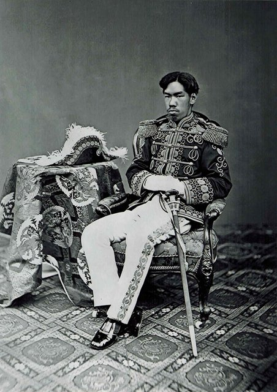
明治政府廢藩置縣、改革軍制與教育、學習西方制度，推動全面現代化，日本迅速成為亞洲強國。

## 1870 | 普法戰爭；義大利完成統一
俾斯麥誘使法國宣戰，普軍在色當俘虜拿破崙三世，法國成立第三共和。義大利趁法軍撤出羅馬，收復羅馬完成統一。

## 1871-01-18 | 德意志帝國成立
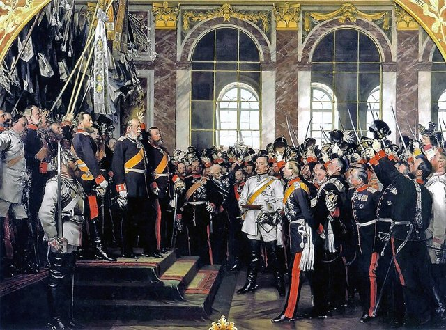
普魯士國王威廉一世在凡爾賽宮鏡廳加冕為德意志皇帝，德意志帝國成立，歐洲均勢從此改變。

## 1873 | 三帝同盟
俾斯麥為孤立法國，促成德、奧、俄三國皇帝結盟。

## 1877 | 俄土戰爭
俄國以保護巴爾幹的斯拉夫人為名，對土耳其開戰，把勢力延伸到巴爾幹半島；隔年的柏林會議又限制了俄國的戰果，種下德俄失和的種子。

## 1882 | 三國同盟
德國、奧匈帝國與義大利結成三國同盟。

## 1907 | 三國協約
英、法、俄三國分別締約，形成三國協約，與三國同盟對峙，歐洲分裂成兩大武裝陣營。

## 1914-06-28 | 塞拉耶佛事件：第一次世界大戰爆發
奧匈帝國皇儲斐迪南大公在塞拉耶佛遭塞爾維亞民族主義青年刺殺，奧匈對塞爾維亞宣戰，在同盟體系的連鎖反應下，一個月內演變成第一次世界大戰。

## 1915 | 義大利加入協約國
義大利原屬三國同盟，戰爭爆發時保持中立，1915年在協約國允諾割讓領土後倒向協約國參戰。

## 1917 | 俄國革命；美國參戰
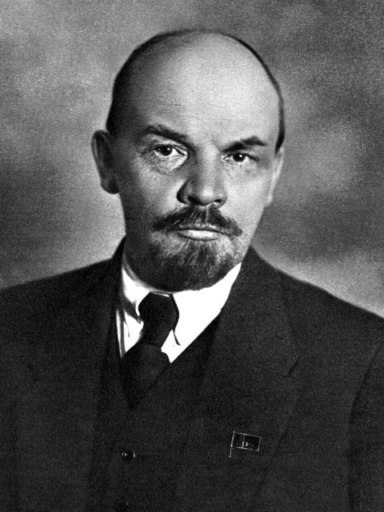
俄國在3月（舊曆二月）爆發二月革命推翻沙皇，11月（舊曆十月）列寧領導布爾什維克發動十月革命奪權，隨後退出大戰。同年4月，因德國無限制潛艇戰，美國加入協約國對德宣戰。

## 1918-11-11 | 第一次世界大戰結束
德國簽署停戰協定，大戰結束。德意志、奧匈、俄羅斯、鄂圖曼四大帝國相繼瓦解，奧匈帝國分裂成奧地利、匈牙利、捷克斯洛伐克等國。

## 1919 | 巴黎和會與《凡爾賽條約》
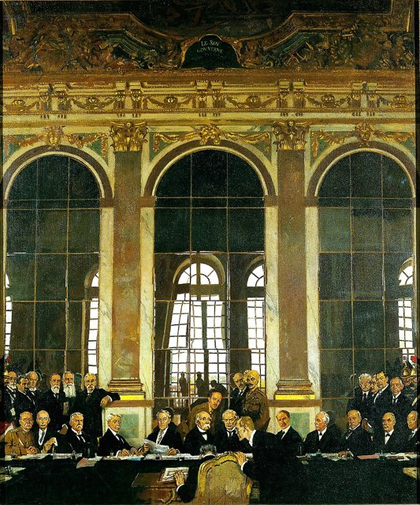
協約國在巴黎召開和會，由美國總統威爾遜、英國首相勞合喬治、法國總理克里蒙梭「三巨頭」主導，6月28日簽訂《凡爾賽條約》，德國割地賠款、限制軍備。德國成立共和政體，史稱威瑪共和。和會把德國在山東的權益轉給日本，引發中國的五四運動。

## 1920-01-10 | 國際聯盟成立
依威爾遜的構想成立國際聯盟，以集體安全維護和平，但美國國會拒絕加入，國聯缺乏制裁力量。

## 1921 | 墨索里尼成立國家法西斯黨
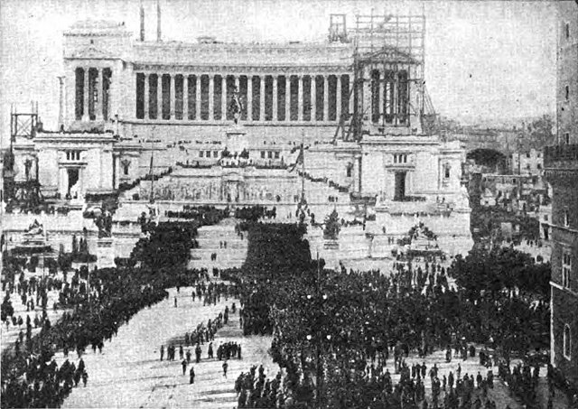
墨索里尼成立國家法西斯黨，隔年（1922）發動「進軍羅馬」，出任義大利首相，逐步建立一黨獨裁。

## 1922-12-30 | 蘇聯成立
十月革命後的蘇維埃俄國在內戰中獲勝，與烏克蘭等共和國組成蘇維埃社會主義共和國聯邦（蘇聯）。

## 1928 | 史達林推行五年計畫
列寧死後，史達林在權力鬥爭中勝出，開始推行第一個五年計畫，以國家力量推動重工業化與農業集體化，代價是大饑荒與大規模的政治整肅。

## 1929-10 | 經濟大恐慌
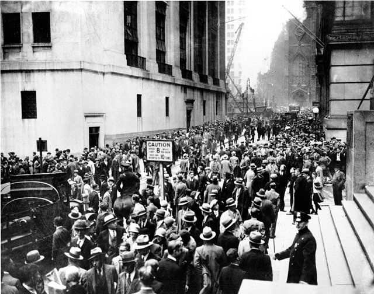
美國紐約股市崩盤，銀行倒閉、工廠關門，經濟危機迅速擴散到全世界（1929～1933），失業與社會動盪成為極權主義崛起的溫床。

## 1933-01-30 | 希特勒出任德國總理
納粹黨領袖希特勒出任總理，隨即鎮壓異己、退出國際聯盟；1934年總統興登堡死後，他兼任總統，自稱「元首」。

## 1937-07-07 | 盧溝橋事變
日軍在北平郊外的盧溝橋挑起衝突，中日全面戰爭爆發。

## 1938 | 德奧合併；慕尼黑協定
德國併吞奧地利，接著要求捷克割讓蘇台德區，英、法在慕尼黑會議中採取姑息政策，同意德國的要求。

## 1939-09-01 | 德國進攻波蘭：第二次世界大戰爆發
德國在3月佔領捷克全境，8月與蘇聯簽訂《德蘇互不侵犯條約》，9月1日以閃電戰進攻波蘭，英、法對德宣戰，第二次世界大戰（1939～1945）爆發。

## 1940-09-27 | 軸心國成立
德、義、日簽訂三國同盟條約，形成軸心國；英、法（以及後來加入的蘇聯、美國、中國）為同盟國的核心。這一年德軍攻陷法國，並對英國發動大規模空襲。

## 1941 | 德軍攻打蘇聯；珍珠港事件
6月德國撕毀互不侵犯條約，大舉進攻蘇聯。8月英美發表《大西洋憲章》，主張民族自決、反對以武力擴張領土。12月7日日本偷襲夏威夷珍珠港，美國對日宣戰，太平洋戰爭爆發；中華民國隨即正式對日、德、義宣戰。

## 1943 | 開羅宣言；義大利投降
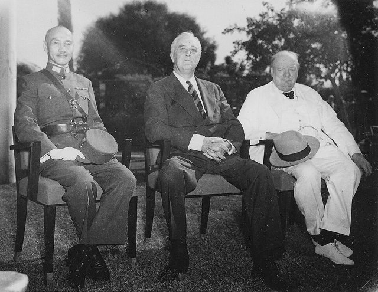
中、美、英三國領袖在開羅會議後發表《開羅宣言》，要求日本歸還侵佔的中國領土。同年盟軍登陸義大利，義大利宣布投降。

## 1945-02 | 雅爾達會議
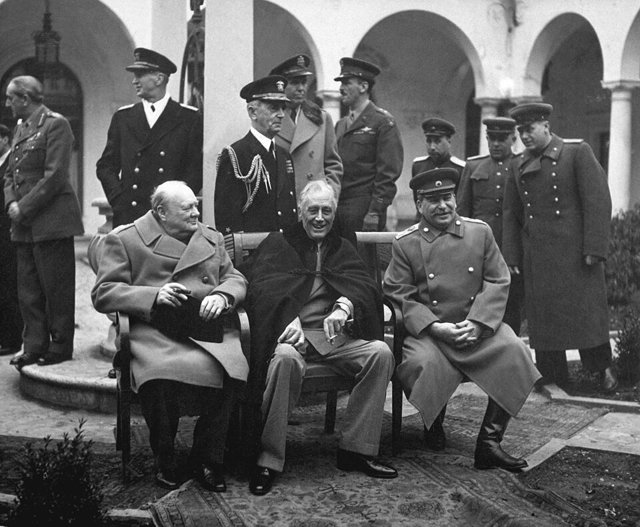
美、英、蘇三國領袖在克里米亞的雅爾達會面，商議戰後德國的處置與歐洲秩序，並以東北權益換取蘇聯對日參戰。

## 1945-05-08 | 德國投降，歐戰結束
蘇軍攻入柏林，希特勒自殺，德國無條件投降。

## 1945-08 | 原子彈與日本投降
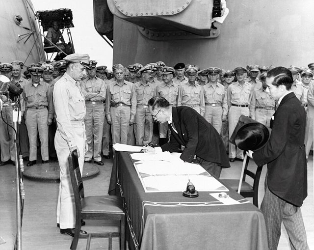
7月美、英、中發表《波茨坦宣言》要求日本無條件投降。8月美國在廣島、長崎投下原子彈，蘇聯對日宣戰，日本於8月15日宣布投降，第二次世界大戰結束。

## 1945-10-24 | 聯合國成立
取代國際聯盟的聯合國正式成立，美、英、法、蘇、中為安全理事會常任理事國。

## 1948 | 柏林危機；以色列建國；南北韓分裂
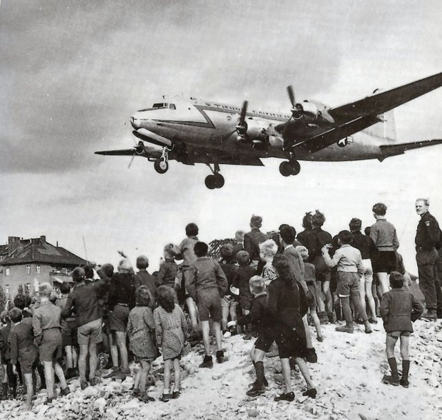
蘇聯封鎖西柏林，美英以大規模空運補給，冷戰正式成形。5月以色列宣布建國，隨即與阿拉伯國家爆發戰爭。朝鮮半島以北緯38度線為界，南北分別成立大韓民國與朝鮮民主主義人民共和國。

## 1949 | 東西德分裂；北約成立；中華人民共和國成立
4月美國與西歐國家成立北大西洋公約組織，以集體防衛對抗蘇聯。德國分裂成西方陣營的德意志聯邦共和國（西德）與蘇聯扶植的德意志民主共和國（東德）。10月中華人民共和國成立，中華民國政府遷往臺灣。

## 1950-06-25 | 韓戰爆發
北韓越過38度線進攻南韓，以美國為首的聯合國軍與中共的「志願軍」相繼參戰，戰事持續到1953年簽訂停戰協定。

## 1951 | 美日安保條約
美國與日本簽訂《舊金山和約》與《美日安保條約》，日本恢復主權並成為美國在東亞的盟友。

## 1953 | 美韓共同防禦條約
韓戰停戰後，美國與南韓簽訂共同防禦條約，美軍長期駐守朝鮮半島。

## 1954-12-02 | 中美共同防禦條約
美國與中華民國簽訂共同防禦條約，把臺灣納入美國在西太平洋的圍堵防線。

## 1955-04 | 萬隆亞非會議
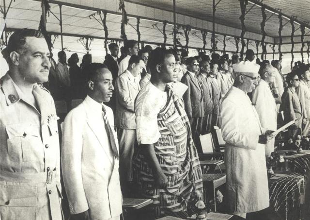
29個亞非國家在印尼萬隆舉行會議，倡導反殖民主義與和平共處，形成不結盟的亞非集團，被稱為「第三世界」。

## 1958-01-01 | 歐洲經濟共同體成立
依1957年的《羅馬條約》，法、西德、義、荷、比、盧六國成立歐洲經濟共同體，是今天歐盟的前身。

## 1961 | 柏林圍牆；美國介入越戰
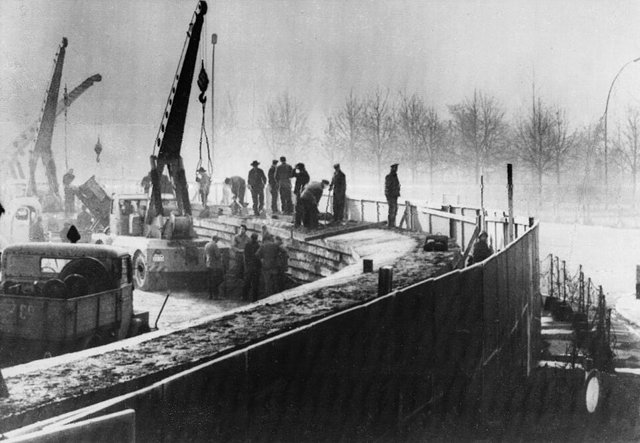
8月東德為阻止人民逃往西柏林，一夜之間築起柏林圍牆，成為冷戰的象徵。美國甘迺迪政府增派軍事顧問支援南越，逐步捲入越戰，1965年起大規模派兵。

## 1962-10 | 古巴飛彈危機
美國發現蘇聯在古巴部署核子飛彈，下令海上封鎖，美蘇一度瀕臨核戰；13天後蘇聯同意撤除飛彈，危機解除。

## 1963-08-28 | 金恩「我有一個夢」
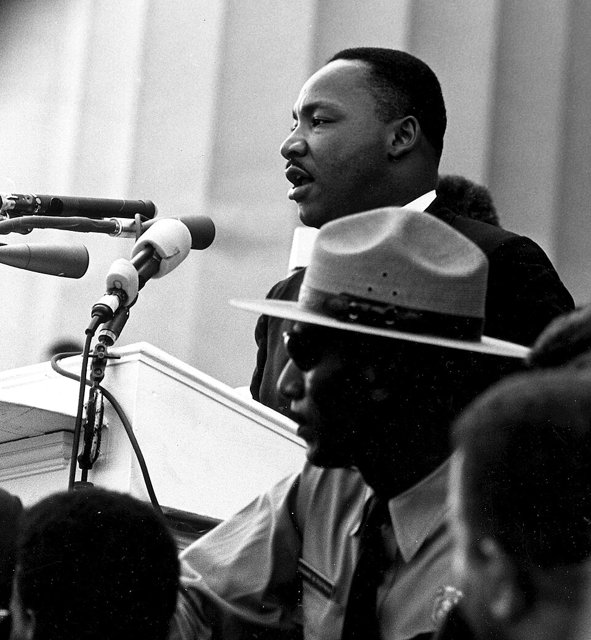
金恩牧師帶領25萬人向華盛頓進軍，爭取非裔美國人的工作權與自由，發表著名的演說〈我有一個夢〉。

## 1964 | 美國《民權法案》
美國國會通過《民權法案》，禁止因種族、膚色、宗教、性別或原國籍而在公共場所與就業上的歧視。

## 1968 | 布拉格之春
捷克斯洛伐克推動政治自由化的「布拉格之春」，蘇聯率華沙公約國家出兵入侵鎮壓。

## 1969-07-20 | 阿波羅11號登陸月球
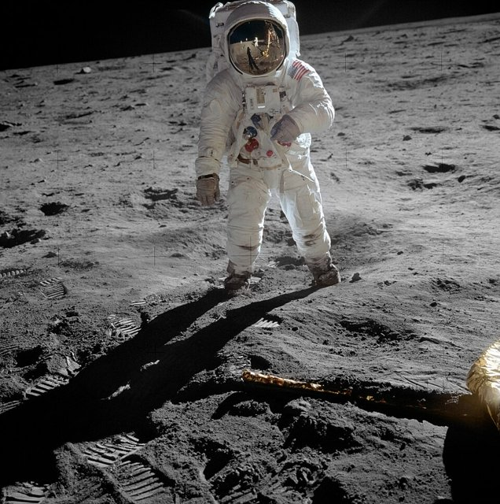
美國太空人阿姆斯壯成為第一個踏上月球的人：「這是我個人的一小步，卻是人類的一大步。」美國在太空競賽中扭轉落後的局面。

## 1979 | 美國與中華人民共和國建交；第二次石油危機
1月1日美國與中華人民共和國建交，同時與中華民國斷交，並通過《臺灣關係法》。同年伊朗革命導致石油減產，油價飆漲，引發第二次能源危機。

## 1980 | 兩伊戰爭
伊拉克進攻伊朗，兩國爆發長達8年的戰爭（1980～1988），波斯灣局勢動盪。

## 1989-11-09 | 柏林圍牆倒塌
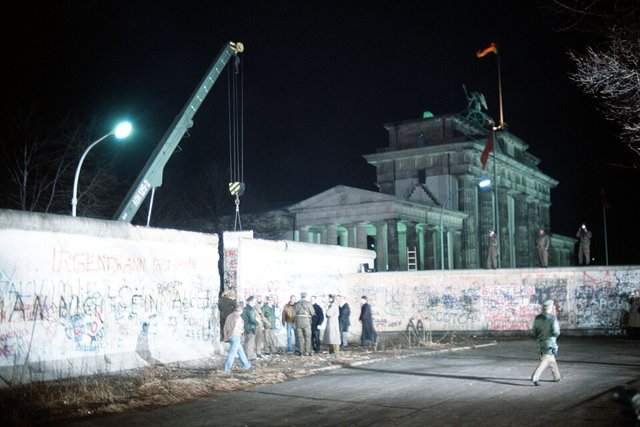
東歐各國民主化浪潮中，東德開放邊界，民眾湧上柏林圍牆將其拆除，象徵冷戰即將結束。

## 1990-10-03 | 兩德統一
東德併入西德，分裂45年的德國重新統一。

## 1991 | 波斯灣戰爭；蘇聯解體
伊拉克在1990年入侵科威特，1991年初以美國為首的多國聯軍發動攻擊，解放科威特。12月蘇聯解體，分裂成15個獨立國家，冷戰結束。

## 1993-11-01 | 歐洲聯盟成立
《馬斯垂克條約》生效，歐洲共同體轉型為歐洲聯盟，朝向經濟與政治整合，後來發行共同貨幣歐元。

## 1994-05-10 | 曼德拉就任南非總統
南非廢除種族隔離制度後舉行首次不分種族的大選，曾坐牢27年的曼德拉當選為南非第一位黑人總統。

## 2001-09-11 | 九一一事件
恐怖組織蓋達挾持民航機撞毀紐約世界貿易中心雙塔，並攻擊華盛頓的五角大廈，近三千人罹難。美國隨後發動反恐戰爭，出兵阿富汗。
